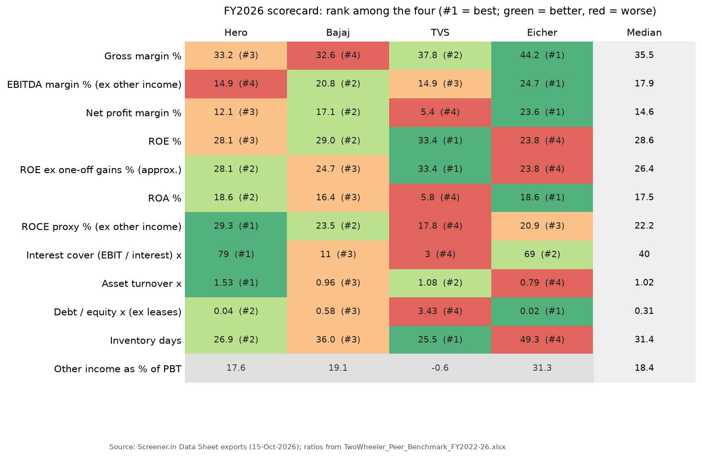
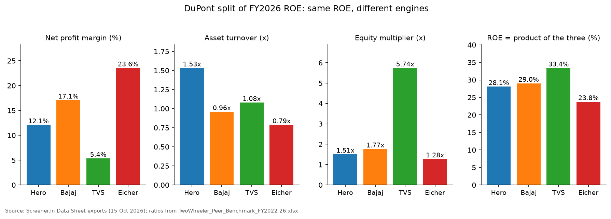
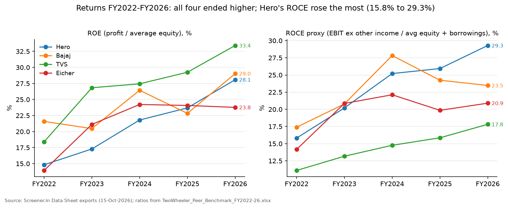
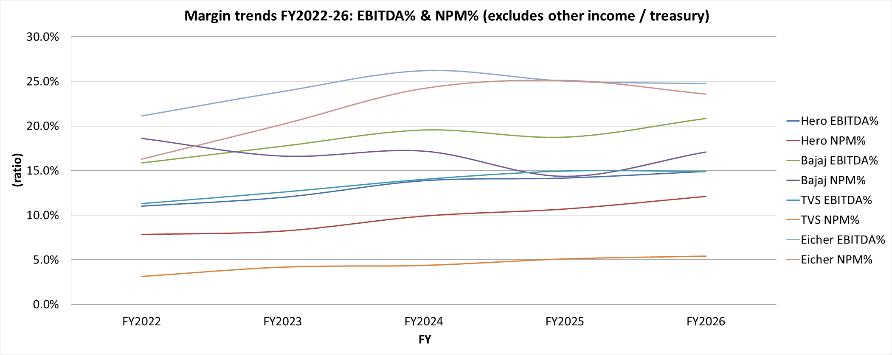
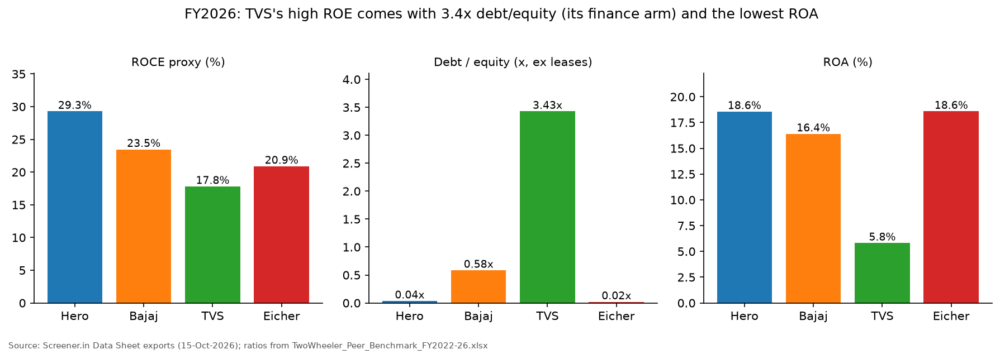
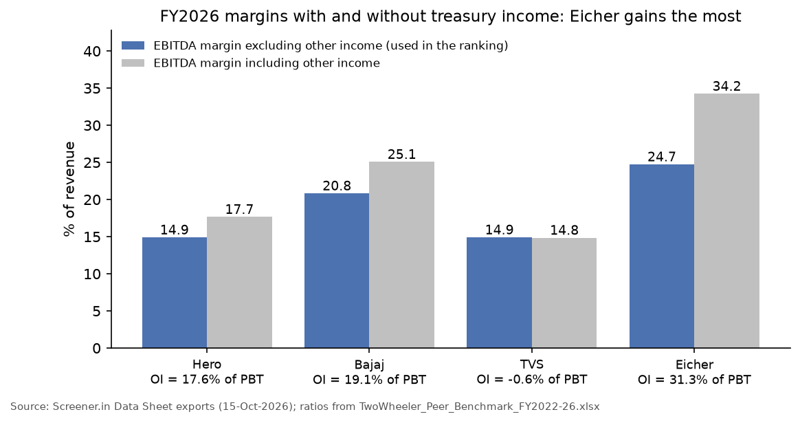

# Project 1: Ratio analysis with peer benchmarking: Indian two-wheeler makers, FY2022-FY2026

This project benchmarks Hero MotoCorp against its three listed peers, Bajaj Auto, TVS Motor and Eicher Motors (Royal Enfield), on five years of consolidated statements (FY2022-FY2026, ₹ crore). An Excel workbook computes profitability, leverage and efficiency ratios with live formulas, splits ROE into its DuPont parts, and ranks the four companies against the peer median. **Hero MotoCorp comes out strongest on returns from its operations and on balance-sheet quality**: the highest ROCE (29.3% on a proxy that excludes other income), the highest asset turnover (1.53x), interest cover of 79x and almost no debt (debt/equity 0.04x). Hero does not have the highest ROE. TVS leads at 33.4%, but that comes from a 5.74x equity multiplier (its lending arm, TVS Credit Services). Bajaj's 29.0% falls to about 24.7% once ₹1,599 crore of one-off gains from the KTM acquisition are removed. Eicher has the best margins (net margin 23.6%), but 31% of its profit before tax is other income. A Python re-computation of all 440 ratio cells matches the workbook exactly, and every input matches the Screener exports it was typed from (504 of 504 values).



## What the project shows

- Financial statement analysis on real filings: 22 ratio lines for 4 companies x 5 years, built from one raw-data sheet so every ratio is a formula that can be traced back to an input.
- Consistent definitions across peers: average balances, cost of goods sold (COGS) built from materials and inventory change, EBITDA and EBIT that exclude other income, and proxies labelled as proxies where Screener lacks a line.
- DuPont analysis: ROE = net margin x asset turnover x equity multiplier, used to show that the same ROE can come from margins (Eicher), efficiency (Hero) or leverage (TVS).
- Judgment about data quality: finding and adjusting for one-offs (Bajaj's KTM step acquisition), a consolidated lending arm (TVS) and treasury income (Eicher, Bajaj, Hero), with the sources checked in Bajaj Auto's annual reports.
- Model checks: two balance-sheet identities and a DuPont identity that hold for every company-year, plus an independent Python check of the whole workbook (`build/check_workbook.py`).
- A one-page written conclusion (`TwoWheeler_Peer_Benchmark_FY2022-26_Summary.pdf`) with a verdict, evidence, limitations and what to monitor.

## Files

| Path | What it is |
|---|---|
| [`TwoWheeler_Peer_Benchmark_FY2022-26.xlsx`](TwoWheeler_Peer_Benchmark_FY2022-26.xlsx) | The model: `Raw_Data` (typed inputs, blue), `Ratios` (all formulas), `Peer_Comparison` (FY2026 vs median), `Charts` (3 native Excel charts), `Summary` (written analysis) |
| [`TwoWheeler_Peer_Benchmark_FY2022-26_Summary.pdf`](TwoWheeler_Peer_Benchmark_FY2022-26_Summary.pdf) | One-page conclusion: FY2026 table, trend table, distortions, verdict, interview questions |
| [`notes/bajaj_auto_ktm_research_report.md`](notes/bajaj_auto_ktm_research_report.md) | Research notes on Bajaj Auto's KTM deal, checked against its annual reports (the basis for the one-off adjustment) |
| [`source_data/`](source_data/README.md) | The original files behind every number, with an index |
| [`outputs/`](outputs/) | Ratios and inputs as CSV, and `validation_results.csv` |
| [`figures/`](figures/) | Charts used in this README, including PNG exports of the workbook's own Excel charts |
| [`build/`](build/) | Python scripts that read the workbook (they never change it): checks, CSV outputs, charts, source downloads |
| [`explained_simply/README.md`](explained_simply/README.md) | Plain-language walk-through of the project |

## Data and sources

| Data | Detail | Source |
|---|---|---|
| Income statement, balance sheet, cash from operations | Consolidated, FY2017-FY2026, ₹ crore. FY2021 is used only as the opening balance sheet for FY2022 averages | Screener.in "Export to Excel" Data Sheets for [HEROMOTOCO](https://www.screener.in/company/HEROMOTOCO/consolidated/), [BAJAJ-AUTO](https://www.screener.in/company/BAJAJ-AUTO/consolidated/), [TVSMOTOR](https://www.screener.in/company/TVSMOTOR/consolidated/) and [EICHERMOT](https://www.screener.in/company/EICHERMOT/consolidated/), downloaded 15-Oct-2026 |
| Bajaj Auto one-off gains in FY2026 | ₹953.10 crore gain on remeasuring the previously held 49.9% stake in Pierer Bajaj AG (KTM's parent) and ₹645.71 crore of currency-translation reserve moved to profit, both on 18-Nov-2025; consolidated borrowings FY2024-FY2026 | [Bajaj Auto 19th Annual Report 2025-26](https://www.bajajauto.com/-/media/images/bajajauto/media-kit/press-release/new-annual-reports/fy2025-26/bajaj-auto-annual-report-2025-26.pdf), Note 46 (printed pages 352-356), balance sheet (p.247) and notes (p.300-301, 318-322) |
| Bajaj Auto FY2025 context | ₹915.48 crore share of loss of the KTM associate (incl. ₹600.93 crore impairment); ₹211.26 crore exceptional deferred tax | [Bajaj Auto 18th Annual Report 2024-25](https://investors.bajajauto.com/ar25/wp-content/uploads/2025/07/BAL_Annual_Report_2025.pdf), Directors' Report and Notes 30 and 42 |
| KTM timeline | Bajaj announces it will take control of KTM (21-May-2025) | [Bajaj Auto press release](https://www.bajajauto.com/corporate/media-centre/press-releases/bajaj-auto-makes-decisive-move-to-take-charge-of-rebuilding-ktm) |

Copies of all of these are in [`source_data/`](source_data/README.md), together with the four Screener company pages saved on 1-Nov-2026 as HTML. Saved copies of news articles cited in the research notes are copyrighted, so they stay on the author's PC; the index gives the link for each.

The four companies are India's largest listed two-wheeler makers. All four report consolidated accounts for years ending 31 March, so the years line up without adjustment.

## Method

All ratios use the same definitions for the four companies. Averages are (opening + closing) / 2.

| Ratio | Definition |
|---|---|
| Gross margin | (revenue - COGS) / revenue, where COGS = cost of materials + purchases of stock-in-trade (0 in Screener) - Screener's "change in inventory" |
| EBITDA margin | (PBT + finance costs + depreciation - other income) / revenue. Other income (mostly treasury income) is excluded so that cash-rich companies are compared on their operations |
| Net profit margin | profit attributable to owners / revenue |
| ROE | profit / average equity (share capital + reserves) |
| ROA | profit / average total assets |
| ROCE (proxy) | EBIT / average (equity + borrowings), with EBIT = PBT + finance costs - other income. A proxy because lease liabilities and current liabilities are not in Screener |
| Interest cover | EBIT / finance costs (and EBITDA / finance costs) |
| Asset turnover | revenue / average total assets |
| Inventory days, receivable days | average inventory / COGS x 365; average receivables / revenue x 365 |
| Debt / equity (proxy) | borrowings / equity, excluding leases |
| DuPont | ROE = net margin x asset turnover x equity multiplier, where equity multiplier = average assets / average equity |
| Ex one-off (approx.) | profit minus Bajaj's ₹1,598.81 crore pre-tax one-off gains, assumed untaxed, over revenue or average equity |

Checks built into the workbook: equity + borrowings + other liabilities = total assets, and net block + CWIP + investments + other assets = total assets, for all 24 company-years; DuPont ROE - ROE = 0 for all 20 company-years.

## Results

### FY2026 against the peer median

| Metric (FY2026) | Hero | Bajaj | TVS | Eicher | Median | Hero rank |
|---|---|---|---|---|---|---|
| Gross margin % | 33.2 | 32.6 | 37.8 | 44.2 | 35.5 | 3 |
| EBITDA margin % (ex other income) | 14.9 | 20.8 | 14.9 | 24.7 | 17.9 | 4 |
| Net profit margin % | 12.1 | 17.1 | 5.4 | 23.6 | 14.6 | 3 |
| ROE % | 28.1 | 29.0 | 33.4 | 23.8 | 28.6 | 3 |
| ROE ex one-off gains % (approx.) | 28.1 | 24.7 | 33.4 | 23.8 | 26.4 | 2 |
| ROA % | 18.6 | 16.4 | 5.8 | 18.6 | 17.5 | 2 |
| ROCE (proxy) % | 29.3 | 23.5 | 17.8 | 20.9 | 22.2 | **1** |
| Interest cover (EBIT / interest) x | 79 | 11 | 3 | 69 | 40 | **1** |
| Asset turnover x | 1.53 | 0.96 | 1.08 | 0.79 | 1.02 | **1** |
| Debt / equity x (ex leases) | 0.04 | 0.58 | 3.43 | 0.02 | 0.31 | 2 |
| Inventory days | 26.9 | 36.0 | 25.5 | 49.3 | 31.4 | 2 |
| Other income as % of PBT | 17.6 | 19.1 | -0.6 | 31.3 | 18.4 | - |

Source: `outputs/peer_comparison_FY2026.csv`. Rank 1 = best of four (lower is better for debt/equity and inventory days). Hero and Eicher's ROA differ only in the second decimal (18.57% and 18.59%).

### DuPont: why the ROE ranking misleads



| FY2026 | Net margin | x Asset turnover | x Equity multiplier | = ROE |
|---|---|---|---|---|
| Hero MotoCorp | 12.1% | 1.53 | 1.51 | 28.1% |
| Bajaj Auto | 17.1% | 0.96 | 1.77 | 29.0% |
| TVS Motor | 5.4% | 1.08 | 5.74 | 33.4% |
| Eicher Motors | 23.6% | 0.79 | 1.28 | 23.8% |

- **Hero's ROE comes from efficiency.** It sells ₹1.53 of motorcycles for every rupee of assets, the most of the four, with little leverage.
- **TVS's ROE comes from leverage.** TVS consolidates TVS Credit Services, its two-wheeler lending business: ₹32,791 crore of borrowings on ₹56,146 crore of assets in FY2026. The equity multiplier of 5.74x turns a 5.8% ROA into a 33.4% ROE, and interest cover is only about 3x.
- **Eicher's ROE comes from margins.** It has the highest net margin, but a large investment portfolio (₹17,496 crore) sits in its assets, so turnover is the lowest at 0.79x.

### Trend FY2022 to FY2026

| Company | Revenue ₹ crore | Net margin % | EBITDA margin % | ROE % | ROCE proxy % | Debt/equity x |
|---|---|---|---|---|---|---|
| Hero MotoCorp | 29,551 → 47,411 | 7.8 → 12.1 | 11.0 → 14.9 | 14.8 → 28.1 | 15.8 → 29.3 | 0.04 → 0.04 |
| Bajaj Auto | 33,145 → 62,905 | 18.6 → 17.1 | 15.9 → 20.8 | 21.6 → 29.0 | 17.4 → 23.5 | 0.00 → 0.58 |
| TVS Motor | 24,355 → 56,070 | 3.1 → 5.4 | 11.3 → 14.9 | 18.4 → 33.4 | 11.1 → 17.8 | 3.60 → 3.43 |
| Eicher Motors | 10,298 → 23,408 | 16.3 → 23.6 | 21.1 → 24.7 | 13.9 → 23.8 | 14.2 → 20.9 | 0.01 → 0.02 |



Hero's net margin rose from 7.8% to 12.1% and its ROCE almost doubled, with debt flat. Revenue grew fastest at TVS (+130%) and Eicher (+127%). Bajaj's FY2025 dip in ROE (22.8%) is the ₹915 crore loss on its KTM associate; its FY2026 figures include KTM for about 4.4 months.

The workbook's own margin chart (exported from Excel):



### Leverage and treasury income





Other income is 31.3% of Eicher's FY2026 profit before tax, 19.1% of Bajaj's and 17.6% of Hero's. Including it would lift Eicher's EBITDA margin from 24.7% to 34.2%. This is why the ranking uses margins and ROCE that exclude it. For Eicher, other income probably includes its share of profit from the VE Commercial Vehicles joint venture with Volvo; Screener does not split it, so this was not verified.

### Known distortions

- **Bajaj Auto / KTM.** Bajaj held 49.9% of Pierer Bajaj AG (KTM's parent) as an associate until it bought the rest on 18-Nov-2025 and began consolidating KTM. Screener shows borrowings rising from ₹124 crore (FY2023) to ₹22,713 crore (FY2026). The FY2025-26 annual report shows ₹1,785.90 crore (FY2024), ₹9,236.52 crore (FY2025) and ₹21,980.59 crore (FY2026), so Screener's figures run 1-7% higher; the research notes report no borrowings in FY2023. FY2025 carries the debt raised to fund KTM's restructuring and a ₹915.48 crore associate loss. FY2026 is not comparable with earlier years and includes ₹1,598.81 crore of pre-tax one-off gains (about 11.5% of PBT).
- **TVS Motor's lending arm** inflates assets, borrowings and ROE; ratios excluding it need segment data from the annual report.
- **Consolidation scope** was checked only for Bajaj. TVS bought 75% of Swiss E-Mobility Group in January 2022 and the rest in June 2023 (small); Hero and Eicher were not checked.

## Verdict

Hero MotoCorp is the strongest of the four on returns from its operations and on balance-sheet quality:

1. The highest ROCE proxy, 29.3%, which already excludes other income (35.5% including it).
2. The highest asset turnover, 1.53x.
3. Almost no debt (debt/equity 0.04x, cash and bank about equal to borrowings) and 79x interest cover.
4. The largest operating cash flow of the four in FY2026 (₹8,315 crore) and a steady rise in margins: gross 29.2% → 33.2%, net 7.8% → 12.1%.

On ROE Hero ranks second once Bajaj's one-offs are removed (28.1% against TVS's leverage-driven 33.4%). Hero's weakness is margins: it ranks third or fourth on gross, EBITDA and net margin. What to monitor next: Bajaj's first full year with KTM (FY2027) and the €550 million KTM refinancing; Hero's margins after the GST cut against steel costs; asset quality at TVS Credit Services; Eicher's joint-venture profit share and its 49 inventory days.

## Validation

`python build/check_workbook.py` reads the workbook and writes `outputs/validation_results.csv`.

| Check | Result | Status |
|---|---|---|
| Python re-computation of 22 ratio rows x 4 companies x 5 years matches the Ratios sheet | 440 of 440 cells, largest gap 1.1e-16 | PASS |
| DuPont identity: net margin x asset turnover x equity multiplier = ROE | 20 of 20 company-years, largest gap 5.6e-17 | PASS |
| Balance check 1: equity + borrowings + other liabilities = total assets | 24 company-years, largest gap ₹1.5e-11 crore | PASS |
| Balance check 2: net block + CWIP + investments + other assets = total assets | 24 company-years, largest gap ₹7.3e-12 crore | PASS |
| Equity row = share capital + reserves | exact | PASS |
| Raw_Data inputs equal the Screener Excel exports of 15-Oct-2026 | 504 of 504 values | PASS |
| Raw_Data inputs agree with the Screener pages saved on 1-Nov-2026 (rounded to whole ₹ crore) | 384 of 384 values | PASS |
| Typed FY2026 table on the Summary sheet matches the recomputed ratios | 49 of 49 | PASS |
| Numbers in the one-page PDF match the workbook | 105 of 105 | PASS |
| Excel error values (#REF!, #DIV/0!, ...) in any formula | 0 in 1,317 formulas | PASS |
| Net profit on the Screener page vs the workbook | the page includes minority interests (FY2026: Hero +₹34 crore, Bajaj -₹170 crore, TVS +₹168 crore, Eicher 0); the workbook uses profit attributable to owners, which matches its equity base | INFO |
| Screener's own ROCE % vs the workbook's ROCE including other income | 16 of 20 company-years within 1 percentage point; largest gap 3.7 points (Screener's capital base is not published) | INFO |

One median on the Summary sheet (inventory days, 31.5) was taken from the rounded company values; the unrounded median is 31.45.

## Limitations

- **Screener data, not annual reports.** Screener does not give current assets and liabilities, trade payables, lease liabilities or interest paid, so the current ratio, quick ratio, payable days, cash conversion cycle and lease-inclusive leverage are shown as "n/a - needs AR data". ROCE and debt/equity are proxies.
- **Other income cannot be split** into treasury income and operating items (or Eicher's joint-venture share) from Screener.
- **The Bajaj one-off adjustment is approximate**: it assumes the gains were untaxed and leaves equity unchanged.
- **TVS** is not adjusted for its lending business; that needs segment data.
- **Reasons for trends** (volume recovery, pricing, mix) are stated as hypotheses in the workbook; they were not checked against each company's management discussion.

## How to use and reproduce

1. Open `TwoWheeler_Peer_Benchmark_FY2022-26.xlsx`. Inputs are the blue cells on `Raw_Data`; everything else is a formula. Rows 29 and 50 of `Raw_Data` hold the two balance checks (0 for every column).
2. To re-run the checks and outputs (Python 3 with the packages in `requirements.txt`):

```
python -m pip install -r requirements.txt
python build/check_workbook.py        # checks + outputs/*.csv (exit code 1 if a check fails)
python build/make_figures.py          # figures/fig1-fig5
python build/export_excel_charts.py   # figures/excel_chart_*.png (Windows with Excel)
python build/fetch_sources.py         # re-download the web sources into source_data/ (internet)
```

## Project structure

```
01-ratio-analysis/
  TwoWheeler_Peer_Benchmark_FY2022-26.xlsx           the model (Excel)
  TwoWheeler_Peer_Benchmark_FY2022-26_Summary.pdf    one-page conclusion
  notes/bajaj_auto_ktm_research_report.md            KTM research notes
  source_data/                                       original downloads + index (README.md)
  build/                                             common.py, check_workbook.py, make_figures.py,
                                                     export_excel_charts.py, fetch_sources.py
  outputs/                                           ratios, inputs, peer comparison, DuPont, validation (CSV)
  figures/                                           README charts
  explained_simply/README.md                         plain-language guide
```

Educational project, not investment advice.
