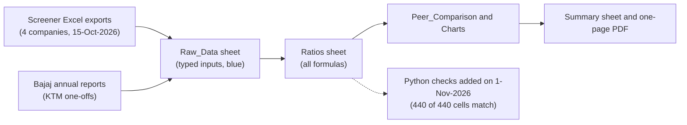

# Project 1 explained simply: which two-wheeler maker is the strongest business?

## What this project does

You took four Indian motorcycle and scooter makers, Hero MotoCorp, Bajaj Auto, TVS Motor and Eicher Motors (the maker of Royal Enfield), and compared five years of their accounts (FY2022 to FY2026). For each company and year the workbook works out ratios: how much profit is left from each ₹100 of sales, how much profit the company makes on its shareholders' money, how hard its assets work, and how much it borrows. Then it ranks the four against each other and explains the differences.

The short answer: **Hero MotoCorp is the strongest business of the four.** It earns the most on the money invested in its operations (ROCE 29.3%), gets the most sales out of its assets (1.53x), and has almost no debt. TVS shows the highest ROE (33.4%), but only because its lending arm runs on borrowed money. Bajaj's ROE is boosted by one-time gains from buying KTM. Eicher has the best margins, but almost a third of its profit is interest and investment income rather than selling motorcycles.

## Why these companies and this data

**Why these four.** A peer comparison only works when the companies do the same thing. These four are India's largest listed two-wheeler makers, they sell to the same customers, and all of them close their books on 31 March. Hero is the main company in the workbook; its story (margins rising, almost no debt) is easy to test against the other three.

**Why not other companies.** Ola Electric and Ather Energy also sell two-wheelers, but they listed only in 2024 and 2025 and were loss-making when they listed, so most ratios (ROE, margins) would be negative and the comparison would say little. Car makers such as Maruti have a different business (bigger products, different suppliers).

**Why this data.** Screener.in lets you export ten years of a company's consolidated accounts to Excel in one click, in the same layout for every company. That makes the same formulas work for all four. Screener does not have every line (for example current liabilities and lease debts), so a few ratios are marked "n/a - needs AR data" instead of being guessed. For Bajaj Auto the KTM numbers were checked in its annual reports, because Screener cannot show one-off items.

## How it was done, step by step

1. **Picked the four companies** and confirmed they all report consolidated accounts for years ending 31 March.
2. **Downloaded each company's Screener export** (15-Oct-2026). Files: `source_data/screener/exports/`. Why: one consistent source for all four.
3. **Typed the lines you need into `Raw_Data`**, one column per company-year, in the same rows for every company so one formula can be copied across. FY2021 is there only to give the opening balance for FY2022 averages.
4. **Added two balance checks** (`Raw_Data` rows 29 and 50): equity + borrowings + other liabilities must equal total assets, and the asset lines must add up to total assets. Both are zero for every column, which shows the inputs were typed correctly.
5. **Built the ratios** on the `Ratios` sheet, every one a formula pointing at `Raw_Data`. Why formulas: if an input changes, every ratio updates, and anyone can click a cell to see how it was calculated.
6. **Took other income out of EBITDA and EBIT.** Hero, Bajaj and Eicher hold large investment portfolios. The interest on those investments is real income, but it is not from making motorcycles, so leaving it in would make cash-rich companies look like better manufacturers.
7. **Ran the DuPont split** (`Ratios` rows 25-30): ROE = net margin x asset turnover x equity multiplier. The check row shows the product equals ROE exactly.
8. **Compared FY2026 against the peer median** (`Peer_Comparison`) and ranked each company.
9. **Researched the strange numbers.** Bajaj's borrowings jumped from about ₹124 crore to ₹22,713 crore; the reason is KTM (notes in `notes/bajaj_auto_ktm_research_report.md`). Bajaj's FY2026 profit includes ₹1,599 crore of one-time gains from the KTM purchase, so `Raw_Data` rows 51-53 hold them and `Ratios` rows 52-53 show margin and ROE without them.
10. **Made three Excel charts** (`Charts` sheet) and wrote the conclusion on the `Summary` sheet and in the one-page PDF.
11. **Checked the whole workbook in Python** (added on 1-Nov-2026, `build/check_workbook.py`): every ratio recomputed from the inputs, the inputs compared with the Screener exports and with the Screener web pages, and the numbers in the Summary sheet and the PDF compared with the formulas. All checks pass.
12. **Saved copies of the sources** (added on 1-Nov-2026, `build/fetch_sources.py`): the four Screener pages as HTML, the Bajaj press release, and the annual-report pages behind the KTM numbers.

## Where every important number came from

The saved news pages (`news_and_macro/*.html`) are copyrighted articles, so they stay on your PC and are not in the GitHub copy. Use the link in the Source column instead.

| Number | Value | Source | File in source_data/ |
|---|---|---|---|
| All statement lines, FY2021-FY2026 (revenue, costs, profit, assets, debt, cash from operations) | e.g. Hero FY2026 revenue ₹47,411 crore, profit ₹5,742 crore | Screener exports for [Hero](https://www.screener.in/company/HEROMOTOCO/consolidated/), [Bajaj](https://www.screener.in/company/BAJAJ-AUTO/consolidated/), [TVS](https://www.screener.in/company/TVSMOTOR/consolidated/), [Eicher](https://www.screener.in/company/EICHERMOT/consolidated/) | `screener/exports/*_Screener_DataSheet_export_15Oct2026.xlsx` |
| Same lines, as shown on the website on 1-Nov-2026 | 384 of 384 values agree with the workbook | Screener company pages | `screener/raw/*_consolidated.html` |
| Bajaj gain on the old 49.9% KTM stake | ₹953.10 crore | [Bajaj 19th Annual Report](https://www.bajajauto.com/-/media/images/bajajauto/media-kit/press-release/new-annual-reports/fy2025-26/bajaj-auto-annual-report-2025-26.pdf), Note 46 | `company_filings/BajajAuto_Annual_Report_FY2025-26_extract.pdf` |
| Bajaj currency reserve moved to profit | ₹645.71 crore | same note | same file |
| Bajaj borrowings in the annual reports | ₹1,785.90 crore (FY2024), ₹9,236.52 crore (FY2025), ₹21,980.59 crore (FY2026) | same report, balance sheet and notes | same file |
| Bajaj loss on KTM in FY2025 | ₹915.48 crore (incl. ₹600.93 crore impairment) | [Bajaj 18th Annual Report](https://investors.bajajauto.com/ar25/wp-content/uploads/2025/07/BAL_Annual_Report_2025.pdf), Note 42 | `company_filings/BajajAuto_Annual_Report_FY2024-25_extract.pdf` |
| Date Bajaj took control of KTM | 18-Nov-2025 | 19th Annual Report, Note 46 | `company_filings/BajajAuto_Annual_Report_FY2025-26_extract.pdf` |
| Bajaj's plan to take charge of KTM | 21-May-2025 | [Bajaj press release](https://www.bajajauto.com/corporate/media-centre/press-releases/bajaj-auto-makes-decisive-move-to-take-charge-of-rebuilding-ktm) | `company_filings/BajajAuto_press_release_KTM_control_21May2025.html` |
| €566 million loan for KTM | May 2025 | [Economic Times](https://economictimes.indiatimes.com/industry/auto/auto-news/ktm-co-owner-bajaj-auto-signs-566m-loan-before-funding-deadline/articleshow/121245454.cms) | `news_and_macro/ET_Bajaj_KTM_EUR566m_loan_18May2025.html` (local only) |

Every ratio in the workbook is calculated from these inputs. See `outputs/ratios_FY2022-FY2026.csv` for all of them.

## Key assumptions and why

| Assumption | Choice | Why |
|---|---|---|
| Averages | (opening + closing) / 2 | Profit is earned over the year, so it is compared with the average balance, not the year-end one |
| Other income | Excluded from EBITDA, EBIT and ROCE | Treasury income is not from the core business; it is shown separately as a % of PBT |
| COGS | Materials + purchases (0) - Screener's "change in inventory" | Screener does not split purchases of finished goods; the definition was checked against reported PBT |
| ROCE | EBIT / average (equity + borrowings) | Screener has no current liabilities or lease debts, so this is a labelled proxy |
| Debt/equity | Borrowings / equity, without leases | Lease debts are not in Screener |
| Bajaj one-offs | Removed in full, as if untaxed | The tax effect is not disclosed separately; this is labelled approximate |
| Profit | Profit attributable to owners (Screener's export) | Matches the equity used for ROE, which excludes minority shareholders |

## Words you need to know

| Term | Meaning |
|---|---|
| Consolidated accounts | The parent company plus the companies it controls, added together as one group |
| Gross margin | What is left from sales after paying for materials, as a % of sales |
| EBITDA | Earnings before interest, tax, depreciation and amortisation: a rough measure of cash profit from operations |
| EBIT | EBITDA minus depreciation: operating profit |
| Other income | Mostly interest and gains on the company's investments, not from selling products |
| ROE (return on equity) | Profit / shareholders' money. How much the owners earn on their capital |
| ROA (return on assets) | Profit / everything the company owns |
| ROCE (return on capital employed) | Operating profit / (shareholders' money + borrowings). How well all the money put into the business is used |
| Asset turnover | Sales / assets. How many rupees of sales each rupee of assets produces |
| Equity multiplier | Assets / equity. How much the company is stretched with borrowed money; 1.0x means no liabilities at all |
| DuPont analysis | Splitting ROE into margin x asset turnover x equity multiplier to see where it comes from |
| Interest cover | Operating profit / interest. How many times the company could pay its interest |
| Peer median | The middle value of the four companies; the benchmark each company is compared with |
| One-off gain | A profit that will not repeat, such as revaluing an old stake when you buy the rest |
| Minority interest | The share of a subsidiary owned by outsiders |

## How to check the work yourself

1. Open `TwoWheeler_Peer_Benchmark_FY2022-26.xlsx`. On `Raw_Data`, rows 29 and 50 must show 0 (or a tiny number like 1E-12) in every column.
2. Pick any input, for example Hero FY2026 revenue (`Raw_Data!I5` = 47,411.24), and find it in `source_data/screener/exports/HEROMOTOCO_Screener_DataSheet_export_15Oct2026.xlsx`, sheet `Data Sheet`, row "Sales", column for March 2026.
3. On `Ratios`, row 30 (DuPont ROE minus ROE) must be 0 for every column.
4. Check a DuPont line by hand: Hero FY2026 = 12.1% x 1.53 x 1.51 = 28.1%.
5. Run `python build/check_workbook.py`. It prints PASS for each check and writes `outputs/validation_results.csv`. All 10 checks must say PASS (3 more lines are marked INFO; they explain differences in definitions).

## How to explain this project in an interview

**30-second version.** "I benchmarked Hero MotoCorp against Bajaj, TVS and Eicher on five years of consolidated accounts, in an Excel model where every ratio is a formula on one raw-data sheet. I excluded treasury income from EBITDA and ROCE so cash-rich companies are judged on operations, and used DuPont to explain ROE. Hero comes out strongest: the best ROCE at 29.3%, the best asset turnover at 1.53x and almost no debt. TVS has the highest ROE, 33.4%, but that comes from a 5.7x equity multiplier because it consolidates a lending business. Bajaj's ROE falls from 29% to about 25% once ₹1,599 crore of one-off KTM gains are removed."

**Q: Hero's net margin is half of Eicher's. How can its ROE be higher?**
A: DuPont. Hero makes 12.1% on sales but turns its assets over 1.53 times and has a 1.51x equity multiplier: 12.1% x 1.53 x 1.51 = 28.1%. Eicher makes 23.6% but turns its assets only 0.79 times because a large investment portfolio sits in its assets: 23.6% x 0.79 x 1.28 = 23.8%.

**Q: Why not just rank the companies by ROE?**
A: Because ROE rewards borrowing. TVS's ROA is only 5.8%, the lowest of the four, but its lending arm has ₹32,791 crore of borrowings, so a thin return on assets becomes a 33.4% return on equity. Interest cover of about 3x shows the risk that comes with it.

**Q: What would you improve with more time?**
A: Take current assets and liabilities, payables and lease debts from the annual reports so the liquidity ratios and a proper ROCE can be calculated; split TVS's lending business out using its segment note; and split Eicher's other income into treasury income and its share of the VECV joint venture.
