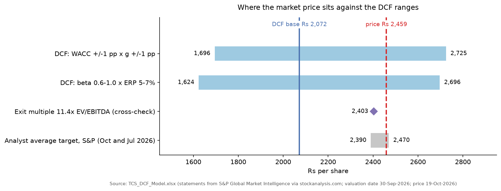
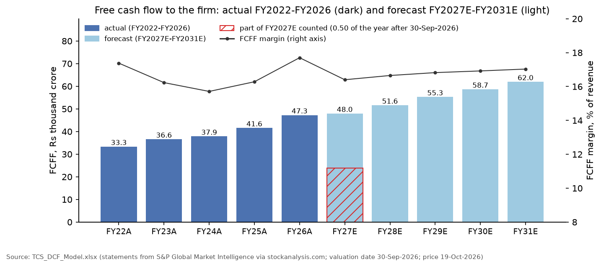
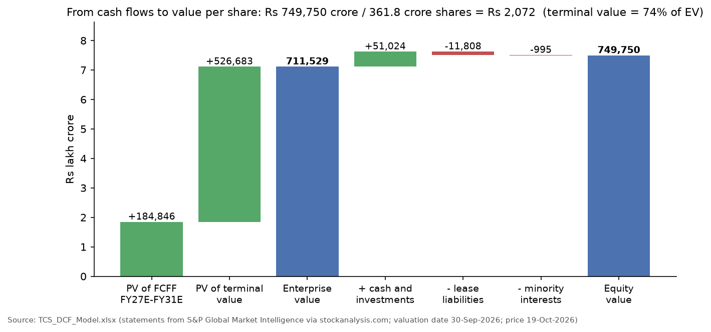
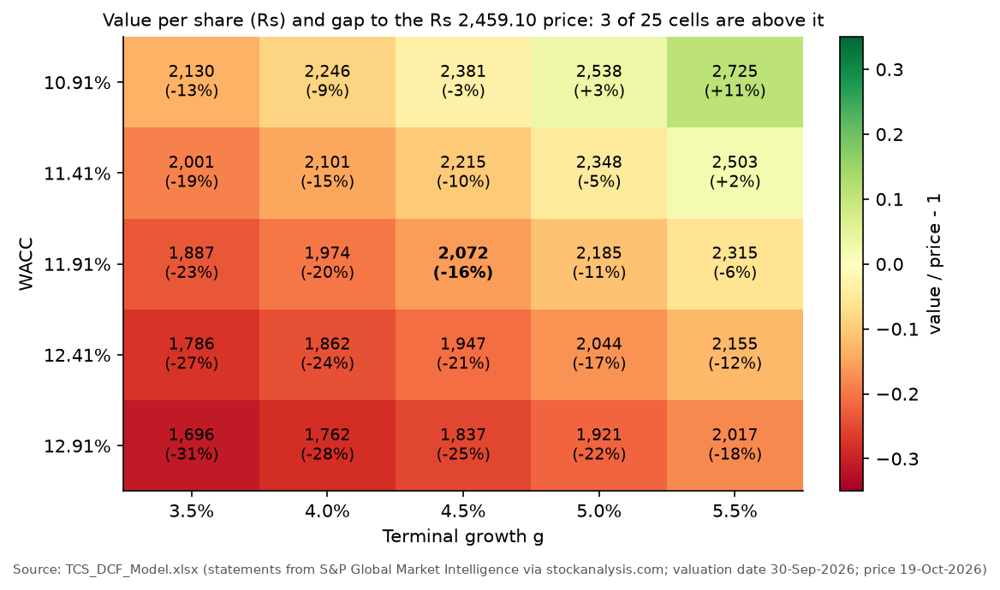
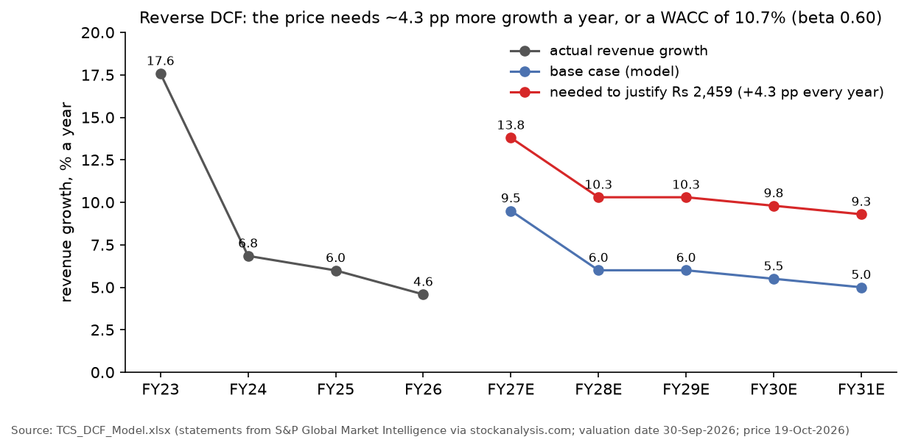

# Project 2: DCF valuation of Tata Consultancy Services (TCS), FY2027E-FY2031E

This project values TCS, India's largest IT services company, with a five-year discounted cash flow (DCF) model in Excel. It forecasts free cash flow to the firm (FCFF) for FY2027-FY2031, discounts it at a weighted average cost of capital (WACC) of **11.91%**, adds a terminal value growing at **4.5%**, and bridges from enterprise value to a value per share. The result is **₹2,072 per share, 15.7% below the market price of ₹2,459.10** (NSE, 19-Oct-2026). The gap is mostly about the discount rate and long-run growth: a WACC 1 point lower with terminal growth 1 point higher gives ₹2,725, and only 3 of the 25 cells in the WACC x growth grid are above the price. A reverse DCF shows what the price implies: either a WACC of **10.70%** (a beta of about 0.60 instead of 0.80) or revenue growth **4.3 percentage points higher every year** (13.8% in FY2027 falling to 9.3% in FY2031). An independent Python rebuild of the model reproduces every valuation cell, and the inputs match the source exports (70 of 70 values).



## What the project shows

- A complete FCFF DCF: five-year forecast, CAPM cost of equity, WACC, Gordon-growth terminal value and the bridge from enterprise value to equity value per share.
- Careful treatment of the details that move an IT-services valuation: other income kept out of FCFF and cash added back in the bridge, leases treated as debt, acquisitions kept out of organic cash flow, and a stub period because the valuation date (30-Sep-2026) falls halfway through FY2027.
- Testing the answer: a WACC x terminal-growth grid, a beta x equity-risk-premium grid, an exit-multiple cross-check and a two-way reverse DCF solved with Goal Seek.
- Explaining the gap between value and price instead of stopping at a number.
- Model discipline: inputs in blue with one-line reasons, formulas everywhere else, eight built-in checks on the Summary sheet (all PASS), plus an independent rebuild in Python (`build/check_model.py`).

## Files

| Path | What it is |
|---|---|
| [`TCS_DCF_Model.xlsx`](TCS_DCF_Model.xlsx) | The model: `Summary` (result, reasons for the gap, checks), `Historical`, `Assumptions`, `WACC`, `DCF`, `Sensitivity` (four grids), `Reverse_DCF` |
| [`TCS_DCF_Report.pdf`](TCS_DCF_Report.pdf) | Two-page report: result, forecast, sensitivity, assumptions, the reasons for the gap, interview questions and a source table |
| [`source_data/`](source_data/README.md) | The original files behind every input, with an index |
| [`outputs/`](outputs/) | Forecast, sensitivity grids, reverse-DCF path and results as CSV, and `validation_results.csv` |
| [`figures/`](figures/) | Charts used in this README |
| [`build/`](build/) | Python scripts that read the workbook (they never change it): checks, CSV outputs, charts, source downloads |
| [`explained_simply/README.md`](explained_simply/README.md) | Plain-language walk-through of the project |

## Data and sources

| Input | Value used | Source |
|---|---|---|
| Income statement, cash flow and balance sheet, FY2022-FY2026 | e.g. FY2026 revenue ₹2,67,021 crore, EBIT ₹66,857 crore | S&P Global Market Intelligence data via StockAnalysis.com: [income statement](https://stockanalysis.com/quote/nse/TCS/financials/), [balance sheet](https://stockanalysis.com/quote/nse/TCS/financials/balance-sheet/), [cash flow](https://stockanalysis.com/quote/nse/TCS/financials/cash-flow-statement/); converted from ₹ million (÷10) |
| Cash and short-term investments, lease debt at 30-Sep-2026 | ₹51,024 crore; ₹11,808 crore (TCS has no bank debt) | StockAnalysis balance sheet (latest quarter) |
| Shares, beta, EV/EBITDA, price | 361.8 crore shares; observed 5-year beta 0.18; 11.4x; ₹2,459.10 at 1:10 pm IST on 19-Oct-2026 | [StockAnalysis statistics](https://stockanalysis.com/quote/nse/TCS/statistics/) |
| Analyst consensus | FY2027 revenue growth 9.0% (range 7.1-11.1%); average target ₹2,470 (Jul-2026), ₹2,390 (Oct-2026) | [StockAnalysis forecast](https://stockanalysis.com/quote/nse/TCS/forecast/) |
| Q2 FY2027 results (8-Oct-2026) | Revenue ₹73,188 crore, operating margin 24.0%, cash from operations 102.2% of net profit | [TCS Q2 FY2027 fact sheet](https://www.tcs.com/content/dam/tcs/investor-relations/financial-statements/2026-27/q2/Presentations/Q2%202026-27%20Fact%20Sheet.pdf) |
| Q1 FY2027 results (9-Jul-2026) | Revenue ₹72,275 crore (+13.9% year on year in rupees; +0.4% quarter on quarter in constant currency) | [TCS Q1 FY2027 press release](https://www.tcs.com/content/dam/tcs/investor-relations/financial-statements/2026-27/q1/IND%20AS/Press%20Release%20-%20INR.pdf); [earnings-call transcript](https://www.tcs.com/content/dam/tcs/investor-relations/financial-statements/2026-27/q1/Management%20Commentary/Transcript%20of%20the%20Q1%202026-27%20Earnings%20Conference%20Call%20held%20on%20Jul%209,%202026.pdf) |
| Risk-free rate | 7.15% (India 10-year G-sec about 7.17% on 28-Sep-2026) | [Trading Economics](https://tradingeconomics.com/india/government-bond-yield/news/587153) |
| Equity risk premium reference | India total ERP 7.08%, mature-market ERP 4.23% (Jan-2026); 6.0% used | [Damodaran, country risk premiums](https://pages.stern.nyu.edu/~adamodar/New_Home_Page/datafile/ctryprem.html) |

Copies are in [`source_data/`](source_data/README.md): the author's StockAnalysis Excel exports and TCS PDFs (downloaded 23-Oct-2026, the files the model was built from), the same StockAnalysis pages saved as HTML on 1-Nov-2026, and Yahoo Finance prices. Saved news and macro pages are copyrighted, so they stay on the author's PC; the index gives the link for each.

## Method

**Free cash flow to the firm.** FCFF = EBIT x (1 - tax rate) + D&A - capex - increase in net working capital. EBIT excludes other income (interest on TCS's cash), so the cash itself is added in the equity bridge instead. D&A excludes right-of-use (lease) depreciation because leases are treated as debt. Capex includes purchases of software and other intangibles. Cash acquisitions (₹6,768 crore in FY2026) are left out of organic FCFF. TCS grants no material share awards, so there is no stock-compensation adjustment.

**Cost of capital.** Cost of equity = risk-free rate + beta x ERP = 7.15% + 0.80 x 6.0% = 11.95%. Cost of debt = FY2026 interest (₹1,227 crore, almost all on leases) / average lease debt (₹10,338 crore) = 11.87%, or 8.90% after 25% tax. With equity at market value (₹8,89,702 crore) and lease debt of ₹11,808 crore, debt is 1.3% of capital, so WACC = 98.7% x 11.95% + 1.3% x 8.90% = **11.91%**.

**Valuation date and stub period.** The model values TCS on the 30-Sep-2026 balance sheet. That cash balance already contains the first half of FY2027, so only the remaining 182/365 = 0.50 of FY2027's FCFF is counted, and each year's cash flow is discounted from 30-Sep-2026 to the following 31 March (0.50, 1.50, ... 4.50 years).

**Terminal value and bridge.** Terminal value at the end of FY2031 = FCFF(FY2031) x (1 + g) / (WACC - g). Equity value = enterprise value + cash and short-term investments - lease debt - minority interests. Value per share = equity value / 361.8 crore diluted shares.

**Checks on the answer.** Two sensitivity grids (WACC ±1 point x g ±1 point; beta 0.6-1.0 x ERP 5-7%), an exit-multiple terminal value (11.4x FY2031 EBITDA, TCS's own current multiple) and a reverse DCF that finds (A) the extra growth every year, or (B) the WACC, that makes the DCF value equal the price.

## Assumptions

| Driver | FY2026A | FY2027E | FY2028E | FY2029E | FY2030E | FY2031E | Reason (from the Assumptions sheet) |
|---|---|---|---|---|---|---|---|
| Revenue growth | 4.6% | 9.5% | 6.0% | 6.0% | 5.5% | 5.0% | H1 FY2027 revenue ₹1,45,463 crore is +12.6% year on year and the Q2 run-rate implies about 9-10%; consensus 9.0%. Then a fade towards about 4.5% |
| EBIT margin | 25.0% | 24.2% | 24.4% | 24.5% | 24.5% | 24.5% | Q1 and Q2 FY2027 were both 24.0%; consensus about 24.6%; 5-year average 24.7% |
| Tax rate | 24.5% | 25.0% | 25.0% | 25.0% | 25.0% | 25.0% | Effective rate 24.5-25.7% in FY2022-FY2026 |
| D&A (excl. leases), % of revenue | 1.34% | 1.35% | 1.35% | 1.35% | 1.35% | 1.35% | Steady at 1.34-1.36% for three years |
| Capex, % of revenue | 1.72% | 1.60% | 1.60% | 1.60% | 1.60% | 1.60% | 1.7-1.9% in FY2025-FY2026; 5-year average 1.5% |
| Increase in NWC, % of revenue | 0.83% | 1.50% | 1.40% | 1.30% | 1.20% | 1.10% | 5-year average 1.7%, fading as growth slows |

Valuation inputs: risk-free rate 7.15%, beta 0.80 (a judgment: the observed 5-year beta of 0.18 is not usable; IT-services betas are usually 0.7-1.0), ERP 6.0% (below Damodaran's 7.08% India total to avoid counting the sovereign spread twice, since the rupee yield already contains it), terminal growth 4.5% (below the 10-year G-sec yield), exit multiple 11.4x for the cross-check only.

## Results

### Forecast

| ₹ crore | FY22A | FY23A | FY24A | FY25A | FY26A | FY27E | FY28E | FY29E | FY30E | FY31E |
|---|---|---|---|---|---|---|---|---|---|---|
| Revenue | 191,754 | 225,458 | 240,893 | 255,324 | 267,021 | 292,388 | 309,931 | 328,527 | 346,596 | 363,926 |
| EBIT margin | 25.3% | 24.1% | 24.6% | 24.3% | 25.0% | 24.2% | 24.4% | 24.5% | 24.5% | 24.5% |
| FCFF | 33,332 | 36,602 | 37,852 | 41,573 | 47,269 | 47,952 | 51,604 | 55,275 | 58,661 | 61,958 |
| FCFF margin | 17.4% | 16.2% | 15.7% | 16.3% | 17.7% | 16.4% | 16.7% | 16.8% | 16.9% | 17.0% |
| PV of FCFF counted | | | | | | 22,606 | 43,596 | 41,727 | 39,571 | 37,347 |



### From cash flows to value per share

| ₹ crore | Value |
|---|---|
| Sum of PV of FCFF, FY2027E-FY2031E | 184,846 |
| PV of terminal value (TV ₹8,73,763 crore at end-FY2031) | 526,683 |
| **Enterprise value** | **711,529** |
| + Cash and short-term investments (30-Sep-2026) | 51,024 |
| - Lease liabilities | 11,808 |
| - Minority interests | 995 |
| **Equity value** | **749,750** |
| / Diluted shares (crore) | 361.8 |
| **Value per share** | **₹2,072** |



The terminal value is 74.0% of enterprise value, inside the usual 70-85% range. It equals 9.3x FY2031 EBITDA, below TCS's current 11.4x; an 11.4x exit multiple instead would give ₹2,403 per share and implies 5.8% perpetual growth. At the market price TCS's enterprise value is ₹8,51,481 crore, 11.4x FY2027E EBITDA; the DCF enterprise value is 9.5x.

### Sensitivity



| Value per share (₹) | g = 3.5% | 4.0% | 4.5% | 5.0% | 5.5% |
|---|---|---|---|---|---|
| WACC 10.91% | 2,130 | 2,246 | 2,381 | 2,538 | 2,725 |
| WACC 11.41% | 2,001 | 2,101 | 2,215 | 2,348 | 2,503 |
| **WACC 11.91%** | 1,887 | 1,974 | **2,072** | 2,185 | 2,315 |
| WACC 12.41% | 1,786 | 1,862 | 1,947 | 2,044 | 2,155 |
| WACC 12.91% | 1,696 | 1,762 | 1,837 | 1,921 | 2,017 |

The beta x ERP grid (beta 0.6-1.0, ERP 5-7%) gives WACCs from 10.1% to 14.1% and values from ₹1,624 to ₹2,696; 3 of its 25 cells are above the price.

### Reverse DCF: what the price assumes



| Block | Solved input | Market-implied value | Base case |
|---|---|---|---|
| A: growth | Extra revenue growth added to every forecast year | +4.30 percentage points (13.8% in FY2027 to 9.3% in FY2031) | 9.5% to 5.0% |
| B: discount rate | WACC | 10.70% (beta 0.595 at a 6% ERP) | 11.91% (beta 0.80) |

### Why the DCF value is below the price

- **Discount rate.** Beta is the most judgment-heavy input. The market price is consistent with a beta of about 0.60; TCS's observed beta is only 0.18, which reflects a defensive, cash-rich stock.
- **Growth runway.** The base case already has FY2027 growth of 9.5%, above the 9.0% consensus. To justify the price the market needs much faster growth for five years, or growth that lasts well beyond five years: AI-led demand (annualised AI revenue passed US$3.1 billion in Q2 FY2027, over 10% of revenue, according to Free Press Journal and Upstox reports of 8-Oct-2026), rupee depreciation lifting rupee revenue, or market-share gains.
- **What a DCF captures poorly.** Brand and client relationships, a high payout (dividend yield about 4.5%) that investors may value for itself, and sentiment towards IT services.

On these assumptions TCS trades above its DCF value. That is not a sell signal: a 1-point lower WACC, or a modestly longer growth runway, closes most of the gap. Analysts' average targets (₹2,390-2,470) sit close to the price.

## Validation

`python build/check_model.py` rebuilds the model in Python from the input cells and writes `outputs/validation_results.csv`.

| Check | Result | Status |
|---|---|---|
| Historical ratios and FCFF (FY2022-FY2026) recomputed from the typed statement lines | 44 of 44 cells | PASS |
| WACC recomputed | 11.910078%, equal to the workbook | PASS |
| Forecast, stub-period discounting, terminal value and equity bridge rebuilt | 43 of 43 cells; ₹2,072.28 per share | PASS |
| Stub period | 182 / 365 = 0.4986 years | PASS |
| Exit-multiple cross-check, implied multiples, market EV | 8 of 8 cells | PASS |
| All four sensitivity grids recomputed | 100 of 100 cells | PASS |
| Reverse DCF A re-solved with a root finder (the workbook used Goal Seek) | +4.297718 points, same as the workbook | PASS |
| Reverse DCF B re-solved | 10.698471%, same as the workbook; beta 0.595 | PASS |
| Goal Seek residuals | ₹0.00005 and ₹0.0001 per share | PASS |
| The workbook's own Summary checks | 8 of 8 PASS | PASS |
| Historical inputs equal the StockAnalysis exports ÷ 10 | 70 of 70 values (14 lines x 5 years) | PASS |
| Cash and lease debt at 30-Sep-2026 equal the balance-sheet export | both equal | PASS |
| Diluted shares | 3,618 million in the export | PASS |
| Model price ₹2,459.10 lies in that day's trading range (Yahoo Finance) | low ₹2,432.10, high ₹2,497.00, close ₹2,460.90 | PASS |
| Cited facts in the TCS PDFs (Q2 revenue and margin, Q1 revenue, H1 total) | found | PASS |
| Numbers in the two-page PDF report match the workbook | 59 of 59 | PASS |
| Excel error values in any formula | 0 in 503 formulas | PASS |
| Minority interests: the model uses ₹995 crore (30-Jun-2026), the latest figure when it was built; the 30-Sep-2026 figure is ₹1,008 crore | effect ₹0.04 per share | INFO |
| DCF value against the latest close in the saved price file | ₹2,502.60 on 30-Oct-2026; gap -17.2% | INFO |

## Limitations

- **Aggregator data.** The statements are S&P Global data republished by StockAnalysis, not typed from TCS's annual report; key lines were checked against TCS's own fact sheet, but not every line.
- **D&A excluding leases** is S&P's "D&A for EBITDA". That the difference is lease depreciation is an inference: it matches lease principal paid (FY2026: ₹1,866 crore against ₹1,861 crore).
- **One scenario.** There are no bull and bear cases; the sensitivity grids stand in for them.
- **Exit multiple** uses TCS's own 11.4x, not a peer median (Infosys, HCLTech, Wipro).
- **Timing.** Year 1 is split by time, ignoring seasonality. The price is an intraday, delayed quote; minority interests are at 30-Jun-2026.

## How to use and reproduce

1. Open `TCS_DCF_Model.xlsx`. Change any yellow assumption on `Assumptions` or `WACC`; the value, the sensitivity grids and the checks update. After a change, re-run Goal Seek on `Reverse_DCF` (set B24 to 0 by changing B5, and B47 to 0 by changing B28); the Summary sheet shows "RE-RUN GOAL SEEK" until you do.
2. To re-run the checks and outputs (Python 3 with the packages in `requirements.txt`):

```
python -m pip install -r requirements.txt
python build/check_model.py      # checks + outputs/*.csv (exit code 1 if a check fails)
python build/make_figures.py     # figures/fig1-fig5
python build/fetch_sources.py    # re-download the web sources into source_data/ (internet)
```

## Project structure

```
02-dcf-valuation/
  TCS_DCF_Model.xlsx          the model (Excel)
  TCS_DCF_Report.pdf          two-page report
  source_data/                original downloads + index (README.md)
  build/                      common.py, check_model.py, make_figures.py, fetch_sources.py
  outputs/                    forecast, sensitivity grids, reverse DCF, summary, validation (CSV)
  figures/                    README charts
  explained_simply/README.md  plain-language guide
```

Educational project, not investment advice.
