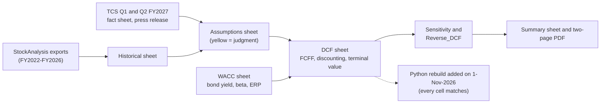

# Project 2 explained simply: what is one TCS share worth?

## What this project does

A discounted cash flow (DCF) valuation asks: if you owned the whole company, how much cash would it hand you over the years, and what is all that future cash worth in today's money? You estimated TCS's free cash flow for five years (FY2027 to FY2031), added a value for all the years after that, turned the total into today's money using a discount rate, and divided by the number of shares.

The short answer: **₹2,072 per share, against a market price of ₹2,459.10 on 19-Oct-2026, so the DCF says TCS is about 16% more expensive than its cash flows justify.** But the answer moves a lot with two inputs nobody can know for sure: the discount rate and long-run growth. With a discount rate 1 point lower and long-run growth 1 point higher, the value is ₹2,725, above the price. The reverse DCF says the market is either using a lower discount rate (10.7% instead of 11.9%) or expecting much faster growth.

## Why this company and this data

**Why TCS.** A DCF works best for a company with steady, predictable cash flows. TCS is India's largest IT services company, its revenue grew in every year from FY2022 to FY2026, it has no bank debt, and its capital spending is only about 1.6% of revenue, so most of its profit turns into cash. That makes the forecast easier to defend, and it leaves the interesting question: why does the market pay more than the cash flows suggest?

**Why not the obvious alternatives.** A bank cannot be valued this way (its debt is its raw material, so free cash flow to the firm has no meaning). A fast-growing start-up would put almost all of the value in the far future and make the answer a guess. A cyclical company (steel, cement) would need a view on the cycle.

**Why this data.** StockAnalysis.com republishes S&P Global's standardised statements for Indian companies, so the income statement, cash flow and balance sheet arrive in one consistent format, in ₹ million. TCS's own fact sheet and press releases give the latest quarter (Q2 FY2027) and were used to set the first forecast year. Market inputs (bond yield, equity risk premium) come from Trading Economics and Professor Damodaran's data.

## How it was done, step by step

1. **Downloaded the statements** from StockAnalysis (23-Oct-2026) and the TCS results documents. Files: `source_data/stockanalysis/exports/`, `source_data/company_filings/`.
2. **Typed five years of history** into the `Historical` sheet, dividing by 10 to turn ₹ million into ₹ crore. Why: the forecast percentages (margin, capex, working capital) come from these years.
3. **Worked out historical free cash flow**: EBIT x (1 - tax) + depreciation - capex - extra working capital. Other income (interest on TCS's large cash pile) is left out on purpose; the cash itself is added at the end instead, so it is not counted twice.
4. **Set the assumptions** on the `Assumptions` sheet, each with a one-line reason: revenue growth 9.5% in FY2027 fading to 5.0% by FY2031, EBIT margin 24.2% rising to 24.5%, tax 25%, capex 1.6% of revenue.
5. **Built the discount rate** on the `WACC` sheet: cost of equity = 7.15% bond yield + 0.80 beta x 6.0% equity risk premium = 11.95%. TCS's only debt is leases, 1.3% of its capital, so WACC = 11.91%.
6. **Handled the half year.** The valuation date is 30-Sep-2026, and the cash at that date already includes the first half of FY2027. So only the second half (0.50 of the year) of FY2027's cash flow is counted.
7. **Discounted the five years and added a terminal value** on the `DCF` sheet: the FY2031 cash flow growing at 4.5% a year forever, discounted back. It is 74% of the total, which is normal.
8. **Bridged to a share price**: enterprise value + cash - leases - minority interests = equity value ₹7,49,750 crore; divided by 361.8 crore shares = ₹2,072.
9. **Cross-checked with a multiple**: valuing the end-FY2031 business at TCS's current 11.4x EBITDA instead gives ₹2,403.
10. **Built four sensitivity grids** on the `Sensitivity` sheet (discount rate x long-run growth, and beta x equity risk premium).
11. **Ran the DCF backwards** on `Reverse_DCF` with Goal Seek: what growth, or what discount rate, makes the DCF equal the price?
12. **Wrote the conclusion** on the `Summary` sheet and in the two-page PDF, with eight checks (all PASS).
13. **Rebuilt the model in Python** (added on 1-Nov-2026, `build/check_model.py`): every forecast, discounting, terminal-value, bridge and grid cell was recomputed and matches; both Goal Seek answers were re-solved with a root finder and match; the inputs match the exports.

## Where every important number came from

The saved news and macro pages (`news_and_macro/*.html`) are copyrighted, so they stay on your PC and are not in the GitHub copy. Use the link in the Source column instead.

| Number | Value | Source | File in source_data/ |
|---|---|---|---|
| Revenue, EBIT, tax, FY2022-FY2026 | FY2026: ₹2,67,021 / 66,857 / 16,033 crore | [StockAnalysis income statement](https://stockanalysis.com/quote/nse/TCS/financials/) | `stockanalysis/exports/TCS_Income_Statement_StockAnalysis.xlsx` |
| Capex, D&A, working capital, acquisitions | FY2026 capex ₹4,224 + 367 crore; working capital -₹2,210 crore | [StockAnalysis cash flow](https://stockanalysis.com/quote/nse/TCS/financials/cash-flow-statement/) | `stockanalysis/exports/TCS_Cash_Flow_Statement_StockAnalysis.xlsx` |
| Cash, lease debt, minority interests | ₹51,024 / 11,808 crore (30-Sep-2026); ₹995 crore (30-Jun-2026) | [StockAnalysis balance sheet](https://stockanalysis.com/quote/nse/TCS/financials/balance-sheet/) | `stockanalysis/exports/TCS_Balance_Sheet_StockAnalysis.xlsx` |
| Share price, shares, beta, EV/EBITDA | ₹2,459.10 (19-Oct-2026); 361.8 crore; 0.18; 11.4x | [StockAnalysis statistics](https://stockanalysis.com/quote/nse/TCS/statistics/) | `stockanalysis/exports/TCS_Statistics_Valuation_StockAnalysis.xlsx` (downloaded 23-Oct, so it shows later prices) and `yahoo_finance/TCS_NS_daily_2026-09-01_to_2026-10-30.csv` |
| Consensus growth and price target | FY2027 growth 9.0%; target ₹2,390 (Oct) / ₹2,470 (Jul) | [StockAnalysis forecast](https://stockanalysis.com/quote/nse/TCS/forecast/) | `stockanalysis/exports/TCS_Forecast_Analyst_Projections_StockAnalysis.xlsx` |
| Q2 FY2027 revenue and margin | ₹73,188 crore; operating margin 24.0% | [TCS fact sheet](https://www.tcs.com/content/dam/tcs/investor-relations/financial-statements/2026-27/q2/Presentations/Q2%202026-27%20Fact%20Sheet.pdf) | `company_filings/TCS_Q2FY27_Fact_Sheet_8Oct2026.pdf` |
| Q1 FY2027 revenue | ₹72,275 crore | [TCS press release](https://www.tcs.com/content/dam/tcs/investor-relations/financial-statements/2026-27/q1/IND%20AS/Press%20Release%20-%20INR.pdf) | `company_filings/TCS_Q1FY27_Press_Release_INR_9Jul2026.pdf` |
| India 10-year bond yield | about 7.17% (28-Sep-2026); 7.15% used | [Trading Economics](https://tradingeconomics.com/india/government-bond-yield/news/587153) | `news_and_macro/TradingEconomics_India_10Y_yield_news_28Sep2026.html` (local only) |
| Equity risk premium for India | 7.08% total (Jan-2026); 6.0% used | [Damodaran](https://pages.stern.nyu.edu/~adamodar/New_Home_Page/datafile/ctryprem.html) | `news_and_macro/Damodaran_country_risk_premiums_Jan2026.html` (local only) |
| AI revenue | above US$3.1 billion annualised in Q2 FY2027 | [Free Press Journal](https://www.freepressjournal.in/business/tcs-net-profit-up-025-to-13884-crore-in-q2-fy27-revenue-rises-to-73188-crore) | `news_and_macro/FreePressJournal_TCS_Q2FY27_8Oct2026.html` (local only) |

## Key assumptions and why

| Assumption | Value | Why |
|---|---|---|
| Revenue growth | 9.5% (FY2027), then 6.0%, 6.0%, 5.5%, 5.0% | The first half of FY2027 grew 12.6% in rupees; the second quarter's pace points to about 9-10% for the year. After that growth fades towards the long-run rate |
| EBIT margin | 24.2% rising to 24.5% | The last two quarters were both 24.0%; the five-year average is 24.7% |
| Beta | 0.80 | The measured beta (0.18) is too low to use; IT-services companies usually sit at 0.7-1.0. This is the biggest judgment in the model |
| Equity risk premium | 6.0% | Damodaran's India figure is 7.08%, but part of that is country risk already inside the rupee bond yield |
| Terminal growth | 4.5% | Below India's 10-year bond yield and close to long-run nominal growth in rupees |
| Valuation date | 30-Sep-2026 | The latest balance sheet; only the rest of FY2027 is counted |

## Words you need to know

| Term | Meaning |
|---|---|
| DCF | Valuing a company as the present value of the cash it will produce |
| FCFF (free cash flow to the firm) | Cash left after taxes, investment and working capital, available to all lenders and shareholders |
| Present value | What future money is worth today; ₹100 next year is worth less than ₹100 now |
| WACC | Weighted average cost of capital: the return lenders and shareholders together expect, used as the discount rate |
| Cost of equity (CAPM) | Bond yield + beta x equity risk premium |
| Beta | How much a share moves with the market; 1.0 moves with it, below 1.0 moves less |
| Equity risk premium (ERP) | The extra return investors want for holding shares instead of government bonds |
| Terminal value | The value of all cash flows after the forecast years, assuming steady growth forever |
| Enterprise value (EV) | The value of the whole business, before adding cash and subtracting debt |
| Equity value | What belongs to shareholders: EV + cash - debt - minority interests |
| Stub period | A part-year at the start of the forecast |
| Sensitivity table | A grid showing the answer for different inputs |
| Reverse DCF | Starting from the price and asking which inputs would justify it |
| Exit multiple | A shortcut terminal value: a multiple of EBITDA instead of a growth formula |

## How to check the work yourself

1. Open `TCS_DCF_Model.xlsx`. On `Summary`, rows 27-34 must all say PASS.
2. Check one input against the source: FY2026 revenue on `Historical!F5` is 267,021; the income-statement export shows 2,670,210 (₹ million) for FY2026.
3. Check the middle of the sensitivity grid: `Sensitivity!E9` must equal the DCF value on `DCF!B37` (₹2,072.28).
4. Change beta on `WACC!B6` from 0.80 to 0.60: the value rises to about ₹2,449, close to the price. Change it back.
5. Run `python build/check_model.py`. All 17 checks must say PASS (3 lines are INFO and explain small differences).

## How to explain this project in an interview

**30-second version.** "I valued TCS with a five-year FCFF DCF. FCFF excludes interest income, so I added TCS's ₹51,000 crore of cash in the bridge and treated leases as debt. At an 11.9% WACC and 4.5% terminal growth I get ₹2,072 a share, about 16% below the ₹2,459 price. The gap is a discount-rate story: a reverse DCF shows the price implies a 10.7% WACC, a beta of about 0.6, or 4.3 points more revenue growth every year. So I would not call it a sell; I would say the market is pricing a lower risk or a longer growth runway than my base case."

**Q: Why is WACC almost the same as the cost of equity?**
A: TCS has no bank debt. Its only debt is ₹11,808 crore of leases, 1.3% of its capital, so WACC (11.91%) is almost equal to the cost of equity (11.95%).

**Q: Is a terminal value of 74% of enterprise value a problem?**
A: It is in the normal 70-85% range for a five-year DCF. The terminal value equals 9.3x FY2031 EBITDA, below TCS's current 11.4x, so if anything it is cautious. At 11.4x the value would be ₹2,403.

**Q: Why count only half of FY2027?**
A: The valuation uses the 30-Sep-2026 balance sheet. The cash on that date already includes the cash earned from April to September, so counting the whole year's cash flow would count that half twice.
