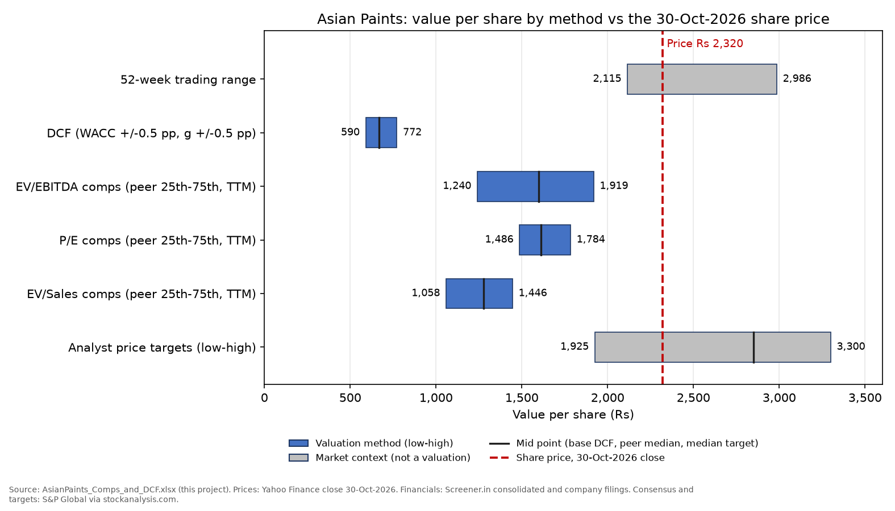
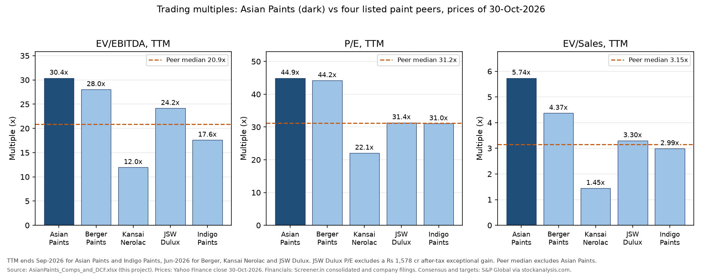
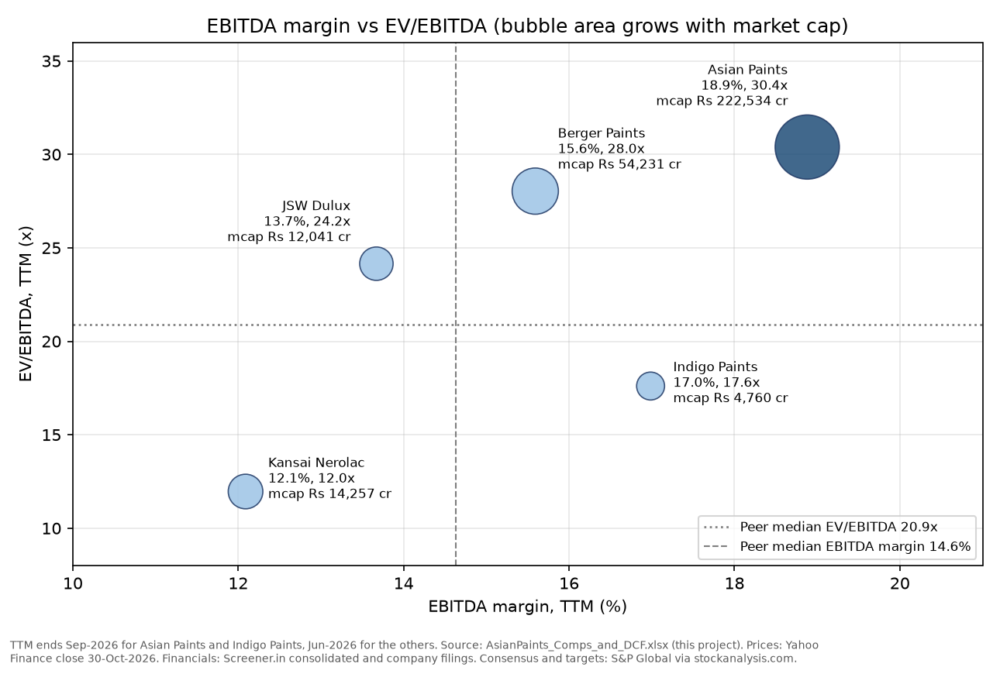

# Asian Paints: comparable company analysis and DCF, shown on a football field

At the 30-Oct-2026 close of Rs 2,320, Asian Paints trades at 30.4x TTM EV/EBITDA and 44.9x TTM P/E. That is a 46% and 44% premium to the median of four listed Indian paint peers (20.9x and 31.2x). Peer multiples at the 25th-75th percentile imply Rs 1,240-1,919 per share on EV/EBITDA, Rs 1,486-1,784 on P/E and Rs 1,058-1,446 on EV/Sales. A five-year FCFF DCF (WACC 12.68%, terminal growth 6.0%) gives Rs 668 per share, or Rs 590-772 when WACC and growth each move 0.5 percentage points. The share price is above every valuation-based range. It sits inside only the 52-week range (Rs 2,115-2,986) and the analyst target range (Rs 1,925-3,300). With the model's cash flows, the price requires free cash flow to grow 11.05% a year forever after FY2031, against a 7.41% risk-free rate.



## What this project shows

- Building a trading-comps table from primary data: market cap from price x shares, an explicit EV bridge (debt, lease liabilities, minority interest, cash, liquid investments) and trailing-twelve-month (TTM) metrics.
- Cleaning the data: aligning TTM periods and flagging mismatches, removing exceptional items from P/E, adjusting consensus EPS for a share split, and checking every input against a second source.
- Peer statistics (minimum, quartiles, median, maximum), the implied value per share at each statistic, and a drop-one-peer test, because four peers is a small sample.
- A compact FCFF DCF with a half-year stub, a CAPM WACC using a regression beta computed in Python, a Gordon terminal value, an exit-multiple cross-check and a reverse DCF (the growth rate the market price implies).
- A football field in native Excel (stacked bar chart) and in matplotlib.
- A reproducible pipeline: Python writes an Excel model with live formulas, Excel recalculates it through COM, 22 model checks must say PASS, and every CSV, chart and PDF number is read back from the recalculated file.

## Files

| File | What it is |
|---|---|
| `AsianPaints_Comps_and_DCF.xlsx` | The model: sheets Cover, Peer_Data, Comps, DCF_Assumptions, WACC, DCF, Sensitivity, Football_Field, Checks. 868 live formulas; 22 of 22 checks PASS |
| `AsianPaints_Comps_Summary.pdf` | 3-page summary: comps table, football field, implied values, DCF, sensitivity, interpretation, sources |
| `outputs/comps_table.csv` | One row per company plus peer statistics rows: market cap, EV bridge, TTM metrics, multiples, margins, growth, ROCE, ROE |
| `outputs/implied_values.csv` | Peer multiple statistics and the implied Asian Paints value per share for 5 multiples |
| `outputs/drop_one_sensitivity.csv` | Peer medians and implied values with each peer dropped in turn |
| `outputs/dcf_summary.csv` | WACC inputs, EV-to-equity bridge, value per share, cross-checks (with the source cell of each number) |
| `outputs/dcf_forecast.csv` | Forecast lines FY2026A to FY2031E, including H1 and H2 FY2027 |
| `outputs/sensitivity_wacc_g.csv` | 5x5 grid of DCF value per share |
| `outputs/football_field.csv` | Low, high and mid of each football-field bar |
| `outputs/READY.txt` | Hand-off summary for Project 5 (equity research report) |
| `figures/` | `football_field.png`, `multiples_bar.png`, `margin_vs_multiple.png` |
| `build/` | Python scripts (see "How to reproduce") and `verify_log.txt` |
| `data/` | Tidy inputs read by the model builder |
| `source_data/` | Original downloads (Screener, stockanalysis.com, Yahoo Finance, NSE, company PDFs, news pages); index in `source_data/README.md` |
| `explained_simply/README.md` | Plain-language guide to the project |

## Companies

| Company | NSE symbol | Role | Basis | TTM ends | Why it is in the set |
|---|---|---|---|---|---|
| Asian Paints | ASIANPAINT | Target | Consolidated | Sep-2026 | Market leader in Indian decorative paints |
| Berger Paints India | BERGEPAINT | Peer | Consolidated | Jun-2026 | Second-largest listed paint company |
| Kansai Nerolac Paints | KANSAINER | Peer | Consolidated | Jun-2026 | Decorative plus a large automotive/industrial business |
| JSW Dulux (formerly Akzo Nobel India) | JSWDULUX | Peer | Consolidated | Jun-2026 | Dulux brand; renamed on 11-Mar-2026 after JSW Paints bought control |
| Indigo Paints | INDIGOPNTS | Peer | Consolidated | Sep-2026 | Smaller decorative-paint challenger |

Excluded, and why:

- **Birla Opus** is the decorative-paint business of Grasim Industries, launched in 2024. It reached about a 10% revenue share of Indian decorative paints within two years ([BusinessWorld](https://www.businessworld.in/article/grasim-industries-targets-rs-2-lakh-cr-revenue-in-fy27-birla-620427)), so it matters as a competitor. It is not separately listed, and Grasim's market value mostly reflects cement (UltraTech), fibres, chemicals and financial services, so Grasim's multiples say nothing about paints.
- **Pidilite Industries** sells adhesives and sealants (Fevicol, M-Seal). It is often grouped with paints because both sell through hardware and paint dealers, but its products, margins and growth drivers are different.
- **JSW Paints** is unlisted. It completed the purchase of 60.76% of Akzo Nobel India in December 2025 and holds 61.2% ([ETLegalWorld, 11-Dec-2025](https://legal.economictimes.indiatimes.com/news/corporate-business/jsw-paints-completes-acquisition-of-majority-stake-in-akzonobel-india/125909724)). It has no market price; its listed subsidiary JSW Dulux is in the peer set.

## Data and sources

All files were downloaded on 1-Nov-2026 and are saved in `source_data/` (index with full URLs in `source_data/README.md`).

| Data | Source | Used for |
|---|---|---|
| Financial statements, quarterly results, line-item schedules (Rs crore) | [Screener.in](https://www.screener.in/company/ASIANPAINT/consolidated/) consolidated pages and schedules API, all five companies | TTM revenue, EBITDA, PAT, debt, leases, cash, investments, minority interest, FY2023-FY2026 history |
| Statistics, financials, consensus estimates, price targets | [stockanalysis.com](https://stockanalysis.com/quote/nse/ASIANPAINT/forecast/) (S&P Global Market Intelligence data) | FY27E/FY28E consensus EBIT and EPS, analyst targets (34 analysts for Asian Paints), cross-check of debt and EV |
| Daily prices, 2021-2026 | Yahoo Finance via yfinance (ASIANPAINT.NS, BERGEPAINT.NS, KANSAINER.NS, JSWDULUX.NS, INDIGOPNTS.NS, ^NSEI) | 30-Oct-2026 closes, 52-week ranges, 5-year weekly betas |
| Asian Paints Q2 FY27 results, press release and investor presentation (29-Oct-2026) | [NSE filing](https://nsearchives.nseindia.com/corporate/ASIANPAINT_29102026140213_OutcomeofBM29102026signed.pdf), [presentation](https://nsearchives.nseindia.com/corporate/ASIANPAINT_29102026164544_SEIntimation_Investor_Presentation_Q2FY26-27pdfsigned.pdf) | H1 FY2027 actuals, 30-Sep-2026 balance sheet, management commentary |
| Peer result dates | NSE corporate-announcements API and the peers' NSE filings | Which quarter each TTM ends in |
| 10-year G-sec yield, 30-Oct-2026 | [Reuters via ETBFSI](https://bfsi.economictimes.indiatimes.com/articles/india-bonds-buckle-for-fourth-straight-month-on-oils-climb/135363689) (7.4139%), [Trading Economics](https://tradingeconomics.com/india/government-bond-yield) (7.40%) | Risk-free rate 7.41% |
| Country risk premium, Jan-2026 | [Damodaran](https://pages.stern.nyu.edu/~adamodar/New_Home_Page/datafile/ctryprem.html) | Memo cost of equity (India total ERP 7.08%, default spread 1.87%) |
| JSW Dulux rename and 1:10 split | [ET Manufacturing, 12-Mar-2026](https://manufacturing.economictimes.indiatimes.com/news/chemicals/akzo-nobel-india-gets-regulatory-nod-to-change-name-to-jsw-dulux/129502125), [Mint, 22-Sep-2026](https://www.livemint.com/market/stock-market-news/jsw-dulux-announced-record-date-for-1-10-stock-split-what-investors-should-know-11790079151086.html) | Ticker, share count, split adjustment of consensus EPS |

The conventions file gave a 10-year G-sec yield of about 7.44%. That figure is the 29-Oct-2026 close. Two sources put the 30-Oct-2026 close at 7.40-7.41%, so the model uses 7.41%.

## Method

**Market cap and EV.** Market cap = 30-Oct-2026 close x diluted shares. EV = market cap + borrowings + lease liabilities + minority interest - cash and bank balances - current (liquid) investments.

- What is subtracted: cash, bank deposits and current investments. For Asian Paints these are Rs 612.6 cr of cash and bank balances and Rs 5,512.0 cr of current investments at 30-Sep-2026. Rs 5,508.9 cr of those investments are liquid mutual funds that the company's own cash-flow statement counts as cash equivalents. Berger (Rs 1,072.7 cr) and Kansai Nerolac (Rs 2,388.0 cr) also hold large current-investment books, treated the same way.
- What is not subtracted: non-current investments (Asian Paints Rs 877.2 cr, mostly associates such as the PPG Asian Paints joint venture). They are strategic, not spare cash. The Comps sheet shows EV/EBITDA with them deducted as a memo column; for Asian Paints it changes 30.4x to 30.3x.
- Lease liabilities count as debt because EBITDA under Ind AS 116 excludes rent.

**Multiples.** EV/EBITDA and EV/Sales use TTM EBITDA (operating profit before other income) and TTM revenue. P/E = market cap / TTM profit attributable to owners, excluding exceptional items after tax. For JSW Dulux this removes a Rs 1,578 cr after-tax gain in the Sep-2025 quarter; without that, its P/E would be about 6x. Forward multiples use S&P Global consensus for FY2027E (EBITDA = consensus EBIT + TTM D&A). JSW Dulux consensus EPS is divided by 10 for its 1:10 split (record date 22-Oct-2026).

**TTM timing.** Asian Paints (results 29-Oct-2026, 14:04 IST) and Indigo Paints (30-Oct-2026, 17:41 IST, after the close) have TTM to Sep-2026. Berger, Kansai Nerolac and JSW Dulux report Q2 FY27 on 4-5 Nov-2026, after the price date, so their TTM ends Jun-2026 and their latest balance sheets are 31-Mar-2026. The Comps sheet flags each mismatch. Indigo's price does not yet reflect its Q2 results.

**Peer statistics and implied values.** Minimum, 25th percentile, median, 75th percentile and maximum of the four peers (Excel `QUARTILE` and `MEDIAN`, Asian Paints excluded). Implied value per share:

- EV multiples: (peer multiple x Asian Paints metric - debt incl. leases - minority interest + cash and liquid investments) / 95.92 crore shares
- P/E: peer multiple x Asian Paints EPS

**DCF.** Valuation date 30-Sep-2026, the latest balance sheet. H1 FY2027 has already happened, so year 1 counts only H2 FY2027E (Oct-2026 to Mar-2027), discounted 0.4986 years. FY2028E-FY2031E follow at 1.4986-4.4986 years (cash flows at each 31-Mar, as in the TCS model of Project 2).

- FCFF = EBIT x (1 - 25.17%) + D&A - capex - new leases - increase in trade working capital
- Terminal value = FCFF(FY2031E) x (1 + g) / (WACC - g)
- Equity value = EV + cash + current investments + non-current investments - borrowings - lease liabilities - minority interest
- WACC = E/V x Ke + D/V x Kd x (1 - t), with Ke = rf + beta x ERP
- Market-implied growth: solve TV = FCFF x (1 + g) / (WACC - g) for g, using the terminal value that makes the DCF equal the market EV: g = (TV x WACC - FCFF) / (TV + FCFF)

Forecast drivers (yellow cells on DCF_Assumptions, each with a one-line reason):

| Driver | H2 FY2027E | FY2028E | FY2029E | FY2030E | FY2031E | Basis |
|---|---|---|---|---|---|---|
| Revenue growth | 15.0% vs H2 FY2026 | 8.0% | 8.5% | 8.5% | 8.0% | H1 FY2027 +17.4%; Q2 Decorative India volume +6.4%, value +14.5%; further price rises under way |
| EBITDA margin | 17.0% | 18.5% | 19.0% | 19.0% | 19.0% | Q2 FY2027 15.6% (-202 bp) on raw-material inflation; FY2022-26 average 18.5% |
| D&A, % of revenue | 3.1% | 3.2% | 3.2% | 3.2% | 3.2% | New VAE plant adds depreciation |
| Capex, % of revenue | 3.5% | 4.0% | 3.8% | 3.5% | 3.5% | VAE/VAM project phase 2 in FY2028-29 |
| New leases, % of revenue | 1.0% | 1.0% | 1.0% | 1.0% | 1.0% | FY2026 lease principal repaid Rs 340 cr |
| Trade working capital, % of revenue | 19% at 31-Mar-2027 | 19% | 19% | 19% | 19% | FY2026 17.8%, 30-Sep-2026 20.8% |

WACC inputs: rf 7.41%; beta 0.90 (5-year weekly regression vs NIFTY 50 0.885 with R-squared 0.25 and standard error 0.10; Blume-adjusted 0.92; peer median 0.89); equity risk premium 6.0% (same as the TCS model); pre-tax cost of debt rf + 1.0% = 8.41%; tax 25.17% (s.115BAA); debt weight 2.0% at market values.

## Results

### Trading comparables (prices of 30-Oct-2026; Rs crore unless stated)

| Company | TTM to | Market cap | EV | EV/EBITDA | P/E | EV/Sales | EV/EBITDA FY27E | P/E FY27E | EBITDA margin | Revenue CAGR FY23-26 | ROCE FY26 |
|---|---|---|---|---|---|---|---|---|---|---|---|
| **Asian Paints** | Sep-2026 | 222,534 | 221,679 | **30.4x** | **44.9x** | **5.74x** | 29.4x | 43.0x | 18.9% | 1.0% | 26.3% |
| Berger Paints | Jun-2026 | 54,231 | 53,601 | 28.0x | 44.2x | 4.37x | 26.0x | 40.3x | 15.6% | 4.0% | 21.6% |
| Kansai Nerolac | Jun-2026 | 14,257 | 11,950 | 12.0x | 22.1x | 1.45x | 11.2x | 19.8x | 12.1% | 2.2% | 12.0% |
| JSW Dulux | Jun-2026 | 12,041 | 11,810 | 24.2x | 31.4x | 3.30x | 19.7x | 30.0x | 13.7% | -1.8% | 22.7% |
| Indigo Paints | Sep-2026 | 4,760 | 4,525 | 17.6x | 31.0x | 2.99x | 15.3x | 26.3x | 17.0% | 9.4% | 18.6% |
| Peer median | | | | 20.9x | 31.2x | 3.15x | 17.5x | 28.1x | 14.6% | 3.1% | 20.1% |
| Asian Paints vs median | | | | +46% | +44% | +82% | +68% | +53% | +4.2 pp | -2.0 pp | +6.2 pp |



### Implied Asian Paints value per share (Rs)

| Multiple | Peer 25th | Peer median | Peer 75th | At 25th | At median | At 75th | Median vs price |
|---|---|---|---|---|---|---|---|
| EV/EBITDA TTM | 16.2x | 20.9x | 25.1x | 1,240 | 1,597 | 1,919 | -31.2% |
| P/E TTM | 28.8x | 31.2x | 34.6x | 1,486 | 1,610 | 1,784 | -30.6% |
| EV/Sales TTM | 2.60x | 3.15x | 3.57x | 1,058 | 1,276 | 1,446 | -45.0% |
| EV/EBITDA FY27E | 14.3x | 17.5x | 21.2x | 1,132 | 1,384 | 1,680 | -40.3% |
| P/E FY27E | 24.6x | 28.1x | 32.6x | 1,330 | 1,517 | 1,756 | -34.6% |

Drop-one test: removing one peer at a time moves the EV/EBITDA median between 17.6x and 24.2x (Rs 1,348-1,845 per share) and the EV/Sales median between 2.99x and 3.30x. The P/E median stays between 31.0x and 31.4x (Rs 1,602-1,618), so P/E is the steadier comps anchor for this peer set.



Among the four peers, a higher EBITDA margin does not line up with a higher multiple: Indigo has the best peer margin (17.0%) and a below-median multiple (17.6x), while JSW Dulux has the second-lowest margin (13.7%) and the second-highest multiple (24.2x). With four points the link is weak; size and company events (such as JSW Dulux's change of control) also move multiples.

### DCF (Rs crore)

| | FY2026A | FY2027E | FY2028E | FY2029E | FY2030E | FY2031E |
|---|---|---|---|---|---|---|
| Revenue | 35,584 | 41,349 | 44,657 | 48,453 | 52,572 | 56,777 |
| Revenue growth | 4.9% | 16.2% | 8.0% | 8.5% | 8.5% | 8.0% |
| EBITDA | 6,696 | 7,267 | 8,262 | 9,206 | 9,989 | 10,788 |
| EBITDA margin | 18.8% | 17.6% | 18.5% | 19.0% | 19.0% | 19.0% |
| FCFF | 4,330 | 2,500 | 3,680 | 4,232 | 4,750 | 5,176 |
| PAT attributable to owners | 4,325 | 5,013 | 5,615 | 6,269 | 6,802 | 7,346 |
| EPS (Rs) | 45.09 | 52.27 | 58.54 | 65.36 | 70.91 | 76.58 |
| Consensus EPS (Rs, S&P Global) | | 53.94 | 60.40 | | | |

FY2027E = H1 FY2027 actual + H2 FY2027E. FY2027E FCFF is low because trade working capital rose by Rs 1,669 cr in H1 (a seasonal and inflation-led inventory build). Only the H2 FY2027E part (Rs 2,035 cr) is valued.

| Valuation | Value |
|---|---|
| WACC | 12.68% (Ke 12.81%, after-tax Kd 6.29%, D/V 2.0%) |
| Terminal growth g | 6.0% |
| PV of FCFF, H2 FY2027E-FY2031E | Rs 14,289 cr |
| PV of terminal value | Rs 48,019 cr (77% of EV) |
| Enterprise value | Rs 62,308 cr |
| + cash and investments - debt, leases and minority interest | +Rs 1,732 cr |
| Equity value | Rs 64,040 cr |
| **Value per share** | **Rs 667.64** (-71% vs Rs 2,320) |
| Terminal value as a multiple of FY2031E EBITDA | 7.6x |
| Value with a 20.9x exit multiple (peer median) instead of Gordon growth | Rs 1,540 per share (implies 10.1% perpetual growth) |
| Perpetual growth after FY2031E implied by the market price | 11.05% |

Sensitivity of value per share (Rs) to WACC (rows) and g (columns); the centre equals the base case, and the inner 3x3 is the DCF bar on the football field:

| WACC \ g | 5.0% | 5.5% | 6.0% | 6.5% | 7.0% |
|---|---|---|---|---|---|
| 11.68% | 687 | 731 | 783 | 846 | 921 |
| 12.18% | 639 | 677 | 721 | 772 | 834 |
| 12.68% | 598 | 631 | **668** | 711 | 761 |
| 13.18% | 562 | 590 | 622 | 658 | 701 |
| 13.68% | 530 | 555 | 582 | 613 | 649 |

### Football field (Rs per share)

| Bar | Low | High | Mid | Price inside? |
|---|---|---|---|---|
| 52-week trading range (context) | 2,115 | 2,986 | | Yes |
| DCF (WACC +/-0.5 pp, g +/-0.5 pp) | 590 | 772 | 668 | No |
| EV/EBITDA comps (peer 25th-75th) | 1,240 | 1,919 | 1,597 | No |
| P/E comps (peer 25th-75th) | 1,486 | 1,784 | 1,610 | No |
| EV/Sales comps (peer 25th-75th) | 1,058 | 1,446 | 1,276 | No |
| Analyst price targets (context) | 1,925 | 3,300 | 2,850 | Yes |
| Share price, 30-Oct-2026 | 2,320 | | | |

## Key takeaways

1. Asian Paints trades at a premium of 44-82% to the peer median on every multiple. It has the best EBITDA margin (18.9% vs 14.6%) and ROCE (26.3% vs 20.1%) in the group, but its FY2023-26 revenue CAGR was 1.0%, below the peer median of 3.1%. The premium rests on quality and market position, not on recent growth.
2. Even the 75th-percentile peer multiple (EV/EBITDA, Rs 1,919) is 17% below the share price. For the sector leader, peer multiples work better as a floor than as a fair value.
3. The DCF (Rs 668) is far below both the comps and the price. To justify Rs 2,320 with these cash flows, FCFF would have to grow 11.05% a year forever after FY2031. A common rule caps perpetual growth at the risk-free rate (7.41%). The market is pricing a much longer period of high growth than five years, a lower discount rate, or both.
4. Analyst targets (Rs 1,925-3,300, median Rs 2,850) contain the price. The median target is 52.8x consensus FY2027E EPS (Rs 53.94), against a peer median FY2027E P/E of 28.1x, so analysts are much closer to the market than either method here.
5. The comps result depends on the peer set: dropping a single peer moves the EV/EBITDA-implied value by up to 16%. The P/E result barely moves.

## Limitations

- Four listed peers, all smaller than Asian Paints. JSW Dulux is in transition after its change of control (and has only 2 analysts covering it), Kansai Nerolac has a large automotive business, and Indigo is small.
- Three peers' TTM figures are one quarter older than Asian Paints', and their balance sheets are seven months old. Indigo's price predates its Q2 results.
- The DCF has a five-year forecast followed directly by 6% growth, with no fade period. A longer high-growth phase would raise the value. The terminal value is 77% of EV.
- The cost of equity adds a 6.0% ERP to a G-sec yield that already contains India's sovereign default spread. Damodaran's method (rf minus the 1.87% default spread, plus beta x 7.08% total ERP) gives a cost of equity of 11.91%, about 0.9 pp lower. The lower rows of the WACC grid show the effect.
- Minority interests and non-current investments are at book value.
- Consensus comes from one aggregator (S&P Global via stockanalysis.com). All prices are from one day.

## How to reproduce

Requirements: Python 3.11+ with the packages in `requirements.txt`. The recalculation step needs Windows with Microsoft Excel (COM automation through pywin32).

```bash
pip install -r requirements.txt
python build/fetch_sources.py       # optional, online: re-downloads source_data/ (keeps saved Screener schedules)
python build/prepare_data.py        # offline: source_data/ -> data/ (TTM figures, EV items, betas, price targets)
python build/build_model.py         # data/ -> AsianPaints_Comps_and_DCF.xlsx with live formulas
python build/recalc_verify.py       # Excel recalculation via COM, then checks -> build/verify_log.txt
python build/make_outputs.py        # outputs/*.csv, figures/*.png, outputs/READY.txt (reads cached Excel values)
python build/make_pdf.py            # AsianPaints_Comps_Summary.pdf
python build/export_source_xlsx.py  # Excel copies of the Screener and stockanalysis.com tables in source_data/
```

Every step after `fetch_sources.py` runs offline. Open the workbook's Checks sheet: all 22 checks must say PASS, and the Cover sheet shows the overall status.

Educational project, not investment advice.
