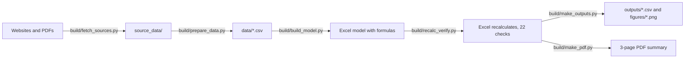

# Project 3 explained simply: what is Asian Paints worth?

## What this project does

It values Asian Paints in two ways and puts the answers side by side. The first way compares it with similar listed paint companies: if they trade at about 21 times their operating profit, what would Asian Paints be worth at that price tag? The second way, a DCF, estimates the cash the business will produce in future and converts it into a value today. A "football field" chart then shows every method's range next to the actual share price of Rs 2,320 (30-Oct-2026).

The short answer: peer prices give Rs 1,058-1,919 a share, the DCF gives Rs 590-772, and the market pays Rs 2,320. Asian Paints is priced far above what either method supports. The market expects it to keep growing fast for much longer than five years.

## Why this company, these peers and this data

**Why Asian Paints.** It is India's largest paint company, and it faces a real debate in 2026. New competitors (Birla Opus, launched by Grasim in 2024, and JSW Dulux) are spending heavily, and raw-material costs jumped this year. Its shares still trade at a large premium. That makes it a good test case: do the numbers justify the premium? It is also a different company from your other projects (two-wheelers in Project 1, TCS in Project 2), and Project 5 builds an equity research report on the same company using these results.

**Why these four peers.** Berger Paints, Kansai Nerolac, JSW Dulux and Indigo Paints are the listed Indian companies whose main business is paint. Comparing like with like is the whole point of comps.

**Why not the obvious alternatives.**

- Birla Opus is not listed on its own. Its parent, Grasim, is mostly cement, fibres and financial services, so Grasim's share price says little about paint.
- Pidilite (Fevicol) is often mentioned next to paint companies, but it sells adhesives. Different products, different margins.
- JSW Paints owns 61% of JSW Dulux but is not listed itself, so it has no share price.

**Why this data.** Screener.in gives clean financial statements in Rs crore for every Indian listed company. stockanalysis.com gives S&P Global analyst forecasts and price targets. Yahoo Finance gives daily prices. The company's own results PDF is the final word, so every key Asian Paints number was checked against it.

## How I did it, step by step

1. **Chose the peer set.** Four listed paint companies, with the exclusions above. Written up in the main README.
2. **Downloaded the raw data** with `build/fetch_sources.py` into `source_data/`: Screener tables, stockanalysis.com pages, Yahoo prices, NSE announcements, company PDFs and news pages. Saved untouched so anyone can trace a number back.
3. **Read the Asian Paints Q2 FY27 results PDF** (filed 29-Oct-2026) and typed the key lines into `data/asian_paints_q2fy27_filing.csv`: H1 FY2027 revenue Rs 20,518 cr, EBITDA Rs 3,726 cr, and the 30-Sep-2026 balance sheet (cash, investments, debt, leases). Why: the DCF starts from the latest real numbers.
4. **Built tidy inputs** with `build/prepare_data.py` into `data/peer_inputs.csv`: for each company, the last four quarters added up (TTM), debt, cash, minority interest, share count and price. It also removes one-off gains (JSW Dulux had a Rs 1,578 cr one-off gain) and adjusts JSW Dulux's forecasts for its 1:10 share split.
5. **Measured beta** (how much the share moves with the market) in the same script: 260 weekly returns of each stock against NIFTY 50. Result for Asian Paints: 0.885. Saved in `data/beta_summary.csv`.
6. **Wrote the Excel model** with `build/build_model.py`. Every input sits on the Peer_Data or DCF_Assumptions sheet in blue; everything else is a live formula, so changing one input updates the whole model.
7. **Comps sheet:** market cap, enterprise value, the three multiples for each company, then the peer minimum, 25th percentile, median, 75th percentile and maximum. Then it applies each peer statistic to Asian Paints' own numbers to get a value per share.
8. **Drop-one test (Comps sheet, rows 30-37):** recalculates the peer median four times, leaving out one peer each time. Why: with only four peers, one odd company can move the median a lot.
9. **DCF_Assumptions sheet:** history for FY2022-FY2026, H1 FY2027 actuals, and the forecast drivers in yellow (growth, margin, capex, working capital), each with a one-line reason.
10. **WACC sheet:** the discount rate, built from the government bond yield, beta and the extra return investors want from shares.
11. **DCF sheet:** revenue to EBITDA to free cash flow for H2 FY2027 to FY2031, a terminal value for the years after, and the bridge from business value to value per share. It also works backwards: what growth rate would justify the share price?
12. **Sensitivity sheet:** a 5x5 grid showing value per share for different discount rates and growth rates. The middle 3x3 becomes the DCF bar on the football field.
13. **Football_Field sheet:** the six bars, the price line, a native Excel chart, and a "read-across" block that says whether the price falls inside each range.
14. **Checks sheet, then verification:** 22 checks (market caps match Screener, balance sheet figures match the filing, profit rebuilds to the reported number, the grid centre equals the DCF value, and so on). `build/recalc_verify.py` opens the file in Excel, recalculates it, and confirms that every check says PASS and no cell shows an error.
15. **Outputs:** `build/make_outputs.py` and `build/make_pdf.py` read the numbers Excel calculated and write the CSVs, charts, PDF and `outputs/READY.txt`. Nothing is typed twice, so the numbers cannot drift apart.

## Where every important number came from

Files under `news_and_macro/` are saved news articles. They are copyrighted, so they stay on your PC and are not in the GitHub copy. Use the link in the Source column instead.

| Number | Value | Source | File in source_data/ |
|---|---|---|---|
| Asian Paints share price, 30-Oct-2026 | Rs 2,320.00 | [Yahoo Finance ASIANPAINT.NS](https://finance.yahoo.com/quote/ASIANPAINT.NS/history/) via yfinance | `yahoo_finance/ASIANPAINT.NS_daily.csv` |
| 52-week low / high | Rs 2,115.0 / 2,985.7 | Yahoo Finance (intraday) | `yahoo_finance/ASIANPAINT.NS_daily.csv` |
| Shares outstanding | 95.92 crore | [stockanalysis.com statistics](https://stockanalysis.com/quote/nse/ASIANPAINT/statistics/); paid-up capital in the results PDF | `stockanalysis/raw/ASIANPAINT_statistics.html` |
| TTM revenue / EBITDA (Dec-2025 to Sep-2026) | Rs 38,633 cr / Rs 7,294 cr | [Screener.in](https://www.screener.in/company/ASIANPAINT/consolidated/), checked against the filing | `screener/ASIANPAINT_quarters.csv` |
| H1 FY2027 revenue / EBITDA | Rs 20,518 cr / Rs 3,726 cr | [Asian Paints Q2 FY27 results, p.12](https://nsearchives.nseindia.com/corporate/ASIANPAINT_29102026140213_OutcomeofBM29102026signed.pdf) | `company_filings/AsianPaints_Q2FY27_Results_and_Press_Release_29Oct2026.pdf` |
| Cash and bank / current investments, 30-Sep-2026 | Rs 612.6 cr / Rs 5,512.0 cr | Same results PDF, balance sheet p.13 | same PDF |
| Borrowings / lease liabilities / minority interest | Rs 2,899.9 / 1,695.8 / 674.3 cr | Same results PDF, p.13 | same PDF |
| Q2 FY2027 EBITDA margin | 15.6% (down 202 bp) | Same PDF, press release section | same PDF |
| Q2 FY2027 Decorative India volume / value growth | +6.4% / +14.5% | Same PDF, press release section | same PDF |
| Consensus EPS FY2027E / FY2028E | Rs 53.94 / Rs 60.40 | [stockanalysis.com forecast](https://stockanalysis.com/quote/nse/ASIANPAINT/forecast/) (S&P Global) | `stockanalysis/raw/ASIANPAINT_forecast.html` |
| Analyst price targets low / median / high | Rs 1,925 / 2,850 / 3,300 (34 analysts) | Same forecast page | same file |
| 10-year government bond yield (risk-free rate) | 7.41% | [Reuters via ETBFSI, 30-Oct-2026](https://bfsi.economictimes.indiatimes.com/articles/india-bonds-buckle-for-fourth-straight-month-on-oils-climb/135363689) (7.4139%) and [Trading Economics](https://tradingeconomics.com/india/government-bond-yield) (7.40%) | `news_and_macro/ETBFSI_Reuters_India_bonds_October_2026.html`, `news_and_macro/TradingEconomics_India_10Y_bond_yield.html` |
| Beta (5-year weekly vs NIFTY 50) | 0.885 | Computed in `build/prepare_data.py` | `yahoo_finance/ASIANPAINT.NS_daily.csv`, `yahoo_finance/IDX_NSEI_daily.csv` |
| India equity risk premium (memo) | 7.08% total, 1.87% default spread | [Damodaran, Jan-2026](https://pages.stern.nyu.edu/~adamodar/New_Home_Page/datafile/ctryprem.html) | `news_and_macro/Damodaran_country_risk_premium_Jan2026.html` |
| Corporate tax rate | 25.17% | Income-tax Act s.115BAA (22% + 10% surcharge + 4% cess) | none (statute) |
| Peer prices, TTM figures, debt and cash | see `outputs/comps_table.csv` | [Screener.in](https://www.screener.in/company/BERGEPAINT/consolidated/) pages and Yahoo Finance | `screener/<SYMBOL>_*.csv`, `yahoo_finance/<SYMBOL>.NS_daily.csv` |
| JSW Dulux one-off gain removed from P/E | Rs 1,578 cr after tax | Screener quarterly results and schedules | `screener/JSWDULUX_quarters.csv`, `screener/schedules/JSWDULUX_consolidated_quarters_Net_Profit.json` |
| JSW Dulux 1:10 split, record date 22-Oct-2026 | divide old EPS forecasts by 10 | [Mint, 22-Sep-2026](https://www.livemint.com/market/stock-market-news/jsw-dulux-announced-record-date-for-1-10-stock-split-what-investors-should-know-11790079151086.html) | `news_and_macro/Livemint_JSW_Dulux_1for10_split_record_date.html` |

## Key assumptions and why

| Assumption | Value | Why |
|---|---|---|
| Revenue growth, H2 FY2027 vs H2 FY2026 | 15% | H1 grew 17.4% with price rises of about 12%; a little lower to allow for softer demand and Birla Opus |
| Revenue growth, FY2028-FY2031 | 8.0-8.5% a year | Volume growth of 5-6% plus modest price increases; analysts expect 7.6% for FY2028 |
| EBITDA margin | 17.0% in H2 FY2027, 18.5% in FY2028, 19.0% after | Q2 was 15.6% because of raw-material inflation; 18.5% is the FY2022-26 average; the new VAE plant should cut costs |
| Capex | 3.5-4.0% of revenue | The VAE/VAM plant project, then a normal level |
| Trade working capital | 19% of revenue | Between FY2026 (17.8%) and the five-year average |
| Tax on operating profit | 25.17% | Statutory rate under s.115BAA |
| Risk-free rate | 7.41% | 10-year government bond on 30-Oct-2026, two sources |
| Beta | 0.90 | Regression 0.885, Blume-adjusted 0.92, peer median 0.89 all point to about 0.9 |
| Equity risk premium | 6.0% | Same as your TCS model; Damodaran's method would give a slightly lower cost of equity |
| Cost of debt | 7.41% + 1.0% = 8.41% before tax | Asian Paints is a top-rated borrower; debt is only 2% of its capital, so this hardly matters |
| Terminal growth | 6.0% | About 4% inflation plus 2% real growth, and below the 7.41% bond yield |
| Valuation date | 30-Sep-2026 | The latest balance sheet; only H2 FY2027 onwards is valued because H1 has already happened |
| Current investments in EV | Subtracted, like cash | Asian Paints' own cash-flow statement treats Rs 5,509 cr of them as cash equivalents |

## Words you need to know

| Term | Meaning |
|---|---|
| Trading comparables (comps) | Valuing a company by the prices investors pay for similar listed companies |
| Market cap | Share price x number of shares: what the shares are worth in total |
| Enterprise value (EV) | Market cap + debt + leases + minority interest - cash and liquid investments: the price of the whole business, not just the shares |
| EBITDA | Operating profit before depreciation and amortisation, and here before other income: a rough measure of cash profit from the business |
| TTM | Trailing twelve months: the last four reported quarters added together |
| EV/EBITDA, P/E, EV/Sales | Price tags: EV per rupee of EBITDA, share price per rupee of earnings, EV per rupee of sales |
| Median and percentiles | The median is the middle value; the 25th and 75th percentiles mark the middle half of the peers |
| Implied value per share | What Asian Paints would be worth per share at a peer price tag |
| DCF (discounted cash flow) | Value today of all future cash, where cash further in the future counts for less |
| FCFF (free cash flow to the firm) | Cash left after tax, new investment and working capital, available to both lenders and shareholders |
| WACC | The average return lenders and shareholders require; used as the discount rate |
| Beta | How much a share moves when the market moves 1%; 0.9 means 0.9% on average |
| Equity risk premium | The extra return investors want for owning shares instead of government bonds |
| Terminal value | The value of all cash flows after the last forecast year, assuming steady growth forever |
| Football field | A chart of horizontal bars, one per valuation method, with the share price as a vertical line |

## How to check the work yourself

1. Open `AsianPaints_Comps_and_DCF.xlsx`. The **Cover** sheet shows "Overall status (Checks sheet): PASS, 22 of 22 checks pass".
2. Go to the **Checks** sheet. Column C must show PASS on all 22 rows. A few to look at:
   - check 1: market cap within 1% of Screener's for all five companies;
   - checks 3-7: Asian Paints revenue, EBITDA, debt, cash and minority interest match the results PDF;
   - checks 11-12: profit before tax rebuilt from EBITDA equals the reported number;
   - check 15: the centre of the sensitivity grid equals the DCF value.
3. On **Comps**, compare row 5 (Asian Paints) with row 14 (peer median): EV/EBITDA in column R is 30.4x vs 20.9x. Rows 21-25 hold the implied values per share.
4. On **DCF**, cell B64 is the value per share (Rs 667.64), B49 the WACC (12.68%) and B80 the growth rate the share price implies (11.05%).
5. On **Sensitivity**, cell E9 (the green centre) must equal DCF!B64.
6. Change an input to see the model react: for example set DCF_Assumptions cell B67 (terminal growth) from 6% to 7%. The value per share rises and the grid moves. Undo afterwards.
7. Read `build/verify_log.txt`: it lists every check, the key outputs and "VERIFICATION PASSED".

## How to explain this project in an interview

**30-second version.** "I valued Asian Paints with trading comps against the four listed Indian paint companies and a five-year DCF, and showed both on a football field. Asian Paints trades at 30x EV/EBITDA against a peer median of 21x, so peer multiples imply about Rs 1,240-1,920 a share against a price of Rs 2,320. My DCF at a 12.7% WACC gives about Rs 670. Working backwards, the price needs 11% cash-flow growth forever after 2031. So the market is betting on many more years of high growth than a five-year model assumes, while new competitors like Birla Opus are pushing margins down."

**Likely questions.**

1. *Your DCF is 71% below the price. Is the model wrong?*
   The inputs are close to market norms: a 7.41% bond yield, a 0.9 beta and 6% growth after 2031. Even the most generous corner of the sensitivity grid (WACC 11.68%, growth 7%) gives only Rs 921. The gap is about how long high growth lasts. A five-year model then drops straight to 6% growth, while the market price assumes growth near 11% for a very long time. I show that gap explicitly as the market-implied growth rate.

2. *Why did you subtract current investments from EV but not non-current investments?*
   Current investments are mostly liquid mutual funds; the company itself counts Rs 5,509 cr of them as cash equivalents. Non-current investments are mainly stakes in associate companies, which are strategic and not spare cash. On the Comps sheet a memo column deducts them too, and Asian Paints' EV/EBITDA changes only from 30.4x to 30.3x. In the DCF I add them in the equity bridge because their income is not in my cash flows.

3. *Four peers is a small sample. How much can you trust the median?*
   Not fully, so I tested it. Dropping each peer in turn moves the EV/EBITDA median between 17.6x and 24.2x, a swing of up to 16% in the implied value. The P/E median barely moves (31.0x to 31.4x). So I show the 25th-75th percentile range rather than one number, and treat P/E as the steadier anchor.
