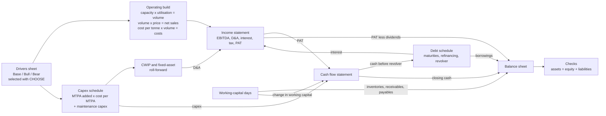
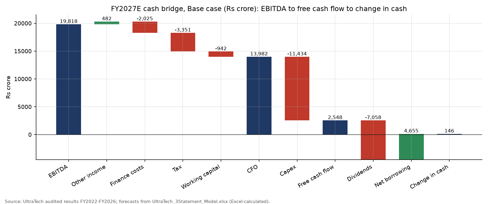
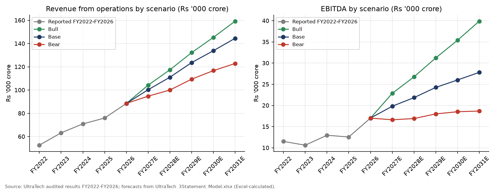
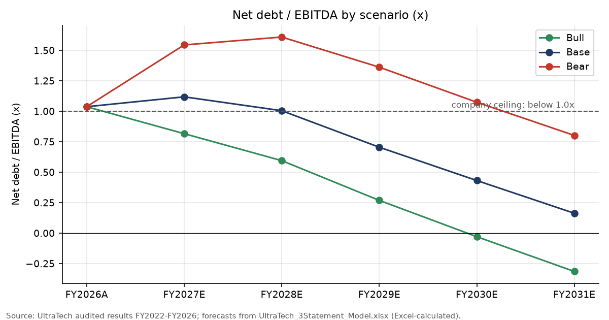
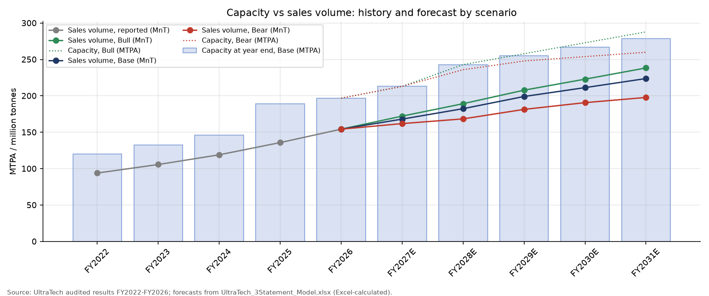

# UltraTech Cement: three-statement model with Base, Bull and Bear scenarios (FY2027E-FY2031E)

This project links UltraTech Cement's income statement, balance sheet and cash flow statement in one Excel model
(`UltraTech_3Statement_Model.xlsx`), driven by cement-industry operating drivers: capacity, utilisation, price per
tonne, cost per tonne, capex per MTPA, working-capital days and a debt schedule with a revolver. It starts from the
audited consolidated statements for FY2022-FY2026 (FY2026 revenue Rs 88,512 crore, EBITDA Rs 17,020 crore,
Rs 1,103 per tonne). In the Base case, revenue grows to Rs 144,552 crore by FY2031E (10.3% a year), EBITDA per
tonne rises to Rs 1,243 and EPS reaches Rs 533 (Rs 337 in FY2027E, close to the Rs 326 consensus average). Net debt
/ EBITDA peaks at 1.12x in FY2027E, when the Rs 240 per share FY2026 dividend (Rs 7,058 crore) is paid alongside
Rs 11,434 crore of capex, and falls to 0.16x by FY2031E. The Bull case ends FY2031E with net cash (-0.31x) and the
Bear case peaks at 1.61x in FY2028E. All 19 checks (balance sheet balances, cash ties, roll-forwards, no error
cells) pass in all three scenarios, verified by recalculating the workbook in Excel.

## What this project shows

- Building a fully linked three-statement model where every forecast cell is a live Excel formula traced to an input.
- An operating build specific to cement: capacity (MTPA) x utilisation = volume; volume x realisation = revenue;
  cost per tonne by bucket (raw materials, power and fuel, freight, other) x volume = costs.
- Capex linked to capacity additions (MTPA added x cost per MTPA, phased over two years) flowing through capital
  work-in-progress into fixed assets and depreciation.
- A debt schedule with actual maturities from the annual report, partial refinancing, and a revolver that draws or
  repays automatically to hold a minimum cash balance, with no circular references.
- Scenario analysis with a selector cell, CHOOSE-based drivers and a live Excel data table that shows all three
  cases side by side.
- Model checks that evaluate to PASS / FAIL, tested in every scenario through Excel COM automation.
- Transcribing and reconciling audited statements (60 subtotal checks against the filings, Screener cross-check).

## Files

| Path | What it is |
|---|---|
| `UltraTech_3Statement_Model.xlsx` | The model (9 sheets, 1,328 formulas, Excel-calculated values saved) |
| `build/01_fetch_data.py` | Downloads Screener, StockAnalysis and Yahoo Finance data (network) |
| `build/02_fetch_filings.py` | Downloads company PDFs, saves page extracts and the macro/news pages (network) |
| `build/03_prepare_data.py` | Transcribed audited statements -> tidy CSVs in `data/`, with 60 tie-out checks |
| `build/04_build_model.py` | Builds the workbook with openpyxl (all formulas live) |
| `build/05_verify_model.py` | Opens the workbook in Excel, creates the data table, runs all checks in all three scenarios, saves |
| `build/06_make_figures.py` | Charts in `figures/` from the verified outputs |
| `build/07_export_sources.py` | Writes the Screener and StockAnalysis tables as .xlsx files in `source_data/` |
| `data/` | Tidy inputs (`hist_*.csv`, `operating_kpis.csv`, `company_guidance.csv`, `debt_maturities.csv`, `market_inputs.json`) and logs |
| `outputs/` | `scenario_summary.csv`, `checks_log.csv`, `model_outputs_by_scenario.csv`, `verification_log.txt` |
| `source_data/` | Original downloads (filings, Screener, StockAnalysis, Yahoo, macro pages) with an index |
| `explained_simply/README.md` | Plain-language walk-through of the project |

## Model map



| Sheet | Contents |
|---|---|
| Cover | Scenario selector (cell C6: 1 = Base, 2 = Bull, 3 = Bear), key outputs, overall check status, how to use, the scenario data table |
| Historical | Audited FY2022-FY2026 income statement, balance sheet (41 reported lines mapped to 16 model lines with SUMIF) and cash flow, with ratios and tie-out checks |
| Drivers | Base / Bull / Bear values for every driver with a one-line reason, the selected value, macro inputs and company guidance |
| Income_Statement | Operating build and income statement to EPS |
| Balance_Sheet | Capex, CWIP and fixed-asset schedule, working capital, balance sheet, equity roll-forward, net debt and ROCE |
| Cash_Flow | Indirect cash flow statement; closing cash feeds the balance sheet |
| Debt_Schedule | Term debt (maturities and refinancing), revolver, interest, credit statistics |
| Scenario_Summary | Base, Bull and Bear side by side for FY2027E-FY2031E, read from the live data table |
| Checks | 19 PASS / FAIL tests |

Colour code: blue font = input; light-yellow fill = judgment assumption with a reason next to it; black = formula;
green = link to another sheet.

## Data and sources

All company figures are consolidated, in Rs crore, for fiscal years ending 31 March. Files were downloaded on
1-Nov-2026; copies are in `source_data/` (index: `source_data/README.md`).

| Data | Source |
|---|---|
| Income statement, balance sheet, cash flow FY2022-FY2026 | UltraTech audited consolidated results: [FY2026](https://www.ultratechcement.com/content/dam/ultratechcementwebsite/pdf/financials/financial-results/fy26/q4/q4fy26-results.pdf) (p.8-10, also gives FY2025), [FY2024](https://www.ultratechcement.com/content/dam/ultratechcementwebsite/pdf/financials/financial-results/fy24/q4/Q4FY24Results.pdf) (p.1-3), [FY2023](https://www.ultratechcement.com/content/dam/ultratechcementwebsite/pdf/financials/financial-results/fy23/q4/utcl-results-q4-fy-23-clean.pdf) (p.1-3, also gives FY2022) |
| Sales volume, net sales, capacity, capex | Q4 results presentations FY2022-FY2026 and the [Q2FY27 investor presentation](https://www.ultratechcement.com/content/dam/ultratechcementwebsite/pdf/financials/investor-update/q2fy27-investor-presentation.pdf) (19-Oct-2026, capacity roadmap p.12) |
| Capex plan (Rs 16,000 crore for 37 MTPA by FY2028), debt maturities (Note 17) | [Integrated and Sustainability Report FY2025-26](https://www.ultratechcement.com/content/dam/ultratechcementwebsite/pdf/financials/annual-reports/integrated-and-sustainability-report-2025-26-single-page.pdf) (PDF p.46-47, 509-512) |
| Guidance: capex, volume growth, net debt / EBITDA, dividend, Rs 5,000 crore NCDs | [Q4FY26 call](https://www.ultratechcement.com/content/dam/ultratechcementwebsite/pdf/financials/earnings-call/ultratech-cement-limited-earnings-call-transcript-q4fy26.pdf) (27-Apr-2026) and [Q2FY27 call](https://www.ultratechcement.com/content/dam/ultratechcementwebsite/pdf/financials/earnings-call/q2fy27-earnings-call-transcript.pdf) (19-Oct-2026) |
| Cross-check of the statements, H1 FY2027 quarters | [Screener consolidated](https://www.screener.in/company/ULTRACEMCO/consolidated/) and its schedules API; all 35 comparisons within 1% |
| Consensus (FY2027 revenue about Rs 1.03 lakh crore, EPS Rs 325.76 average, range 275.91-386.30) | [StockAnalysis forecast](https://stockanalysis.com/quote/nse/ULTRACEMCO/forecast/) (S&P Global data) |
| Share price Rs 11,045 (30-Oct-2026 close) | [Yahoo Finance ULTRACEMCO.NS](https://finance.yahoo.com/quote/ULTRACEMCO.NS/history/) |
| RBI repo rate 5.50% (raised 7-Oct-2026) | [The Hindu](https://www.thehindu.com/business/Economy/rbi-hikes-repo-rate-by-25-basis-points-to-55/article71554369.ece), [Mint](https://www.livemint.com/market/stock-market-news/rbi-mpc-meeting-october-2026-repo-rate-hiked-by-25-bps-to-5-50-growth-inflation-forecast-other-key-takeaways-11791344804917.html) |
| 91-day T-bill 5.93% (auction of 28-Oct-2026) | [Economic Times](https://economictimes.indiatimes.com/markets/bonds/rbi-accepts-20-bps-higher-treasury-bill-cutoff-yields-than-last-auction/articleshow/135284706.cms) |
| 10-year G-sec 7.41% (30-Oct-2026 close) | [Reuters via ETBFSI](https://bfsi.economictimes.indiatimes.com/articles/india-bonds-buckle-for-fourth-straight-month-on-oils-climb/135363689) (7.4139%) and [Trading Economics](https://tradingeconomics.com/india/government-bond-yield) (7.40%) |
| Tax rate 25.17% (section 115BAA: 22% + 10% surcharge + 4% cess) | [ClearTax](https://cleartax.in/s/section-115-baa-tax-rate-domestic-companies); [Income Tax Department](https://www.incometaxindia.gov.in/domestic-company) (blocked download, link recorded) |

Acquisitions that affect comparability: Kesoram Industries' cement business (10.75 MTPA, consolidated from
1-Apr-2024) and India Cements (14.45 MTPA, a subsidiary from 24-Dec-2024; UltraTech holds 74.99%). Both sit inside
FY2025, so FY2025 ratios (utilisation, D&A rate) are distorted and FY2026 is used as the base year. The 8.69% stake in
Star Cement (December 2024, up to Rs 851 crore) is a financial investment and is not consolidated.

## Method

Operating build (Income_Statement sheet), for each forecast year t:

- Average capacity = (opening + closing capacity) / 2, with closing = opening + MTPA added (Drivers).
- Volume (MnT) = utilisation x average capacity.
- Net sales (Rs crore) = volume x realisation (Rs/t) / 10, with realisation(t) = realisation(t-1) x (1 + growth).
  Other operating income = 1.29% of net sales.
- Each cost bucket (raw materials incl. traded goods, power and fuel, freight, other) = cost per tonne x volume / 10,
  with cost per tonne growing at the driver rate. Employee cost grows as a total.
- EBITDA = revenue - operating costs. Other income = 5.93% x opening (cash + bank balances + investments).

Capex and fixed assets (Balance_Sheet sheet):

- Expansion capex(t) = cost per MTPA x [50% x MTPA added(t) + 50% x MTPA added(t+1)]; maintenance and other
  capex = Rs 75 per tonne x opening capacity.
- CWIP at year end = 75% of the year's capex; capitalised = opening CWIP + capex - closing CWIP.
- Net fixed assets(t) = opening + capitalised - D&A, with D&A = 5.0% x opening net fixed assets.

Working capital: inventories = 50 days and payables = 52 days of operating costs; receivables = 25 days of revenue
(Base). Investments, other bank balances, other assets and liabilities, leases and deferred tax are held at the
31-Mar-2026 level.

Equity and dividends: other equity(t) = opening + profit to owners - dividends. Dividends paid in FY2027E are the
declared Rs 240 per share for FY2026 (Rs 7,058 crore on 29.41 crore shares); from FY2028E they are 50% of the
previous year's profit to owners. Minority interest = opening + 0.5% of profit after tax.

Cash flow and debt (Cash_Flow, Debt_Schedule):

- CFO = profit after tax + D&A - increase in working capital (interest stays inside CFO in the forecast).
- Term debt(t) = opening + new debt - scheduled repayments. FY2027E new debt is the Rs 5,000 crore of NCDs raised in
  Q2FY27; later, 50% of each maturity is refinanced. Maturities come from the FY2026 annual report: Rs 1,173 crore
  (FY2027E), Rs 7,979 crore (FY2028E: USD 500m loan, SBI Rs 2,000 crore loan, Rs 1,000 crore NCD), Rs 1,000 crore
  (FY2030E) and Rs 3,793 crore (FY2031E: USD 400m bond).
- Cash before revolver = opening cash + CFO - capex + new debt - repayments - dividends.
  Revolver draw = MAX(minimum cash - cash before revolver, -opening revolver), so the revolver covers any shortfall
  below Rs 500 crore and is repaid from any surplus.
- Interest = 8.2% x average term debt + 8.5% (repo 5.50% + 3.0%) x opening revolver. Average term debt only uses
  inputs, and the revolver uses its opening balance, so the model has no circular reference.
- Tax = 25.17% x PBT. EPS = profit to owners / 29.41 crore shares.

Net debt = borrowings - cash - other bank balances - current investments (leases excluded). On this definition
Mar-2026 net debt / EBITDA is 1.04x; the company reports 0.94x because it also nets some non-current treasury
investments and divides by EBITDA including other income.

## Key drivers

| Driver | Base | Bull | Bear | Basis |
|---|---|---|---|---|
| Capacity added, FY27E / FY28E / FY29E-FY31E (MTPA) | 16.3 / 29.8 / 12 a year | 16.3 / 29.8 / 15 a year | 16.3 / 22.8 / 12, 6, 6 | Roadmap 196.8 -> 213.1 -> 242.9 MTPA; 210.1 already reached in Sep-2026 |
| Utilisation, FY27E-FY31E | 82%, 80%, 80%, 81%, 82% | 84%, 83%, 83%, 84%, 85% | 79%, 75%, 75%, 76%, 77% | FY26A 80%; guidance of 7-8% volume growth a year |
| Realisation growth, FY27E / later | 4.0% / 2.0% | 5.5% / 2.5% | 2.0% / 1.5% | H1FY27 revenue per tonne about 5% above the FY26 average |
| Power and fuel per tonne growth, FY27E / later | 6.0% / 1.5% | 3.0% / 0.5% | 8.0% / 1.0% | Fuel shock in FY27E; more green power later |
| Raw material, freight and other cost per tonne growth | 2.5% | 2.0% | 2.5% | Near inflation; FY22-FY26 freight per tonne was flat |
| Employee cost growth | 9% | 8% | 10% | Wages plus staff for new plants |
| Cost per MTPA added (Rs crore) | 432 | 410 | 475 | Rs 16,000 crore for 37 MTPA (annual report) |
| Receivable / inventory / payable days | 25 / 50 / 52 | 24 / 48 / 53 | 28 / 54 / 50 | FY26A 24.9 / 49.5 / 52.3 |
| Interest rate on term debt | 8.2% | 8.0% | 8.6% | FY26A finance costs / average borrowings 8.2% |
| Same in all cases | Maintenance capex Rs 75/t; D&A 5.0%; CWIP 75% of capex; tax 25.17%; payout 50%; 50% refinancing; minimum cash Rs 500 crore; cash yield 5.93%; revolver 8.5% | | | Drivers sheet, sections B and C |

## Results

All figures are from the workbook after Excel recalculation (`outputs/scenario_summary.csv` and `outputs/model_outputs_by_scenario.csv`). Rs crore unless stated.

### Base case

| | FY2026A | FY2027E | FY2028E | FY2029E | FY2030E | FY2031E |
|---|---:|---:|---:|---:|---:|---:|
| Capacity at year end (MTPA) | 196.8 | 213.1 | 242.9 | 254.9 | 266.9 | 278.9 |
| Sales volume (MnT) | 154.3 | 168.1 | 182.4 | 199.1 | 211.3 | 223.8 |
| Utilisation | 80% | 82% | 80% | 80% | 81% | 82% |
| Revenue from operations | 88,512 | 100,292 | 111,028 | 123,629 | 133,834 | 144,552 |
| EBITDA | 17,020 | 19,818 | 21,850 | 24,259 | 26,015 | 27,816 |
| EBITDA per tonne (Rs) | 1,103 | 1,179 | 1,198 | 1,218 | 1,231 | 1,243 |
| Profit attributable to owners | 8,166 | 9,911 | 11,154 | 12,608 | 14,079 | 15,683 |
| EPS (Rs) | 277.6 | 337.0 | 379.2 | 428.7 | 478.7 | 533.3 |
| Capex | 9,678 | 11,434 | 10,627 | 7,006 | 7,096 | 7,186 |
| Free cash flow (CFO - capex) | 5,638 | 2,548 | 5,167 | 10,428 | 12,178 | 13,731 |
| Dividends paid | 2,273 | 7,058 | 4,956 | 5,577 | 6,304 | 7,039 |
| Revolver at year end | 0 | 829 | 4,607 | 0 | 0 | 0 |
| Net debt | 17,661 | 22,171 | 21,960 | 17,109 | 11,235 | 4,543 |
| Net debt / EBITDA (x) | 1.04 | 1.12 | 1.01 | 0.71 | 0.43 | 0.16 |
| Interest cover, EBIT / finance costs (x) | 6.6 | 7.3 | 7.9 | 8.3 | 11.0 | 12.7 |
| ROCE | 12.8% | 14.2% | 14.8% | 16.1% | 16.7% | 17.4% |
| Balance check: assets - equity - liabilities | 0.0 | 0.0 | 0.0 | 0.0 | 0.0 | 0.0 |

FY2027E cash flow bridge (Base): EBITDA 19,818 + other income 482 - finance costs 2,025 - tax 3,351 - increase in working capital 942 = CFO 13,982. CFO - capex 11,434 = free cash flow 2,548. Free cash flow - dividends 7,058 + net new borrowing 4,655 = +146 of cash, which takes cash to the Rs 500 crore minimum.



### Base, Bull and Bear compared

| | Base | Bull | Bear |
|---|---:|---:|---:|
| FY2031E sales volume (MnT) | 223.8 | 238.3 | 197.8 |
| FY2031E utilisation | 82% | 85% | 77% |
| FY2031E realisation (Rs/t) | 6,377 | 6,597 | 6,133 |
| FY2031E EBITDA per tonne (Rs) | 1,243 | 1,674 | 944 |
| FY2031E revenue | 144,552 | 159,264 | 122,883 |
| FY2031E EBITDA | 27,816 | 39,902 | 18,679 |
| FY2027E EPS (Rs) | 337.0 | 415.2 | 253.4 |
| FY2031E EPS (Rs) | 533.3 | 857.6 | 288.4 |
| Free cash flow, FY2027E-FY2031E total | 44,051 | 70,714 | 24,864 |
| FY2031E net debt (negative = net cash) | 4,543 | -12,540 | 14,983 |
| FY2031E net debt / EBITDA (x) | 0.16 | -0.31 | 0.80 |
| Highest net debt / EBITDA (x) | 1.12 (FY2027E) | 0.82 (FY2027E) | 1.61 (FY2028E) |
| Highest revolver balance | 4,607 (FY2028E) | 0 (never drawn) | 9,872 (FY2028E) |
| Lowest interest cover (x) | 7.3 (FY2027E) | 9.1 (FY2027E) | 4.5 (FY2029E) |
| FY2031E ROCE | 17.4% | 24.1% | 11.3% |
| Model checks | 19 of 19 PASS | 19 of 19 PASS | 19 of 19 PASS |







## What drives the differences between the cases

- **Profit per tonne matters more than volume.** The FY2031E EBITDA gap between Bull and Base is Rs 12,086 crore. Of that, Rs 1,810 crore (15%) comes from selling 14.6 MnT more, valued at the Base EBITDA per tonne. The other Rs 10,276 crore (85%) comes from earning Rs 431 more per tonne. The Bear gap of -Rs 9,136 crore splits -Rs 3,227 crore volume (35%) and -Rs 5,909 crore per tonne (65%). Cement profit per tonne is the difference between two large numbers: in FY2031E (Base), revenue is about Rs 6,460 a tonne and operating cost about Rs 5,220. A 3% change in price therefore moves EBITDA per tonne by about 15%.
- **The FY2026 dividend and the expansion peak fall in the same year.** In FY2027E the Rs 240 per share dividend (Rs 7,058 crore) plus Rs 11,434 crore of capex exceed CFO of Rs 13,982 crore. So net debt rises in every case, even Bull. In FY2028E, Rs 7,979 crore of debt matures and only half is refinanced, so the Base revolver peaks at Rs 4,607 crore. It is repaid in FY2029E as capex falls back to about Rs 7,000 crore.
- **Capex is largely committed.** The 242.9 MTPA roadmap is already under construction, so FY2027E-FY2028E capex is similar in all three cases (Rs 9,863-11,434 crore a year). The cases split from FY2029E: Bull adds 15 MTPA a year and Base 12; Bear adds 12 in FY2029E and then only 6 a year. In Bear, the lower capex (Rs 4,709 crore in FY2030E against Rs 7,096 crore in Base) partly offsets the weaker cash flow.
- **The balance sheet survives the downside.** Even in Bear, net debt / EBITDA peaks at 1.61x and interest cover never falls below 4.4x. The weak case shows up as low returns (ROCE about 11%), not as financial distress.

## Key takeaways

1. The Base case gives FY2027E EPS of Rs 337, 3.5% above the Rs 325.76 consensus average and inside the Rs 275.91-386.30 analyst range. The model's FY2027E revenue of Rs 1.00 lakh crore is close to the Rs 1.03 lakh crore consensus.
2. UltraTech grows into its new capacity. Base volume rises 7.7% a year (154.3 to 223.8 MnT), in line with the 7-8% guidance, and ROCE improves from 12.8% to 17.4% as utilisation recovers to 82%.
3. Free cash flow is low during the build-out (Rs 2,548 crore in FY2027E) and then jumps (Rs 10,428 crore in FY2029E) as expansion capex falls from about Rs 9,000-10,000 crore to about Rs 5,000 crore a year.
4. On the model's definition, leverage is above 1x for two years (FY2027E-FY2028E) because of the large FY2026 dividend. Management aims for "below 1x". Its own measure is lower: 0.94x at March 2026, against 1.04x here, because it also nets non-current treasury investments and includes other income in EBITDA.
5. The scenario range is wide: FY2031E EPS runs from Rs 288 (Bear) to Rs 858 (Bull). Almost all of that range comes from price and cost per tonne, which is what a cement analyst should watch most closely.

## Limitations

- **Annual model.** FY2027E is forecast as a full year. H1 FY2027 actuals (79.5 MnT of volume, Rs 5,882 crore of capex) are reference points, not inputs. Quarterly seasonality (the monsoon quarter is weak) is ignored.
- **One average price and one cost structure for all products.** Grey cement, white cement, ready-mix concrete, building products and the overseas plants are not modelled separately.
- **Simplified balance sheet.** Investments, other bank balances, other assets and liabilities, leases and deferred tax are held at the 31-Mar-2026 level. Minority interest is 0.5% of profit after tax. There are no new acquisitions, buybacks or equity issues.
- **Simplified interest.** Interest on term debt uses the average of opening and closing balances, which depend only on inputs. Interest on the revolver uses the opening balance. This avoids a circular reference but slightly misstates interest in years when the revolver moves a lot.
- **Statutory tax rate.** Tax is the statutory 25.17% on profit before tax. The FY2026 effective rate was also about 25%, but individual years can differ.
- **Judgment-based scenarios.** The three cases are judgments, not probability-weighted forecasts. Their drivers are on the Drivers sheet with a reason for each.
- **Excel needed for the data table.** The scenario data table and the saved values need Microsoft Excel. LibreOffice and openpyxl do not calculate Excel data tables.

## How to use the workbook

1. Open `UltraTech_3Statement_Model.xlsx` in Excel. The Cover sheet shows the key outputs for the selected case and the overall check status (must read PASS).
2. Choose a case in Cover!C6: 1 = Base, 2 = Bull, 3 = Bear. All sheets update.
3. Change a driver on the Drivers sheet. Blue cells are inputs. Yellow cells are judgments, with the reason in the next column. The "selected" column picks the Base, Bull or Bear value with CHOOSE.
4. Scenario_Summary shows all three cases side by side from the live data table on the Cover sheet (Cover!B43:E88). If it looks stale, press F9: Excel can be set to calculate data tables only on request.
5. After any change, check the Checks sheet: all 19 tests must say PASS.

## How to reproduce

Windows with Microsoft Excel and Python 3.14:

```
python -m pip install -r requirements.txt
python build/01_fetch_data.py       # online: Screener, StockAnalysis and Yahoo Finance -> source_data/ and data/raw/
python build/02_fetch_filings.py    # online: company PDFs (page extracts) and macro pages -> source_data/
python build/03_prepare_data.py     # offline: transcribed audited statements -> data/*.csv, 60 tie-out checks
python build/04_build_model.py      # offline: writes the workbook with live formulas
python build/05_verify_model.py     # Excel via COM: data table, all three cases, 19 checks each -> outputs/
python build/06_make_figures.py     # charts in figures/
python build/07_export_sources.py   # optional: .xlsx copies of the Screener and StockAnalysis tables
```

Steps 3-7 run offline from `data/` and `source_data/`. Last verified run: 1,328 formula cells, 0 error values, 57 of 57 checks PASS (19 checks x 3 cases), and the data table equals the live model in every case (largest difference 0.000000).

Educational project, not investment advice.
