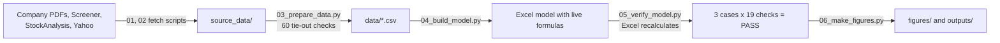

# Project 4 explained simply: how UltraTech's three financial statements fit together

## What this project does

A company reports three statements. The income statement shows profit. The balance sheet shows what the company owns and owes. The cash flow statement shows where the cash went. This project builds all three for UltraTech Cement for five future years (FY2027 to FY2031) in one Excel file, and links them so that one change flows through all three. It runs three stories: Base (what I expect), Bull (things go well) and Bear (things go badly). A balance check proves the statements agree in every year and every story.

The short answer: in the Base case UltraTech earns Rs 337 a share in FY2027 (analysts expect about Rs 326) and Rs 533 by FY2031. Its debt peaks in FY2027, when a big dividend and heavy building spending land in the same year, and then falls fast. In the Bear case it stays safe; it simply earns less.

## Why this company and this data

**Why UltraTech Cement.** A three-statement model is only interesting when the three statements really talk to each other. That happens most clearly in a company that builds plants (capex), carries real debt and pays dividends. UltraTech is India's largest cement maker. In 2026 it is in the middle of a big expansion, from 196.8 to 242.9 million tonnes of yearly capacity by FY2028, and it has loans and bonds that fall due on known dates. Every link in the model therefore matters. It is also a different company from your other projects.

**Why not the obvious alternatives.**

- An IT company like TCS has almost no debt and very little capex, so the balance sheet and debt schedule would be nearly empty.
- A bank does not fit a normal three-statement model; banks are built around loans and deposits.
- A smaller cement company would work, but UltraTech publishes more detail: capacity, volumes, costs per tonne and a dated debt list.

**Why this data.** The company's own audited results PDFs are the most reliable source, so every historical number was typed from them and checked against their subtotals. Screener.in and StockAnalysis.com are second sources to catch typing mistakes. The investor presentations and earnings-call transcripts give the operating facts (capacity, tonnes sold, management guidance).

## How I did it, step by step

1. **Downloaded the sources** (`build/01_fetch_data.py`, `build/02_fetch_filings.py`) into `source_data/`: audited results, presentations, call transcripts, Screener and StockAnalysis pages, Yahoo prices. Why: so every number can be traced back to a saved file.
2. **Typed the audited statements for FY2022-FY2026** into `build/03_prepare_data.py` and checked 60 subtotals (total expenses, profit before tax, total assets and others) against the PDFs. All 60 tie. A second check compares 35 lines with Screener; all are within 1%.
3. **Mapped 41 reported balance-sheet lines into 16 model lines** on the Historical sheet using SUMIF. Why: the forecast needs a short, clean balance sheet.
4. **Chose FY2026 as the base year.** Two acquisitions (Kesoram's cement business and India Cements) joined during FY2025, which distorts FY2025 ratios.
5. **Built the drivers** on the Drivers sheet: three values (Base, Bull, Bear) for each driver, each with a one-line reason. A selector cell (Cover!C6) picks the case, and CHOOSE formulas feed the chosen values to the model.
6. **Built the operating model** (Income_Statement sheet): capacity x utilisation = tonnes sold; tonnes x price per tonne = sales; tonnes x cost per tonne = costs. Why: this is how cement analysts think, and it lets you see what drives profit.
7. **Built capex and fixed assets** (Balance_Sheet sheet): new capacity x cost per tonne of capacity (Rs 432 crore per million tonnes, from the annual report), plus maintenance. Spending first sits in "capital work-in-progress" and becomes fixed assets when plants open. Depreciation is 5% of fixed assets.
8. **Built working capital** from days: customers pay in about 25 days, inventory lasts about 50 days, suppliers are paid in about 52 days.
9. **Built the cash flow statement** (Cash_Flow sheet): profit + depreciation - extra working capital = cash from operations; minus capex; plus or minus debt and dividends = change in cash.
10. **Built the debt schedule** (Debt_Schedule sheet) with the real repayment dates from the annual report, half of each maturity refinanced, and a revolver (a credit line) that borrows automatically if cash would drop below Rs 500 crore and repays as soon as cash allows. Interest uses balances known at the start of each year, so the model has no circular reference.
11. **Closed the loop on the balance sheet**: cash comes from the cash flow statement, debt from the debt schedule, and equity from last year's equity + profit - dividends. If all links are right, assets = equity + liabilities in every year.
12. **Wrote 19 checks** on the Checks sheet (the balance sheet balances, cash on the balance sheet equals cash from the cash flow, roll-forwards tie, debt never negative, no error cells, and more).
13. **Verified in Excel** (`build/05_verify_model.py`): Excel opens the file, recalculates, switches to Bull and Bear and back, and records the checks. Result: 57 of 57 PASS (19 checks x 3 cases). It also builds a live data table showing all three cases side by side.
14. **Made the charts and tables** (`build/06_make_figures.py`, `outputs/`) from the numbers Excel calculated, so the README cannot drift from the model.

## Where every important number came from

The saved news pages (`news_and_macro/*.html`) are copyrighted articles, so they stay on your PC and are not in the GitHub copy. Use the link in the Source column instead.

| Number | Value | Source | File in source_data/ |
|---|---|---|---|
| FY2026 revenue / EBITDA / profit to owners | Rs 88,512 / 17,020 / 8,166 crore | [FY2026 audited results](https://www.ultratechcement.com/content/dam/ultratechcementwebsite/pdf/financials/financial-results/fy26/q4/q4fy26-results.pdf), p.8 | `company_filings/UltraTech_FY26_Audited_Consolidated_Results_extract.pdf` |
| FY2022-FY2025 statements | see the Historical sheet | FY2024 and FY2023 audited results (FY2025 from the FY2026 comparatives) | `company_filings/UltraTech_FY24_Audited_Results.pdf`, `company_filings/UltraTech_FY23_Audited_Results.pdf` |
| Tonnes sold FY2022-FY2026 | 94.0 to 154.3 million tonnes | Q4 results presentations | `company_filings/UltraTech_Q4FY2*_*_extract.pdf` |
| Capacity now and planned | 196.8 MTPA (Mar-2026), 210.1 (Sep-2026), 242.9 by FY2028 | [Q2 FY2027 presentation](https://www.ultratechcement.com/content/dam/ultratechcementwebsite/pdf/financials/investor-update/q2fy27-investor-presentation.pdf), p.12-13 | `company_filings/UltraTech_Q2FY27_Investor_Presentation_19Oct2026_extract.pdf` |
| Cost of new capacity | Rs 16,000 crore for 37 MTPA (about Rs 432 crore per MTPA) | [Annual report FY2025-26](https://www.ultratechcement.com/content/dam/ultratechcementwebsite/pdf/financials/annual-reports/integrated-and-sustainability-report-2025-26-single-page.pdf), p.46-47 | `company_filings/UltraTech_Integrated_Report_FY2025-26_extract.pdf` |
| Debt repayment dates | Rs 1,173 crore (FY2027), 7,979 (FY2028), 1,000 (FY2030), 3,793 (FY2031) | Annual report, note 17, p.509-512 | same file |
| Guidance | Volume growth 7-8% a year; capex Rs 8,000-10,000 crore a year; leverage below 1x | [Q4 FY2026 call](https://www.ultratechcement.com/content/dam/ultratechcementwebsite/pdf/financials/earnings-call/ultratech-cement-limited-earnings-call-transcript-q4fy26.pdf) | `company_filings/UltraTech_Q4FY26_Earnings_Call_Transcript_27Apr2026.pdf` |
| New bonds (NCDs) | Rs 5,000 crore at 7.25%, raised in Q2 FY2027 | [Q2 FY2027 call](https://www.ultratechcement.com/content/dam/ultratechcementwebsite/pdf/financials/earnings-call/q2fy27-earnings-call-transcript.pdf), p.7 | `company_filings/UltraTech_Q2FY27_Earnings_Call_Transcript_19Oct2026.pdf` |
| FY2026 dividend | Rs 240 a share, paid in July 2026 (about Rs 7,058 crore) | [Q4 FY2026 call](https://www.ultratechcement.com/content/dam/ultratechcementwebsite/pdf/financials/earnings-call/ultratech-cement-limited-earnings-call-transcript-q4fy26.pdf), p.5 ("The Board has recommended a dividend of INR240 a share") | `company_filings/UltraTech_Q4FY26_Earnings_Call_Transcript_27Apr2026.pdf` |
| Analyst consensus | FY2027 EPS Rs 325.76 average (Rs 275.91-386.30) | [StockAnalysis forecast](https://stockanalysis.com/quote/nse/ULTRACEMCO/forecast/) | `stockanalysis/UltraTech_Forecast_Analyst_Projections_StockAnalysis.xlsx` |
| Share price | Rs 11,045 (30-Oct-2026 close) | [Yahoo Finance](https://finance.yahoo.com/quote/ULTRACEMCO.NS/history/) | `yahoo_finance/quote_30Oct2026.json` |
| Interest on cash | 5.93% (91-day T-bill, 28-Oct-2026) | [Economic Times](https://economictimes.indiatimes.com/markets/bonds/rbi-accepts-20-bps-higher-treasury-bill-cutoff-yields-than-last-auction/articleshow/135284706.cms) | `news_and_macro/ET_TBill_auction_28Oct2026.html` (local only) |
| RBI repo rate (for the revolver rate) | 5.50% (raised 7-Oct-2026) | [The Hindu](https://www.thehindu.com/business/Economy/rbi-hikes-repo-rate-by-25-basis-points-to-55/article71554369.ece) | `news_and_macro/TheHindu_RBI_repo_hike_7Oct2026.html` (local only) |
| Tax rate | 25.17% (22% + 10% surcharge + 4% cess) | [ClearTax](https://cleartax.in/s/section-115-baa-tax-rate-domestic-companies) | `news_and_macro/ClearTax_section_115BAA.html` (local only) |

## Key assumptions and why

| Assumption | Base value | Why |
|---|---|---|
| Capacity added | 16.3 MTPA (FY2027), 29.8 (FY2028), then 12 a year | The company's own roadmap to 242.9 MTPA by FY2028; 210.1 was already reached by September 2026 |
| Utilisation (share of capacity actually used) | 80-82% | FY2026 was 80%; this gives 7-8% volume growth, matching guidance |
| Price per tonne growth | 4.0% in FY2027, then 2.0% a year | H1 FY2027 revenue per tonne was about 5% above the FY2026 average |
| Power and fuel cost per tonne | +6.0% in FY2027, then +1.5% a year | A fuel price shock in 2026; more green power later |
| Other costs per tonne | +2.5% a year | Close to inflation; freight per tonne was flat over FY2022-FY2026 |
| Cost of new capacity | Rs 432 crore per MTPA | Rs 16,000 crore for 37 MTPA (annual report) |
| Dividend | Rs 240 a share in FY2027, then 50% of last year's profit | The declared FY2026 dividend; about half of profit after that |
| Debt | Half of each maturity refinanced; revolver keeps cash at Rs 500 crore | Management wants leverage below 1x; a revolver is the normal backstop |
| Interest rates | 8.2% on term debt; 8.5% on the revolver | FY2026 finance costs / average borrowings = 8.2%; revolver = repo 5.50% + 3.0% |
| Tax | 25.17% | The statutory rate under section 115BAA |

Bull and Bear change the same drivers. For example, Bull uses 83-85% utilisation and 5.5% price growth in FY2027; Bear uses 75-79% utilisation and 2.0%.

## Words you need to know

| Term | Meaning |
|---|---|
| Three-statement model | A model where the income statement, balance sheet and cash flow statement are linked, so a change in one flows into the others |
| MTPA | Million tonnes per annum: how much cement the plants can make in a year |
| Utilisation | Tonnes actually sold divided by capacity (80% means a fifth of capacity is idle) |
| Realisation | The average price received per tonne of cement |
| EBITDA per tonne | Operating profit before depreciation for each tonne sold; the main profit measure in cement |
| Capex | Capital expenditure: money spent on new plants and equipment |
| CWIP | Capital work-in-progress: money spent on plants that are not finished yet |
| Depreciation (D&A) | The yearly cost of wearing out plants and equipment, spread over their life |
| Working capital | Money tied up in stock and in bills customers have not paid yet, minus bills the company has not paid yet |
| CFO / free cash flow | Cash from operations / that cash minus capex |
| Revolver | A credit line the company can draw and repay as needed, like an overdraft |
| Net debt / EBITDA | Debt minus cash, divided by a year's EBITDA: roughly how many years of profit would repay the debt |
| Interest cover | Operating profit divided by interest cost; higher means safer |
| ROCE | Return on capital employed: operating profit as a share of the money invested in the business |
| Circular reference | A formula loop (interest depends on debt, which depends on cash, which depends on interest); this model avoids it by using balances known at the start of each year |

## How to check the work yourself

1. Open `UltraTech_3Statement_Model.xlsx`. On the Cover sheet the overall check must read **PASS**.
2. Change Cover!C6 to 2 (Bull), then 3 (Bear), then back to 1. The check stays PASS each time and the key outputs change.
3. On Balance_Sheet, find the row "Balance check: assets - equity - liabilities (must be 0)". It shows 0.0 in every year.
4. On Cash_Flow, the cash at the end of each year equals the cash line on the Balance_Sheet.
5. On the Checks sheet, all 19 rows say PASS. For the same test in all three cases, open `outputs/checks_log.csv` (57 rows, all PASS).
6. Compare the FY2026A column of the Historical sheet with the FY2026 results PDF in `source_data/company_filings/`: revenue is Rs 88,511.53 crore and profit to owners Rs 8,165.64 crore.

## How to explain this project in an interview

**30-second version.** "I built a linked three-statement model of UltraTech Cement for FY2027-31 in Excel, driven by cement drivers: capacity, utilisation, price and cost per tonne. Capex comes from the company's capacity plan, the debt schedule uses the actual maturities from the annual report, and a revolver keeps a minimum cash balance without circular references. Base EPS for FY2027 is Rs 337, close to the Rs 326 consensus. Leverage peaks at 1.1x in FY2027 because a Rs 7,000 crore dividend and peak capex land in the same year, then falls to 0.2x. Nineteen checks, including the balance sheet balancing, pass in all three scenarios, verified by recalculating in Excel."

**Likely questions.**

1. *How do you know the balance sheet balances, and what do you do when it doesn't?* Cash is the only plug, and it comes from the cash flow statement. If every balance-sheet movement also appears in the cash flow statement, the sheet balances. When it does not, I compare each balance-sheet change with its cash-flow line year by year until I find the item that is missing or has the wrong sign.
2. *What drives the gap between Bull and Bear?* Profit per tonne. Of the Rs 12,086 crore FY2031 EBITDA gap between Bull and Base, 85% comes from earning Rs 431 more per tonne and only 15% from selling more tonnes. Price is about Rs 6,460 a tonne against cost of about Rs 5,220, so a 3% price move changes the margin by about 15%.
3. *How did you avoid a circular reference in interest?* Term-debt interest uses the average of opening and closing balances, and both depend only on inputs (the maturity schedule and refinancing share). Revolver interest uses the opening balance. Interest therefore never depends on cash that the same year's interest affects.
