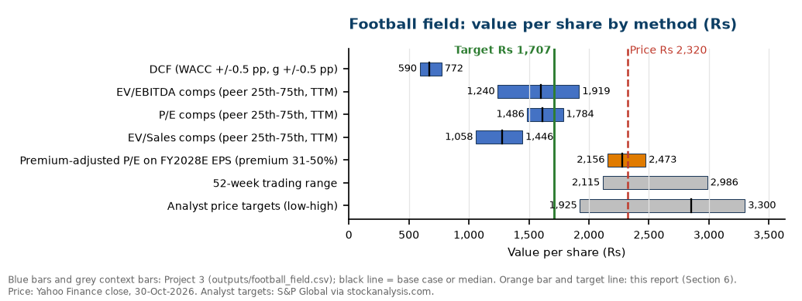
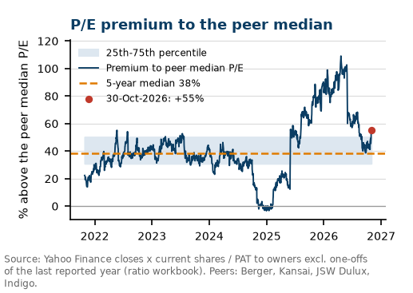
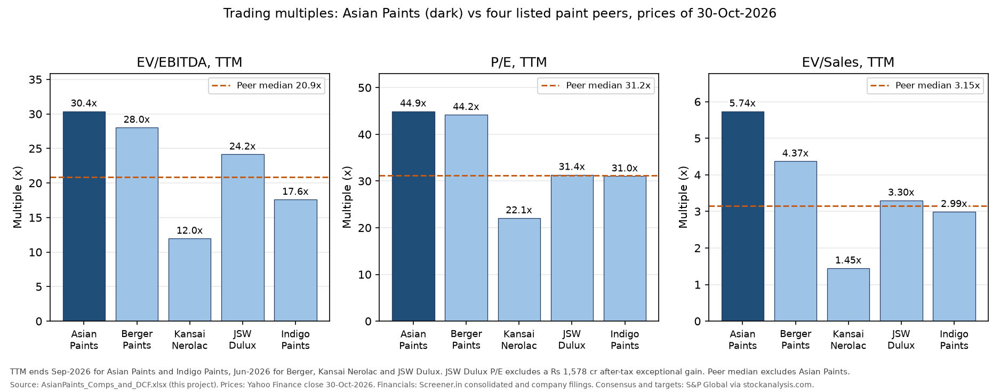
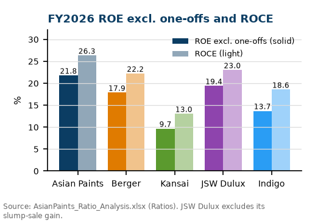
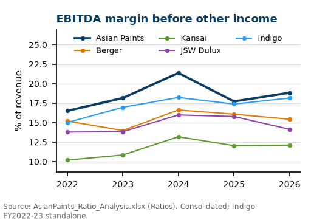
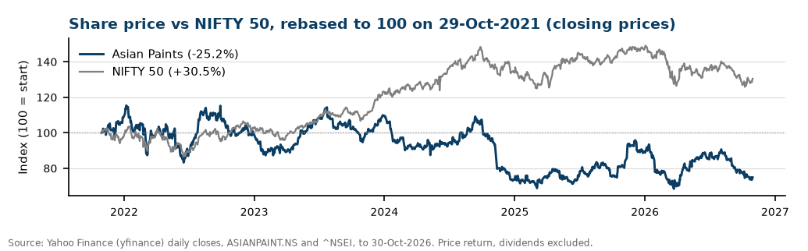

# Project 5: Equity research initiation report on Asian Paints (NSE: ASIANPAINT)

**Rating: SELL. 12-month target ₹1,707, 26.4% below the 30-Oct-2026 close of ₹2,320.**

A 9-page initiation-of-coverage report on Asian Paints, India's largest paint company, built the way a sell-side analyst would: ratio and DuPont benchmarking against four listed peers, a review of the Q2 FY27 results, industry and competition research, risks with numbers attached, forecasts, a valuation and a rating. Asian Paints is still the best business of the five on FY2026 data (ROE excluding one-offs 21.8% against a peer median of 15.8%, ROCE 26.3% against 20.4%), but the price assumes more than that lead is likely to deliver. To justify ₹2,320, Project 3's DCF needs free cash flow to grow 11.05% a year forever after FY2031. The target blends Project 3's DCF (₹668, weight 25%), peer P/E comps (₹1,610, 25%) and a P/E that keeps Asian Paints' 5-year median premium of 38% to its peers (₹2,276, 50%). Every weighting tested puts the target below the price; with no weight on the DCF it is ₹2,109 (-9.1%, a Hold).

Deliverables:
- [report/AsianPaints_Initiation_Report.pdf](report/AsianPaints_Initiation_Report.pdf): the 9-page report (HTML source next to it).
- [AsianPaints_Ratio_Analysis.xlsx](AsianPaints_Ratio_Analysis.xlsx): ratio workbook, live Excel formulas, 70 of 70 checks PASS.
- [explained_simply/README.md](explained_simply/README.md): the plain-language guide to this project.
- [outputs/valuation_summary.csv](outputs/valuation_summary.csv): target price and rating under five weightings.

## What the project shows
- Financial statement analysis: 24 ratios per company, a 3-step and 5-step DuPont split that reconciles to ROE, and working-capital days.
- Peer benchmarking with consistent definitions across five companies (company-reported cost of goods sold, one-off items removed).
- Valuation judgment: reconciling a DCF that sits 71% below the price with peer multiples and the stock's own premium history, using a reverse DCF, weights fixed in writing before the result, and a sensitivity of the rating to those weights.
- A relative-valuation lens computed from scratch: Asian Paints' daily P/E premium to the peer median over 1,236 trading days.
- Excel modelling discipline: inputs in blue with sources, formulas only, a Checks sheet, Excel recalculation and an independent pandas re-computation (1,020 cells matched).
- Research from primary sources (results, presentations, transcript, annual report) plus industry news, consensus and broker views, all cited with links and dates.
- Report production from code: every number in the PDF is read from the workbook outputs, data files and Project 3's outputs, and the PDF text is read back and checked against those files (55 checks).

## Data and sources
All data was downloaded on 1-Nov-2026; prices are 30-Oct-2026 closes. Original files are indexed in [source_data/README.md](source_data/README.md).

| Source | What was used | Link |
|---|---|---|
| Screener.in (consolidated pages and schedules API) | Income statement, balance sheet, cash flow, schedules (inventories, receivables, payables, cash, borrowings, leases, minority interest), shareholding, market cap and P/E | https://www.screener.in/company/ASIANPAINT/consolidated/ |
| NSE XBRL annual results, FY2021-FY2024 | Company-reported cost of materials, purchases of traded goods, inventory change and exceptional items | https://www.nseindia.com |
| Company results PDFs (Q4 FY26, Q2 FY27) | FY2025-FY2026 cost of goods sold and one-offs for all five companies; Q2 FY27 results | NSE announcements (links in source_data/README.md) |
| StockAnalysis.com (S&P Global data) | Current assets and liabilities, cash and short-term investments, cross-checks, consensus estimates, price targets and ratings | https://stockanalysis.com/quote/nse/ASIANPAINT/forecast/ |
| Yahoo Finance via yfinance | Daily closes for the five stocks and the NIFTY 50, 1-Oct-2021 to 30-Oct-2026 | ASIANPAINT.NS, ^NSEI |
| Asian Paints Integrated Annual Report FY2025-26 | Capacity, dealer count, segments, ESG data | https://nsearchives.nseindia.com/annual_reports/AR_29385_ASIANPAINT_2025_2026_A_26278926_12062026160918.pdf |
| Project 3 of this portfolio (comps and DCF on Asian Paints, final 1-Nov-2026, 22 of 22 checks PASS) | FY2027E-FY2031E forecasts, DCF, WACC, reverse DCF, peer multiples and implied values, football-field bars, FY2028E consensus EPS | `03-comparable-company-analysis/outputs/*.csv` and `AsianPaints_Comps_and_DCF.xlsx`; copies in [data/p3/](data/p3/) |
| News and industry pages | Competition (Birla Opus, JSW Dulux, Pidilite), broker reactions, TiO2 duty, monsoon, CCI probe | listed in [data/research_facts.json](data/research_facts.json) |

Companies: Asian Paints, Berger Paints, Kansai Nerolac, JSW Dulux (Akzo Nobel India until 11-Mar-2026) and Indigo Paints, FY2022-FY2026, consolidated. Indigo Paints is standalone for FY2021-FY2023 because it had no subsidiary then.

## Method
- **Cost of goods sold** = cost of materials consumed + purchases of stock-in-trade + change in inventories, as reported. Screener's expense schedule has no purchases line and would understate Asian Paints' FY2026 COGS by about ₹2,250 crore (gross margin 50% instead of 43.8%), so the company filings are used.
- **One-offs**: exceptional items from the filings, plus JSW Dulux's ₹80.8 crore gain on property sales. Adjusted PAT = PAT to owners - one-offs x (PAT / PBT).
- **Ratios** use average balances ((opening + closing) / 2; FY2021 is the opening balance sheet). EBITDA and EBIT exclude other income. ROCE = EBIT excluding one-offs / average (equity + minority interest + borrowings incl. leases).
- **DuPont**: ROE = net margin x asset turnover x equity multiplier (3-step) = tax burden x interest burden x EBIT margin x asset turnover x equity multiplier (5-step). The workbook checks that both products equal ROE.
- **Forecasts and DCF** come from Project 3 and are loaded from its output files by `build/build_report.py` (never typed in), after a cross-check of 60 values against Project 3's recalculated workbook (0 mismatches). FY2027E = H1 FY27 as reported + H2 forecast.
- **Premium-adjusted P/E** (`build/relative_value.py`): for each trading day from 29-Oct-2021 to 30-Oct-2026, P/E = close x today's shares / PAT to owners excluding one-offs of the last reported year (switching on 1 June). Premium = Asian Paints' P/E / median P/E of the four peers - 1. Value = peer median P/E on FY2027E consensus EPS (28.1x) x (1 + 5-year median premium, 38.2%) x FY2028E EPS (₹58.54) = ₹2,276.
- **Target and rating**: target = 25% DCF + 25% peer P/E comps + 50% premium-adjusted P/E. The weights and the reason for each were written down before the target was computed. Buy if upside > +15%, Hold if -10% to +15%, Sell if below -10%.
- **Risk sensitivities**: one-factor arithmetic on FY2026 figures at the 25.17% tax rate (for example, each 1% rise in COGS = ₹200 crore of EBITDA, 3.0%).

## Results

### Valuation and rating

| Component | ₹ per share | Weight | Why this weight |
|---|---|---|---|
| DCF (Project 3: WACC 12.68%, g 6.0%) | 668 | 25% | The only cash-flow method, but biased low here: five explicit years, then 6% growth, an exit at 7.6x EBITDA (below every listed peer) |
| Peer comps, P/E median (Project 3) | 1,610 | 25% | Today's market price for the sector; steady when any one peer is dropped, but the peers earn lower returns |
| Premium-adjusted P/E (this report) | 2,276 | 50% | Matches the 12-month horizon and the premium the market has paid for Asian Paints; not 100% because that premium can shrink |
| **12-month target** | **1,707** | | **-26.4% vs ₹2,320: SELL** |

| Weighting (DCF / comps / relative) | Target (₹) | Upside | Rating |
|---|---|---|---|
| Base case (25 / 25 / 50) | 1,707 | -26.4% | SELL |
| Equal weights (33 / 33 / 33) | 1,518 | -34.6% | SELL |
| DCF-heavy (50 / 25 / 25) | 1,305 | -43.7% | SELL |
| No DCF (0 / 25 / 75) | 2,109 | -9.1% | HOLD |
| Base weights, Asian Paints' own 5-year P/E band (67.6x on FY2027E EPS) instead of the peer premium | 2,335 | +0.7% | HOLD |

Source: [outputs/valuation_summary.csv](outputs/valuation_summary.csv). The own-band row is not used because that band comes from 2021-2023, when the whole sector traded near 77x earnings; the peer median has since fallen to 32.3x. Our target is below the lowest analyst target (₹1,925); the median analyst target of ₹2,850 is 52.8x FY27E consensus EPS.



**Why the DCF is so low.** Project 3's five-year DCF gives ₹668 because growth drops straight to 6% after FY2031 and 77% of the value sits in a terminal value worth 7.6x FY2031E EBITDA. With the peer-median 20.9x exit multiple the same cash flows give ₹1,540. Read in reverse, the ₹2,320 price implies 11.05% growth forever (1.6 points below the WACC), or a value of about 32.8x EBITDA in FY2031, close to today's 30.4x: the market is paying for a high-growth phase well beyond five years, while revenue grew 1.0% a year over FY2023-FY2026.

 

Left: Asian Paints' trailing P/E premium to the peer median (median 38%, now 55%). Right: trading multiples by company (chart from Project 3).

### Forecasts (Project 3) vs consensus

| ₹ crore, consolidated | FY26A | FY27E | FY28E | FY29E |
|---|---|---|---|---|
| Revenue | 35,584 | 41,349 | 44,657 | 48,453 |
| EBITDA | 6,700 | 7,267 | 8,262 | 9,206 |
| EBITDA margin | 18.8% | 17.6% | 18.5% | 19.0% |
| PAT to owners | 4,325 | 5,013 | 5,615 | 6,269 |
| EPS (₹) | 45.09 | 52.27 | 58.54 | 65.36 |
| Consensus EPS (₹) | | 53.94 | 60.40 | |

Project 3's EPS is 3.1% below consensus in both years. Revenue is within 1%; the gap is the H2 FY27 margin (Project 3: 17.0%; consensus EBITDA of ₹7,544 crore implies about 18.1%).

### FY2026 peer comparison (consolidated)

| FY2026 | Asian Paints | Berger | Kansai | JSW Dulux | Indigo | Peer median |
|---|---|---|---|---|---|---|
| Revenue (₹ crore) | 35,584 | 11,880 | 8,052 | 3,599 | 1,405 | |
| Gross margin | 43.8% | 42.5% | 35.5% | 41.4% | 46.5% | 42.0% |
| EBITDA margin | 18.8% | 15.4% | 12.1% | 14.1% | 18.1% | 14.8% |
| ROE excl. one-offs | 21.8% | 17.9% | 9.7% | 19.4% | 13.7% | 15.8% |
| ROCE | 26.3% | 22.2% | 13.0% | 23.0% | 18.6% | 20.4% |
| Asset turnover (x) | 1.10 | 1.24 | 0.95 | 1.07 | 0.92 | 1.01 |
| Net debt / EBITDA (x) | -0.70 | -0.35 | -2.34 | -0.45 | -1.22 | -0.84 |
| Cash conversion cycle (days) | 88 | 82 | 97 | 14 | 54 | 68 |
| Free-cash-flow margin | 15.7% | 8.6% | 8.5% | -30.7% | 6.3% | 7.4% |
| Scorecard place, FY2026 | 1 | 2 | 5 | 4 | 3 | |
| Scorecard place, 5-yr average | 1 | 4 | 5 | 2 | 3 | |

Peer median excludes Asian Paints. JSW Dulux's reported ROE of 104% comes from the gain on its slump sale to AkzoNobel; 19.4% excludes it. Source: [outputs/peer_comparison_fy2026.csv](outputs/peer_comparison_fy2026.csv), [outputs/scorecard.csv](outputs/scorecard.csv).

 

DuPont (FY2026): tax burden 0.72 x interest burden 0.97 x EBIT margin 17.4% x asset turnover 1.10x x equity multiplier 1.59x = ROE 21.2%. Berger: 0.76 x 0.96 x 13.0% x 1.24x x 1.47x = 17.2%. Asian Paints' lead comes from its operating margin, not from debt.

### Q2 FY27 results (29-Oct-2026)

| ₹ crore, consolidated | Q2 FY27 | Q2 FY26 | YoY | H1 FY27 | H1 FY26 | YoY |
|---|---|---|---|---|---|---|
| Net sales | 9,953.9 | 8,513.7 | +16.9% | 20,475.3 | 17,438.2 | +17.4% |
| PBDIT (before other income) | 1,557.1 | 1,503.4 | +3.6% | 3,725.8 | 3,128.3 | +19.1% |
| PBDIT margin | 15.6% | 17.7% | -202 bp | 18.2% | 17.9% | +26 bp |
| PAT after minority interest | 1,067.6 | 993.6 | +7.5% | 2,606.9 | 2,093.4 | +24.5% |

Decorative volume grew 6.4% and value 14.5% in Q2. Standalone gross margin fell 339 bp to 40.3% as raw-material inflation ran ahead of price increases. Management kept its 18-20% standalone EBITDA margin guidance (H1: 19.6%).



## Key takeaways
1. Asian Paints is still the best business in Indian paints on returns, margins and cash: first of five on the FY2026 scorecard and on 5-year averages.
2. The lead has narrowed: ROE excluding one-offs fell from 31.5% (FY2024) to 21.8% (FY2026), EBITDA margin from 21.4% to 18.8%, and revenue grew 1.0% a year over FY2023-FY2026 as Birla Opus and JSW Dulux added capacity.
3. The price assumes the lead lasts: 11.05% perpetual growth in the reverse DCF, and a P/E premium to peers of 55% against a 5-year median of 38%.
4. The SELL rating does not hinge on one method: every weighting tested gives a target below ₹2,320. A Hold needs either no weight on the DCF or a return to the 2021-2023 sector multiples.
5. What would change the view: an EBITDA margin back above 20% with 8-10% volume growth, or evidence that the new entrants are cutting discounts.

## Limitations
- The weights are a judgment, fixed before the result but still a judgment; the sensitivity table shows how much they matter.
- The DCF and comps values are as of 30-Sep / 30-Oct-2026 and are not rolled forward 12 months.
- The P/E history uses the last reported annual PAT (switching on 1 June), not quarterly trailing earnings, so the premium jumps when a new year's results arrive; the 5-year median smooths this.
- Peer multiples cover four smaller companies; three peers' trailing figures end Jun-2026 (Project 3 flags this).
- Consensus comes from one aggregator (S&P Global via StockAnalysis.com); FY2028E consensus EPS is as collected by Project 3.
- Market-share figures for the industry are third-party estimates (press reports), not audited data.
- The Q2 FY27 earnings-call transcript was not yet filed on 1-Nov-2026; the call is covered from the press release, presentation and published call summaries.
- JSW Dulux's FY2026 figures are distorted by the sale of two divisions to AkzoNobel; adjusted figures remove the gains but not the lost revenue.

## How to reproduce
Windows with Python 3.12+ (`pip install -r requirements.txt`), Microsoft Excel (for recalculation and verification through COM) and Microsoft Edge (for the PDF). The `data/` snapshots, including the copies of Project 3's outputs in `data/p3/`, are included, so steps 2-6 run offline.

```
python build/fetch_screener.py; python build/fetch_stockanalysis.py; python build/fetch_xbrl.py
python build/fetch_nse_filings.py; python build/fetch_prices.py; python build/fetch_news.py   # 1. optional: re-download (internet)
python build/prepare_data.py           # 2. tidy inputs -> data/ratio_inputs.csv
python build/build_ratio_workbook.py   # 3. AsianPaints_Ratio_Analysis.xlsx (live formulas)
python build/verify_workbook.py        # 4. Excel recalculation (COM), error scan, 70 checks, 1,020 cells vs ratio_engine.py
python build/build_report.py --p3-dir ../03-comparable-company-analysis   # 5. loads Project 3 (or data/p3/ if absent),
                                       #    relative value, target, figures/, report/*.html and *.pdf, PDF read-back check
python build/export_source_xlsx.py     # 6. Excel copies of the Screener and StockAnalysis tables in source_data/
python build/trim_source_data.py       #    only after a re-download: shrink source_data/ below 40 MB
```

Logs to check: `outputs/verification_log.txt` (workbook) and `outputs/report_build_log.txt` (Project 3 cross-check PASSED, CHECK PASSED, 0 placeholders, 9 pages).

## Folder layout
```
AsianPaints_Ratio_Analysis.xlsx   ratio workbook (Cover, Raw_Data, Ratios, DuPont, Peer_Comparison, Charts, Conclusion, Checks)
report/                           the initiation report: HTML + PDF
build/                            fetch, prepare, workbook, verification, relative-value, report, export and trim scripts
data/                             tidy inputs (CSV/JSON) read by the scripts; data/p3/ = copies of Project 3's outputs
outputs/                          ratio tables, scorecard, checks, valuation summary, P/E premium history, build logs
figures/                          PNG charts used in the report and this README (p3_ = from Project 3)
source_data/                      original downloaded files with an index (README.md)
explained_simply/                 plain-language guide
```

Educational project, not investment advice. The author holds no position.
