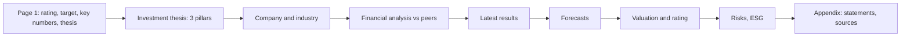

# Project 5 explained simply: an equity research report on Asian Paints

## What this project does
This project writes an "initiation of coverage" report on Asian Paints, the kind of report a broker's analyst publishes the first time they cover a stock. It compares Asian Paints with four other listed paint companies using ratios, explains the business, the industry and the latest results, lists the risks with numbers, and ends with a valuation and a rating. The result is **SELL, with a 12-month target of ₹1,707, 26.4% below the price of ₹2,320 on 30-Oct-2026**. Everything in the report is produced by code from saved data, so you can trace every number back to a file.

## Why Asian Paints, and why not something else
- **It is a real debate.** Asian Paints is the clear market leader with the best returns, but two big groups have entered the market since 2024 (Grasim's Birla Opus, and JSW, which bought Akzo Nobel India and renamed it JSW Dulux). The share price fell 25% in five years while the NIFTY 50 rose 30%. Is the quality still worth the price? That makes a Buy/Hold/Sell call worth arguing.
- **It combines the earlier projects.** The brief for Project 5 is to bring Projects 1-3 together: ratio analysis (like your two-wheeler Project 1), and comps plus DCF (Project 3, which is also on Asian Paints and feeds the valuation here).
- **It is different from your other work.** Your TCS DCF (Project 2) is IT services and Project 1 is two-wheelers. Paints is a consumer business with dealers, brands and crude-linked raw materials, so it shows a different set of skills.
- **Why not Pidilite, Berger or a bank?** Pidilite is mainly adhesives, so its numbers would not compare cleanly. Berger is a good company but smaller and less debated. Banks need different ratios (no gross margin, no inventory days).

## How an initiation report is laid out

Page 1 is the most important: a busy fund manager reads only that. The rest of the report backs it up.

## How I did it, step by step
1. **Downloaded the financial statements** for the five companies from Screener.in (statements and line-item schedules) and StockAnalysis.com (S&P Global data). Files: `build/fetch_screener.py`, `build/fetch_stockanalysis.py`. Why: two sources let us cross-check each other.
2. **Downloaded the companies' own filings**: annual results in XBRL format from NSE (FY2021-FY2024) and the results PDFs for FY2025-FY2026. Files: `build/fetch_xbrl.py`, `build/fetch_nse_filings.py`. Why: Screener misses "purchases of traded goods", which would make Asian Paints' gross margin look like 50% instead of the real 43.8%.
3. **Cleaned the data into one table** of inputs per company and year. File: `build/prepare_data.py` -> `data/ratio_inputs.csv`. Why: every ratio then uses the same definitions for all five companies.
4. **Built the Excel workbook** with live formulas. File: `build/build_ratio_workbook.py` -> `AsianPaints_Ratio_Analysis.xlsx`, sheets Raw_Data (inputs in blue with sources), Ratios, DuPont, Peer_Comparison, Charts, Conclusion, Checks. Why: an Excel model that anyone can open and change.
5. **Verified the workbook**: Excel recalculated it, a script scanned all cells for errors, and a separate pandas program (`build/ratio_engine.py`) recomputed all 1,020 ratio cells. File: `build/verify_workbook.py` -> `outputs/verification_log.txt`. Why: two independent calculations that agree are strong evidence that the formulas are right.
6. **Ranked the companies** with a weighted scorecard (Peer_Comparison sheet, section C). The weights (for example ROE 20%, ROCE 20%) were set before looking at the results, with a reason next to each.
7. **Researched the story**: results press release and investor presentation, the Q4 FY26 earnings-call transcript, the annual report, and news on competition, raw materials and the monsoon. File: `data/research_facts.json` (every fact with its link and date).
8. **Typed in the Q2 FY27 results** from the press release with page numbers. File: `data/asianpaints_q2fy27_results.csv`.
9. **Downloaded prices** for the five stocks and the NIFTY 50 from Yahoo Finance. File: `build/fetch_prices.py` -> `data/prices/`.
10. **Loaded Project 3's valuation** (forecasts, DCF, peer multiples). File: `build/build_report.py`, function `load_p3()`. It copies Project 3's output files to `data/p3/` and checks 60 of their numbers against Project 3's Excel workbook (0 differences). Why: the numbers are read from files, never retyped, so they cannot drift.
11. **Built a third valuation lens**: Asian Paints' P/E premium to its peers, day by day for five years. File: `build/relative_value.py` -> `outputs/pe_premium_history.csv`, `outputs/relative_value.csv`. Why: the DCF says ₹668 and the peers say ₹1,610, but both ignore that the market has always paid extra for Asian Paints. This lens asks: if it keeps its usual premium, what is it worth?
12. **Wrote down the weights before calculating the target** (25% DCF, 25% peer comps, 50% premium-adjusted P/E, each with a reason in `WEIGHTS` and `WEIGHT_WHY` at the top of `build_report.py`), then computed the target and applied the rating rule. Output: `outputs/valuation_summary.csv`. Why: so the weights cannot be tuned to get a wanted answer.
13. **Built the report from code.** `build/build_report.py` draws the charts (`figures/`), writes the HTML and prints it to PDF with Microsoft Edge. The narrative was written for a SELL; if the rule ever gives a different rating, the build check fails.
14. **Checked the PDF**: the script reads the PDF text back and confirms 55 items, from the price and ROE to every Project 3 forecast, the DCF range, the target and the sensitivity rows. Log: `outputs/report_build_log.txt`. I also looked at all 9 pages for cut tables, overlapping charts and blank pages.
15. **Kept the source files small enough for GitHub**: `build/trim_source_data.py` compresses big PDFs (text unchanged), keeps only the used pages of the 294-page annual report and moves unused downloads off the repository (36.6 MB left, limit 40 MB). `build/export_source_xlsx.py` saves Excel copies of the web tables.

## Where every important number came from

Files in `news_and_macro/` that end in `.html` are saved news articles: they are copyrighted, so they stay on my PC and are not in the GitHub copy; `source_data/README.md` lists each one with its link.

| Number | Value | Source | File in source_data/ |
|---|---|---|---|
| Share price, 30-Oct-2026 | ₹2,320.00 | [Yahoo Finance ASIANPAINT.NS](https://finance.yahoo.com/quote/ASIANPAINT.NS/history/) | yahoo_finance/ASIANPAINT.NS.csv |
| NIFTY 50, 30-Oct-2026 | 23,053.10 | [Yahoo Finance ^NSEI](https://finance.yahoo.com/quote/%5ENSEI/history/) | yahoo_finance/IDX_NSEI.csv |
| Market cap | ₹222,534 crore | [Screener.in](https://www.screener.in/company/ASIANPAINT/consolidated/) | screener/raw/ASIANPAINT_consolidated.html |
| FY2026 revenue | ₹35,584 crore | [Screener.in](https://www.screener.in/company/ASIANPAINT/consolidated/) (matches the company's ₹35,583.54 crore) | screener/AsianPaints_Screener_Consolidated.xlsx |
| FY2026 cost of goods sold | ₹20,001.78 crore | [Q4 FY26 results PDF](https://nsearchives.nseindia.com/corporate/ASIANPAINT_29052026140521_SEIntimationoutcomeFY26.pdf), page 16 | company_filings/AsianPaints_Q4FY26_Results_and_Press_Release_29May2026.pdf |
| FY2026 ROE excl. one-offs | 21.8% | Calculated in the workbook (Ratios sheet) | (calculated) |
| FY2026 ROCE | 26.3% | Calculated in the workbook (Ratios sheet) | (calculated) |
| Q2 FY27 net sales | ₹9,953.9 crore | [Q2 FY27 results and press release](https://nsearchives.nseindia.com/corporate/ASIANPAINT_29102026140213_OutcomeofBM29102026signed.pdf), page 18 | company_filings/AsianPaints_Q2FY27_Results_and_Press_Release_29Oct2026.pdf |
| Q2 FY27 PAT | ₹1,067.6 crore | Same press release, page 18 | same file |
| Decorative volume growth, Q2 | 6.4% | Same press release, page 17 | same file |
| Standalone gross margin, Q2 | 40.3% | [Q2 FY27 investor presentation](https://nsearchives.nseindia.com/corporate/ASIANPAINT_29102026164544_SEIntimation_Investor_Presentation_Q2FY26-27pdfsigned.pdf), page 26 | company_filings/AsianPaints_Q2FY27_Investor_Presentation_29Oct2026.pdf |
| Consensus FY27E EPS | ₹53.94 (30 analysts) | [StockAnalysis.com forecast](https://stockanalysis.com/quote/nse/ASIANPAINT/forecast/) | stockanalysis/raw/ASIANPAINT_forecast.html |
| Consensus price targets | low ₹1,925, average ₹2,756, median ₹2,850, high ₹3,300 | same page | same file |
| DCF value | ₹668 (range ₹590-772) | Project 3, `outputs/dcf_summary.csv` (workbook cell DCF!B64) | data/p3/dcf_summary.csv (copy) |
| WACC and terminal growth | 12.68% and 6.0% | Project 3, `outputs/dcf_summary.csv` | data/p3/dcf_summary.csv |
| Growth the price implies (reverse DCF) | 11.05% a year forever | Project 3, `outputs/dcf_summary.csv` | data/p3/dcf_summary.csv |
| Peer P/E comps value | ₹1,610 (25th-75th: ₹1,486-1,784) | Project 3, `outputs/implied_values.csv` | data/p3/implied_values.csv |
| FY2028E EPS | ₹58.54 | Project 3, `outputs/dcf_forecast.csv` | data/p3/dcf_forecast.csv |
| 5-year median P/E premium to peers | 38.2% | Calculated by `build/relative_value.py` from Yahoo prices and the workbook's PAT | outputs/relative_value.csv |
| Premium-adjusted value | ₹2,276 | 28.1x x (1 + 38.2%) x ₹58.54 | outputs/relative_value.csv |
| 12-month target and rating | ₹1,707, SELL | 25% x 668 + 25% x 1,610 + 50% x 2,276 | outputs/valuation_summary.csv |
| Dealers billed in FY2026 | 72,873 | [Annual Report FY2025-26](https://nsearchives.nseindia.com/annual_reports/AR_29385_ASIANPAINT_2025_2026_A_26278926_12062026160918.pdf), page 165 | company_filings/AsianPaints_Annual_Report_FY2025-26_extract.pdf |
| Birla Opus revenue share | about 10% | [BusinessWorld, 31-Oct-2026](https://www.businessworld.in/article/grasim-industries-targets-rs-2-lakh-cr-revenue-in-fy27-birla-620427) | news_and_macro/2026-10-31_BusinessWorld_Grasim_BirlaOpus_share.html (local only) |
| Paint industry size | about ₹77,500 crore (FY2025) | [Kansai Nerolac Q4 FY26 release](https://nsearchives.nseindia.com/corporate/KANSAINER_06052026164550_Outcome_BM_6that_may_2026signed.pdf) | company_filings/peers/KansaiNerolac_Q4FY26_Results_extract.pdf |
| Broker target cuts after Q2 | Jefferies ₹3,025, Goldman ₹2,375 | [Economic Times, 30-Oct-2026](https://economictimes.indiatimes.com/markets/stocks/news/asian-paints-shares-in-focus-as-jefferies-goldman-sachs-other-brokerages-cut-target-prices-after-q2-results-buy-sell-or-hold/articleshow/135342271.cms) | news_and_macro/2026-10-30_ET_AsianPaints_broker_target_cuts.html (local only) |
| USD/INR | 95.15 | Yahoo Finance INR=X close, 30-Oct-2026 (shared macro table) | (shared input) |

## Key assumptions and why

| Assumption | Value | Why |
|---|---|---|
| Cost of goods sold = materials + traded goods + inventory change, from the filings | FY2026 AP ₹20,002 crore | Screener has no purchases-of-traded-goods line and understates COGS by about ₹2,250 crore |
| Remove one-off items from "adjusted" ROE, margins and P/E | e.g. JSW Dulux's ₹1,846 crore slump-sale gain | One-offs are not repeatable; JSW's reported ROE of 104% would otherwise look like the best |
| Averages of opening and closing balances | FY2021 balance sheet = opening for FY2022 | Profit is earned over a year, so compare it with the average capital in that year |
| Leases counted as debt | AP leases ₹1,636 crore in FY2026 | Under Ind AS 116 leases are a financing obligation |
| Scorecard weights fixed before the results | ROE 20%, ROCE 20%, EBITDA margin 15%, ... | So the ranking cannot be tuned to a wanted answer |
| Target weights fixed before the result | DCF 25%, peer comps 25%, premium-adjusted P/E 50% | The DCF is biased low for a long-runway business; peers are weaker businesses; the premium lens matches how the market prices Asian Paints but the premium can shrink |
| Use the premium to peers, not Asian Paints' own P/E history | 38.2% median premium | The whole sector's P/E fell from 77.5x to 32.3x in five years; using Asian Paints' old 67.6x would assume the sector re-rates |
| Peer comps anchor | P/E, not EV/EBITDA | Project 3 found the P/E result barely moves when any one peer is dropped (₹1,602-1,618) |
| DCF inputs (Project 3) | WACC 12.68%, terminal growth 6.0% | Project 3's choices; Section 6 of the report explains why they give a low value |
| Tax rate for sensitivities | 25.17% | New-regime corporate tax (22% + surcharge + cess) |
| Share of COGS priced in US dollars | 30% (illustration only) | Not disclosed; used only for the rupee sensitivity and labelled as an assumption |
| Indigo Paints FY2021-FY2023 standalone | | It had no subsidiary then, so standalone = consolidated |

## Words you need to know
- **Initiation report**: the first research report an analyst writes on a company, with a full analysis and a rating.
- **Target price**: what the analyst thinks the share will be worth in 12 months.
- **Upside**: target price / current price - 1. Here ₹1,707 / ₹2,320 - 1 = -26.4% (a downside).
- **ROE (return on equity)**: profit / shareholders' money. How hard the owners' money works.
- **ROCE (return on capital employed)**: operating profit (EBIT) / all capital (equity + debt). Independent of how the company is financed.
- **EBITDA margin**: profit before interest, tax, depreciation and other income, as a % of revenue.
- **DuPont analysis**: splits ROE into margin x asset turnover x leverage to show where the return comes from.
- **Cash conversion cycle**: inventory days + receivable days - payable days. How long cash is tied up in the business.
- **One-off (exceptional) item**: a gain or loss that will not repeat, such as selling a building.
- **Consensus**: the average forecast of all analysts covering the stock.
- **DCF (discounted cash flow)**: value = future cash flows brought back to today at the cost of capital (Project 3).
- **Terminal value**: the value of all cash flows after the last forecast year, usually most of a DCF (77% here).
- **WACC**: the average return that lenders and shareholders require; the DCF's discount rate (12.68% here).
- **Reverse DCF**: instead of asking "what is it worth?", ask "what growth does today's price assume?" (11.05% a year forever here).
- **Comps (comparable companies)**: value a company at the multiples (P/E, EV/EBITDA) that similar companies trade at (Project 3).
- **P/E ratio**: share price / earnings per share. 45x means investors pay ₹45 for each ₹1 of yearly profit.
- **P/E premium**: how much higher a company's P/E is than its peers'. Asian Paints' 5-year median is 38%.
- **Football field**: a chart with one bar per valuation method, so you can see all the value ranges against the price at once.

## How to check the work yourself
1. Open `AsianPaints_Ratio_Analysis.xlsx`. The **Cover** sheet must say checks **PASS, 70 of 70**. The **Checks** sheet lists each test (balance sheets balance, DuPont product = ROE, no error cells) and each must say PASS.
2. On **Raw_Data**, pick any blue input, read its source in column J, and find it in the file in `source_data/` (the Excel exports in `source_data/screener/` and `source_data/stockanalysis/` are easiest).
3. Read `outputs/verification_log.txt`: "0 error values", "70 checks, 0 FAIL", "1020 cells compared ... worst relative gap 0.00e+00".
4. Read `outputs/report_build_log.txt`: "P3 CROSS-CHECK PASSED" (60 values against Project 3's workbook), 55 lines starting with OK, "P3 placeholders still in the PDF: 0" and "CHECK PASSED".
5. Recompute the target by hand from `outputs/valuation_summary.csv`: 0.25 x 667.64 + 0.25 x 1,610 + 0.50 x 2,275.98 = 1,707.4. Then 1,707.4 / 2,320 - 1 = -26.4%, below -10%, so SELL.
6. Open `outputs/pe_premium_history.csv` in Excel: the median of the `ap_premium` column is 0.382.
7. In the PDF, compare page 1's key-financials table with Appendix A and with `outputs/ratios_fy2022_fy2026.csv`.

## How the rating was decided
The rule was written down in phase 1, before any valuation existed: Buy if the target is more than 15% above today's price, Hold if it is between 10% below and 15% above, Sell if it is more than 10% below. In phase 2 I took three values. Project 3's DCF says ₹668: on its cash flows the share is worth far less than ₹2,320, because the model assumes growth slows to 6% after five years. Peer companies' P/E multiples say ₹1,610. And a third lens says ₹2,276: what Asian Paints is worth if it keeps the 38% P/E premium over peers that the market has paid on average for five years, applied to next year's earnings. I chose the weights before adding them up (25%, 25%, 50%), and the mix is ₹1,707, 26.4% below the price, so the rule says SELL. I also tried other weights: equal weights give ₹1,518 and leaving the DCF out gives ₹2,109 (-9.1%, a Hold). So the answer is "the stock is priced above what these methods support", and how far above depends on how much you trust the DCF. A Buy would need the sector's 2021-2023 multiples to come back.

## How to explain this project in an interview
**30-second version:** "I wrote an initiation report on Asian Paints and rated it Sell with a ₹1,707 target, 26% below the price. I benchmarked it against four listed peers on 24 ratios and a DuPont split in an Excel model with 70 automated checks. It is still the best business, 21.8% ROE excluding one-offs against a 15.8% peer median, but the lead has narrowed as Birla Opus and JSW Dulux entered. A reverse DCF shows the price needs 11% cash-flow growth forever. I blended a DCF, peer comps and the stock's own 5-year premium to peers, with weights fixed in advance, and showed how the rating changes with the weights."

**Q: Why did you not use Screener's cost of materials for gross margin?**
A: Screener's schedule has no line for purchases of traded goods. For Asian Paints that understates COGS by about ₹2,250 crore, which would show a 50% gross margin instead of 43.8%. I took COGS from the companies' own filings for all five peers so the comparison is fair.

**Q: Your target is below every analyst's. Why trust it?**
A: Because the gap is explained, not hidden. Analysts' median target of ₹2,850 is 52.8x this year's consensus EPS, above where the stock trades today. My target gives the DCF a 25% weight; with no DCF weight it would be ₹2,109, still below the price. The weights were fixed before I saw the result, and the report shows the target under four other settings.

**Q: If Asian Paints is the best business, why Sell?**
A: A great company can be a poor investment if the price assumes too much. Returns fell from 31.5% to 21.8% ROE in two years, revenue grew about 1% a year over FY2023-FY2026, and its P/E premium to peers is 55% against a 38% five-year norm. The rating is about the price, not the quality.
