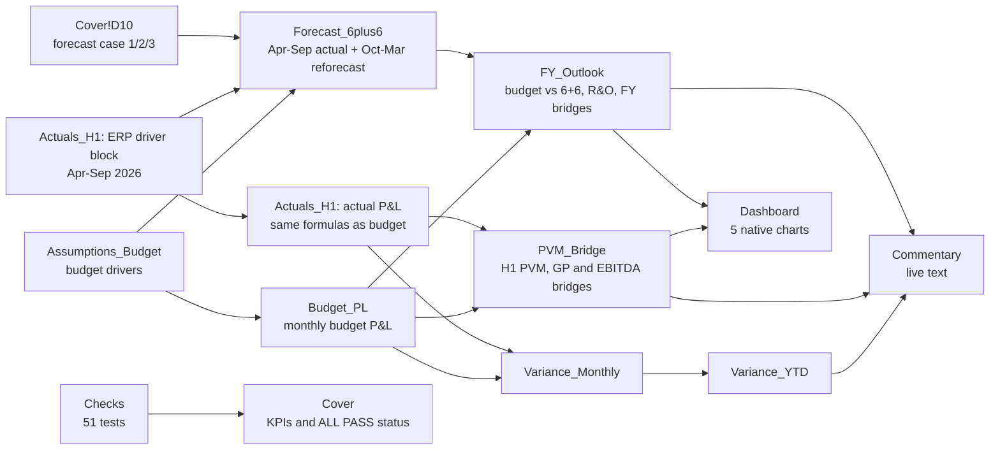
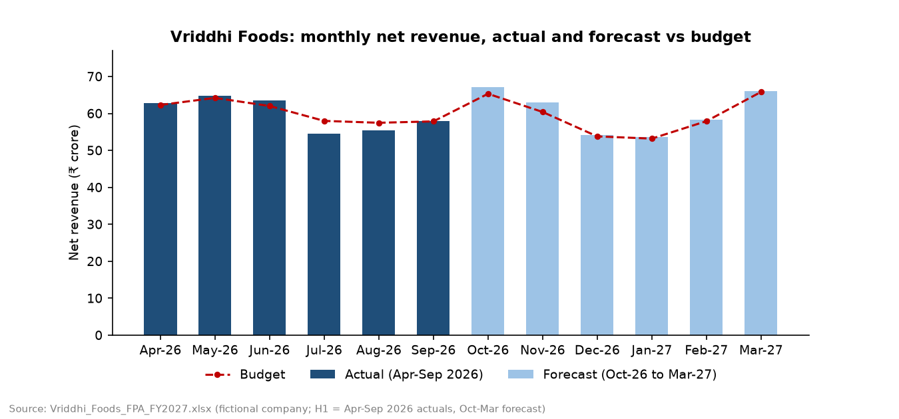
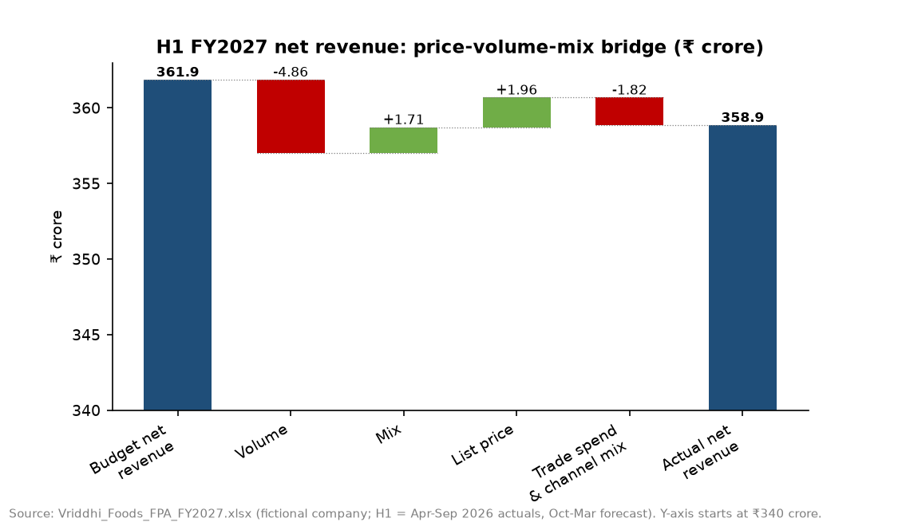
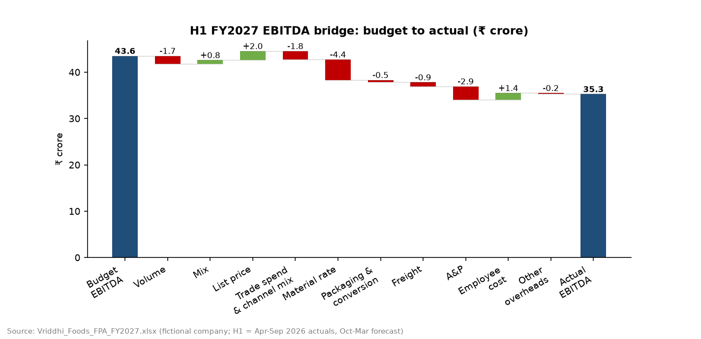
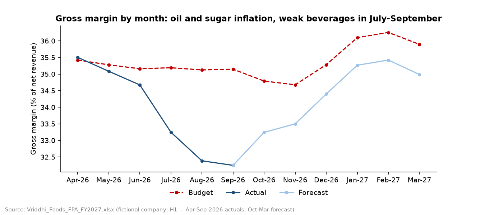
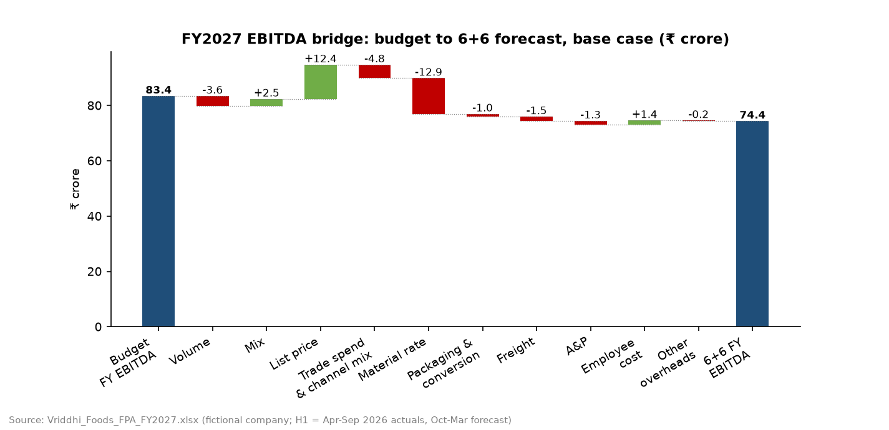

# FP&A: FY2027 budget, H1 variance analysis and 6+6 reforecast for Vriddhi Foods (fictional)

Vriddhi Foods Pvt. Ltd. is a fictional Indian packaged-foods company (namkeen and chips, biscuits and cookies, beverages) with a FY2027 budget of ₹718 crore net revenue. The Excel model builds a monthly driver-based budget, calculates the April-September 2026 actuals from an ERP-style driver extract, explains every variance with price-volume-mix and margin bridges, and rolls the year forward as a 6+6 forecast (6 months of actuals plus 6 months of forecast). **H1 EBITDA was ₹35.3 crore against a budget of ₹43.6 crore (-₹8.2 crore, -18.9%), while net revenue was only 0.8% below budget.** Input-cost inflation explains ₹4.4 crore of the gap (edible oil ₹3.9 crore, sugar ₹1.1 crore) and advertising overspend ₹2.9 crore. The 6+6 forecast puts FY2027 EBITDA at ₹74.4 crore against ₹83.4 crore budget (-10.9%), or ₹72.9 crore after probability-weighted risks and opportunities. All 51 model checks pass, and an independent Python re-computation gives the same numbers as Excel.

Main file: [`Vriddhi_Foods_FPA_FY2027.xlsx`](Vriddhi_Foods_FPA_FY2027.xlsx). Plain-language guide: [`explained_simply/README.md`](explained_simply/README.md).

## What FP&A is

Financial planning and analysis (FP&A) is the finance team that plans the year and explains the results. It sets the annual budget, compares actual results with the budget every month, explains each gap in terms the business can act on (we sold less, we sold a cheaper mix, we paid more for oil), and updates the full-year forecast as the year goes on. This project runs that cycle for one year of a mid-sized food company: a budget set in February 2026, six months of actuals, and a reforecast at the end of October 2026.

## What the project shows

- Driver-based budgeting: volume × list price × channel mix, trade spend by channel, bill of materials × input prices, payroll by function, and monthly phasing with festive seasonality.
- Variance analysis by month and year to date, with favourable/unfavourable (F/U) sign logic and conditional formatting.
- Price-volume-mix (PVM) analysis of net revenue, plus gross-profit and EBITDA bridges that reconcile exactly to the P&L.
- A 6+6 reforecast with three cases (base, downside, upside) and a register of quantified risks and opportunities.
- Management commentary in the style of a monthly FP&A pack, where every number in the text is a live formula.
- Model discipline: live formulas only, colour-coded inputs, 51 automated checks, an independent Python re-computation and a driver-change test.
- Anchoring a fictional plan to real 2026 facts (festival dates, monsoon, commodity prices, GST, quick commerce, the RBI rate rise) and to the margins of listed peers.

## The business (fictional)

| Product line | FY2027 budget volume (t) | Budget list price (₹/kg, ex-GST) | Budget channel mix GT / MT / E-com & QC | FY2027 budget net revenue (₹ crore) |
|---|---:|---:|---|---:|
| Namkeen & chips | 14,000 | 238 | 64% / 20% / 16% | 296.8 |
| Biscuits & cookies | 21,000 | 138 | 70% / 18% / 12% | 259.6 |
| Beverages (juices & RTD) | 24,000 | 76 | 58% / 26% / 16% | 161.9 |
| **Total** | **59,000** | | | **718.3** |

- Channels: General Trade (GT, kirana stores served through distributors), Modern Trade (MT, supermarket chains) and E-commerce & quick commerce (E-com & QC). Budget trade spend is 8% of gross sales in GT (9% in October-November), 14% in MT and 18% in E-com & QC.
- Fiscal year FY2027 = April 2026 to March 2027. Status date 31-Oct-2026: April-September actuals are closed and October-March is forecast.
- Why a fictional company: listed companies do not publish monthly budgets or driver-level actuals, so a "real" version would still need an invented budget. Here every business number is invented and labelled as such; the outside context is real and cited.

## Model map



| Sheet | What it holds |
|---|---|
| Cover | Purpose, KPI summary, forecast case selector (D10), check status (D11), how to use, H1 storyline, the 15 cited real-world facts |
| Assumptions_Budget | Budget drivers by month: volumes and seasonality, channel mix, list prices, trade-spend rates, input prices, bill of materials, unit costs, A&P, payroll, overheads, D&A, borrowings, tax; listed-peer benchmarks (section 6) |
| Budget_PL | Monthly budget P&L with H1/H2/FY totals, plus supporting calculations (volume, sales and trade spend by line and channel, material by input, unit economics) |
| Actuals_H1 | ERP-style block of actual drivers for April-September (rows 144-200) and the actual P&L calculated from it with the budget's formulas |
| Forecast_6plus6 | April-September linked to actuals; October-March reforecast drivers (rows 148-229) and the case overlays |
| Variance_Monthly | Actual minus budget for each month, % variance and F/U flags, colour-coded |
| Variance_YTD | September month and year to date (April-September) versus budget |
| PVM_Bridge | H1 net revenue PVM, gross-profit bridge and EBITDA bridge, with five workings tables by product line and input |
| FY_Outlook | FY budget vs 6+6 forecast by line (H1, H2, FY), risks and opportunities, FY bridges |
| Dashboard | Native Excel charts: monthly revenue (budget, actual, forecast), gross margin %, H1 EBITDA waterfall, variance by line, PVM |
| Commentary | Monthly pack commentary; each sentence is a formula and names the cells it uses |
| Checks | 51 integrity tests with PASS/FAIL, summarised on the Cover |

## Data and sources

The business is fictional, so the "data" are the real-world facts used to set or test the assumptions. Saved copies of every page and export (downloaded 01-Nov-2026) are indexed in [`source_data/README.md`](source_data/README.md). The GitHub copy keeps the government PDF and the Screener data; the saved news and web pages are copyrighted, so only their links are published. The same list is on the Cover sheet and in `data/external_reference_facts.csv`.

| Fact | Value used | Source | Used for |
|---|---|---|---|
| Navratri and Dussehra 2026 | Navratri 11-19 Oct; Dussehra 20-Oct-2026 | [Times of India](https://timesofindia.indiatimes.com/religion/festivals/navratri-2026-start-end-date-is-ghatasthapana-on-october-10-or-11-check-the-full-tithi-schedule/articleshow/134767429.cms), [Economic Times](https://economictimes.indiatimes.com/news/new-updates/navratri-2026-date-and-time-check-all-dates-9-colours-forms-of-goddess-durga-puja-muhurat/articleshow/134849399.cms) | October festive load in the budget seasonality; namkeen forecast +3% in October |
| Diwali 2026 | Lakshmi Puja on Sunday 8-Nov-2026 | [Drik Panchang](https://www.drikpanchang.com/festivals/lakshmipuja/festivals-lakshmipuja-timings.html?year=2026), [Economic Times](https://economictimes.indiatimes.com/astrology/others/diwali-2026-date-when-is-diwali-check-lakshmi-puja-muhurat-significance-and-5-day-festival-calendar/articleshow/135254249.cms) | November festive load; namkeen forecast +5% in November |
| 2026 monsoon | June 40% below the long-period average, July 103%, August 84% | [ICRA, 01-Sep-2026](https://www.icra.in/Research/ViewResearchReport/deficient-rainfall-inflation-risks-and-weak-crop-output-prospects-cloud-outlook-for-rural-demand-in-h2-fy2027/7096) | Beverage stock loading in June and destocking in July-September; weak rural demand in H2 |
| FMCG demand, Apr-Jun 2026 | Volume -2% YoY, rural volume -5%, e-commerce volume +34.8% | [Moneycontrol (NIQ data), 27-Sep-2026](https://www.moneycontrol.com/news/business/macro-headwinds-rising-input-costs-impact-fmcg-volumes-in-june-quarter-niq-14039279.html) | General Trade slowdown; quick-commerce growth |
| Category growth | Snacks 8.28% CAGR 2026-2034; namkeen 10.2% CAGR 2025-2030; juices 8.52% CAGR 2026-2033 | [IMARC](https://www.imarcgroup.com/india-snacks-market), [Technavio](https://www.technavio.com/report/namkeen-market-industry-in-india-analysis), [Grand View Research](https://www.grandviewresearch.com/horizon/outlook/fruit-and-vegetable-juice-market/india) | Budget volume growth of 6-9% by line |
| Edible oil | Retail palm oil ₹153.89/kg on 23-Sep-2026 (+16.3% YoY); import duty on crude palm and soybean oil cut from 10% to 5% on 24-Sep-2026 (effective 16.5% to 11%) | [Mint](https://www.livemint.com/economy/centre-cuts-import-duty-on-edible-oils-to-curb-price-rise-11790184261562.html), [The Hindu](https://www.thehindu.com/business/Industry/ahead-of-festivals-centre-cuts-import-duty-on-edible-oils/article71504736.ece), [Financial Express](https://www.financialexpress.com/policy/economy-edible-oil-duty-cut-may-put-8-retail-price-hikes-on-hold-4346955/) | Actual oil path ₹112 to ₹128/kg; forecast easing to ₹120/kg |
| Sugar | Ex-mill about ₹38.5/kg in early 2026, ₹41.5 in early July, record ₹67 in mid-August, ₹55 late August; ₹50.4-55.5 on 31-Oct-2026 | [Indian Express](https://indianexpress.com/article/business/commodities/sugar-supply-situation-stable-despite-stocks-at-nine-year-low-says-cooperative-federation-chief-10624476/), [Moneycontrol](https://www.moneycontrol.com/news/india/sugar-shock-in-india-why-the-world-s-biggest-producer-is-turning-importer-14012525.html), [Times of India](https://timesofindia.indiatimes.com/business/india-business/sugar-prices-cool-18-after-hitting-record-high-ex-mill-rates-fall-to-rs-55-per-kg/articleshow/133504686.cms), [ChiniMandi](https://www.chinimandi.com/daily-sugar-market-update-by-vizzie-31-10-2026/) | Budget ₹42/kg; actual ₹54-55 in August-September; forecast ₹53.5 easing to ₹49.5 |
| Wheat | MSP ₹2,585/quintal for 2026-27; wholesale ₹2,910/quintal and millers bidding above ₹3,100 on 28-Oct-2026 | [Times of India](https://timesofindia.indiatimes.com/city/agra/47-centres-msp-fixed-at-rs-2585/quintal-as-agra-gears-up-for-wheat-procurement/articleshow/129886182.cms), [BusinessLine](https://www.thehindubusinessline.com/economy/agri-business/indian-millers-bid-higher-rates-to-get-fcis-wheat-offtake-100-in-many-states/article71645756.ece) | Wheat flour ₹32/kg budget, ₹33/kg forecast |
| Potato | Large 2026 crop; all-India wholesale about ₹11.7/kg on 16-Oct-2026 | [Times of India](https://timesofindia.indiatimes.com/city/kolkata/bumper-potato-harvest-sparks-distress-sales-fears-no-sign-of-farm-retail-gap-narrowing/articleshow/128434204.cms), [IndianPotato.com](https://indianpotato.com/) | Actual and forecast potato below the budget path |
| GST | Namkeen 12% to 5%, biscuits 18% to 5%, fruit juices to 5%, from 22-Sep-2025 | [56th GST Council press release (PIB, copy on BCAS)](https://bcasonline.org/wp-content/uploads/2025/09/03_Sep-_025_GST_Council_Recommendations.pdf), [Economic Times](https://economictimes.indiatimes.com/articleshow/123705935.cms) | All prices in the model are ex-GST |
| Quick commerce | Order value about USD 2.9 bn in Q4 FY26, +81% YoY; large brands pay 10-20% commission, platforms quote 15-25% | [BusinessWorld (Bernstein)](https://www.businessworld.in/article/india-s-quick-commerce-growth-enters-a-more-rational-phase-bernstein-615248), [Economic Times](https://economictimes.indiatimes.com/articleshow/109380031.cms), [StartupTalky](https://startuptalky.com/quick-commerce-real-cost-d2c-brands/) | E-com & QC share of volume and its 18% trade-spend rate |
| Salary increments | India 9.1% projected for 2026; FMCG 8.6% | [Aon, 24-Feb-2026](https://www.aon.com/apac/in-the-press/asia-newsroom/2026/aon-survey-projects-slight-uptick-in-salaries-in-india-2026), [Moneycontrol](https://www.moneycontrol.com/news/business/looking-forward-to-that-increment-why-your-next-appraisal-just-got-harder-to-crack-13881323.html) | Budget increments of 8-10% by function |
| RBI repo rate | Raised 25 bp to 5.50% on 7-Oct-2026 | [The Hindu](https://www.thehindu.com/business/Economy/rbi-hikes-repo-rate-by-25-basis-points-to-55/article71554369.ece), [Mint](https://www.livemint.com/market/stock-market-news/rbi-mpc-meeting-october-2026-repo-rate-hiked-by-25-bps-to-5-50-growth-inflation-forecast-other-key-takeaways-11791344804917.html) | Borrowing rate 9.00% to 9.25% from November 2026 |
| Corporate tax | 25.168% = 22% + 10% surcharge + 4% cess (s.115BAA) | [EZTax](https://eztax.in/section-115baa-tax-rate-explained); [Income Tax Department](https://www.incometaxindia.gov.in/domestic-company) (link only, download blocked) | Tax on profit before tax |
| Listed peers, FY2026 | Median of six companies: material cost 56% of sales, employee cost 7%, operating margin 13.5%, revenue growth 7.9% | Screener.in: [Britannia](https://www.screener.in/company/BRITANNIA/consolidated/), [Mrs Bectors](https://www.screener.in/company/BECTORFOOD/consolidated/), [Bikaji](https://www.screener.in/company/BIKAJI/consolidated/), [Gopal Snacks](https://www.screener.in/company/GOPAL/), [Prataap Snacks](https://www.screener.in/company/DIAMONDYD/), [Tata Consumer](https://www.screener.in/company/TATACONSUM/consolidated/) | Sanity check of budget cost shares and margins (Assumptions_Budget section 6) |

All pages were accessed on 01-Nov-2026. DFM Foods was also downloaded because the brief named it, but it was taken private in 2023 (last full year FY2022), so it is excluded from the peer median.

## Method

### Budget (Assumptions_Budget to Budget_PL)

For product line *i*, channel *c* and month *m* (money in ₹ crore; 1 t × ₹1/kg = ₹0.0001 crore):

- Volume(*i*, *c*, *m*) = FY volume(*i*) × seasonality(*i*, *m*) × channel share(*i*, *c*)
- Gross sales = volume × list price; trade spend = gross sales × trade-spend rate(*c*, *m*); **net revenue = gross sales - trade spend**
- Material = volume × [Σ inputs (bill of materials kg per kg × input price ₹/kg) + other ingredients ₹/kg]; packaging and conversion = volume × ₹/kg
- Freight = % of net revenue (plus one-off charges); A&P = monthly plan; employee cost = headcount × annual cost per head ÷ 12 × (1 + increment from the increment date); other overheads and D&A = monthly inputs
- Interest = average borrowings × rate ÷ 12; tax = 25.17% of profit before tax

### Actuals (Actuals_H1)

The ERP block holds the actual drivers for April-September 2026: volumes by line and channel (to 0.1 t), realised list prices, trade-spend rates, input prices, unit costs, headcount, A&P and overheads. The actual P&L is calculated from these drivers with the same formulas as the budget, so it is never typed in. The same extract is saved in long format as `data/erp_extract_h1_fy2027.csv`.

### 6+6 forecast (Forecast_6plus6)

April-September link to the actuals. October-March start from the budget drivers and apply the reforecast drivers:

| Driver | Budget | 6+6 forecast, Oct-26 to Mar-27 | Reason |
|---|---|---|---|
| Namkeen volume vs budget | - | +3% Oct, +5% Nov, +1% Dec-Mar | Festive packs and quick commerce (Diwali 8-Nov-2026) |
| Biscuits volume vs budget | - | 0% Oct, +1% Nov, -3% Dec-Mar | Festive lift, then weak rural demand and about 1 pp lost to the price rise |
| Beverages volume vs budget | - | -6% Oct easing to -3% Mar | Distributor stocks still high after the June loading |
| Namkeen list price (₹/kg) | 238.00 | 247.52 | +4% from 1-Aug-2026 stays |
| Biscuits list price (₹/kg) | 138.00 | 142.14 | +3% from 1-Oct-2026 to recover sugar and oil |
| Trade-spend rate | GT 8-9%, MT 14%, E-com & QC 18% | +0.3 pp GT and MT, +1.0 pp E-com & QC | H1 run-rate |
| Edible oil (₹/kg) | 110 | 125 in Oct, easing to 120 from Jan | Import-duty cut of 24-Sep-2026 |
| Sugar (₹/kg) | 42 | 53.5 in Oct, easing to 49.5 by Feb | ChiniMandi 31-Oct-2026; new crushing season |
| Wheat flour (₹/kg) | 32 | 33 | FCI auction bids above ₹3,100/quintal |
| Potato (₹/kg) | 15.5-16.0 Oct-Nov, 11.5-12.0 Jan-Mar | ₹0.5-1.2 below the budget path | Wholesale about ₹11.7/kg in mid-October |
| A&P, Oct-Mar (₹ crore) | 21.4 | 19.8 | Festive plan kept; December-March cut ₹0.4 crore a month |
| Salary increment date | 1-Jul-2026 | 1-Oct-2026 | Deferred; not paid retrospectively |
| Interest rate | 9.00% | 9.25% from November | RBI repo +25 bp on 7-Oct-2026 |

A case selector on the Cover (D10) adds one of three overlays to October-March:

| Case | Overlay | FY2027 EBITDA (₹ crore) |
|---|---|---:|
| 1 Base | None | 74.4 |
| 2 Downside | Edible oil +₹8/kg from October; General Trade volume -3% from December | 69.7 |
| 3 Upside | Edible oil -₹5/kg from October; second biscuit price rise of 2% from January | 77.7 |

### Variance sign logic

Variance = actual - budget (or forecast - budget). Column A of each variance sheet holds a sign: +1 for revenue, profit and volume lines, -1 for cost lines. A line is **F** (favourable) when variance × sign > 0 and **U** (unfavourable) when it is < 0; green and red formatting follows the F/U result, so a cost overrun shows red even though its variance is positive. Ratio variances are in percentage points (pp).

### Price-volume-mix and bridges

For product line *i*: *V* = total volume, *s* = share of total volume, *v* = line volume, *p* = net price per kg (net revenue ÷ volume), *L* = list price per kg, *t* = trade-spend rate (trade spend ÷ gross sales), *g* = gross profit per kg. Subscript *a* = actual (or forecast), *b* = budget.

| Effect | Formula (summed over product lines) |
|---|---|
| Volume | (*V*<sub>a</sub> - *V*<sub>b</sub>) × *s*<sub>b,i</sub> × *p*<sub>b,i</sub>, which equals (*V*<sub>a</sub> - *V*<sub>b</sub>) × budget average net price |
| Mix | (*s*<sub>a,i</sub> - *s*<sub>b,i</sub>) × *V*<sub>a</sub> × *p*<sub>b,i</sub> |
| Price | (*p*<sub>a,i</sub> - *p*<sub>b,i</sub>) × *v*<sub>a,i</sub> |
| Price split: list price | (*L*<sub>a,i</sub> - *L*<sub>b,i</sub>) × (1 - *t*<sub>b,i</sub>) × *v*<sub>a,i</sub> |
| Price split: trade-spend rate and channel mix | *L*<sub>a,i</sub> × (*t*<sub>b,i</sub> - *t*<sub>a,i</sub>) × *v*<sub>a,i</sub> |
| Gross-profit volume and mix | Same as above with *g*<sub>b,i</sub> in place of *p*<sub>b,i</sub> |
| Material rate | -(material ₹/kg<sub>a,i</sub> - material ₹/kg<sub>b,i</sub>) × *v*<sub>a,i</sub>, also split by input (edible oil, wheat flour, sugar, potato, fruit pulp, other) |
| Packaging and conversion rate | -(₹/kg<sub>a,i</sub> - ₹/kg<sub>b,i</sub>) × *v*<sub>a,i</sub> |
| Operating costs (EBITDA bridge) | -(actual - budget) for freight, A&P, employee cost and other overheads |

Volume + mix + price = net revenue variance exactly. The gross-profit bridge (volume, mix, price, material rate, packaging and conversion) equals the gross-profit variance, and the EBITDA bridge equals the EBITDA variance; each bridge has a "difference (must be zero)" line that feeds the Checks sheet. Because a trade-spend rate belongs to a channel, a shift of volume towards E-com & QC shows up in the trade-spend effect.

### Risks and opportunities, and checks

FY_Outlook sizes six items that are not in the forecast (₹ crore of FY EBITDA, with a probability each) and adds the probability-weighted net to give a risk-adjusted EBITDA. The Checks sheet runs 51 tests with a tolerance of ₹0.01: inputs sum to 100%, months add up to H1/H2/FY totals, product-line totals equal channel totals, forecast April-September equals actuals, monthly variances add up to YTD, every bridge reconciles to the P&L (H1 and FY), the dashboard waterfall ends at actual EBITDA, and no sheet contains an error value.

## Results

All figures are for the base case. ₹ crore unless stated.

### Headline KPIs

| KPI | H1 budget | H1 actual | H1 variance | FY budget | FY 6+6 forecast | FY variance |
|---|---:|---:|---:|---:|---:|---:|
| Volume (t) | 31,102 | 30,684.5 | -417.5 (-1.3%) | 59,000 | 58,165.2 | -834.8 (-1.4%) |
| Net revenue (₹ crore) | 361.9 | 358.9 | -3.0 (-0.8%) | 718.3 | 721.1 | +2.8 (+0.4%) |
| Gross margin (% of net revenue) | 35.2% | 33.9% | -1.3 pp | 35.4% | 34.2% | -1.2 pp |
| EBITDA (₹ crore) | 43.6 | 35.3 | -8.2 (-18.9%) | 83.4 | 74.4 | -9.1 (-10.9%) |
| EBITDA margin (% of net revenue) | 12.0% | 9.8% | -2.2 pp | 11.6% | 10.3% | -1.3 pp |
| PAT (₹ crore) | 21.4 | 15.1 | -6.3 (-29.3%) | 39.3 | 32.1 | -7.2 (-18.3%) |



### H1 net revenue: price-volume-mix

| Product line (₹ crore) | Net revenue variance | Volume | Mix | Price | of which list price | of which trade spend and channel mix |
|---|---:|---:|---:|---:|---:|---:|
| Namkeen & chips | +1.76 | -1.86 | +2.47 | +1.15 | +1.96 | -0.81 |
| Biscuits & cookies | -2.26 | -1.69 | +0.06 | -0.63 | 0.00 | -0.63 |
| Beverages (juices & RTD) | -2.51 | -1.31 | -0.82 | -0.38 | 0.00 | -0.38 |
| **Total** | **-3.00** | **-4.86** | **+1.71** | **+0.14** | **+1.96** | **-1.82** |

Volume was 417.5 t below budget, mostly beverages (-314 t, -2.2%): distributors loaded stock in a hot, dry June and then ran it down when the monsoon arrived in July. Mix added ₹1.7 crore because lower-priced beverages lost share (46.3% to 45.9% of volume) and higher-priced namkeen gained (21.0% to 21.4%). The 4% namkeen price rise from 1-Aug-2026 added ₹2.0 crore, but higher trade spend took ₹1.8 crore back: E-com & QC reached 15.0% of net revenue against 13.4% in the budget, and its trade terms ran at 18.8% of gross sales in September against 18.0% budgeted.



### H1 EBITDA bridge: budget to actual

| Step | ₹ crore | What drove it |
|---|---:|---|
| Budget EBITDA | 43.55 | |
| Volume | -1.71 | 417.5 t below budget, valued at budget gross profit per kg |
| Mix | +0.79 | Shift from beverages to namkeen |
| List price | +1.96 | Namkeen +4% from 1-Aug-2026 |
| Trade spend and channel mix | -1.82 | Higher trade rates and the shift to E-com & QC |
| Material rate | -4.42 | Edible oil -3.86 (H1 average ₹120/kg vs ₹110), sugar -1.08 (₹54-55/kg in Aug-Sep vs ₹42), wheat flour -0.12, fruit pulp -0.08, other -0.14, potato +0.86 |
| Packaging and conversion rate | -0.50 | Packaging rates up ₹0.1-0.3/kg from July; beverage conversion ₹7.2-7.6/kg in July-September vs ₹7.0 |
| Freight | -0.87 | One-off ₹0.85 crore route-disruption surcharge in July |
| A&P | -2.90 | Festive launches brought forward to August-September |
| Employee cost | +1.45 | Increment moved from 1-Jul to 1-Oct-2026; average headcount 1,307 vs 1,315 |
| Other overheads | -0.23 | |
| **Actual EBITDA** | **35.30** | Bridge difference to the P&L: 0.00 |



Gross margin fell from 35.5% in April to 32.3% in September as edible oil and sugar rose. The forecast recovers to 35.4% by February 2027 as the biscuit price rise, the oil duty cut and new-season sugar come through, but it stays below budget in every forecast month.



### FY2027 outlook: budget to 6+6 forecast

| Bridge step (₹ crore) | Net revenue bridge | EBITDA bridge |
|---|---:|---:|
| Budget | 718.34 | 83.44 |
| Volume | -10.16 | -3.59 |
| Mix | +5.41 | +2.54 |
| List price | +12.37 | +12.37 |
| Trade spend and channel mix | -4.85 | -4.85 |
| Material rate (oil -8.69, sugar -4.34, wheat -0.81, fruit pulp -0.28, other -0.50, potato +1.71) | | -12.91 |
| Packaging and conversion rate | | -1.02 |
| Freight | | -1.51 |
| A&P | | -1.30 |
| Employee cost | | +1.45 |
| Other overheads | | -0.23 |
| **6+6 forecast** | **721.11** | **74.38** |

For the full year, price increases (+₹12.4 crore) almost cover material inflation (-₹12.9 crore). The EBITDA gap of ₹9.1 crore comes from trade spend, lower volume, freight, A&P and packaging. ₹8.2 crore of the gap was made in H1; H2 is forecast ₹0.8 crore below budget.



| Risk or opportunity (not in the forecast) | Type | FY EBITDA impact (₹ crore) | Probability | Probability-weighted (₹ crore) |
|---|---|---:|---:|---:|
| Edible oil stays at the September price (₹128/kg) for Oct-Mar | Risk | -2.63 | 30% | -0.79 |
| Sugar stays at the September price (₹55/kg) for Oct-Mar | Risk | -1.38 | 30% | -0.42 |
| Rural slowdown: General Trade volume -3% in Dec-Mar | Risk | -1.47 | 40% | -0.59 |
| Festive A&P campaign extended into December | Risk | -1.50 | 50% | -0.75 |
| Second biscuit price rise of 2% from January, no volume loss | Opportunity | +1.28 | 40% | +0.51 |
| E-com & QC volume 10% above forecast in H2 | Opportunity | +1.48 | 40% | +0.59 |
| **Net** | | **-4.23** | | **-1.44** |

Risk-adjusted FY2027 EBITDA = 74.38 - 1.44 = **₹72.9 crore**. Below EBITDA, a further 25 bp rate rise from February 2027 would cost ₹0.04 crore of profit before tax.

### Peer sanity check

| Metric | Vriddhi FY2027 budget | Vriddhi 6+6 forecast | Median of listed peers, FY2026 |
|---|---:|---:|---:|
| Material + packaging (% of net revenue) | 56.3% | 57.5% | 56% (5 companies; Screener's material cost includes packaging) |
| Employee cost (% of net revenue) | 8.3% | 8.1% | 7% (5 companies) |
| EBITDA margin vs operating margin | 11.6% | 10.3% | 13.5% (6 companies) |

The budget's material share sits at the peer median. The EBITDA margin is below the median, which fits a smaller company with less scale in A&P and overheads.

### Verification

- 51 of 51 checks PASS and no sheet contains an error value ([`outputs/verification_log.txt`](outputs/verification_log.txt)).
- `build/reference_model.py` recomputes the model in Python without reading the workbook. It matches Excel on 72 P&L values (18 lines for H1 budget, H1 actual, FY budget and FY forecast) and 25 bridge steps; the largest difference is a floating-point rounding gap of 7 × 10<sup>-12</sup>.
- Driver-change test on a temporary copy of the workbook (recalculated by Excel after each change, then deleted):

| Test | Change | Result (Excel = Python model) | Checks |
|---|---|---|---|
| A | August actual edible-oil price ₹126 to ₹140/kg | H1 EBITDA 35.30 to 34.41; YTD EBITDA variance -8.25 to -9.14; August EBITDA variance -3.04 to -3.92; oil rate effect -3.86 to -4.75; forecast H1 and bridge end follow | ALL PASS |
| B | August actual beverages General Trade volume -100 t | Beverages H1 volume variance -314.3 to -414.3 t; PVM volume -4.86 to -6.02, mix +1.71 to +2.20, trade spend -1.82 to -1.84; net revenue variance -3.00 to -3.70; H1 EBITDA 35.30 to 35.11 | ALL PASS |
| C | Forecast case 2, then 3, then back to 1 | FY EBITDA 69.67, 77.67, 74.38 | ALL PASS |

## Key takeaways

1. Revenue was close to plan (-0.8%) while EBITDA was 18.9% below it, so the H1 shortfall came from margins. Input costs (₹4.4 crore) and A&P (₹2.9 crore) explain ₹7.3 crore of the ₹8.2 crore gap.
2. A small revenue variance can hide large offsetting effects. The -₹3.0 crore net revenue variance is -₹4.9 crore of volume, +₹1.7 crore of mix, +₹2.0 crore of list price and -₹1.8 crore of trade spend.
3. Pricing recovers input inflation with a lag. The namkeen increase recovered 51% of H1 edible-oil inflation; over the full year, price actions (+₹12.4 crore) nearly offset material inflation (-₹12.9 crore).
4. Channel growth has a cost. E-com & QC rises to 15.8% of FY net revenue against 13.4% in the budget, and it carries the highest trade rate; trade spend costs ₹4.8 crore of FY EBITDA.
5. Most of the full-year gap is already in the actuals (₹8.2 of ₹9.1 crore). H2 depends on the biscuit price rise, oil easing after the duty cut and new-season sugar; the downside case (₹69.7 crore) shows the exposure if oil rises ₹8/kg and rural demand weakens.

## How to use the workbook

1. Open `Vriddhi_Foods_FPA_FY2027.xlsx` in Excel. The Cover shows the KPIs; Cover!D11 must read **ALL PASS**.
2. Pick a forecast case in Cover!D10 (1 = Base, 2 = Downside, 3 = Upside). FY_Outlook, Dashboard and Commentary update.
3. Change a driver: budget drivers on Assumptions_Budget, actual drivers in the ERP block of Actuals_H1 (rows 144-200, columns D-I), reforecast drivers on Forecast_6plus6 (rows 148-229, columns J-O). Everything else recalculates.
4. Colour code: blue font = input; yellow fill = judgment assumption with its reason in the next column; black = formula; green = link to another sheet; grey fill = totals.
5. Read the variances on Variance_Monthly and Variance_YTD, the explanations on PVM_Bridge and FY_Outlook, and the story on Commentary.
6. After any change, check Cover!D11 and the Checks sheet.

## Limitations

- Fictional company: the business numbers are invented to tell a plausible story. Real ledgers are messier (returns, credit notes, accrual reversals, late postings).
- P&L only: there is no balance sheet, cash flow or working capital. Interest uses an average-borrowings input.
- Standard bill of materials: all material variance is treated as price (rate). There is no usage or yield variance and no inventory timing; inputs are costed at the month's price.
- Mix is measured across the three product lines only. Pack-size and SKU mix within a line are not modelled, and channel mix appears inside the trade-spend effect.
- PVM convention: the joint price × volume term sits in the price effect (price is measured on actual volume). Other conventions split the same total slightly differently.
- Tax is a flat 25.17% of monthly profit before tax; there is no deferred tax.
- Risk and opportunity probabilities are judgment calls. Market-research growth rates come from the public summaries of paid reports.
- Recalculation, checks and the driver-change test need Windows with Microsoft Excel (COM automation). The workbook itself opens in any spreadsheet program that supports Excel formulas.

## How to reproduce

```
pip install -r requirements.txt
python build/run_all.py
```

`run_all.py` runs four steps offline, in under a minute:

1. `peer_benchmarks.py`: reads the saved Screener files in `source_data/screener/` and writes `data/peer_benchmarks.csv`.
2. `build_fpa_model.py`: writes the workbook from `inputs.py` with live formulas, plus `data/erp_extract_h1_fy2027.csv`, `data/external_reference_facts.csv` and `build/layout.json` (row map).
3. `recalc_verify.py`: Excel recalculation, error scan, checks, Python cross-check, driver-change test, `outputs/*.csv` and `outputs/verification_log.txt`.
4. `make_figures.py`: the PNG charts in `figures/`.

Downloading the sources again is optional and needs internet: `python build/fetch_source_data.py` (pages may have changed since 01-Nov-2026).

## Folder layout

```
06-fpa-budget-variance/
  Vriddhi_Foods_FPA_FY2027.xlsx   the model (12 sheets, live formulas)
  README.md                       this file
  requirements.txt
  build/                          build, verification and figure scripts; inputs.py holds every assumption
  data/                           ERP extract, external facts and peer benchmarks written by the build
  figures/                        PNG charts used in this README
  outputs/                        CSV exports of the P&L, variances and bridges; verification_log.txt
  source_data/                    saved source pages and Screener exports, indexed in source_data/README.md
  explained_simply/               plain-language guide to the project
```

Educational project, not investment advice.
