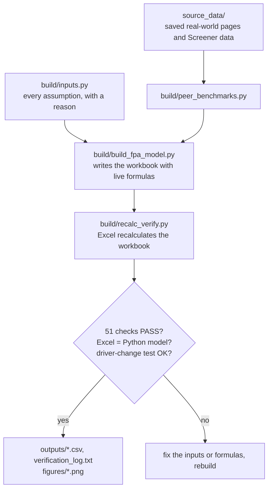
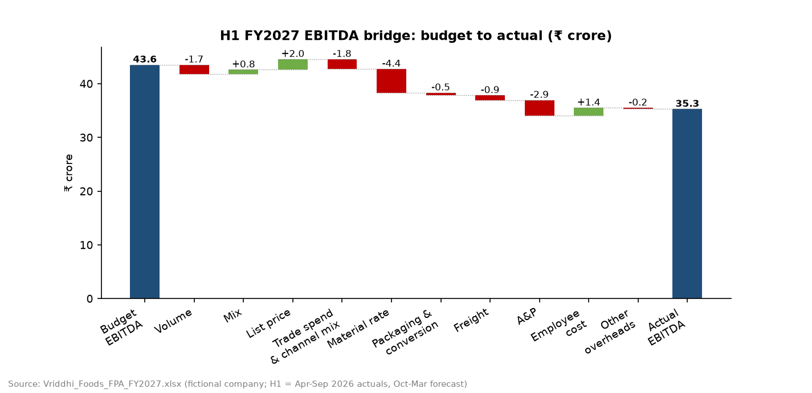

# Project 6 explained simply: plan, actuals, variances and a new forecast for a snack company

This is the plain-language guide to the FP&A project. The full technical write-up is in the [project README](../README.md). The model is [`Vriddhi_Foods_FPA_FY2027.xlsx`](../Vriddhi_Foods_FPA_FY2027.xlsx).

## What this project does

I invented a snack and drinks company, Vriddhi Foods, and planned its year in Excel: how much it sells each month, at what price, and what everything costs. That plan is the **budget**. I then gave the company six months of "actual" results (April-September 2026) and built the sheets an FP&A team uses to explain the gap between plan and actual. Finally, I updated the full-year view with the six actual months plus a new forecast for the other six (a "6+6 forecast").

The short story: sales were almost on plan (-0.8%), but profit (EBITDA) was 18.9% below plan, mainly because edible oil and sugar became expensive and the company spent more on advertising. The new full-year forecast is ₹74.4 crore of EBITDA against a budget of ₹83.4 crore.

## Why a fictional company, and why this kind of business

- **Real companies do not publish budgets.** They publish results every quarter, but never the internal plan by month, product and channel. Without a budget there is nothing to compare actuals against, so a "real company" version would still need an invented budget. A fictional company is honest about that.
- **Variance analysis needs driver data.** To explain a variance you need tonnes sold, price per kg, the price paid for oil, trade terms by channel and headcount. Listed companies report none of this monthly. In this project the drivers exist because I created them.
- **Why packaged foods.** The drivers are easy to picture (tonnes, ₹ per kg, oil and sugar prices), the seasons are strong (summer drinks, Diwali snacks), and 2026 had real events to build the story on: a dry June and a late monsoon, a record sugar price in August, an edible-oil import-duty cut in September, and an RBI rate rise in October.
- **Why not a real food company such as Britannia or Bikaji?** Their published data cannot produce a monthly budget-vs-actual analysis. I used them in a different way: as benchmarks, to check that Vriddhi's invented cost shares and margins look realistic.
- **What is invented and what is real.** Every business number (volumes, prices, costs, headcount) is invented. Everything outside the company is real and has a source: festival dates, rainfall, commodity prices, GST, tax, quick-commerce trends and listed-peer margins.

## How I did it, step by step

1. **Wrote every assumption in one file** (`build/inputs.py`): budget volumes, prices, channel mix, input prices, recipes, costs, the actual drivers for April-September and the forecast drivers. Why: one place to change anything, and each assumption carries a one-line reason.
2. **Saved the real-world facts** (`build/fetch_source_data.py` into `source_data/`): festival dates, the ICRA monsoon report, oil, sugar, wheat and potato prices, GST, quick commerce, salary increases, the RBI rate, the tax rate, and Screener pages for six listed food companies. Why: so every assumption can be traced to a public page. The download log checks that each quoted number appears in the saved page.
3. **Summarised the listed peers** (`build/peer_benchmarks.py` into `data/peer_benchmarks.csv`; shown on the Assumptions_Budget sheet, section 6). Why: to check that the invented budget looks like a real food company (material cost about 56% of sales, operating margin about 13.5%).
4. **Built the budget** (sheets Assumptions_Budget and Budget_PL). Tonnes = yearly tonnes × the month's share × the channel's share; revenue = tonnes × price; costs = tonnes × cost per kg. Why: in a driver-based budget you change one driver and everything follows.
5. **Built the actuals** (sheet Actuals_H1). The bottom of the sheet is an "ERP extract" of actual drivers; the top is the actual P&L, calculated with the same formulas as the budget. Why: real FP&A teams receive data from the ERP system (the company's accounting software), and calculating the P&L from drivers lets the bridges explain every rupee.
6. **Built the 6+6 forecast** (sheet Forecast_6plus6). April-September link to the actuals. October-March use new drivers: festive volumes, a biscuit price rise, oil and sugar easing, the delayed salary increase and a higher interest rate. A switch on the Cover (cell D10) picks the base, downside or upside case. Why: by October, management needs a current view of the year, not the February plan.
7. **Built the variance sheets** (Variance_Monthly and Variance_YTD) with F/U flags and green/red colours. Why: the first question in every monthly review is "where are we against plan, and is it good or bad?"
8. **Built the bridges** (PVM_Bridge for April-September, FY_Outlook for the full year). Why: a variance tells you how much; a bridge tells you why (volume, mix, price, input costs, overheads).
9. **Listed risks and opportunities** (FY_Outlook, below the P&L). Six items, each with a ₹ impact and a probability. Why: a forecast is a single number; the list shows what could move it and by how much.
10. **Built the Dashboard and Commentary sheets.** Five Excel charts, and a written management summary in which every number is a formula. Why: managers read charts and sentences, and live text cannot go out of date when the numbers change.
11. **Added 51 automated checks** (sheet Checks, summarised on the Cover). Why: a model that does not test itself can be wrong without anyone noticing.
12. **Recalculated and verified** (`build/recalc_verify.py`). Excel recalculates the file; the script then confirms there are no error cells, all checks say PASS, and every result matches a separate Python calculation (`build/reference_model.py`) that never reads the workbook. Why: two independent calculations that agree are good evidence the formulas are right.
13. **Ran a driver-change test on a copy.** The script changed the August oil price, then an August beverage volume, then the forecast case, and confirmed that the variances and bridges moved exactly as the Python model predicted, with every check still PASS. The copy was then deleted. Why: it proves the numbers are live formulas, not typed-in values.
14. **Drew the charts for the README** (`build/make_figures.py` into `figures/`).

## How to read a variance

**Variance = actual - budget.** The sign alone does not tell you whether it is good or bad. The F/U flag does.

| Line (H1, ₹ crore) | Budget | Actual | Variance | Flag | Why |
|---|---:|---:|---:|---|---|
| Net revenue | 361.9 | 358.9 | -3.0 | U | Less revenue than planned is bad |
| A&P (advertising and promotion) | 20.2 | 23.1 | +2.9 | U | Spending more than planned is bad, even though the number is positive |
| Employee cost | 28.9 | 27.5 | -1.4 | F | Spending less than planned is good |
| EBITDA | 43.6 | 35.3 | -8.2 | U | Less profit than planned is bad |

The model stores +1 (revenue or profit line) or -1 (cost line) in column A of each variance sheet. A line is F when variance × sign is positive and U when it is negative.

## How to read a PVM (price-volume-mix) bridge

A PVM bridge splits a revenue variance into three causes:

- **Volume**: we sold more or fewer tonnes in total.
- **Mix**: of what we sold, a bigger or smaller share was the expensive products.
- **Price**: we got a higher or lower price per kg for each product.

A tiny example you can check by hand:

| | Namkeen | Drinks | Total |
|---|---:|---:|---:|
| Budget | 100 kg at ₹200 | 100 kg at ₹50 | 200 kg, ₹25,000 (average ₹125/kg) |
| Actual | 120 kg at ₹210 | 60 kg at ₹50 | 180 kg, ₹28,200 |

Revenue variance = 28,200 - 25,000 = **+₹3,200**.

- Volume = (180 - 200) × ₹125 = **-₹2,500**. We sold 20 kg less in total, valued at the budget average price.
- Mix = (66.7% - 50%) × 180 × ₹200 + (33.3% - 50%) × 180 × ₹50 = 6,000 - 1,500 = **+₹4,500**. The expensive product took a bigger share.
- Price = (₹210 - ₹200) × 120 = **+₹1,200**. Namkeen sold for ₹10/kg more.
- Check: -2,500 + 4,500 + 1,200 = +3,200. The three always add up to the variance exactly.

The same logic on Vriddhi's real model numbers (H1, ₹ crore): volume -4.86, mix +1.71, price +0.14, total -3.00. Volume fell because beverages were 314 t below plan. Mix was positive because cheap beverages (about ₹68/kg net) lost share and expensive namkeen (about ₹212/kg net) gained. The price effect splits into a list-price gain (+1.96, the 4% namkeen price rise from August) and higher trade spend (-1.82): more sales went through e-commerce and quick commerce, where platforms take about 18% of the price.

An **EBITDA bridge** works the same way but walks all the way from budget profit to actual profit. Each bar is one cause: volume, mix, price, input costs, packaging, freight, advertising, salaries and overheads. The H1 bridge goes from ₹43.6 crore to ₹35.3 crore, and the biggest bars are input costs (-4.4) and advertising (-2.9).

## Where every important number came from

All pages were saved on 01-Nov-2026. File paths are inside [`source_data/`](../source_data/); the full index is [`source_data/README.md`](../source_data/README.md). The saved `.html` pages are copyrighted news articles and web pages, so they stay on your PC and are not in the GitHub copy. Use the link in the Source column instead.

| Number | Value | Source (link) | File in source_data/ |
|---|---|---|---|
| Navratri and Dussehra 2026 | Navratri from 11-Oct; Dussehra 20-Oct-2026 | [Times of India](https://timesofindia.indiatimes.com/religion/festivals/navratri-2026-start-end-date-is-ghatasthapana-on-october-10-or-11-check-the-full-tithi-schedule/articleshow/134767429.cms) | `news_and_macro/festive_navratri_2026_timesofindia.html` |
| Diwali 2026 | Sunday 8-Nov-2026 | [Drik Panchang](https://www.drikpanchang.com/festivals/lakshmipuja/festivals-lakshmipuja-timings.html?year=2026) | `news_and_macro/festive_diwali_2026_drikpanchang.html` |
| 2026 monsoon rainfall | June 40% below normal, July 103%, August 84% | [ICRA, 01-Sep-2026](https://www.icra.in/Research/ViewResearchReport/deficient-rainfall-inflation-risks-and-weak-crop-output-prospects-cloud-outlook-for-rural-demand-in-h2-fy2027/7096) | `news_and_macro/monsoon_rural_demand_icra_2026-09-01.html` |
| Rural FMCG volume, Apr-Jun 2026 | -5% (e-commerce +34.8%) | [Moneycontrol (NIQ data)](https://www.moneycontrol.com/news/business/macro-headwinds-rising-input-costs-impact-fmcg-volumes-in-june-quarter-niq-14039279.html) | `news_and_macro/fmcg_volumes_aprjun2026_niq_moneycontrol.html` |
| Namkeen market growth | 10.2% a year (2025-2030) | [Technavio](https://www.technavio.com/report/namkeen-market-industry-in-india-analysis) | `news_and_macro/industry_namkeen_market_technavio.html` |
| Juice market growth | 8.52% a year (2026-2033) | [Grand View Research](https://www.grandviewresearch.com/horizon/outlook/fruit-and-vegetable-juice-market/india) | `news_and_macro/industry_juice_market_grandviewresearch.html` |
| Palm oil retail price | ₹153.89/kg on 23-Sep-2026, +16.3% in a year | [Mint](https://www.livemint.com/economy/centre-cuts-import-duty-on-edible-oils-to-curb-price-rise-11790184261562.html) | `news_and_macro/edible_oil_duty_cut_livemint_2026-09.html` |
| Edible-oil import duty cut | 10% to 5% from 24-Sep-2026 (effective 16.5% to 11%) | [The Hindu](https://www.thehindu.com/business/Industry/ahead-of-festivals-centre-cuts-import-duty-on-edible-oils/article71504736.ece), [Financial Express](https://www.financialexpress.com/policy/economy-edible-oil-duty-cut-may-put-8-retail-price-hikes-on-hold-4346955/) | `news_and_macro/edible_oil_duty_cut_thehindu_2026-09-24.html`, `news_and_macro/edible_oil_effective_duty_financialexpress_2026-09.html` |
| Sugar price, early 2026 | about ₹38.5/kg ex-mill | [Indian Express](https://indianexpress.com/article/business/commodities/sugar-supply-situation-stable-despite-stocks-at-nine-year-low-says-cooperative-federation-chief-10624476/) | `news_and_macro/sugar_exmill_apr2026_indianexpress.html` |
| Sugar spike | Record ₹67/kg in mid-August, ₹55 after imports | [Times of India](https://timesofindia.indiatimes.com/business/india-business/sugar-prices-cool-18-after-hitting-record-high-ex-mill-rates-fall-to-rs-55-per-kg/articleshow/133504686.cms) | `news_and_macro/sugar_record_high_timesofindia_2026-08.html` |
| Sugar price at the status date | ₹50.4-55.5/kg on 31-Oct-2026 | [ChiniMandi](https://www.chinimandi.com/daily-sugar-market-update-by-vizzie-31-10-2026/) | `news_and_macro/sugar_daily_market_chinimandi_2026-10-31.html` |
| Wheat support price (MSP) | ₹2,585 per quintal (100 kg) | [Times of India](https://timesofindia.indiatimes.com/city/agra/47-centres-msp-fixed-at-rs-2585/quintal-as-agra-gears-up-for-wheat-procurement/articleshow/129886182.cms) | `news_and_macro/wheat_msp_2026-27_timesofindia.html` |
| Wheat market price | ₹2,910/quintal; millers paying over ₹3,100 (28-Oct-2026) | [BusinessLine](https://www.thehindubusinessline.com/economy/agri-business/indian-millers-bid-higher-rates-to-get-fcis-wheat-offtake-100-in-many-states/article71645756.ece) | `news_and_macro/wheat_fci_auction_businessline_2026-10-28.html` |
| Potato wholesale price | about ₹11.7/kg (16-Oct-2026) | [IndianPotato.com](https://indianpotato.com/) | `news_and_macro/potato_prices_indianpotato_2026-10.html` |
| GST on namkeen, biscuits, juices | 5% from 22-Sep-2025 | [56th GST Council press release](https://bcasonline.org/wp-content/uploads/2025/09/03_Sep-_025_GST_Council_Recommendations.pdf) | `government/gst_56th_council_press_release_2025-09-03.pdf` |
| Quick-commerce commission | 10-20% for large brands | [Economic Times](https://economictimes.indiatimes.com/articleshow/109380031.cms) | `news_and_macro/quick_commerce_commissions_economictimes_2024.html` |
| Quick-commerce growth | +81% a year in Q4 FY26 | [BusinessWorld (Bernstein)](https://www.businessworld.in/article/india-s-quick-commerce-growth-enters-a-more-rational-phase-bernstein-615248) | `news_and_macro/quick_commerce_growth_bernstein_businessworld_2026.html` |
| Salary increases, 2026 | India 9.1%; FMCG 8.6% | [Aon](https://www.aon.com/apac/in-the-press/asia-newsroom/2026/aon-survey-projects-slight-uptick-in-salaries-in-india-2026), [Moneycontrol](https://www.moneycontrol.com/news/business/looking-forward-to-that-increment-why-your-next-appraisal-just-got-harder-to-crack-13881323.html) | `news_and_macro/salary_increase_aon_2026-02-24.html`, `news_and_macro/salary_increase_fmcg_moneycontrol_2026.html` |
| RBI repo rate | 5.50% (+0.25%) on 7-Oct-2026 | [The Hindu](https://www.thehindu.com/business/Economy/rbi-hikes-repo-rate-by-25-basis-points-to-55/article71554369.ece) | `news_and_macro/rbi_repo_hike_thehindu_2026-10-07.html` |
| Corporate tax rate | 25.168% (22% + 10% surcharge + 4% cess) | [EZTax](https://eztax.in/section-115baa-tax-rate-explained) | `government/corporate_tax_115BAA_section200_eztax.html` |
| Listed peers, FY2026 median | Material cost 56% of sales; operating margin 13.5%; revenue growth 7.9% | [Screener: Britannia](https://www.screener.in/company/BRITANNIA/consolidated/), [Bikaji](https://www.screener.in/company/BIKAJI/consolidated/), [Tata Consumer](https://www.screener.in/company/TATACONSUM/consolidated/) and three more | `screener/*.xlsx` (summary in `data/peer_benchmarks.csv`) |

The model's own results live in the workbook:

| Result | Value (₹ crore) | Where to find it |
|---|---:|---|
| H1 EBITDA: budget, actual, variance | 43.6, 35.3, -8.2 | Variance_YTD row 37 (columns J, K, L); Cover row 18 |
| H1 revenue PVM | -4.86 volume, +1.71 mix, +1.96 list price, -1.82 trade spend | PVM_Bridge C8:C11 |
| H1 EBITDA bridge | 43.55 to 35.30 | PVM_Bridge C28:C41 |
| FY2027 EBITDA: budget and 6+6 forecast | 83.4 and 74.4 | FY_Outlook D38 and E38; Cover H18 and I18 |
| FY2027 EBITDA bridge | 83.44 to 74.38 | FY_Outlook C102:C115 |
| Risk-adjusted FY2027 EBITDA | 72.9 | FY_Outlook H69 |

## Key assumptions and why

| Assumption | Value | Why | Real-world anchor |
|---|---|---|---|
| Budget volume growth vs FY2026 | Namkeen +9%, biscuits +6%, beverages +8% | Grow with the category | Namkeen market +10.2% a year; listed biscuit makers +7-9% in FY2026; juices +8.5% a year |
| Seasonality | Beverages 12.5-14% of the year in April-May; namkeen 10.2% in October | Summer drinks, festive snacks | Navratri 11-Oct, Diwali 8-Nov-2026 |
| E-commerce & quick-commerce share | 12-16% of each line's volume | Fast-growing channel | Quick commerce +81% a year; e-commerce FMCG volume +34.8% |
| Trade spend (discounts to the trade) | 8% GT (9% in Oct-Nov), 14% MT, 18% e-com & QC | Each channel takes a different cut | Large brands pay 10-20% to QC platforms; platforms quote 15-25% |
| List prices in the budget | Flat all year | No price rise was planned in February | Judgment (yellow cell) |
| Edible oil, budget | ₹110/kg | February contract rate | Judgment; retail palm oil later rose 16% in a year |
| Sugar, budget | ₹42/kg | Ex-mill price plus freight plus a ₹2 cushion | Ex-mill about ₹38.5/kg in early 2026 |
| Wheat flour, budget | ₹32/kg | Linked to the government support price | MSP ₹2,585/quintal |
| Potato, budget | ₹12.5-16/kg, rising until the new crop | Cold-storage prices rise through the year | Large 2026 crop |
| Salary increase | 8-10% from 1-Jul (actually paid from 1-Oct) | Annual increment cycle | India 9.1%, FMCG 8.6% (Aon, Moneycontrol) |
| Interest rate | 9.00%, then 9.25% from November | Loans reset after the rate rise | RBI repo +0.25% on 7-Oct-2026 |
| Tax | 25.17% of profit before tax | New corporate tax regime | Income-tax Act s.115BAA |
| Prices exclude GST | All prices and revenue are ex-GST | GST is collected for the government, so it is not revenue | GST Council, 3-Sep-2025 |
| Forecast cases | Downside: oil +₹8/kg and General Trade -3%; upside: oil -₹5/kg and a second 2% biscuit price rise | Stress the two biggest uncertainties | Judgment |
| Risk probabilities | 30-50% | How likely each item looked on 31-Oct-2026 | Judgment |

## Words you need to know

| Term | Meaning |
|---|---|
| FP&A | Financial planning and analysis: the finance team that builds the budget, tracks results and updates the forecast. |
| Budget | The plan for the year, set before it starts (here in February 2026). |
| Actuals | What really happened, taken from the accounting system. |
| 6+6 forecast | Six months of actuals plus a fresh forecast for the remaining six months. |
| H1, H2, YTD | First half (April-September), second half (October-March), year to date. |
| Variance | Actual minus budget. |
| F / U | Favourable or unfavourable: whether the variance helps or hurts profit. |
| Driver-based model | A model where results are calculated from drivers such as tonnes, ₹ per kg and headcount, instead of typed-in totals. |
| Trade spend | Discounts, margins and promotion money given to distributors, shops and platforms; gross sales minus trade spend = net revenue. |
| General Trade, Modern Trade, quick commerce | Small neighbourhood shops (kiranas); supermarket chains; apps that deliver in minutes from dark stores. |
| Bill of materials (BOM) | The recipe: kg of each input (oil, flour, sugar, potato, fruit pulp) needed per kg of product. |
| Gross margin | (Net revenue - cost of goods sold) ÷ net revenue. |
| EBITDA | Earnings before interest, tax, depreciation and amortisation: operating profit before non-cash charges and financing. |
| PVM | Price-volume-mix: the split of a revenue variance into volume, mix and price effects. |
| Bridge (waterfall) | A chart or table that walks from one number to another, one cause at a time. |

## How to check the work yourself

1. Open `Vriddhi_Foods_FPA_FY2027.xlsx`. On the Cover, D11 must say **ALL PASS** and E11 "51 of 51 checks pass".
2. On the Checks sheet, every row in column F must say **PASS**, and D7 (failed) must be 0.
3. On PVM_Bridge, the three "Difference (must be zero)" cells (C14, C25, C41) must be 0. On FY_Outlook, C88, C99 and C115 must be 0. (C115 may show -0.0: a computer rounding residue of about ₹0.0000000000001 crore.)
4. Check one number by hand. April budget volume of namkeen in General Trade = 14,000 t × 7.5% (April's share) × 64% (GT share) = 672 t. Gross sales = 672,000 kg × ₹238/kg = ₹15.99 crore. Budget_PL cell D67 shows the same number. (The model uses the shortcut 1 t × ₹1/kg = ₹0.0001 crore.)
5. Change a driver yourself. Set Actuals_H1!H165 (August oil price) from 126 to 140. H1 EBITDA (Actuals_H1!J37) falls from 35.30 to 34.41, the oil effect (PVM_Bridge!C86) moves from -3.86 to -4.75, and the Cover still says ALL PASS. Close without saving.
6. Switch the case in Cover!D10: 2 gives FY EBITDA (Cover!I18) of 69.7, 3 gives 77.7, and 1 returns 74.4.
7. Read [`outputs/verification_log.txt`](../outputs/verification_log.txt). The last line must say `OVERALL VERIFICATION: PASS`.
8. Rebuild everything with `python build/run_all.py` (Windows with Excel). It should end with `ALL STEPS OK`.

## How to explain this project in an interview

**30-second version.** "I built a driver-based FP&A model in Excel for a fictional Indian snack and beverage company with a ₹718 crore budget. It has a monthly budget, six months of actuals from an ERP-style extract, variance analysis with favourable and unfavourable flags, price-volume-mix and EBITDA bridges that reconcile exactly, and a 6+6 reforecast with three scenarios. The story is that H1 revenue was only 0.8% below budget, but EBITDA was 19% below because of edible-oil and sugar inflation and an advertising overspend. The reforecast puts full-year EBITDA at ₹74 crore against ₹83 crore budget. The assumptions are anchored to real 2026 data such as festival dates, the monsoon, commodity prices and listed-peer margins, and 51 automated checks plus an independent Python model confirm the numbers."

**Q1. Why a fictional company?**
Real companies do not publish monthly budgets or driver data, so a budget-vs-actual analysis of a listed company would need an invented budget anyway. I made the invention explicit and anchored it to real benchmarks: Screener data for six listed food companies, and real 2026 prices, dates and policy changes.

**Q2. How do you know the numbers are right?**
Three ways. Every bridge has a difference line that must be zero, and the Checks sheet tests 51 such conditions. A separate Python model recalculates everything from the same inputs and agrees with Excel to more than ten decimal places. And a driver-change test edits an actual oil price and a volume on a copy of the file: the variances and bridges move exactly as the Python model predicts, and every check still passes.

**Q3. What would you recommend to management?**
Three actions from the Commentary sheet. Prepare a second 2% biscuit price rise for January if sugar stays above ₹50/kg (worth ₹1.3 crore). Buy forward half of the January-March edible oil and contract half of the sugar to cap the downside. Renegotiate quick-commerce visibility fees, because each percentage point is worth ₹0.7 crore in H2.
