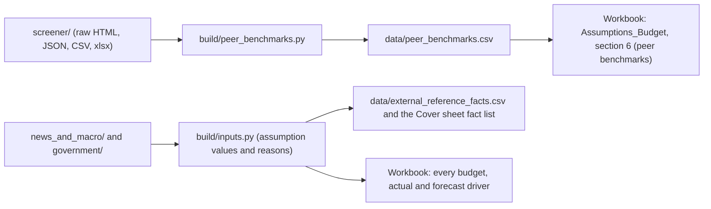

# source_data: the real-world benchmarks behind the fictional Vriddhi Foods model

Vriddhi Foods Pvt. Ltd. is a fictional company, so nothing in this folder is "Vriddhi's data". These files are the public facts used to set, test and explain the model's assumptions: festive dates, the 2026 monsoon, FMCG demand, edible-oil, sugar, wheat and potato prices, GST rates, quick-commerce growth and trade terms, salary increments, the RBI repo rate, the corporate tax rate, and the margins of listed Indian packaged-food companies.

- Every file is saved exactly as downloaded on 01-Nov-2026. The only files written by code are the Screener `.xlsx` exports, the tidy Screener CSVs and `screener_summary.json`, all built from the raw pages saved next to them.
- Each `.xlsx` export has a source line in row 1 (site, URL, download date, units) and the table from row 2.
- Two sites blocked the automated download (HTTP 403). For those, a `.md` note keeps the link and the fact used.
- `download_log.csv` lists every download with its URL, HTTP status, size, SHA-256 hash and a phrase check. The check confirms that the number quoted in the model appears in the saved page. Every saved page passed.
- Size: 101 files, 12.6 MB in total; the largest file is 0.70 MB.
- **Not in the GitHub copy:** the saved web pages (`news_and_macro/*.html` and `government/*.html`) are copies of copyrighted articles and commercial sites. They stay on the author's PC and are left out of the public repository. Each one is listed below with its full link and the fact taken from it. The government PDF, the Screener data and the download log are included.

## How the files feed the model

To download again (needs internet; pages may have changed since 01-Nov-2026): `python build/fetch_source_data.py`. Use `python build/fetch_source_data.py screener` or `... pages` to refresh one part only.

## Index

Units: Screener values are in ₹ crore; percentages are shown as such. Market prices quoted in the news pages are in ₹ per kg or ₹ per quintal (100 kg).

| File | What it contains | Source (name and URL) | Date downloaded | Used for |
|---|---|---|---|---|
| `screener/Britannia_Screener_Consolidated.xlsx` | Britannia Industries (consolidated): quarterly and annual P&L, balance sheet, cash flow, ratios, expense breakdown (₹ crore) | Screener.in, https://www.screener.in/company/BRITANNIA/consolidated/ | 01-Nov-2026 | Peer revenue growth and margins (biscuits) |
| `screener/MrsBectors_Screener_Consolidated.xlsx` | Mrs Bectors Food Specialities (consolidated): same tables, with expense breakdown (₹ crore) | Screener.in, https://www.screener.in/company/BECTORFOOD/consolidated/ | 01-Nov-2026 | Peer revenue growth and margins (biscuits) |
| `screener/Bikaji_Screener_Consolidated.xlsx` | Bikaji Foods International (consolidated): same tables, with expense breakdown (₹ crore) | Screener.in, https://www.screener.in/company/BIKAJI/consolidated/ | 01-Nov-2026 | Peer revenue growth and margins (namkeen) |
| `screener/GopalSnacks_Screener_Standalone.xlsx` | Gopal Snacks (standalone): same tables; Screener has no expense breakdown for it (₹ crore) | Screener.in, https://www.screener.in/company/GOPAL/ | 01-Nov-2026 | Peer revenue growth and margins (namkeen) |
| `screener/PrataapSnacks_Screener_Standalone.xlsx` | Prataap Snacks (standalone; the consolidated view lacks FY2024-FY2025): same tables, with expense breakdown (₹ crore) | Screener.in, https://www.screener.in/company/DIAMONDYD/ | 01-Nov-2026 | Peer revenue growth and margins (potato chips) |
| `screener/TataConsumer_Screener_Consolidated.xlsx` | Tata Consumer Products (consolidated): same tables, with expense breakdown (₹ crore) | Screener.in, https://www.screener.in/company/TATACONSUM/consolidated/ | 01-Nov-2026 | Peer revenue growth and margins (foods and beverages) |
| `screener/DFMFoods_Screener_Standalone.xlsx` | DFM Foods (standalone; delisted, last full year FY2022): same tables (₹ crore) | Screener.in, https://www.screener.in/company/DFMFOODS/ | 01-Nov-2026 | Reference only; excluded from the peer median |
| `screener/raw/*.html`, `screener/raw/*_expenses_schedule.json` | Raw Screener pages and the expense-schedule API responses behind the exports | Screener.in (pages above; schedules API `https://www.screener.in/api/company/<id>/schedules/?parent=Expenses&section=profit-loss`) | 01-Nov-2026 | Audit trail for the exports |
| `screener/csv/*.csv`, `screener/screener_summary.json` | Tidy tables parsed from the raw pages (one CSV per company and section) and the list of pages used | Built from the raw files | 01-Nov-2026 | Input to `build/peer_benchmarks.py` |
| `news_and_macro/festive_navratri_2026_timesofindia.html` | Navratri 2026 start and end date | Times of India, https://timesofindia.indiatimes.com/religion/festivals/navratri-2026-start-end-date-is-ghatasthapana-on-october-10-or-11-check-the-full-tithi-schedule/articleshow/134767429.cms | 01-Nov-2026 | Festive seasonality: Navratri 11-Oct, Dussehra 20-Oct-2026 |
| `news_and_macro/festive_navratri_2026_economictimes.html` | Navratri 2026 date and time | Economic Times, https://economictimes.indiatimes.com/news/new-updates/navratri-2026-date-and-time-check-all-dates-9-colours-forms-of-goddess-durga-puja-muhurat/articleshow/134849399.cms | 01-Nov-2026 | Second source for the Navratri and Dussehra dates |
| `news_and_macro/festive_diwali_2026_drikpanchang.html` | Lakshmi Puja (Diwali) 2026 timings | Drik Panchang, https://www.drikpanchang.com/festivals/lakshmipuja/festivals-lakshmipuja-timings.html?year=2026 | 01-Nov-2026 | Festive seasonality: Diwali (Lakshmi Puja) on Sunday 8-Nov-2026 |
| `news_and_macro/festive_diwali_2026_economictimes.html` | Diwali 2026 date | Economic Times, https://economictimes.indiatimes.com/astrology/others/diwali-2026-date-when-is-diwali-check-lakshmi-puja-muhurat-significance-and-5-day-festival-calendar/articleshow/135254249.cms | 01-Nov-2026 | Second source for the Diwali date |
| `news_and_macro/monsoon_rural_demand_icra_2026-09-01.html` | Deficient rainfall, inflation risks and weak crop output prospects cloud outlook for rural demand in H2 FY2027 (thematic report, 01-Sep-2026) | ICRA, https://www.icra.in/Research/ViewResearchReport/deficient-rainfall-inflation-risks-and-weak-crop-output-prospects-cloud-outlook-for-rural-demand-in-h2-fy2027/7096 | 01-Nov-2026 | Monsoon by month (June 40% below LPA, July 103%, August 84%); weak rural demand in H2 |
| `news_and_macro/fmcg_volumes_aprjun2026_niq_economictimes.html` | Triple shock rattles India's FMCG basket as 68% of categories lose volume (27-Sep-2026) | Economic Times (NIQ data), https://economictimes.indiatimes.com/industry/cons-products/fmcg/68-of-fmcg-categories-lose-volume-as-a-triple-shock-squeezes-indias-basket-in-april-june/articleshow/134520579.cms | 01-Nov-2026 | FMCG volumes -2% YoY in Apr-Jun 2026, rural -5% |
| `news_and_macro/fmcg_volumes_aprjun2026_niq_moneycontrol.html` | Macro headwinds, rising input costs impact FMCG volumes in June quarter (27-Sep-2026) | Moneycontrol (NIQ data), https://www.moneycontrol.com/news/business/macro-headwinds-rising-input-costs-impact-fmcg-volumes-in-june-quarter-niq-14039279.html | 01-Nov-2026 | Rural volume -5%; e-commerce volume +34.8%, modern trade +17.5% (Apr-Jun 2026) |
| `news_and_macro/fmcg_gst2_niq_newscenter_2026.html` | NIQ: GST 2.0 transition reshapes India's FMCG growth landscape (13-Mar-2026) | NielsenIQ, https://nielseniq.com/global/en/news-center/2026/niq-gst-2-0-transition-reshapes-indias-fmcg-growth-landscape/ | 01-Nov-2026 | Context for the Feb-2026 budget: GST 2.0 demand effect expected from Jan-Mar 2026 |
| `news_and_macro/britannia_q1fy27_results_economictimes.html` | Britannia Q1 results: profit rises 14% to Rs 593 crore on volumes, price rise (06-Aug-2026) | Economic Times, https://economictimes.indiatimes.com/markets/stocks/earnings/britannia-q1-results-profit-rises-14-to-rs-591-crore-misses-estimates-as-iran-war-pushes-costs-higher/articleshow/133007596.cms | 01-Nov-2026 | Biscuit demand in Apr-Jun 2026; the leader also raised prices |
| `news_and_macro/industry_snacks_market_imarc.html` | India snacks market size and growth | IMARC Group, https://www.imarcgroup.com/india-snacks-market | 01-Nov-2026 | Snacks market Rs 50,590 crore in 2025, 8.28% CAGR 2026-2034 (namkeen volume budget) |
| `news_and_macro/industry_namkeen_market_technavio.html` | India namkeen market analysis (Jan-2026) | Technavio, https://www.technavio.com/report/namkeen-market-industry-in-india-analysis | 01-Nov-2026 | Namkeen market 10.2% CAGR 2025-2030 |
| `news_and_macro/industry_juice_market_grandviewresearch.html` | India fruit and vegetable juice market outlook | Grand View Research, https://www.grandviewresearch.com/horizon/outlook/fruit-and-vegetable-juice-market/india | 01-Nov-2026 | Juice market 8.52% CAGR 2026-2033 (beverages volume budget) |
| `news_and_macro/edible_oil_duty_cut_livemint_2026-09.html` | Centre cuts import duty on edible oils to curb price rise | Mint, https://www.livemint.com/economy/centre-cuts-import-duty-on-edible-oils-to-curb-price-rise-11790184261562.html | 01-Nov-2026 | Retail palm oil Rs 153.89/kg on 23-Sep-2026, +16.3% YoY |
| `news_and_macro/edible_oil_duty_cut_thehindu_2026-09-24.html` | Ahead of festivals, Centre cuts import duty on edible oils (24-Sep-2026) | The Hindu, https://www.thehindu.com/business/Industry/ahead-of-festivals-centre-cuts-import-duty-on-edible-oils/article71504736.ece | 01-Nov-2026 | Basic customs duty on crude palm and soybean oil cut from 10% to 5% |
| `news_and_macro/edible_oil_effective_duty_financialexpress_2026-09.html` | Edible oil duty cut may put 8% retail price hikes on hold | Financial Express, https://www.financialexpress.com/policy/economy-edible-oil-duty-cut-may-put-8-retail-price-hikes-on-hold-4346955/ | 01-Nov-2026 | Effective duty on crude palm oil 16.5% to 11%: size of the forecast oil price easing |
| `news_and_macro/edible_oil_retail_prices_ndtv_2026-09.md` | Link only: the site blocked the download (HTTP 403) | NDTV, https://www.ndtv.com/india-news/india-cuts-edible-oil-import-duty-but-how-much-can-it-change-prices-12131246 | 01-Nov-2026 (attempted) | Corroboration: retail palm oil Rs 131.65 to Rs 153.60/kg (+14.3%) over a year |
| `news_and_macro/sugar_exmill_apr2026_indianexpress.html` | Sugar supply situation stable despite stocks at nine-year low (08-Apr-2026) | Indian Express, https://indianexpress.com/article/business/commodities/sugar-supply-situation-stable-despite-stocks-at-nine-year-low-says-cooperative-federation-chief-10624476/ | 01-Nov-2026 | Budget anchor: all-India ex-mill sugar about Rs 3,850/quintal |
| `news_and_macro/sugar_imports_moneycontrol_2026-08.html` | Sugar shock in India: why the world's biggest producer is turning importer (22-Aug-2026) | Moneycontrol, https://www.moneycontrol.com/news/india/sugar-shock-in-india-why-the-world-s-biggest-producer-is-turning-importer-14012525.html | 01-Nov-2026 | Ex-mill Rs 38.5/kg early June, Rs 41.5 early July, Rs 5,400-5,560/quintal by mid-August; stock limits from 1-Sep |
| `news_and_macro/sugar_record_high_timesofindia_2026-08.html` | Sugar prices cool 18% after hitting record high, ex-mill rates fall to Rs 55 per kg (25-Aug-2026) | Times of India, https://timesofindia.indiatimes.com/business/india-business/sugar-prices-cool-18-after-hitting-record-high-ex-mill-rates-fall-to-rs-55-per-kg/articleshow/133504686.cms | 01-Nov-2026 | Record Rs 67/kg in mid-August; Rs 55/kg after imports and stock limits |
| `news_and_macro/sugar_daily_market_chinimandi_2026-10-31.html` | Daily sugar market update, 31-Oct-2026 | ChiniMandi, https://www.chinimandi.com/daily-sugar-market-update-by-vizzie-31-10-2026/ | 01-Nov-2026 | Forecast anchor: ex-mill S-grade Rs 5,040-5,100, M-grade Rs 5,450-5,550 per quintal |
| `news_and_macro/wheat_fci_auction_businessline_2026-10-28.html` | Indian millers bid higher rates to get FCI's wheat (28-Oct-2026) | BusinessLine, https://www.thehindubusinessline.com/economy/agri-business/indian-millers-bid-higher-rates-to-get-fcis-wheat-offtake-100-in-many-states/article71645756.ece | 01-Nov-2026 | Wholesale wheat Rs 2,910/quintal; millers paying over Rs 3,100 |
| `news_and_macro/food_prices_wheat_atta_livemint_2026-09.html` | Food prices stable as pulses, cereals output rises; sugar rates ease | Mint, https://www.livemint.com/economy/food-prices-stable-sugar-pulses-rice-retail-prices-india-11789896950548.html | 01-Nov-2026 | Retail wheat Rs 31.77/kg and atta Rs 37.39/kg |
| `news_and_macro/wheat_msp_2026-27_timesofindia.html` | MSP fixed at Rs 2,585/quintal as Agra gears up for wheat procurement (30-Mar-2026) | Times of India, https://timesofindia.indiatimes.com/city/agra/47-centres-msp-fixed-at-rs-2585/quintal-as-agra-gears-up-for-wheat-procurement/articleshow/129886182.cms | 01-Nov-2026 | Budget anchor for wheat flour |
| `news_and_macro/potato_bumper_harvest_timesofindia_2026-02.html` | Bumper potato harvest sparks distress sales fears (Feb-2026) | Times of India, https://timesofindia.indiatimes.com/city/kolkata/bumper-potato-harvest-sparks-distress-sales-fears-no-sign-of-farm-retail-gap-narrowing/articleshow/128434204.cms | 01-Nov-2026 | Large 2026 crop, farm-gate Rs 6/kg: why potato ran below budget |
| `news_and_macro/potato_mandi_prices_khetivyapar_2026-10-28.html` | Potato mandi prices today (28-Oct-2026) | Khetivyapar, https://www.khetivyapar.com/en/potato-mandi-prices-today-delhi-rates-hit-indian-rupee2000-per-quintal-10809 | 01-Nov-2026 | Potato wholesale prices at the status date |
| `news_and_macro/potato_prices_indianpotato_2026-10.html` | IndianPotato.com price tracker (rate board for 16-Oct-2026) | IndianPotato.com, https://indianpotato.com/ | 01-Nov-2026 | All-India wholesale potato about Rs 11.7/kg |
| `news_and_macro/quick_commerce_growth_bernstein_businessworld_2026.html` | India's quick-commerce growth enters a more rational phase: Bernstein | BusinessWorld, https://www.businessworld.in/article/india-s-quick-commerce-growth-enters-a-more-rational-phase-bernstein-615248 | 01-Nov-2026 | QC order value about USD 2.9 bn in Q4 FY26; growth slowing from about 116% to 81% YoY |
| `news_and_macro/quick_commerce_share_of_online_economictimes_2026.html` | For a match made in retail heaven, friction on earth can be real | Economic Times, https://economictimes.indiatimes.com/industry/cons-products/fmcg/for-a-match-made-in-retail-heaven-friction-on-earth-can-be-real/articleshow/131406916.cms | 01-Nov-2026 | Quick commerce 60-75% of large FMCG companies' online sales in FY2026 |
| `news_and_macro/quick_commerce_commissions_economictimes_2024.html` | D2C brands cough up 30-45% commission for a spot on quick-commerce platforms (Apr-2024) | Economic Times, https://economictimes.indiatimes.com/articleshow/109380031.cms | 01-Nov-2026 | Large FMCG companies pay 10-20% (trade-spend rate for e-com & QC) |
| `news_and_macro/quick_commerce_costs_startuptalky_2026.html` | What quick commerce actually costs D2C brands (05-Oct-2026) | StartupTalky, https://startuptalky.com/quick-commerce-real-cost-d2c-brands/ | 01-Nov-2026 | Platforms quote 15-25% commission on selling price |
| `news_and_macro/salary_increase_aon_2026-02-24.html` | Aon survey projects slight uptick in salaries in India in 2026 (24-Feb-2026) | Aon, https://www.aon.com/apac/in-the-press/asia-newsroom/2026/aon-survey-projects-slight-uptick-in-salaries-in-india-2026 | 01-Nov-2026 | India salaries +9.1% in 2026 (budget increments 8-10%) |
| `news_and_macro/salary_increase_fmcg_moneycontrol_2026.html` | Looking forward to that increment? Why your next appraisal just got harder to crack | Moneycontrol, https://www.moneycontrol.com/news/business/looking-forward-to-that-increment-why-your-next-appraisal-just-got-harder-to-crack-13881323.html | 01-Nov-2026 | FMCG 8.6% and consumer products 8.7% projected for 2026 |
| `news_and_macro/rbi_repo_hike_thehindu_2026-10-07.html` | RBI raises repo rate by 25 basis points to 5.50% (07-Oct-2026) | The Hindu, https://www.thehindu.com/business/Economy/rbi-hikes-repo-rate-by-25-basis-points-to-55/article71554369.ece | 01-Nov-2026 | Forecast interest rate +25 bp from November |
| `news_and_macro/rbi_repo_hike_livemint_2026-10-07.html` | RBI MPC meeting October 2026: repo rate hiked by 25 bps to 5.50% | Mint, https://www.livemint.com/market/stock-market-news/rbi-mpc-meeting-october-2026-repo-rate-hiked-by-25-bps-to-5-50-growth-inflation-forecast-other-key-takeaways-11791344804917.html | 01-Nov-2026 | Second source for the repo-rate change |
| `government/gst_56th_council_press_release_2025-09-03.pdf` | Recommendations of the 56th GST Council meeting, with the rate-change annexures (PIB press release of 03-Sep-2025; copy hosted by BCAS) | Press Information Bureau, via https://bcasonline.org/wp-content/uploads/2025/09/03_Sep-_025_GST_Council_Recommendations.pdf | 01-Nov-2026 | GST on namkeen (2106 90), biscuits (1905), fruit juices (2009) and fruit-juice based drinks (2202 99 20) at 5%; model prices are ex-GST |
| `government/gst_food_rate_cuts_economictimes_2025-09.html` | Food companies upbeat, expect consumer choice to shift to branded products (04-Sep-2025) | Economic Times, https://economictimes.indiatimes.com/articleshow/123705935.cms | 01-Nov-2026 | Namkeen 12% to 5%, biscuits 18% to 5%, effective 22-Sep-2025 |
| `government/corporate_tax_115BAA_section200_eztax.html` | Section 200 (Section 115BAA) tax rate for companies explained | EZTax, https://eztax.in/section-115baa-tax-rate-explained | 01-Nov-2026 | Tax rate 22% + 10% surcharge + 4% cess = 25.168% |
| `government/corporate_tax_domestic_company_incometaxindia.md` | Link only: the site blocked the download (HTTP 403) | Income Tax Department, https://www.incometaxindia.gov.in/domestic-company | 01-Nov-2026 (attempted) | Official page for the 10% surcharge under s.115BAA |
| `download_log.csv` | One row per download: folder, file, URL, title, publisher, HTTP status, bytes, SHA-256, date, phrase check | Written by `build/fetch_source_data.py` | 01-Nov-2026 | Audit trail |

## Index check (01-Nov-2026)

- Every file in this folder appears in the table above, and every row points to a file that exists (checked with a script that matches the table against the folder).
- Every sheet of the seven Screener `.xlsx` exports has the source line in row 1.
- The 15 facts the model uses are listed in the same words on the workbook's Cover sheet and in `data/external_reference_facts.csv`, each with the file here that supports it. Both are written from `build/inputs.py`, so they cannot drift apart.
- The project [README](../README.md) shows where each fact enters the model, and [explained_simply/README.md](../explained_simply/README.md) has a plain-language version of the same source table.

## Notes

- Screener rounds the expense shares (material, employee, manufacturing and other cost as % of sales) to whole percentages.
- DFM Foods was taken private in 2023, so its last full year is FY2022. It is kept for reference because the brief named it, and it is excluded from every median.
- Market-research growth rates (IMARC, Technavio, Grand View Research) come from the public summary pages of paid reports.
- The macro inputs in the shared portfolio conventions (10-year G-sec yield, USD/INR, NIFTY) are not used in this project, so they are not saved here.
