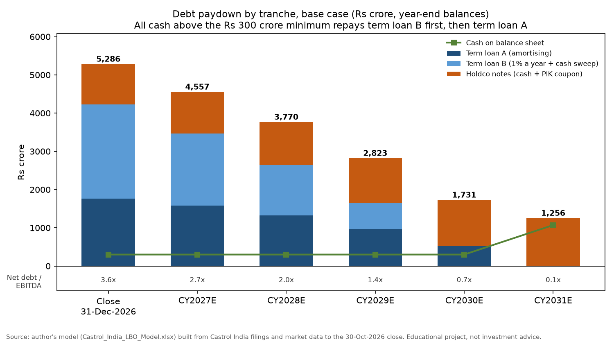
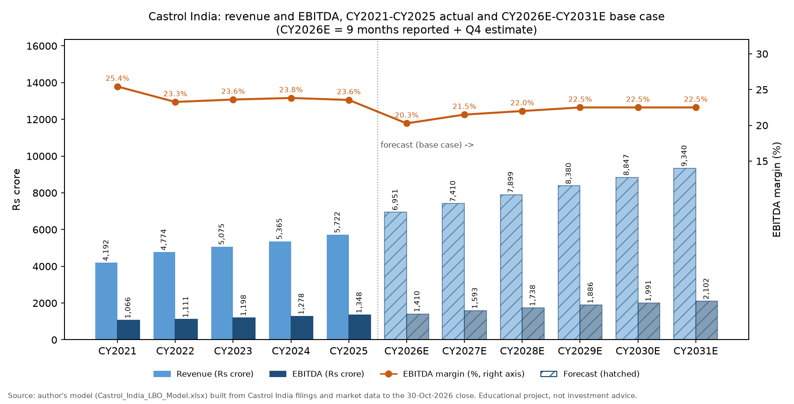
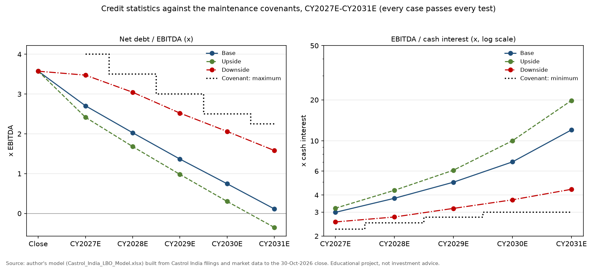
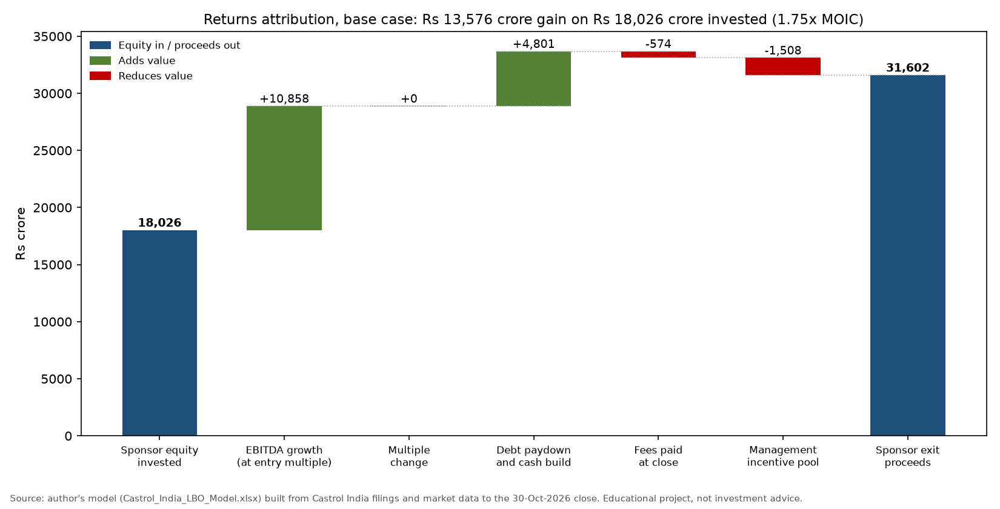
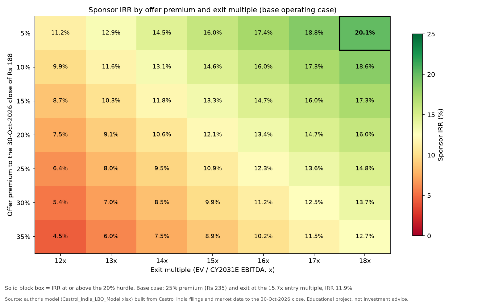
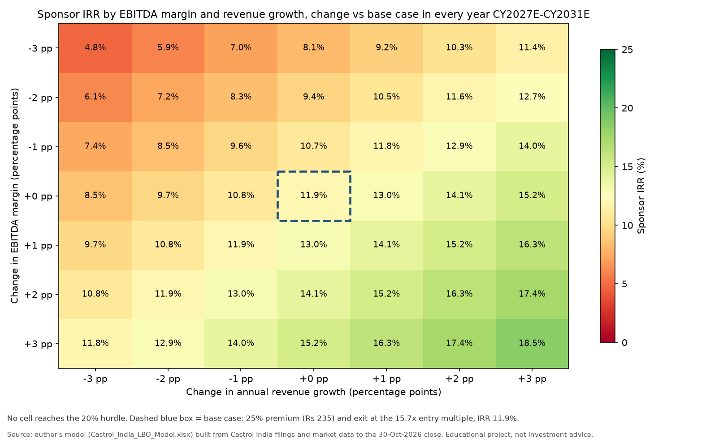

# Castrol India: leveraged buyout (LBO) model

A hypothetical take-private of 100% of Castrol India Ltd (NSE: CASTROLIND) by a financial sponsor, built as a live Excel model with sources and uses, a tranche-by-tranche debt schedule with a cash sweep, and dated sponsor cash flows for IRR and MOIC. The sponsor pays Rs 235.00 a share on 31-Dec-2026 (a 25% premium to the Rs 188.00 close of 30-Oct-2026 and 21% above the Rs 194.04 price of the real Stonepeak open offer). That is an entry enterprise value of Rs 22,113 crore, or 15.7x CY2026E EBITDA. The deal is funded with Rs 5,286 crore of debt (3.75x EBITDA) and Rs 18,026 crore of sponsor equity, and the sponsor exits on 31-Dec-2031 at the same multiple. **Base case: 11.9% IRR and 1.75x MOIC** (upside 16.1% / 2.11x, downside 0.0% / 1.00x). Castrol India has the cash flows an LBO needs, but at a control premium on a 12x-trading stock the 20% buyout hurdle is reached in only one corner of the sensitivity grids.



## What this project shows

- Sources and uses at close: offer price from a premium input, cash-at-close bridge, fees, debt sized as a multiple of EBITDA, sponsor equity as the plug.
- Operating model CY2026E-CY2031E: revenue from volume and price/mix growth, gross and EBITDA margins, D&A, capex, working-capital days, tax, unlevered and levered free cash flow.
- Debt schedule: term loan A (amortising), term loan B (1% a year plus a 100% cash sweep), holdco notes with a cash and a PIK (payment-in-kind) coupon, an undrawn revolver, interest on opening balances (no circular references), credit statistics and covenant tests.
- Returns: exit value, XIRR on dated cash flows, MOIC, a management incentive pool, and a returns attribution that reconciles to the sponsor's gain.
- Five live Excel data tables (offer premium, leverage, exit multiple, margin and growth), a Base / Upside / Downside selector, and 21 model checks that read PASS in all three cases.
- A comparison with the real 2025-26 deal: bp's sale of 65% of Castrol to Stonepeak at 8.6x LTM EBITDA and the SEBI-mandated open offer for Castrol India at Rs 194.04.

## The deal at a glance (base case)

| Item | Value |
|---|---|
| Target | Castrol India Ltd, standalone (lubricants; calendar-year reporter) |
| Entry date / exit date | 31-Dec-2026 / 31-Dec-2031 (5-year hold) |
| Offer price (higher of Rs 194.04 and a 25% premium to Rs 188.00) | Rs 235.00 a share |
| Equity purchase price (98.91 crore fully diluted shares) | Rs 23,244 crore |
| Entry enterprise value | Rs 22,113 crore |
| Entry EV / CY2026E EBITDA (Rs 1,409.5 crore) | 15.7x |
| Entry EV / LTM Sep-2026 EBITDA (Rs 1,453.4 crore) | 15.2x |
| Market EV / LTM EBITDA at the Rs 188 close (no premium) | 12.0x |
| Total debt at close / CY2026E EBITDA | Rs 5,286 crore / 3.75x |
| CY2026E EBITDA / pro-forma cash interest | 2.64x |
| Sponsor equity / (equity + debt) | Rs 18,026 crore / 77% |
| Exit multiple / exit EV | 15.7x / Rs 32,971 crore |
| Sponsor IRR / MOIC | 11.9% / 1.75x |

## Sponsor thesis in five points

1. **Cash generation.** EBITDA margin was 23.3%-25.4% in CY2021-CY2025, capex was 1.7%-2.3% of revenue, and free cash flow (operating cash flow less capex) was 63%-74% of EBITDA in CY2022-CY2025.
2. **An unlevered balance sheet.** No borrowings at any year end from CY2021 to CY2025 or at 30-Jun-2026; Rs 863 crore of cash and bank balances and a Rs 377 crore non-operating investment (TVS Automobile Solutions) at 30-Jun-2026.
3. **Margin recovery room.** The 9M CY2026 EBITDA margin was 21.1% (Q3 CY2026: 15.1%) after a "60-plus percent" rise in the raw-material bill. Management's medium-term frame is 21%-24% (Q3 call, 26-Oct-2026). The base case assumes 21.5% in CY2027E rising to 22.5% from CY2029E.
4. **Steady volume growth.** Management targets volume growth of 1.5x-2x a market that grows 3%-4% in a normal year. The base case uses 3%-4% volume growth plus 2.5% price and mix.
5. **A real sponsor deal around the asset.** Stonepeak (with CPP Investments) agreed to buy 65% of global Castrol at an EV of US$10.1bn (about 8.6x LTM EBITDA) and raised US$3.75bn of holdco debt (about 3.2x that EBITDA), with US$0.3bn of the revolver earmarked for the Castrol India tender offer.

## Data and sources

All market data are as of the Friday 30-Oct-2026 close; files were downloaded 31-Oct-2026 to 1-Nov-2026. Copies of every file are in [`source_data/`](source_data/README.md).

| Data | Source |
|---|---|
| CY2021-CY2025 statements (standalone, Rs crore) | Castrol India annual reports [2022](https://www.castrol.com/content/dam/castrol/country-sites-new/en_in/india/home/documents/investors/castrol_india_limited_annual_report_2022.pdf), [2023](https://www.castrol.com/content/dam/castrol/country-sites-new/en_in/india/home/documents/investors/castrol-india-limited-annual-report-2023.pdf), [2025](https://www.castrol.com/content/dam/castrol/country-sites-new/en_in/india/home/documents/investors/cil-annual-report-2025.pdf) |
| 9M / Q3 CY2026 results, press release | [Board outcome, 24-Oct-2026](https://www.castrol.com/content/dam/castrol/country-sites-new/en_in/india/home/documents/investors/outcome-of-bm-24-oct-2026.pdf) |
| 30-Jun-2026 balance sheet, H1 CY2026 cash flow, interim dividend Rs 6.25 | [Board outcome, 4-Aug-2026](https://www.castrol.com/content/dam/castrol/country-sites-new/en_in/india/home/documents/investors/Outcome-of-BM-Signed.pdf) |
| Management guidance and deal status | [Q3 CY2026 call transcript, 26-Oct-2026](https://www.castrol.com/content/dam/castrol/country-sites-new/en_in/india/home/documents/investors/clse-intimation-analyst-call-26-oct-2026-transcriptsigned.pdf) |
| Cross-checks of revenue and EBITDA | [Screener.in standalone](https://www.screener.in/company/CASTROLIND/), [StockAnalysis.com](https://stockanalysis.com/quote/nse/CASTROLIND/financials/) |
| Share price Rs 188.00, 52-week high Rs 203.40, 60-day VWAP Rs 193.14; USD/INR 95.15 (30-Oct-2026) and 89.60 (23-Dec-2025) | Yahoo Finance [CASTROLIND.NS](https://finance.yahoo.com/quote/CASTROLIND.NS/history/) and INR=X via yfinance |
| Fully diluted shares 98,91,22,384; open offer Rs 194.04 x 25,71,71,820 shares = Rs 4,990.16 crore | [Open-offer public announcement, 24-Dec-2025](https://www.castrol.com/content/dam/castrol/country-sites-new/en_in/india/home/documents/investors/stock-exchange-intimation-public-announcement.pdf) |
| Global deal: EV US$10.1bn, 8.6x LTM EBITDA | [bp press release, 24-Dec-2025](https://www.bp.com/press-and-publications/press-releases/bp-agrees-to-sell-a-65-per-cent-shareholding-in-castrol-to-stonepeak-at-an-enterprise-value-of-10-billion); [CPP Investments, 24-Dec-2025](https://www.cppinvestments.com/wp-content/uploads/attachments/News-Release-CPP-Investments-to-Acquire-Minority-Stake-in-Castrol-EN.pdf) |
| Global deal financing | [Latham & Watkins, Jul-2026](https://www.lw.com/en/news/2026/07/latham-advises-on-financing-for-stonepeak-acquisition-of-castrol-from-bp) |
| Deal status at 30-Oct-2026 | [bp 3Q 2026 results via Alliance News / AJ Bell, 30-Oct-2026](https://www.ajbell.co.uk/news/articles/bp-hits-debt-target-year-ahead-schedule-profit-beats-forecast); Q3 call transcript |
| 10-year G-sec 7.41% | [ETBFSI / Reuters, 30-Oct-2026](https://bfsi.economictimes.indiatimes.com/articles/india-bonds-buckle-for-fourth-straight-month-on-oils-climb/135363689) (7.4139%); [Trading Economics](https://tradingeconomics.com/india/government-bond-yield) (7.40%) |
| RBI repo rate 5.50% (raised 25 bp on 7-Oct-2026) | [The Hindu](https://www.thehindu.com/business/Economy/rbi-hikes-repo-rate-by-25-basis-points-to-55/article71554369.ece); [Mint](https://www.livemint.com/market/stock-market-news/rbi-mpc-meeting-october-2026-repo-rate-hiked-by-25-bps-to-5-50-growth-inflation-forecast-other-key-takeaways-11791344804917.html) |
| 91-day T-bill 5.93% (interest on cash) | [Economic Times, auction of 28-Oct-2026](https://economictimes.indiatimes.com/markets/bonds/rbi-accepts-20-bps-higher-treasury-bill-cutoff-yields-than-last-auction/articleshow/135284706.cms) |
| Corporate tax 25.17% | Income-tax Act s.115BAA (22% + 10% surcharge + 4% cess) |
| Takeover and delisting rules | SEBI [SAST Regulations](https://www.sebi.gov.in/sebi_data/attachdocs/aug-2026/1785911192198.pdf) and [Delisting Regulations](https://www.sebi.gov.in/sebi_data/attachdocs/aug-2026/1786948319926.pdf) (consolidated, Aug-2026) |
| Acquisition-finance rules | [KPMG India, Mar-2026](https://kpmg.com/in/en/blogs/2026/03/rbis-power-play-to-fire-up-m-as.html); [KS&K, 12-Mar-2026](https://ksandk.com/banking/sponsor-side-leveraged-finance-in-india/); [Economic Times, 1-Jul-2026](https://economictimes.indiatimes.com/opinion/et-commentary/rbi-opens-bank-lending-for-acquisitions-under-new-framework/articleshow/132100398.cms) |

The historical line items were typed from the filings into `data/castrol_india_financials.csv` and tie to Screener.in within Rs 1 crore for revenue and Rs 1.5 crore for EBITDA (checks 16 and 17 in the workbook).

## Method

**Entry.** Offer price = MAX(Rs 194.04, Rs 188.00 x (1 + premium)). Equity purchase price = offer price x 98.91 crore diluted shares. Entry EV = equity purchase price + borrowings (nil) + lease liabilities (Rs 53 crore) - estimated cash at close (Rs 807 crore) - non-operating investment (Rs 377 crore). Cash at close rolls the 30-Jun-2026 balance (Rs 863 crore) forward with H2 CY2026 EBITDA, tax, working capital, capex, leases and the Rs 618 crore interim dividend paid in September 2026. CY2026E is 9 months reported plus a Q4 estimate (Q4 EBITDA margin 18%).

**Sources and uses.** Uses = equity purchase + refinancing (nil) + transaction fees (2% of EV) + financing fees (2.5% of debt, amortised over 5 years). Sources = debt (TLA 1.25x, TLB 1.75x, holdco notes 0.75x CY2026E EBITDA) + cash above a Rs 300 crore minimum + sponsor equity (plug).

**Debt pricing.** Spreads over the 7.41% 10-year G-sec are assumptions: TLA +2.00% = 9.41%, TLB +3.00% = 10.41%, holdco notes 9.91% cash + 3.50% PIK = 13.41%, revolver Rs 300 crore at 9.41% with a 0.40% commitment fee. Weighted all-in cost 10.7%; 8.0% after tax.

**Operating model.** Revenue_t = Revenue_t-1 x (1 + volume growth) x (1 + price/mix growth). EBITDA = revenue x EBITDA margin. D&A 1.7% of revenue. Capex 1.8% of revenue. Working capital from inventory and payable days on cost of goods sold and receivable days on revenue. Tax at 25.17% of profit before tax, with acquisition interest deductible (switch on Assumptions).

**Cash waterfall.** Levered FCF = net income + D&A + PIK interest + fee amortisation - increase in working capital - capex - lease principal (cross-checked against a direct calculation from EBITDA every year). Each year: scheduled TLA and TLB repayments, then 100% of the cash above the minimum repays TLB, then TLA. The revolver draws only if cash would fall below the minimum. The holdco notes are not prepaid; PIK interest is added to principal. Interest is charged on opening balances.

**Exit and returns.** Exit EV = exit multiple x CY2031E EBITDA. Exit equity = exit EV - debt - leases + cash + non-operating investment. The management incentive pool takes 10% of the equity gain. Sponsor IRR = XIRR of -equity on 31-Dec-2026 and +proceeds on 31-Dec-2031 (no interim dividends); MOIC = proceeds / equity.

**Attribution.** EBITDA growth x entry multiple + (exit multiple - entry multiple) x exit EBITDA + (net debt at close - net debt at exit) - fees - incentive pool = sponsor gain (check 12).

## Results

### History and base-case forecast

| Rs crore | CY2021 | CY2022 | CY2023 | CY2024 | CY2025 | LTM Sep-2026 |
|---|---:|---:|---:|---:|---:|---:|
| Revenue | 4,192 | 4,774 | 5,075 | 5,365 | 5,722 | 6,591 |
| EBITDA | 1,066 | 1,111 | 1,198 | 1,278 | 1,348 | 1,453 |
| EBITDA margin | 25.4% | 23.3% | 23.6% | 23.8% | 23.6% | 22.0% |
| Cash from operations | 630 | 916 | 853 | 1,044 | 1,090 | |
| Capex | 83 | 110 | 96 | 93 | 97 | |
| Free cash flow (CFO - capex) | 547 | 806 | 758 | 951 | 993 | |
| Dividends paid | 542 | 593 | 643 | 791 | 1,286 | |



Base case: revenue grows from Rs 6,951 crore (CY2026E) to Rs 9,340 crore (CY2031E), 6.1% a year; EBITDA grows from Rs 1,410 crore to Rs 2,102 crore, 8.3% a year, as the margin recovers from 20.3% to 22.5%.

### Sources and uses at close (31-Dec-2026)

| Uses | Rs crore | % of total |
|---|---:|---:|
| Purchase of 100% of the equity (Rs 235.00 x 98.91 crore shares) | 23,244 | 97.6% |
| Refinance existing borrowings | 0 | 0.0% |
| Transaction fees (2% of EV) | 442 | 1.9% |
| Financing fees (2.5% of debt) | 132 | 0.6% |
| **Total uses** | **23,819** | **100%** |

| Sources | Rs crore | x CY2026E EBITDA | Rate |
|---|---:|---:|---|
| Revolver (Rs 300 crore commitment, undrawn) | 0 | 0.00x | 9.41% when drawn |
| Term loan A (repays 10/15/20/20/20% of principal in CY2027E-31E) | 1,762 | 1.25x | 9.41% |
| Term loan B (1% a year plus the cash sweep) | 2,467 | 1.75x | 10.41% |
| Holdco notes (repaid at exit) | 1,057 | 0.75x | 9.91% cash + 3.50% PIK |
| Excess balance-sheet cash (keeps Rs 300 crore) | 507 | 0.36x | |
| Sponsor equity (plug) | 18,026 | 12.79x | |
| **Total sources** | **23,819** | **16.90x** | |

### Debt paydown and credit statistics (base case)

| Rs crore | Close | CY2027E | CY2028E | CY2029E | CY2030E | CY2031E |
|---|---:|---:|---:|---:|---:|---:|
| Term loan A | 1,762 | 1,586 | 1,321 | 969 | 518 | 0 |
| Term loan B | 2,467 | 1,877 | 1,316 | 682 | 0 | 0 |
| Holdco notes incl. PIK | 1,057 | 1,094 | 1,132 | 1,172 | 1,213 | 1,256 |
| Cash | 300 | 300 | 300 | 300 | 300 | 1,071 |
| Levered free cash flow | | 766 | 825 | 987 | 1,133 | 1,288 |
| Net debt / EBITDA (x) | 3.57 | 2.71 | 2.03 | 1.37 | 0.75 | 0.11 |
| EBITDA / cash interest (x) | 2.64 pro forma | 2.99 | 3.79 | 4.97 | 7.01 | 12.03 |
| Covenant: maximum net debt / EBITDA (x) | | 4.00 | 3.50 | 3.00 | 2.50 | 2.25 |
| Covenant: minimum EBITDA / cash interest (x) | | 2.25 | 2.50 | 2.75 | 3.00 | 3.00 |

Term loan B is repaid in CY2030E and term loan A in CY2031E. All senior debt is gone by exit; only the holdco notes remain.



In the downside the covenants still pass, but the cushion is thin: net debt / EBITDA is 3.48x against 4.00x in CY2027E and 3.05x against 3.50x in CY2028E (about 13% EBITDA headroom), and interest cover is 2.54x against 2.25x in CY2027E.

### Returns by case

| | Base | Upside | Downside |
|---|---:|---:|---:|
| Volume growth CY2027E-31E (% a year) | 4.0 to 3.0 | 6.0 to 4.5 | 1.0 to -1.0 |
| Price and mix growth (% a year) | 2.5 | 3.0 | 1.5 |
| EBITDA margin CY2031E | 22.5% | 24.0% | 19.5% |
| CY2031E EBITDA (Rs crore) | 2,102 | 2,492 | 1,460 |
| Exit multiple (x CY2031E EBITDA) | 15.7x | 15.7x | 13.7x |
| Exit EV (Rs crore) | 32,971 | 39,092 | 19,987 |
| Net debt at exit (Rs crore) | 238 | -878 (net cash) | 2,309 |
| Exit equity (Rs crore) | 33,110 | 40,347 | 18,055 |
| Sponsor IRR | 11.9% | 16.1% | 0.0% |
| MOIC | 1.75x | 2.11x | 1.00x |
| Lowest EBITDA / cash interest | 2.99x | 3.20x | 2.54x |
| Covenant tests / model checks | PASS / ALL PASS | PASS / ALL PASS | PASS / ALL PASS |

### Returns attribution (base case)

| Driver | Rs crore | Share of gain |
|---|---:|---:|
| EBITDA growth (Rs 692 crore x 15.7x entry multiple) | +10,858 | 80% |
| Multiple change (exit = entry) | 0 | 0% |
| Debt paydown and cash build (net debt Rs 5,039 crore at close, Rs 238 crore at exit) | +4,801 | 35% |
| Transaction and financing fees | -574 | -4% |
| Management incentive pool (10% of the gain) | -1,508 | -11% |
| **Sponsor gain (Rs 31,602 crore proceeds - Rs 18,026 crore equity)** | **+13,576** | **100%** |



### Sensitivities (live Excel data tables)





Sponsor IRR by debt at close and exit multiple (25% premium, base operating case):

| Debt / CY2026E EBITDA | 12x exit | 14x exit | 16x exit | 18x exit |
|---|---:|---:|---:|---:|
| 2.5x | 6.5% | 9.3% | 11.9% | 14.2% |
| 3.0x | 6.5% | 9.4% | 12.0% | 14.5% |
| 3.75x (base) | 6.4% | 9.5% | 12.3% | 14.8% |
| 4.5x | 6.4% | 9.6% | 12.5% | 15.2% |
| 5.0x | 6.3% | 9.7% | 12.7% | 15.5% |

- Price matters most. At an 18x exit, IRR falls from 20.1% at a 5% premium to 12.7% at a 35% premium. Only the 5% premium / 18x exit cell clears 20%, and a 5% premium (Rs 197.40) is barely above the Rs 194.04 open-offer price.
- Each 1 percentage point of EBITDA margin in every forecast year is worth about 1.1 points of IRR, and so is each extra point of annual revenue growth. Margin and growth both 3 points lower gives 4.8%.
- Extra debt adds little. Moving from 2.5x to 5.0x adds 0.8 points of IRR at a 16x exit and lowers it slightly at 12x. The reason is the entry price: the EBITDA yield on entry EV is 6.4% (1 / 15.7x), below the 10.7% pre-tax cost of the debt, so debt only pays off through growth and the exit value. The grid ignores covenants: scaling the base-case interest bill by 5.0 / 3.75 puts CY2027E interest cover at about 2.25x, right at the covenant minimum.

### The real 2025-26 deal

| Measure | Value | Source |
|---|---:|---|
| bp / Stonepeak: EV of global Castrol (100%) | US$10.1bn | bp release, 24-Dec-2025 |
| Global deal EV / LTM EBITDA | 8.6x | bp release |
| Holdco debt raised / implied LTM EBITDA (US$3.75bn / US$1.17bn) | 3.2x | Latham & Watkins; model arithmetic |
| Castrol India EBITDA (CY2025) as a share of global Castrol LTM EBITDA | about 13% | Model arithmetic (different periods; order of magnitude) |
| Open-offer price for 26% of Castrol India | Rs 194.04 | Public announcement, 24-Dec-2025 |
| EV / CY2025 EBITDA at Rs 194.04 (31-Dec-2025 balance sheet) | 13.1x | Model arithmetic |
| Illustrative enhanced offer price if the detailed public statement came on 31-Dec-2026 (10% a year, SAST Reg 8(12)) | Rs 213.87 | Model arithmetic |
| This model: EV / LTM Sep-2026 EBITDA at Rs 235.00 | 15.2x (77% above 8.6x) | Model |

Status at 30-Oct-2026: the global deal had not closed. bp's 3Q 2026 results called the closing "imminent" and still expected about US$6bn of proceeds in 2026 (Alliance News via AJ Bell). On the 26-Oct-2026 call, Castrol India's CFO said licences in more than 50 countries were still being obtained and that the SEBI announcement would follow completion. So the detailed public statement had not been published and the open offer had not opened. A fully accepted offer would take the acquirer group from 51.00% to 77.00%, below the 90% needed to delist.

## Key takeaways

1. Castrol India suits an LBO on cash flow: no debt, capex near 2% of revenue, and Rs 766-1,288 crore a year of levered free cash flow repays all Rs 4,229 crore of senior debt within five years.
2. The price does not suit an LBO. Paying 15.7x EBITDA with a 25% premium gives an 11.9% IRR with no multiple expansion. Equity has to fund 77% of the capital because 3.75x of debt covers less than a quarter of a 15.7x purchase price.
3. Value creation is mostly operating: EBITDA growth explains 80% of the gain and debt paydown 35%; fees and the incentive pool take 15%.
4. Stonepeak paid 8.6x for the global business, while listed Castrol India trades at 12.0x LTM EBITDA. On these numbers a buyer of the Indian listed company at a control premium would struggle to earn buyout returns, which is consistent with the real structure: a global deal plus only the mandatory 26% offer in India at the regulatory price.
5. A sponsor that wants 20% needs both a low entry price and a high exit: the only grid cell above 20% combines a 5% premium (close to the open-offer price) with an 18x exit. Margins and growth both 3 points above the base case in every year still give only 18.5%.

## Risks

- **Base oil and the rupee.** Base oil tracks crude, which moved from about US$120 a barrel in the June 2026 quarter to about US$80 and back to US$114-115 by late October (Q3 call), and the rupee weakened from 89.60 per US$ at signing to 95.15. The Q3 CY2026 gross margin was 36.5% against a CY2021-CY2025 average of about 49%. The downside case holds the EBITDA margin at 19.0%-19.5%.
- **EV transition and engine-oil volumes.** Automotive engine oils are Castrol India's largest product line, and battery electric vehicles do not use engine oil. Kotak Securities keeps "a long-term cautious view on volume growth given the gradual transition toward EVs" ([result update, 6-Aug-2026](https://www.kotakneo.com/uploads/Castrol_One_Pager_Result_Update_Q2_CY_26_6_Aug2026_0c6b28aa63.pdf)). The downside case has volumes shrinking 0.5%-1% a year by CY2030E-31E and a 2-turn lower exit multiple.
- **Brand licence and royalty.** Castrol India paid Rs 132.49 crore of royalty to Castrol Ltd (UK) in CY2025 (2.3% of revenue; AR2025 related-party note). The brand belongs to the Castrol group, which Stonepeak (65%) and bp (35%) will own. A third-party sponsor would need a long licence on fixed terms; the model keeps royalty inside the EBITDA margin at historical levels. Each extra point of royalty costs about 1.1 points of IRR.
- **Competition.** The lubricant brands of the state-owned oil companies and other private brands limit how fast cost increases can be passed on. On the Q3 call the MD said any pricing action is balanced against keeping the consumer franchise and the brand. Pricing power drives both the margin and the volume assumptions.
- **Exit.** The base case needs another buyer (or an IPO) at 15.7x in 2031. Exiting 2 turns lower (13.7x) cuts the IRR by about 3 points, to about 9% (25% premium row of the grid).

## India execution notes

These are the main legal constraints on a real take-private. They are summarised from the cited sources, not legal advice.

- **Open offer.** Acquiring 25% or more, or control, of a listed company requires an open offer for at least 26% of the shares (SEBI SAST Regulations 3(1), 4 and 7(1)). For an indirect acquisition such as Stonepeak's, the offer price rises by 10% a year from the date of the primary agreement to the detailed public statement (Regulation 8(12)).
- **Delisting.** A delisting offer succeeds only if the acquirer's holding reaches 90% of the total issued shares (SEBI Delisting Regulations 2021, Regulation 21(a)); a counter-offer is possible at 75% if at least half the public shares are tendered (Regulation 22(4)). A 100% take-private therefore needs most public shareholders to tender, and the price comes from reverse book-building (or the fixed-price route added in 2024), so it can end well above the open-offer price.
- **Acquisition debt.** Indian banks were historically not allowed to lend for share purchases. RBI's 2026 framework, announced on 13-Feb-2026, lets banks fund up to 75% of the acquisition value for acquirers with at least Rs 500 crore of net worth, a three-year profit record, an investment-grade rating if unlisted, and post-deal debt-to-equity of no more than 3:1 ([KS&K](https://ksandk.com/banking/sponsor-side-leveraged-finance-in-india/), [KPMG](https://kpmg.com/in/en/blogs/2026/03/rbis-power-play-to-fire-up-m-as.html)). External commercial borrowings still cannot be used to buy shares (KPMG). The Economic Times (1-Jul-2026) expects sponsor-backed and higher-leverage deals to keep relying on private credit. The model's term loans and holdco notes are therefore best read as private-credit or offshore holdco debt.
- **Financial assistance.** Section 67 of the Companies Act 2013 stops a public company from giving financial assistance for the purchase of its own shares (KS&K). Target-level security and the interest tax shield in the model assume the bid vehicle merges with Castrol India after delisting. Without that, the sponsor loses a tax shield of about Rs 538 crore over five years (25.17% of Rs 2,138 crore of acquisition interest and fee amortisation).

## Limitations

- The deal is hypothetical. Castrol Ltd (UK) owns 51% and is itself being sold, so a third party could not buy 100% without the promoter selling.
- CY2026E includes a Q4 estimate (revenue +25% year on year, EBITDA margin 18%), and the cash at close is an estimate.
- Spreads, fees, covenant levels, the 10% incentive pool and the 25% premium are assumptions, not market quotes.
- The model is annual and charges interest on opening balances, so it slightly overstates interest when debt falls during a year.
- Leases are held flat and the non-operating investment is carried at its 30-Jun-2026 fair value.
- One exit date only; no dividend recap, no refinancing, no transaction taxes beyond the 2% fee estimate, and no modelling of the open-offer and delisting steps or their timing.

## How to use the workbook

1. Open `Castrol_India_LBO_Model.xlsx`. The Cover sheet shows the key outputs, the check status and a three-case comparison.
2. Change the case on `Assumptions!C6` (1 = Base, 2 = Upside, 3 = Downside). Blue cells are inputs; yellow-filled cells are judgement assumptions with the reason in column I.
3. `Checks` must read ALL PASS. Covenant tests are reported separately on `Debt_Schedule` and can fail in a stress case.
4. `Sensitivities` holds live data tables; keep its driver cells D5:D11 empty and press F9 if the grids look stale.

## How to reproduce

Windows with Microsoft Excel and Python 3.14:

```
python -m pip install -r requirements.txt
python build/run_all.py                 # build the workbook -> Excel recalculation and checks -> outputs/*.csv -> figures/*.png
python build/export_source_tables.py    # optional: rebuild the .xlsx exports in source_data/
```

`build/run_all.py` runs offline from `data/` and `source_data/`. It runs `build_lbo_model.py` (openpyxl; writes 1,144 formulas), `finalise_with_excel.py` (Excel via COM: adds the five data tables, recalculates, runs all three cases, confirms there are no error values and every check says PASS, writes `build/verification_log.txt` and `outputs/`), then `make_figures.py`. Last verified run: 1,149 formula cells including the data tables, 0 error values, all 226 data-table cells filled, ALL PASS in Base, Upside and Downside. `build/fetch_screener_standalone.py` and `build/fetch_market_data.py` refresh the raw downloads online and overwrite the snapshot in `source_data/`.

## Folder layout

```
07-lbo-model/
  Castrol_India_LBO_Model.xlsx   model: Cover, Historical, Assumptions, Sources_Uses, Operating_Model,
                                 Debt_Schedule, Returns, Sensitivities, Checks, Real_Deal_Context
  build/                         build, verification, figure and export scripts; layout.json; verification_log.txt
  data/                          castrol_india_financials.csv, market_inputs.json, deal_context.json
  outputs/                       CSV exports: scenarios, credit stats, operating model, debt schedule,
                                 sources and uses, attribution, sensitivity grids
  figures/                       charts used in this README
  source_data/                   original downloads with an index (source_data/README.md)
  explained_simply/README.md     plain-language guide to the project
```

Educational project, not investment advice.
