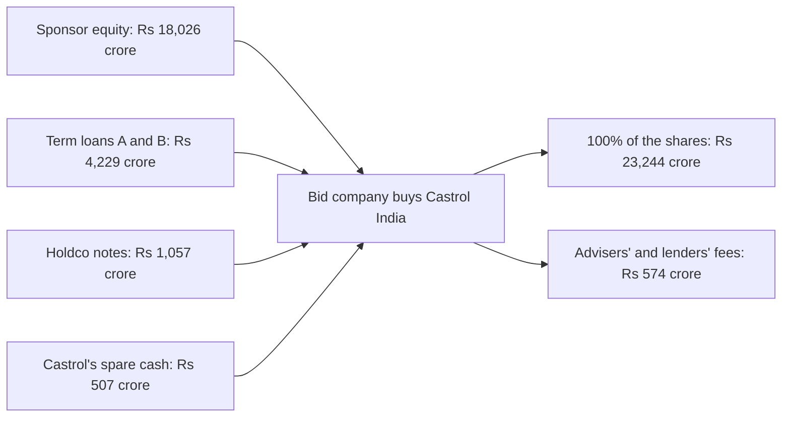
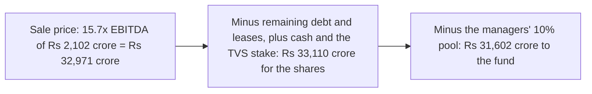

# Castrol India LBO, explained simply

A plain-language guide to Project 7. Every number here comes from `Castrol_India_LBO_Model.xlsx` (base case) or from the files in `source_data/`.

## What this project does

It pretends that a private-equity fund buys all of Castrol India on 31-Dec-2026, pays for it partly with borrowed money, runs it for five years and sells it on 31-Dec-2031. The Excel model works out how much the fund pays (Rs 235.00 a share, Rs 23,244 crore for all the shares), how the purchase is funded, how fast the company's cash repays the loans, and what the fund earns. In the base case the fund puts in Rs 18,026 crore and gets back Rs 31,602 crore: 1.75 times its money, or 11.9% a year.

## Why Castrol India, and why not TCS or Asian Paints

An LBO works best on a company that throws off steady cash, needs little reinvestment and has no debt already. Castrol India fits:

- **Steady cash.** EBITDA margin of 23%-25% every year from CY2021 to CY2025, and free cash flow of Rs 758-993 crore a year in CY2023-CY2025.
- **Low capex.** About 2% of revenue (Rs 83-110 crore a year).
- **No debt.** Zero borrowings at every year end since CY2021, plus Rs 863 crore of cash and bank balances at 30-Jun-2026.
- **A real sponsor deal around it.** On 24-Dec-2025 bp agreed to sell 65% of global Castrol to Stonepeak, an infrastructure investor, at an enterprise value of US$10.1bn. That triggered a compulsory offer to Castrol India's public shareholders at Rs 194.04 a share. The model can be checked against real prices.
- **A size a fund can finance.** Market value of about Rs 18,600 crore (about US$2bn) at the 30-Oct-2026 close.

Why not the obvious alternatives:

- **TCS** is one of India's most valuable companies. No fund could raise enough equity and debt to buy it, and its value sits in its people and client contracts, which lenders cannot take as security. It is also the subject of Project 2.
- **Asian Paints** is also very large and trades at a much higher price per rupee of profit, so a buyer could not earn buyout-style returns. It is already used in Projects 3 and 5.
- Every project in the portfolio uses a different company, and Castrol India is the only one with a live 2025-26 sponsor deal.

## How an LBO makes money

1. **Buy with some borrowed money.** The fund pays Rs 23,819 crore in total (shares plus fees). Lenders supply Rs 5,286 crore, Castrol's own spare cash Rs 507 crore, and the fund the remaining Rs 18,026 crore.
2. **Let the company repay the loans.** Every year the company's cash first pays interest, then repays debt. Between 2027 and 2031 it repays all Rs 4,229 crore of term loans. Every rupee of debt repaid is a rupee more for the owner at exit (Rs 4,801 crore in total, counting the cash left at the end).
3. **Grow the profits.** EBITDA grows from Rs 1,410 crore (CY2026E) to Rs 2,102 crore (CY2031E). At the same price multiple (15.7x), that adds Rs 10,858 crore of value.
4. **Sell.** The model sells at 15.7x EBITDA, the same multiple it paid. Selling at a higher multiple would add more; the model does not count on that.
5. **Pay the bills and split the gain.** Fees cost Rs 574 crore at the start. Managers get 10% of the gain (Rs 1,508 crore) to keep them motivated. The fund keeps the rest.

Here the borrowed money does less work than in a textbook LBO. The fund pays 15.7x EBITDA, and 3.75x EBITDA of debt covers less than a quarter of that price. Most of the gain comes from profit growth.

## How I did it, step by step

1. **Checked the basics.** Castrol India reports on a calendar year (January-December), its latest quarter was July-September 2026, and it has no borrowings. Source: Q3 CY2026 results and call transcript (`source_data/company_filings/`).
2. **Collected the source files.** Annual reports 2022, 2023 and 2025 (financial statement pages), the 4-Aug-2026 and 24-Oct-2026 results, the call transcript, Screener.in and StockAnalysis.com tables, Yahoo Finance prices, the bp and Stonepeak deal documents, the open-offer announcement, the SEBI rules, and news pages for interest rates. All are in `source_data/` with an index.
3. **Typed the history.** Revenue, costs, balance-sheet items and cash flows for CY2021-CY2025, 9M CY2025/26 and the June 2026 balance sheet go into `data/castrol_india_financials.csv` with page references. The `Historical` sheet rebuilds profit before tax and profit after tax from the line items and compares revenue and EBITDA with Screener.in (checks 14-17), so typing errors would show up.
4. **Collected market and deal facts.** Share price, shares, the open offer, exchange rates, the 10-year government bond yield, the repo rate and the T-bill yield go into `data/market_inputs.json`. Deal facts go into `data/deal_context.json`. Each has its source link.
5. **Estimated 2026 and the cash at closing.** CY2026E = 9 months reported + a Q4 estimate (`Assumptions` rows 68-81). Cash at 31-Dec-2026 is rolled forward from the 30-Jun-2026 balance, after the Rs 618 crore September dividend (`Sources_Uses` rows 17-26). This matters because spare cash reduces what the fund must put in.
6. **Set the price.** Offer price = the higher of Rs 194.04 and Rs 188.00 plus a 25% premium = Rs 235.00. Entry EV = Rs 22,113 crore, 15.7x CY2026E EBITDA and 15.2x the last twelve months (`Sources_Uses` rows 5-43).
7. **Sized and priced the debt.** 3.75x EBITDA in three layers, priced as spreads over the 7.41% 10-year government bond yield (`Assumptions` rows 34-59). The size keeps EBITDA at 2.6x the interest bill at closing.
8. **Wrote sources and uses.** Uses = shares + fees. Sources = debt + spare cash + fund equity, where the fund equity is whatever is still missing (`Sources_Uses` rows 57-72). The two totals must match (check 1).
9. **Built the five-year forecast.** Revenue from volume and price growth, then gross margin, EBITDA, depreciation, interest, tax, net income, working capital and capex, ending in the cash available to repay debt (`Operating_Model`).
10. **Built the debt schedule.** Each loan's opening balance, scheduled repayment, extra repayment from spare cash ("cash sweep"), PIK interest and closing balance; interest on opening balances so the sheet never refers to itself (`Debt_Schedule`).
11. **Calculated the returns.** Sale value, the fund's dated cash flows, IRR with Excel's XIRR, MOIC, and a breakdown of where the gain came from (`Returns`).
12. **Tested the inputs.** Five Excel data tables recalculate the whole model for different premiums, debt levels, exit multiples, margins and growth (`Sensitivities`). A switch on `Assumptions!C6` flips between Base, Upside and Downside.
13. **Checked everything in Excel.** `build/finalise_with_excel.py` opens the file in Excel, recalculates, runs all three cases and confirms that no cell shows an error and all 21 checks say PASS. The log is `build/verification_log.txt`.
14. **Compared with the real deal.** The `Real_Deal_Context` sheet sets the model's 15.2x against Stonepeak's 8.6x for the global business and the Rs 194.04 open offer.
15. **Drew the charts and wrote the README.** `build/make_figures.py` makes the PNGs in `figures/`. `build/run_all.py` rebuilds the workbook, reruns the Excel checks and redraws the charts in one go.

## Where every important number came from

The saved news pages (`news_and_macro/*.html`) are copyrighted articles, so they stay on your PC and are not in the GitHub copy. Use the link in the Source column instead.

| Number | Value | Source | File in source_data/ |
|---|---|---|---|
| Share price, 30-Oct-2026 close | Rs 188.00 | [Yahoo Finance CASTROLIND.NS](https://finance.yahoo.com/quote/CASTROLIND.NS/history/) | `yahoo_finance/quote_30Oct2026.json` |
| Fully diluted shares | 98,91,22,384 | [Open-offer public announcement, 24-Dec-2025](https://www.castrol.com/content/dam/castrol/country-sites-new/en_in/india/home/documents/investors/stock-exchange-intimation-public-announcement.pdf) | `deal_documents/Open_offer_public_announcement_Castrol_India_24Dec2025.pdf` |
| Open-offer price and size | Rs 194.04; Rs 4,990.16 crore for 26% | Same announcement | Same file |
| CY2025 revenue | Rs 5,721.50 crore | [Annual Report 2025](https://www.castrol.com/content/dam/castrol/country-sites-new/en_in/india/home/documents/investors/cil-annual-report-2025.pdf), statement of profit and loss (printed p.161) | `company_filings/Castrol_India_AR2025_financial_statements_extract.pdf` (page 1) |
| CY2025 EBITDA | Rs 1,347.52 crore | Revenue less materials, traded goods, inventory change, employee and other expenses, same statement | Same file |
| 9M CY2026 revenue and EBITDA | Rs 5,151.43 crore; Rs 1,085.53 crore | [Results, 24-Oct-2026](https://www.castrol.com/content/dam/castrol/country-sites-new/en_in/india/home/documents/investors/outcome-of-bm-24-oct-2026.pdf) | `company_filings/Castrol_India_Q3CY2026_results_and_press_release_24Oct2026.pdf` |
| LTM Sep-2026 EBITDA | Rs 1,453.37 crore | CY2025 - 9M CY2025 + 9M CY2026 (same two files) | Same files |
| Cash and bank, 30-Jun-2026; borrowings | Rs 862.88 crore; nil | [Results, 4-Aug-2026](https://www.castrol.com/content/dam/castrol/country-sites-new/en_in/india/home/documents/investors/Outcome-of-BM-Signed.pdf) | `company_filings/Castrol_India_H1CY2026_results_and_press_release_4Aug2026.pdf` |
| Interim dividend paid September 2026 | Rs 6.25 a share (Rs 618 crore) | Same results release | Same file |
| Royalty to Castrol Ltd (UK), CY2025 | Rs 132.49 crore | Annual Report 2025, related-party note | `company_filings/Castrol_India_AR2025_financial_statements_extract.pdf` |
| Margin frame 21%-24%, capex Rs 100-150 crore, volume 1.5x-2x the market | | [Q3 CY2026 call transcript, 26-Oct-2026](https://www.castrol.com/content/dam/castrol/country-sites-new/en_in/india/home/documents/investors/clse-intimation-analyst-call-26-oct-2026-transcriptsigned.pdf) | `company_filings/Castrol_India_Q3CY2026_earnings_call_transcript_26Oct2026.pdf` |
| 10-year government bond yield | 7.41% | [ETBFSI / Reuters, 30-Oct-2026](https://bfsi.economictimes.indiatimes.com/articles/india-bonds-buckle-for-fourth-straight-month-on-oils-climb/135363689) (7.4139%); [Trading Economics](https://tradingeconomics.com/india/government-bond-yield) (7.40%) | `news_and_macro/ETBFSI_India_10y_bond_close_30Oct2026.html`, `news_and_macro/TradingEconomics_India_10y_government_bond_yield.html` |
| RBI repo rate | 5.50% | [The Hindu, 7-Oct-2026](https://www.thehindu.com/business/Economy/rbi-hikes-repo-rate-by-25-basis-points-to-55/article71554369.ece) | `news_and_macro/TheHindu_RBI_repo_rate_5.50pct_7Oct2026.html` |
| 91-day T-bill yield (interest on cash) | 5.93% | [Economic Times, 28-Oct-2026 auction](https://economictimes.indiatimes.com/markets/bonds/rbi-accepts-20-bps-higher-treasury-bill-cutoff-yields-than-last-auction/articleshow/135284706.cms) | `news_and_macro/ET_91day_tbill_cutoff_28Oct2026.html` |
| Corporate tax rate | 25.17% | Income-tax Act s.115BAA (22% + 10% surcharge + 4% cess) | none (law) |
| Global deal EV and multiple | US$10.1bn; 8.6x LTM EBITDA | [bp press release, 24-Dec-2025](https://www.bp.com/press-and-publications/press-releases/bp-agrees-to-sell-a-65-per-cent-shareholding-in-castrol-to-stonepeak-at-an-enterprise-value-of-10-billion) | `deal_documents/bp_press_release_Castrol_sale_to_Stonepeak_24Dec2025.pdf` |
| Stonepeak's holdco debt | US$3.75bn | [Latham & Watkins, Jul-2026](https://www.lw.com/en/news/2026/07/latham-advises-on-financing-for-stonepeak-acquisition-of-castrol-from-bp) | `deal_documents/Latham_Watkins_Stonepeak_Castrol_financing_Jul2026.html` |
| USD/INR | 95.15 (30-Oct-2026); 89.60 (23-Dec-2025) | Yahoo Finance INR=X | `yahoo_finance/USDINR_daily.csv` |
| 90% delisting threshold | Regulation 21(a) | [SEBI Delisting Regulations](https://www.sebi.gov.in/sebi_data/attachdocs/aug-2026/1786948319926.pdf) | `regulation/SEBI_Delisting_Regulations_2021_consolidated_Aug2026.pdf` |
| 10% a year open-offer price increase | Regulation 8(12) | [SEBI SAST Regulations](https://www.sebi.gov.in/sebi_data/attachdocs/aug-2026/1785911192198.pdf) | `regulation/SEBI_SAST_Regulations_2011_consolidated_Aug2026.pdf` |

## Key assumptions and why

| Assumption | Value | Why |
|---|---|---|
| Offer premium | 25% over Rs 188.00 = Rs 235.00 | A typical premium for buying control; it also has to beat the Rs 194.04 open offer |
| Dates | Buy 31-Dec-2026, sell 31-Dec-2031 | A common five-year holding period |
| Debt | 3.75x CY2026E EBITDA (1.25x TLA, 1.75x TLB, 0.75x holdco notes) | Inside the usual 3.0x-4.5x range while EBITDA still covers interest about 2.6x |
| Interest rates | Bond yield 7.41% + 2.00% (TLA), + 3.00% (TLB), + 2.50% cash and 3.50% PIK (holdco) | Riskier, later-repaid debt pays more; no market quote exists for this deal |
| Minimum cash | Rs 300 crore | About two to three weeks of operating costs |
| Fees | 2% of EV for advisers; 2.5% of debt for lenders | Typical size |
| Volume growth | 4.0% falling to 3.0% a year | The market grows 3%-4%; management aims higher, the model stays cautious |
| Price and mix growth | 2.5% a year | Premium brands and passing on some cost increases |
| EBITDA margin | 21.5% (CY2027E) rising to 22.5% | Bottom half of management's 21%-24% frame; 9M CY2026 was 21.1% |
| Capex | 1.8% of revenue (Rs 133-168 crore) | A little above the Rs 100-150 crore guidance, to be safe |
| Exit multiple | 15.7x, the same as entry | No credit taken for a higher price at exit |
| Managers' pool | 10% of the gain | Common incentive size |
| Tax | 25.17%; acquisition interest deductible | Assumes the bid company merges with Castrol India after delisting |

## Words you need to know

| Term | Meaning |
|---|---|
| LBO (leveraged buyout) | Buying a company with a mix of the buyer's money and borrowed money, then repaying the loans from the company's own cash |
| Sponsor | The private-equity fund that buys the company and puts in the equity |
| EBITDA | Earnings before interest, tax, depreciation and amortisation: a rough measure of operating cash profit |
| Enterprise value (EV) | The price of the whole business: equity value plus debt and leases, minus spare cash and non-business assets |
| EV / EBITDA multiple | How many years of EBITDA the price equals; 15.7x here |
| Sources and uses | A two-column table: where the money comes from and what it pays for; the totals must match |
| Term loan A / term loan B | Senior bank-style loans; A is repaid in steady instalments, B mostly at the end |
| Holdco notes and PIK | Riskier debt held one level above the company; PIK ("payment in kind") interest is added to the loan instead of being paid in cash |
| Cash sweep | Using all spare cash each year to repay debt early |
| Covenant | A promise to lenders, such as "net debt will stay below 4.0x EBITDA"; breaking it lets lenders step in |
| Interest cover | EBITDA divided by the cash interest bill; 2.99x in CY2027E means profit covers interest about three times |
| IRR / XIRR | The yearly return on the fund's money; XIRR is the Excel function that uses exact dates |
| MOIC | Multiple of invested capital: money back divided by money in (1.75x) |
| Open offer | A SEBI rule: whoever takes control of a listed company must offer to buy at least 26% more from the public |
| Delisting | Removing the shares from the stock exchange; in India the buyer must reach 90% of the shares |

## How to check the work yourself

- **Cover sheet:** "Model checks" must say ALL PASS and the three-case table must show PASS for model checks in every row.
- **Checks sheet:** every one of the 21 rows in column E must say PASS; cell E4 must say ALL PASS.
- **Sources_Uses row 72:** total sources minus total uses must be 0.
- **Returns rows 34-35 and 46:** the simple IRR formula equals XIRR, the NPV at the IRR is about 0, and the attribution difference is 0.
- **Operating_Model row 80:** levered free cash flow worked out two ways must differ by 0.
- **Historical rows 33-36:** revenue and EBITDA differ from Screener.in by less than Rs 1.5 crore in every year.
- **Switch the case:** type 2 or 3 in `Assumptions!C6`. The checks must still say ALL PASS; covenant tests can fail in a stress case without breaking the model.
- **Rerun it:** `python build/run_all.py` rebuilds everything and ends with "ALL STEPS OK"; `build/verification_log.txt` lists the result for each case.

## How to explain this project in an interview

**30-second version.** "I built an LBO model of Castrol India, a debt-free lubricants company with steady cash flows, where a real 2025-26 sponsor deal gives a price check. A sponsor pays Rs 235 a share, 15.7x EBITDA, funded with 3.75x EBITDA of debt and 77% equity. The company repays all its senior debt in five years, and the sponsor makes 11.9% a year, 1.75x its money, selling at the entry multiple. Most of the gain comes from EBITDA growth. The model shows Castrol is a good LBO business at a poor LBO price: to clear a 20% return you need to buy near the Rs 194 open-offer price and sell at around 18x."

**Q: Why is the return only 11.9% when the business is so cash-generative?**
A: Because of the entry price. At 15.7x EBITDA, the business earns a 6.4% EBITDA yield on the price, below the 10.7% cost of the debt, and 3.75x of debt funds less than a quarter of the price. Debt helps only through growth and exit value, so extra debt adds less than one point of IRR.

**Q: How did you avoid circular references in the debt schedule?**
A: Interest is charged on each loan's opening balance, so this year's interest does not depend on this year's repayment. The cash sweep then uses the cash left after that interest. The cost is a small overstatement of interest in years when debt falls.

**Q: Could a fund actually do this deal in India?**
A: Not easily. Taking control triggers a SEBI open offer for 26%, and delisting needs 90% of the shares. Indian banks only gained a route to fund acquisitions in 2026, capped at 75% of the price and a 3:1 debt-to-equity ratio after the deal, so a fund would use private credit or offshore holdco debt. Castrol Ltd (UK), which owns 51%, is part of the global Castrol business being sold to Stonepeak, so the promoter would have to agree.
