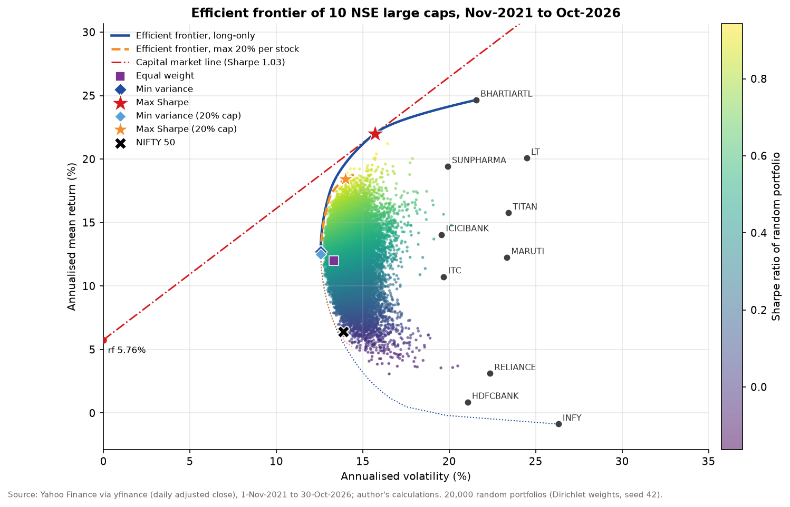
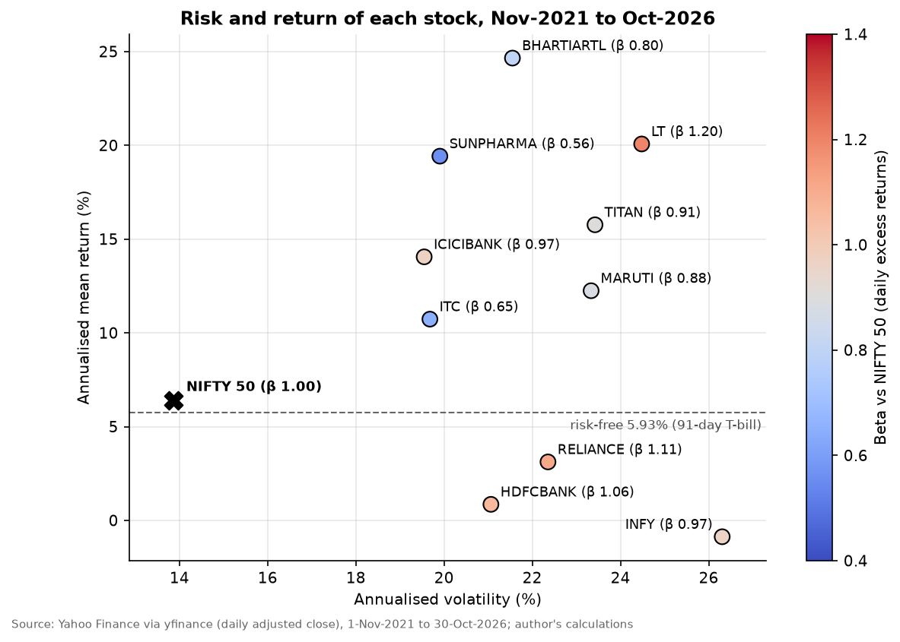
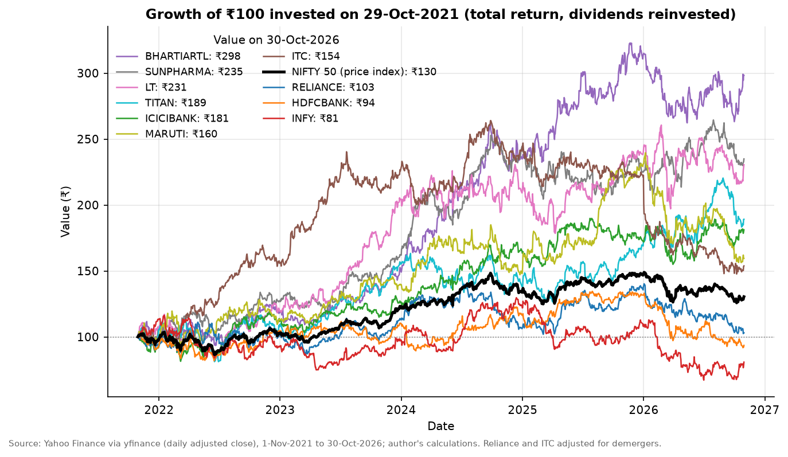
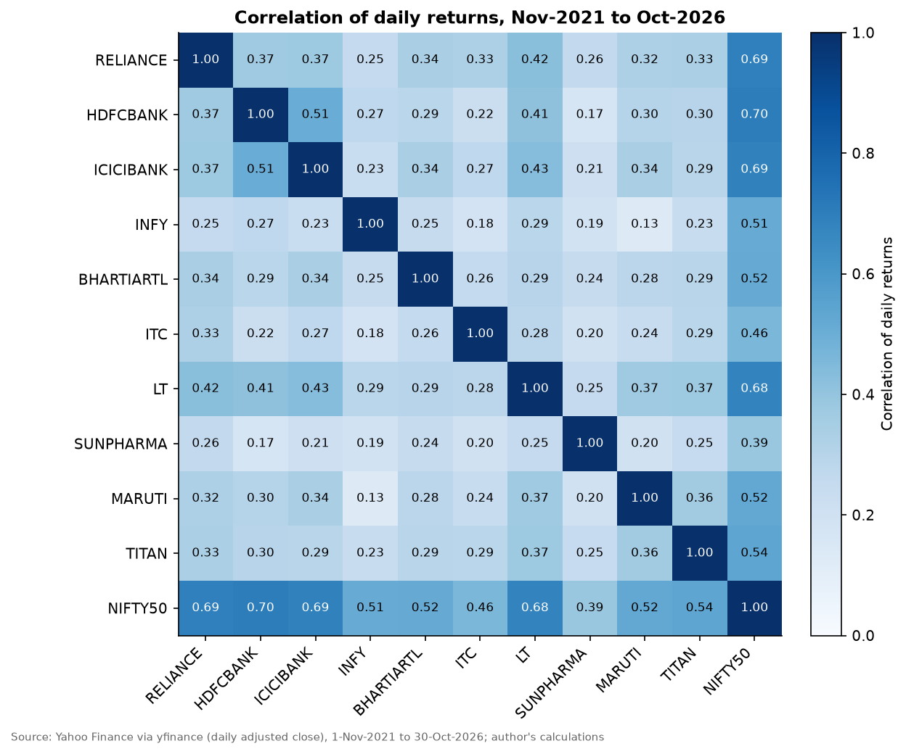
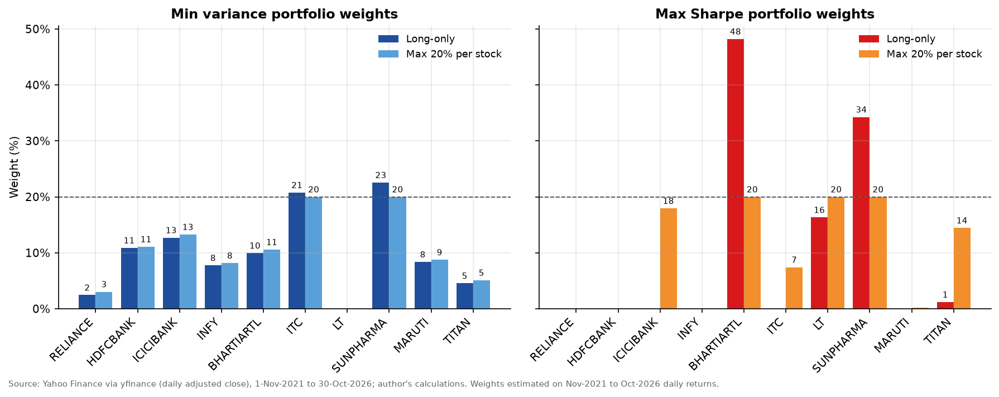
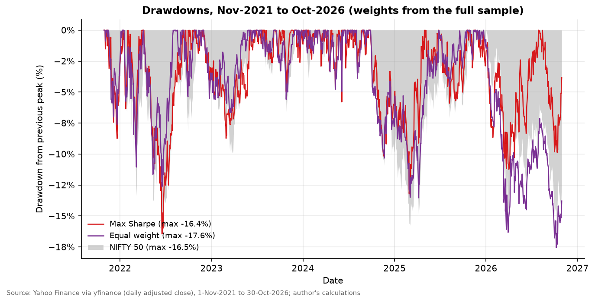
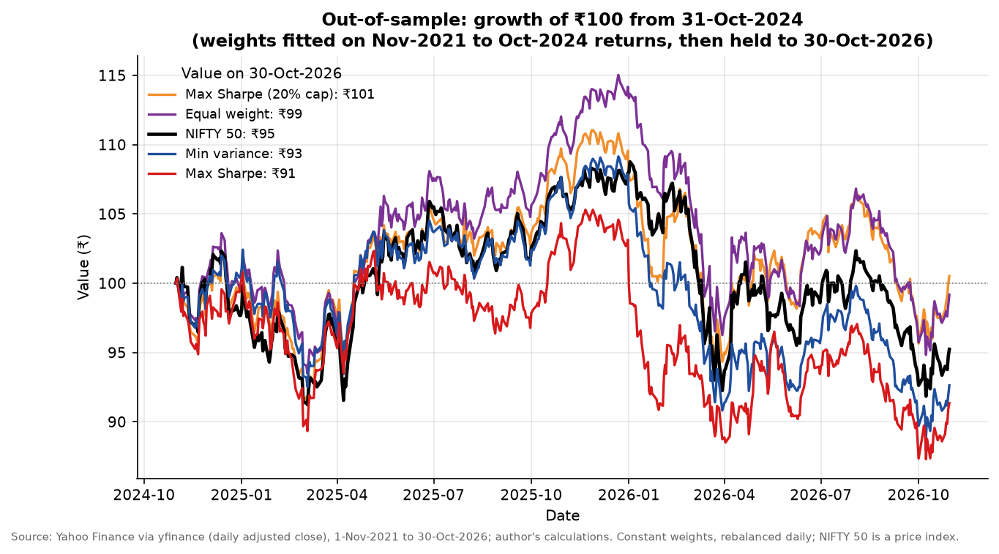

# Portfolio analysis of 10 NSE large caps: returns, beta, Sharpe ratio and the efficient frontier

This project analyses ten large NSE-listed stocks over five years (1-Nov-2021 to 30-Oct-2026) using daily total-return prices from Yahoo Finance. For each stock it measures annualised return, volatility, beta against the NIFTY 50, Jensen's alpha and the Sharpe, Sortino and Treynor ratios. It then builds long-only mean-variance portfolios with SciPy and plots the efficient frontier. With hindsight, the maximum-Sharpe (tangency) portfolio held Bharti Airtel (48%), Sun Pharma (34%), L&T (16%) and Titan (1%) and earned 22.5% a year at 15.7% volatility, a Sharpe ratio of **1.03**, against **0.47** for equal weight and **0.05** for the NIFTY 50 price index (about 0.13 with dividends). Betas range from **0.56 (Sun Pharma)** to **1.20 (L&T)**. An out-of-sample test shows the limits of the method: weights fitted on Nov-2021 to Oct-2024 and held to Oct-2026 lost **4.4% a year** for the tangency portfolio and 3.8% for minimum variance, against -2.4% for NIFTY and -0.4% for equal weight. Volatility forecasts were accurate to within one percentage point; return forecasts were not.



## What the project shows

- Cleaning market data: aligning trading calendars, finding stale vendor rows, correcting demergers with the exchanges' price-discovery data, and checking every large one-day move against news and corporate actions.
- Return and risk statistics: annualised mean, CAGR, volatility, Sharpe, Sortino and Treynor ratios, maximum drawdown and the correlation matrix.
- CAPM regressions: beta, Jensen's alpha with t-statistics and R-squared, with daily, weekly and Dimson betas compared.
- Constrained optimisation with `scipy.optimize` (SLSQP): minimum variance, maximum Sharpe, the efficient frontier and a 20% weight cap, cross-checked with a convex reformulation and the optimality (KKT) conditions.
- Monte Carlo simulation of 20,000 random portfolios and the capital market line.
- An out-of-sample test and a plain reading of estimation error.
- Reproducible Python: typed modules in `src/`, an executed notebook, one command to rebuild every output, saved raw data and 26 PASS/FAIL validation checks.

## Data and sources

| Item | Detail | Source |
|---|---|---|
| Daily prices | RELIANCE.NS, HDFCBANK.NS, ICICIBANK.NS, INFY.NS, BHARTIARTL.NS, ITC.NS, LT.NS, SUNPHARMA.NS, MARUTI.NS, TITAN.NS, NIFTY 50 (`^NSEI`) and NIFTYBEES.NS; 1-Oct-2021 to 30-Oct-2026; `auto_adjust=False`, `Adj Close` used | Yahoo Finance via yfinance 1.7.0, downloaded 31-Oct-2026 (timestamp in `data/metadata.json`) |
| Benchmark | NIFTY 50 price index (`^NSEI`); it excludes dividends. NIFTYBEES (an ETF that keeps the index dividends in its NAV) is used only to size that gap | Yahoo Finance |
| Risk-free rate | 5.93% a year: 91-day T-bill cut-off yield, RBI auction of 28-Oct-2026 | [Economic Times, 28-Oct-2026](https://economictimes.indiatimes.com/markets/bonds/rbi-accepts-20-bps-higher-treasury-bill-cutoff-yields-than-last-auction/articleshow/135284706.cms) |
| Corporate actions and news | Demergers, bonus issues, market holiday and the causes of large moves | Links in the data hygiene tables below |

The ten stocks were chosen as large, liquid NIFTY 50 names that do not appear in the other projects of this portfolio. Raw files are saved in `data/raw/`, so everything after the download runs offline.

Copies of every external source are in [`source_data/`](source_data/), indexed in [`source_data/README.md`](source_data/README.md). They cover the price files, the exchange circulars and company letters on the two demergers, the NIFTY 50 factsheet and constituent list, and the RBI rates page. Saved news articles are copyrighted, so they stay on the author's PC; the index gives the link for each. A plain-language walk-through is in [`explained_simply/README.md`](explained_simply/README.md).

## Data hygiene

All steps run in `src/data_cleaning.py`, which prints a before/after report (reproduced in the notebook). Audit tables are saved in `outputs/demerger_adjustments.csv` and `outputs/large_moves_review.csv`.

**1. Calendar alignment and missing values.** The raw union of dates has 1,256 rows and no missing stock prices. Two dates are dropped so that all 11 series have a real price on every day that remains:

- 15-Jan-2026: NIFTY has no value and Yahoo repeats the 14-Jan stock prices with zero volume. The exchanges were closed for the Maharashtra municipal elections ([Livemint, 15-Jan-2026](https://www.livemint.com/market/stock-market-news/stock-market-holiday-bse-nse-to-remain-shut-for-maharashtra-municipal-elections-commodity-trading-to-begin-at-5-pm-11768439343202.html)).
- 18-Mar-2025: nine of the ten stocks show zero volume and an unchanged price while NIFTY rose 1.45% and ITC traded normally. This is a gap in the vendor data. Keeping it would pair a 0% stock return with a +1.45% market day and distort daily beta.

The aligned panel has 1,254 trading days, of which 1,234 returns fall in the analysis window.

**2. Demergers.** I expected Yahoo not to adjust for demergers. It does, but with factors that differ from the exchanges' special pre-open price discovery. Comparing Yahoo's close on the day before each ex-date with the exchange close shows the factor already inside Yahoo's prices. I replace it with the exchange factor, which is also how NSE treated the NIFTY 50 (the spun-off company stayed in the index as a temporary constituent at the discovered price), by multiplying every earlier price by the residual factor.

| | Reliance / Jio Financial Services | ITC / ITC Hotels |
|---|---|---|
| Ex-date | 20-Jul-2023 | 6-Jan-2025 |
| Entitlement | 1 JFSL share per RIL share | 1 ITC Hotels share per 10 ITC shares |
| Exchange close on the previous day (₹) | 2,841.85 | 481.60 |
| Parent price set in the special pre-open session (₹) | 2,580.00 | 455.60 (NSE) |
| Exchange factor = discovered price / previous close | 0.90786 | 0.94601 |
| Factor already in Yahoo's prices | 0.92300 | 0.96292 |
| Value of one new share: exchange vs Yahoo (₹) | 261.85 vs 218.82 | 260.00 vs 178.60 |
| Residual factor applied to all earlier prices | 0.98360 | 0.98245 |
| Ex-date return (%): traded prices / Yahoo as downloaded / corrected | -7.8 / -0.1 / +1.5 | -8.1 / -4.5 / -2.8 |
| Five-year CAGR (%): as downloaded vs corrected | 0.3 vs 0.6 | 8.6 vs 9.0 |
| Sources | [Reuters via Yahoo Finance, 20-Jul-2023](https://sg.finance.yahoo.com/news/reliance-starts-special-trading-session-034517252.html); [Indian Express, 20-Jul-2023](https://indianexpress.com/article/business/companies/jio-financial-services-ltd-to-demerge-from-ril-today-8849165/) | [Times Now, 6-Jan-2025](https://www.timesnownews.com/business-economy/markets/itc-hotels-share-price-special-trading-session-ends-itc-share-price-adjusts-by-rs-26-on-nse-article-116981147); [CNBC-TV18, 6-Jan-2025](https://www.cnbctv18.com/market/itc-shares-now-trade-ex-hotels-check-stock-price-post-demerger-19534891.htm) |

The corrected ex-date return is P_ex / (f x P_cum) - 1: the return of a holder who sold the new shares at the discovered price and reinvested in the parent. The code measures Yahoo's factor before applying the residual, so it still works if Yahoo changes its adjustment in a later download.

**3. One-day returns below -8%.** Five remain after the correction. None falls on a dividend, split or demerger date, and each matches a reported news event, so all five stay in the data.

| Date | Stock | Return (%) | NIFTY same day (%) | Cause | Source |
|---|---|---:|---:|---|---|
| 17-Apr-2023 | Infosys | -9.4 | -0.7 | Q4 FY23 results below estimates, FY24 guidance of 4-7% | [The Hindu, 17-Apr-2023](https://www.thehindu.com/business/infosys-shares-fall-over-9-mcap-declines-by-59349-crore-post-earnings-announcement/article66747825.ece) |
| 21-Jul-2023 | Infosys | -8.1 | -1.2 | FY24 revenue guidance cut to 1-3.5% | [Reuters via Yahoo Finance, 21-Jul-2023](https://finance.yahoo.com/news/indias-infosys-shares-slide-cutting-035551775.html) |
| 17-Jan-2024 | HDFC Bank | -8.4 | -2.1 | Q3 FY24 results disappointed | [Economic Times, 19-Mar-2026](https://economictimes.indiatimes.com/markets/stocks/news/hdfc-banks-covid-plunge-to-earnings-disappointment-5-biggest-single-day-stock-crashes-since-2020/articleshow/129674611.cms) |
| 4-Jun-2024 | L&T | -12.7 | -5.9 | General election results day | [The Hindu, 4-Jun-2024](https://www.thehindu.com/business/markets/sensex-plunges-57-as-bjp-fails-to-win-majority-on-its-own/article68251438.ece) |
| 1-Jan-2026 | ITC | -9.7 | +0.1 | New excise duty on cigarettes notified on 31-Dec-2025 | [Reuters via Yahoo Finance, 1-Jan-2026](https://sg.finance.yahoo.com/news/indian-tobacco-stocks-tank-government-063100025.html) |

A -8% screen on Yahoo's series would not have caught either demerger, because Yahoo's partial adjustment leaves ex-date moves of only -0.1% and -4.5%. Known corporate actions are therefore handled explicitly. Two gains above +8% are also genuine: HDFC Bank +10.0% on 4-Apr-2022 (merger with HDFC Ltd announced, [CNBC-TV18](https://www.cnbctv18.com/market/stocks/hdfc-hdfc-bank-merger-mortgage-lender-overtakes-icici-bank-to-become-5th-largest-co-by-market-value-13038642.htm)) and Maruti +8.8% on 18-Aug-2025 (proposed GST cut on small cars, [CNBC-TV18](https://www.cnbctv18.com/market/maruti-suzuki-india-share-price-gains-most-in-five-years-gst-rate-cut-product-mix-impact-demand-returns-19655101.htm)).

**4. Bonus issues.** Yahoo records the Reliance 1:1 bonus (28-Oct-2024, [Business Today](https://www.businesstoday.in/markets/stocks/story/ril-bonus-shares-reliance-fixes-monday-october-28-as-record-date-for-issue-450406-2024-10-16)) and the HDFC Bank 1:1 bonus (ex-date 26-Aug-2025, [Livemint](https://livemint.com/market/stock-market-news/hdfc-bank-bonus-issue-reward-or-a-trap-explained-with-the-share-outlook-income-tax-rule-11755912368086.html)) as 2-for-1 splits. Unadjusted, the ex-date returns would be -49.8% and -50.4%. In the adjusted series they are +0.5% and -0.9%, and no return in the three days around either date exceeds 1.6%.

## Method

**Returns.** Daily simple returns r_t = P_t / P_(t-1) - 1 from the cleaned adjusted close, from 1-Nov-2021 to 30-Oct-2026. The first return is measured from the 29-Oct-2021 close, so growth compounds over exactly five calendar years.

**Annualisation.** Means x 252, volatility x sqrt(252). The sample has 246.7 trading days a year, so using 252 raises annualised means by about 2% of their value and Sharpe ratios by about 1%, for every series alike.

**Risk-free rate.** Daily rf = 1.0593^(1/252) - 1 = 0.0229%. On the same arithmetic x252 basis as the mean returns this is 5.76% a year, the rate used in every annualised Sharpe ratio, in the optimiser and as the intercept of the capital market line.

| Measure | Formula |
|---|---|
| CAGR | (V_end / V_start)^(1 / years) - 1, calendar years |
| Sharpe | 252 x mean(r - rf) / (sqrt(252) x std(r)) |
| Sortino | 252 x mean(r - rf) / (sqrt(252) x sqrt(mean(min(r - rf, 0)^2))), downside measured below rf over all days |
| Beta, Jensen's alpha, R-squared | OLS of (r - rf) = alpha + beta (r_m - rf) + e on daily excess returns; alpha annualised as 252 x alpha |
| Treynor | annualised mean excess return / beta |
| Maximum drawdown | largest fall of the wealth index from its running peak |
| Standard error of a mean | annualised volatility / sqrt(years of data) |

**Beta cross-checks.** Weekly beta from Friday-to-Friday returns (261 weeks, weekly rf = 1.0593^(1/52) - 1) and the Dimson (1979) beta, the sum of the slopes on the previous, same and next day's market excess return.

**Portfolios.** Expected returns mu = 252 x mean daily return and covariance Sigma = 252 x sample covariance, both from the full window. All portfolios are long-only and fully invested (w_i >= 0, sum w_i = 1). Problems are solved with `scipy.optimize.minimize(method="SLSQP")` using analytic gradients and several starting points.

- Equal weight: 10% per stock, rebalanced daily. This is an approximation; a real portfolio drifts between rebalances and pays costs when it trades.
- Global minimum variance (GMV): minimise w' Sigma w.
- Maximum Sharpe (tangency): maximise (w' mu - rf) / sqrt(w' Sigma w).
- Efficient frontier: minimise w' Sigma w subject to w' mu = target, for 60 targets from the GMV return (12.7%) to the highest achievable return (24.7%, all in Bharti Airtel), plus 20 targets on the inefficient branch below the GMV. The capped frontier adds w_i <= 20%.
- Monte Carlo: 20,000 portfolios with Dirichlet(1, ..., 1) weights (uniform over all long-only portfolios), seed 42.
- Capital market line: rf + Sharpe_T x volatility.

**Out-of-sample test.** Fit the GMV, maximum-Sharpe and capped maximum-Sharpe weights on 1-Nov-2021 to 31-Oct-2024 (742 trading days), then hold them from 1-Nov-2024 to 30-Oct-2026 (492 trading days) without re-estimating. The main results rebalance daily to the fixed weights; a buy-and-hold version lets the weights drift.

**Validation.** 26 PASS/FAIL checks, all PASS (`outputs/validation_checks.csv`). Six cover the data (no gaps after alignment, no stale rows, demerger dates corrected, every drop below -8% reviewed, no jump at bonus dates, full window). Twenty cover the analysis: weights sum to 1, are non-negative and respect the cap; frontier volatility rises with the target return above the GMV; no frontier or random portfolio has lower volatility than the GMV; the tangency Sharpe ratio is at least that of every frontier point and every random portfolio (1.035 vs a best random 0.943); the tangency weights match a convex reformulation (largest difference 2e-9) and satisfy the KKT conditions; w' mu and sqrt(w' Sigma w) equal 252 x the mean and sqrt(252) x the standard deviation of the daily portfolio returns; the mean log return matches mu - sigma^2/2 within 0.01 percentage points; and weekly and daily volatility agree within 8%. The notebook also confirms that its numbers are identical to those from `src/run_all.py`.

## Results

### Stocks, Nov-2021 to Oct-2026

| Stock | Mean return (% a year) | CAGR (% a year) | Volatility (% a year) | Beta, daily | Beta, weekly | Jensen's alpha (% a year) | Alpha t-stat | R-squared | Sharpe | Sortino | Treynor (% a year) | Max drawdown (%) |
|---|---:|---:|---:|---:|---:|---:|---:|---:|---:|---:|---:|---:|
| Reliance Industries | 3.1 | 0.6 | 22.4 | 1.11 | 1.05 | -3.3 | -0.46 | 0.48 | -0.12 | -0.17 | -2.4 | -27.2 |
| HDFC Bank | 0.9 | -1.3 | 21.1 | 1.06 | 1.01 | -5.6 | -0.82 | 0.49 | -0.23 | -0.32 | -4.6 | -31.7 |
| ICICI Bank | 14.1 | 12.6 | 19.5 | 0.97 | 1.07 | 7.7 | 1.20 | 0.47 | 0.42 | 0.61 | 8.6 | -20.7 |
| Infosys | -0.9 | -4.2 | 26.3 | 0.97 | 0.93 | -7.2 | -0.71 | 0.26 | -0.25 | -0.35 | -6.9 | -48.2 |
| Bharti Airtel | 24.7 | 24.4 | 21.6 | 0.80 | 0.82 | 18.4 | 2.20 | 0.27 | 0.88 | 1.31 | 23.6 | -18.8 |
| ITC | 10.7 | 9.0 | 19.7 | 0.65 | 0.61 | 4.6 | 0.58 | 0.21 | 0.25 | 0.37 | 7.6 | -44.1 |
| Larsen & Toubro | 20.1 | 18.2 | 24.5 | 1.20 | 1.22 | 13.6 | 1.67 | 0.46 | 0.58 | 0.84 | 11.9 | -28.9 |
| Sun Pharmaceutical | 19.4 | 18.6 | 19.9 | 0.56 | 0.62 | 13.3 | 1.61 | 0.15 | 0.69 | 1.03 | 24.5 | -19.1 |
| Maruti Suzuki | 12.2 | 9.8 | 23.3 | 0.88 | 0.89 | 5.9 | 0.66 | 0.27 | 0.28 | 0.41 | 7.4 | -34.8 |
| Titan Company | 15.8 | 13.6 | 23.4 | 0.91 | 1.11 | 9.4 | 1.06 | 0.29 | 0.43 | 0.62 | 11.0 | -28.6 |
| NIFTY 50 (price index) | 6.4 | 5.5 | 13.9 | 1.00 | 1.00 | 0.0 | n/a | 1.00 | 0.05 | 0.06 | 0.6 | -16.5 |

Full table with standard errors, Dimson betas and drawdown dates: `outputs/stock_statistics.csv`.



- **Bharti Airtel** had the best record: 24.4% CAGR, Sharpe 0.88 and the smallest drawdown of the ten (-18.8%). It is the only stock whose Jensen's alpha is statistically different from zero at the 5% level (t = 2.20).
- **Reliance, HDFC Bank and Infosys** earned less than the T-bill rate, so their Sharpe, Sortino and Treynor ratios are negative. Infosys fell 48% from its December-2024 peak.
- **NIFTY 50** returned 5.5% a year as a price index, a little below the T-bill rate, so its Sharpe ratio is 0.05. NIFTYBEES grew 6.6% a year, 1.1 percentage points faster, because it keeps the dividends; on that basis the index's Sharpe ratio is about 0.13. The stock figures include dividends, so comparisons against the price index flatter the stocks by about that margin.
- **Volatility drag:** the arithmetic mean exceeds CAGR by roughly sigma^2/2. Infosys has a -0.9% mean but a -4.2% CAGR at 26% volatility.
- **Noise:** the standard error of a five-year annualised mean is 9 to 12 percentage points for these stocks. Bharti Airtel's 95% confidence interval runs from about 6% to 44% a year.

**Daily vs weekly beta.** A daily beta is biased when prices do not move in sync: if a stock reacts to market news a day late, part of its co-movement lands in the next day's return and a same-day regression misses it (Scholes and Williams, 1977; Dimson, 1979). Weekly returns let that lagged reaction fall inside the same interval. In this sample the two estimates agree within one standard error for eight of the ten stocks. Titan is the clear exception (0.91 daily, 1.11 weekly, 2.2 standard errors apart) and ICICI Bank is borderline (0.97 vs 1.07, 1.6 standard errors); both have Dimson betas (1.02 and 1.04) above their daily betas, which fits a delayed response. For Reliance, HDFC Bank and Infosys, three of the largest NIFTY 50 constituents ([Times Now, Jun-2026](https://www.timesnownews.com/business-economy/markets/how-icici-bank-surpassed-reliance-industries-to-become-nifty-50s-second-highest-weighted-stock-despite-a-smaller-market-cap-explained-article-154530028)), the weekly beta is slightly lower, by less than one standard error. Weekly betas rest on 261 observations instead of 1,234, so their standard errors are about twice as large; most of the remaining gaps are sampling noise.



Seven of the ten stocks beat the NIFTY 50 price index (₹100 to ₹130). Bharti Airtel reached ₹298; Infosys ended at ₹81.



The average pairwise correlation is 0.29, from 0.13 (Infosys and Maruti) to 0.51 (HDFC Bank and ICICI Bank). That is why an equal-weight mix of stocks with about 22% volatility each has 13.3% volatility.

### Portfolios, Nov-2021 to Oct-2026 (weights estimated on the same period)

| Portfolio | Mean return (% a year) | CAGR (% a year) | Volatility (% a year) | Sharpe | Sortino | Beta | Max drawdown (%) | Holdings | Effective number of holdings |
|---|---:|---:|---:|---:|---:|---:|---:|---:|---:|
| Equal weight | 12.0 | 11.5 | 13.3 | 0.47 | 0.67 | 0.91 | -17.6 | 10 | 10.0 |
| Min variance | 12.7 | 12.4 | 12.6 | 0.55 | 0.79 | 0.80 | -17.9 | 9 | 6.8 |
| Max Sharpe | 22.0 | 22.5 | 15.7 | 1.03 | 1.54 | 0.78 | -16.4 | 4 | 2.7 |
| Min variance (20% cap) | 12.5 | 12.1 | 12.6 | 0.54 | 0.77 | 0.81 | -18.1 | 9 | 7.2 |
| Max Sharpe (20% cap) | 18.4 | 18.6 | 14.0 | 0.91 | 1.32 | 0.87 | -14.7 | 7 | 5.6 |
| NIFTY 50 (price index) | 6.4 | 5.5 | 13.9 | 0.05 | 0.06 | 1.00 | -16.5 | n/a | n/a |

Effective number of holdings = 1 / sum(w_i^2).

| Weight (%) | Min variance | Max Sharpe | Min variance (20% cap) | Max Sharpe (20% cap) | Max Sharpe fitted on 2021-24 | Max Sharpe (20% cap) fitted on 2021-24 |
|---|---:|---:|---:|---:|---:|---:|
| Reliance | 2.5 | 0.0 | 3.0 | 0.0 | 0.0 | 0.0 |
| HDFC Bank | 10.9 | 0.0 | 11.1 | 0.0 | 0.0 | 0.0 |
| ICICI Bank | 12.7 | 0.0 | 13.3 | 18.0 | 0.0 | 14.1 |
| Infosys | 7.8 | 0.0 | 8.2 | 0.0 | 0.0 | 0.0 |
| Bharti Airtel | 10.0 | 48.2 | 10.6 | 20.0 | 25.2 | 20.0 |
| ITC | 20.8 | 0.0 | 20.0 | 7.4 | 35.5 | 20.0 |
| L&T | 0.0 | 16.3 | 0.0 | 20.0 | 6.3 | 20.0 |
| Sun Pharma | 22.6 | 34.3 | 20.0 | 20.0 | 33.0 | 20.0 |
| Maruti | 8.4 | 0.0 | 8.7 | 0.2 | 0.0 | 5.9 |
| Titan | 4.6 | 1.2 | 5.1 | 14.4 | 0.0 | 0.0 |



- The best of the 20,000 random portfolios reaches a Sharpe ratio of 0.94, below the tangency's 1.03, and none has lower volatility than the GMV (12.57%). Random weights rarely concentrate, so the cloud sits around equal weight.
- 98.6% of the random portfolios have a higher Sharpe ratio than NIFTY in this sample. That reflects the sample more than the method: the stocks were picked from today's large caps, and the cap-weighted index held large weights in names that lagged.
- The 20% cap costs 0.13 of in-sample Sharpe ratio (1.03 to 0.91) and spreads the tangency portfolio over seven stocks. The capped and uncapped minimum-variance portfolios are almost the same (12.58% vs 12.57% volatility).



The tangency portfolio's worst fall (-16.4%, April to June 2022) matches NIFTY's (-16.5%) despite higher volatility. In the 2026 sell-off its stocks fell less (-11.2% against -15.6% for NIFTY), while equal weight and minimum variance had their worst drawdowns then (-17.6% and -17.9%), not yet recovered on 30-Oct-2026. These are hindsight results.

### Out-of-sample test: fit on Nov-2021 to Oct-2024, hold to Oct-2026

| Portfolio | In-sample CAGR (%) | In-sample Sharpe | Out-of-sample CAGR (%) | Out-of-sample volatility (%) | Out-of-sample Sharpe | Out-of-sample max drawdown (%) | Buy-and-hold CAGR (%) |
|---|---:|---:|---:|---:|---:|---:|---:|
| Equal weight | 20.2 | 1.03 | -0.4 | 12.9 | -0.42 | -17.6 | -0.6 |
| Min variance | 24.6 | 1.37 | -3.8 | 12.2 | -0.74 | -18.6 | -3.7 |
| Max Sharpe | 35.3 | 1.86 | -4.4 | 13.7 | -0.69 | -17.1 | -3.7 |
| Max Sharpe (20% cap) | 31.1 | 1.65 | 0.3 | 13.2 | -0.35 | -15.4 | 0.3 |
| NIFTY 50 (price index) | 11.0 | 0.42 | -2.4 | 13.3 | -0.56 | -15.6 | n/a |



The fitted tangency portfolio turned ₹100 into ₹91 over two years, against ₹95 for NIFTY, ₹99 for equal weight and ₹101 for the capped version. The risk forecasts held: realised volatility was within one percentage point of the in-sample estimate for every portfolio (tangency: 14.0% forecast, 13.7% realised). The return forecasts failed: the tangency portfolio expected a 31.9% mean return and a Sharpe ratio of 1.86, and delivered -3.7% and -0.69. With negative excess returns the Sharpe ratio can rank a riskier loss above a safer one, so CAGR and drawdown should be read alongside it; here the capped portfolio was best on all three.

## Interpretation

**What drives the optimal weights.** At the long-only optimum every stock held earns an excess return proportional to its beta against the tangency portfolio, mu_i - rf = beta_i,T x (mu_T - rf), and every stock left out falls short of that line (`outputs/tangency_optimality.csv`). A stock gets in with a high mean return, low correlation with the other holdings and moderate volatility. Bharti Airtel has the highest mean (24.7%) and correlations of only 0.24 to 0.34 with the other stocks, so it takes 48% of the money and 56% of the portfolio's variance. Sun Pharma has the lowest beta (0.56) and the lowest average correlation with the others (0.22), so it is the largest holding in the minimum-variance portfolio (23%) and the second largest in the tangency portfolio (34%). Reliance, HDFC Bank and Infosys have mean returns below the risk-free rate and get nothing. ICICI Bank misses entry by 0.45 percentage points of expected return a year, a small fraction of its 8.8-point standard error.

**Why mean-variance overweights past winners.** The optimiser treats sample means as true expected returns. The standard error of each five-year mean (9 to 12 percentage points) is larger than most of the gaps between the stocks, so part of every high sample mean is luck, and the optimiser puts the most money where that luck was largest. Michaud (1989) describes mean-variance optimisers as estimation-error maximisers. The weights also move a lot for small input changes: cutting Bharti Airtel's mean by one standard error (9.7 points) drops its tangency weight from 48% to 12% and raises Sun Pharma's to 47%; adding 1 point to ICICI Bank's mean brings it in at 3%. The out-of-sample test shows the consequence. The 2021-24 fit put 94% into ITC, Sun Pharma and Bharti Airtel after each returned over 30% a year. Over the next two years ITC fell 38% (the cigarette tax shock of January 2026) and Sun Pharma was flat. Across the ten stocks the rank correlation between the two periods' mean returns was 0.19, against 0.88 for volatilities and 0.79 for the pairwise correlations: risk estimates carried over, return estimates did not.

**Concentration risk.** The hindsight tangency portfolio has 2.7 effective holdings and one stock supplies 56% of its variance, so a single company event moves the whole portfolio. ITC's 9.7% fall on 1-Jan-2026 cost the 2021-24 tangency portfolio, with 35% in ITC, about 3.4 percentage points in one day. A 20% cap gives up a little in-sample Sharpe ratio but forces diversification; out of sample it was the only fitted portfolio with a positive return. Studies on longer samples find the same: optimised portfolios rarely beat 1/N once estimation error is counted (DeMiguel, Garlappi and Uppal, 2009), and weight constraints work like shrinkage of the covariance estimates (Jagannathan and Ma, 2003).

## Key takeaways

- With hindsight, three stocks (Bharti Airtel, Sun Pharma, L&T) gave a portfolio with more than twice the Sharpe ratio of equal weight (1.03 vs 0.47). The NIFTY 50 price index managed 0.05 (about 0.13 with dividends).
- Betas run from 0.56 (Sun Pharma) to 1.20 (L&T). Daily and weekly betas mostly agree within sampling error; Titan is the one clear case of a higher weekly beta.
- Diversification works: average correlation is 0.29, and equal weight cut volatility from about 22% for the typical stock to 13.3%.
- Optimised weights fitted on 2021-24 lost money in 2024-26 and trailed equal weight. Volatility and correlation estimates carried over; mean-return estimates did not.
- Concentration is the price of the highest in-sample Sharpe ratio. A simple 20% cap cost 0.13 of Sharpe in-sample and did best out of sample.

## Limitations

- Historical means are noisy (standard errors of 9 to 12 percentage points a year over five years), so every optimised weight carries wide uncertainty.
- Five years is one market regime, and the out-of-sample test covers only two years in a weak market; it cannot rank strategies with any confidence.
- Survivorship and selection bias: the ten stocks are 2026 large caps, chosen knowing which companies stayed large.
- The risk-free rate is held at 5.93% for the whole period, although T-bill yields moved during 2021-26.
- No transaction costs, taxes, market impact or rebalancing frictions; daily rebalancing is an approximation.
- The benchmark is the NIFTY 50 price index; the dividend gap is estimated from one ETF (NIFTYBEES), which also carries a small expense ratio and tracking error.
- The demerger corrections use the exchanges' special-session prices. Other choices, such as the new companies' listing prices, would change Reliance's and ITC's five-year CAGR by a few tenths of a percentage point.
- Yahoo data can be revised; a fresh download may differ slightly from the snapshot in `data/raw/`.

## How to reproduce

From the `08-portfolio-analysis` folder, with Python 3.11 or later:

```
python -m pip install -r requirements.txt
python src/run_all.py
python -m jupyter nbconvert --to notebook --execute --inplace portfolio_analysis.ipynb --ExecutePreprocessor.timeout=1200
```

`src/run_all.py` rebuilds `data/processed/`, `outputs/` and `figures/` from the saved raw data in a few seconds, prints the hygiene report and the 26 checks, and exits with code 1 if any check fails. To refresh the raw data first (internet needed), run `python src/fetch_data.py`.

## Project structure

```
08-portfolio-analysis/
  README.md
  portfolio_analysis.ipynb        executed notebook: method, results and checks
  requirements.txt
  data/
    raw/                          one yfinance CSV per ticker (12 files)
    prices_adjclose.csv           tidy Adj Close table, as downloaded
    metadata.json                 download timestamp, tickers, parameters, row counts
    processed/prices_adjclose_clean.csv   aligned and demerger-corrected prices
  source_data/                    original downloads behind every external number, with an index (README.md)
  explained_simply/README.md      plain-language guide to the project
  src/
    config.py                     universe, dates, risk-free rate, paths
    fetch_data.py                 price download (online)
    fetch_source_data.py          saves the source documents into source_data/ (online; the analysis does not need it)
    data_cleaning.py              hygiene steps, corporate-action data and audit tables
    portfolio.py                  return and risk statistics, regressions, optimisers, frontier
    analysis.py                   pipeline, out-of-sample test, validation checks, CSV writer
    plotting.py                   figures
    run_all.py                    regenerates outputs/ and figures/
  figures/                        7 PNG charts (150 dpi)
  outputs/
    stock_statistics.csv          per-stock statistics (incl. standard errors, Dimson beta)
    portfolio_weights.csv         weights: full-sample portfolios and 2021-24 fits
    portfolio_statistics.csv      portfolio performance, Nov-2021 to Oct-2026
    efficient_frontier.csv        160 frontier portfolios with weights (both frontiers)
    out_of_sample.csv             in-sample and out-of-sample results
    tangency_optimality.csv       KKT check and beta against the tangency portfolio
    demerger_adjustments.csv      demerger factors and before/after returns
    large_moves_review.csv        reviewed one-day moves beyond 8%
    validation_checks.csv         26 PASS/FAIL checks
```

## References

- DeMiguel, V., Garlappi, L. and Uppal, R. (2009). Optimal versus naive diversification: how inefficient is the 1/N portfolio strategy? *Review of Financial Studies* 22(5), 1915-1953. [Link](https://academic.oup.com/rfs/article-abstract/22/5/1915/1592901)
- Dimson, E. (1979). Risk measurement when shares are subject to infrequent trading. *Journal of Financial Economics* 7(2), 197-226. [doi:10.1016/0304-405X(79)90013-8](https://doi.org/10.1016/0304-405X(79)90013-8)
- Jagannathan, R. and Ma, T. (2003). Risk reduction in large portfolios: why imposing the wrong constraints helps. *Journal of Finance* 58(4), 1651-1683. [NBER working paper](https://www.nber.org/papers/w8922)
- Michaud, R. (1989). The Markowitz optimization enigma: is 'optimized' optimal? *Financial Analysts Journal* 45(1), 31-42. [doi:10.2469/faj.v45.n1.31](https://doi.org/10.2469/faj.v45.n1.31)
- Scholes, M. and Williams, J. (1977). Estimating betas from nonsynchronous data. *Journal of Financial Economics* 5(3), 309-327. [doi:10.1016/0304-405X(77)90041-1](https://doi.org/10.1016/0304-405X(77)90041-1)

Educational project, not investment advice.
