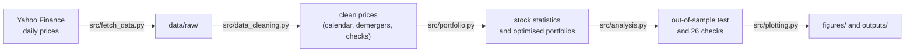

# Project 8 explained simply: which mix of 10 big Indian stocks gave the best return for the risk?

## What this project does

It takes ten large NIFTY 50 companies and five years of daily prices (Nov-2021 to Oct-2026). For each stock it measures how much it earned, how much it swung around, and how closely it followed the market. Then it asks: if you could split ₹100 between these ten stocks, which split gives the most return for each unit of risk? The set of best splits for each level of risk is called the efficient frontier, and the project draws it.

The short answer: looking back, a mix of Bharti Airtel (48%), Sun Pharma (34%), L&T (16%) and Titan (1%) had the best return for its risk, a Sharpe ratio of 1.03, against 0.47 for an equal split and 0.05 for the NIFTY 50. But when the same method was run on 2021-24 data and the portfolio held for 2024-26, it lost 4.4% a year. Past returns are a poor guide to future returns, even though past risk is a good guide to future risk.

## Why these stocks and this data

**Why these ten stocks.** Each comes from a different part of the economy, so the portfolio can actually diversify: energy (Reliance), banks (HDFC Bank, ICICI Bank), IT (Infosys), telecom (Bharti Airtel), consumer goods (ITC), engineering (L&T), pharma (Sun Pharma), cars (Maruti Suzuki) and jewellery and watches (Titan). All ten are NIFTY 50 members (checked against the official constituent list) and trade heavily, so their daily prices are reliable. None of them is used in your other projects.

**Why not the obvious alternatives.**

- The whole NIFTY 50 (50 stocks) makes the covariance estimates much noisier and the charts unreadable. Ten stocks is what the brief asked for.
- Mutual funds or ETFs would hide what each company did, and Project 9 already uses ETFs.
- Monthly data gives only 60 observations in five years, which is too few. Daily data gives 1,234.

**Why this data.** Yahoo Finance gives free daily prices with an "adjusted close" that adds back dividends and splits, so returns include dividends. Its handling of demergers is not quite right, so the exchange circulars and company letters were used to correct it (see step 3 below). The risk-free rate is the 91-day Treasury bill yield from the RBI's auction of 28-Oct-2026 (5.93%).

## How I did it, step by step

1. **Downloaded prices** (`src/fetch_data.py`) for the ten stocks, the NIFTY 50 and NIFTYBEES (an ETF that tracks the NIFTY 50 including dividends), 1-Oct-2021 to 30-Oct-2026, into `data/raw/`. Why: everything afterwards runs offline from this saved copy.
2. **Lined up the calendars** (`src/data_cleaning.py`). Two dates were dropped: 15-Jan-2026, when the exchanges were closed but Yahoo repeated old prices, and 18-Mar-2025, a gap in Yahoo's data where nine stocks showed no trading. Why: a fake 0% day for a stock next to a real market move would distort beta.
3. **Fixed two demergers.** Reliance spun off Jio Financial in July 2023, and ITC spun off ITC Hotels in January 2025. Yahoo adjusts for them, but not with the price the exchange set on the day. I replaced Yahoo's factor with the exchange's (for Reliance, ₹2,580 / ₹2,841.85 = 0.908). Why: an investor who held Reliance kept the Jio Financial shares, so that value must not look like a loss.
4. **Checked every one-day fall of more than 8%.** Five remain, and each matches real news (for example L&T -12.7% on election results day, 4-Jun-2024), so they stay. Two bonus issues (Reliance and HDFC Bank, both 1:1) are already adjusted.
5. **Calculated daily returns** for 1-Nov-2021 to 30-Oct-2026 (1,234 days) and annualised them: mean x 252, volatility x √252.
6. **Measured each stock** (`src/portfolio.py`): mean return, CAGR, volatility, maximum drawdown, and Sharpe, Sortino and Treynor ratios. Regressing each stock's excess return on the market's gives beta, Jensen's alpha and R-squared. Weekly betas were also computed as a check.
7. **Built portfolios** with SciPy's optimiser (SLSQP), long-only and fully invested: equal weight, minimum variance, maximum Sharpe (the "tangency" portfolio), and the same with a 20% cap per stock.
8. **Drew the efficient frontier**: for 60 target returns, the lowest-risk mix that reaches each target. 20,000 random portfolios were added as a cloud (seed 42), plus the capital market line.
9. **Ran an out-of-sample test** (`src/analysis.py`): fit the weights on Nov-2021 to Oct-2024 only, then hold them from Nov-2024 to Oct-2026 and see what actually happened.
10. **Ran 26 checks**, all PASS (`outputs/validation_checks.csv`). Examples: weights add to 100%, no random portfolio beats the tangency Sharpe ratio, the optimiser's answer satisfies the mathematical optimality conditions, and annualised figures agree with the daily data.
11. **Made the charts and the notebook** (`src/plotting.py`, `portfolio_analysis.ipynb`), both from the same code, so the numbers in the README, the notebook and the CSVs are identical.

## Where every important number came from

The saved news pages (`news_and_macro/*.html`, except the RBI page) are copyrighted articles, so they stay on your PC and are not in the GitHub copy. Use the link in the Source column instead.

| Number | Value | Source | File in source_data/ |
|---|---|---|---|
| Daily prices of the ten stocks and NIFTY 50 | 1-Oct-2021 to 30-Oct-2026 | [Yahoo Finance](https://finance.yahoo.com/quote/RELIANCE.NS/history/) via yfinance | `yahoo_finance/<TICKER>.csv`, Excel copy `yahoo_finance/Yahoo_Finance_daily_prices_NSE_2021-10-01_to_2026-10-30.xlsx` |
| NIFTY 50 on 30-Oct-2026 | 23,053.10 | Yahoo Finance (`^NSEI`) | `yahoo_finance/metadata.json` |
| Risk-free rate | 5.93% (91-day T-bill cut-off, 5.9337%) | [RBI home page, Current Rates](https://www.rbi.org.in/); [Economic Times, 28-Oct-2026](https://economictimes.indiatimes.com/markets/bonds/rbi-accepts-20-bps-higher-treasury-bill-cutoff-yields-than-last-auction/articleshow/135284706.cms) | `news_and_macro/RBI_homepage_current_rates_TBill_cutoff_30Oct2026.html` |
| Reliance / Jio Financial demerger | 1 JFSL share per Reliance share; ex-date 20-Jul-2023 | [Reliance letter to the exchanges](https://www.ril.com/sites/default/files/2023-08/SEIntimation_ApportionmentofCost_0.pdf); [NSE circular CMTR57524](https://nsearchives.nseindia.com/content/circulars/CMTR57524.pdf) | `company_filings/RIL_intimation_apportionment_of_cost_JFSL_2023.pdf`, `nse/NSE_circular_CMTR57524_RIL_special_pre-open_session_12Jul2023.pdf` |
| Reliance price set in the special session | ₹2,580 (previous close ₹2,841.85) | [Reuters via Yahoo Finance, 20-Jul-2023](https://sg.finance.yahoo.com/news/reliance-starts-special-trading-session-034517252.html) | `news_and_macro/Reuters_Yahoo_RIL_special_session_price_20Jul2023.html` (local only) |
| ITC / ITC Hotels demerger | 1 ITC Hotels share per 10 ITC shares; ex-date 6-Jan-2025 | [ITC record-date letter](https://itcportal.com/content/dam/itc-corporate/pdfs/2024/lodr-18dec24.pdf); [NSE circular FAOP65975](https://nsearchives.nseindia.com/content/circulars/FAOP65975.pdf) | `company_filings/ITC_letter_record_date_18Dec2024.pdf`, `nse/NSE_circular_FO_adjustment_ITC_scheme_of_arrangement_Jan2025.pdf` |
| ITC price set in the special session | ₹455.60 (previous close ₹481.60) | [Times Now, 6-Jan-2025](https://www.timesnownews.com/business-economy/markets/itc-hotels-share-price-special-trading-session-ends-itc-share-price-adjusts-by-rs-26-on-nse-article-116981147) | `news_and_macro/TimesNow_ITC_special_session_price_6Jan2025.html` (local only) |
| How NIFTY 50 treated the spin-offs | Spun-off company kept in the index at a constant price | [NSE Indices press release, 17-Jul-2023](https://www.niftyindices.com/Press_Release/ind_prs17072023.pdf); [NSE circular FAOP58203](https://nsearchives.nseindia.com/content/circulars/FAOP58203.pdf) | `nse/NSE_Indices_press_release_RIL_demerger_index_treatment_Jul2023.pdf`, `nse/NSE_circular_index_constituent_spun_off_entity_constant_price.pdf` |
| All ten stocks are NIFTY 50 members | yes | [NIFTY 50 constituent list](https://www.niftyindices.com/IndexConstituent/ind_nifty50list.csv) | `nse/NIFTY50_constituents_list.csv` |
| NIFTY 50 method and weights | Free-float market cap, 50 stocks; HDFC Bank 9.95%, ICICI Bank 9.39% | [NIFTY 50 factsheet](https://www.niftyindices.com/Factsheet/ind_nifty50.pdf) | `nse/NIFTY50_factsheet.pdf` |
| Causes of large one-day moves | e.g. L&T -12.7% on 4-Jun-2024 (election results) | News links in the main README | `news_and_macro/*.html` (local only) |

Every other number (returns, betas, Sharpe ratios, weights) is calculated by the code from the price files. See `outputs/*.csv`.

## Key assumptions and why

| Assumption | Value | Why |
|---|---|---|
| Analysis window | 1-Nov-2021 to 30-Oct-2026 | Five full years up to the latest close |
| Returns | Daily simple returns of the adjusted close | Adjusted close includes dividends; simple returns add up across stocks in a portfolio |
| Annualisation | Mean x 252, volatility x √252 | Standard convention (about 247 actual trading days a year here, so all ratios are about 1-2% higher) |
| Risk-free rate | 5.93% a year (5.76% on the same basis as mean returns) | The 91-day T-bill is the usual risk-free rate in India |
| Benchmark | NIFTY 50 price index | Most-used Indian benchmark. It leaves out dividends; NIFTYBEES shows the gap is about 1.1 points a year |
| Portfolio rules | Long-only, fully invested, rebalanced daily | No short selling or borrowing; daily rebalancing keeps weights fixed (real portfolios drift and pay costs) |
| Expected returns and risk | Historical mean and covariance of the same period | Simplest choice. The out-of-sample test shows why this is dangerous for returns |
| Weight cap | 20% per stock (second version) | A simple guard against putting everything in last period's winners |

## Words you need to know

| Term | Meaning |
|---|---|
| Return (mean, CAGR) | Mean = average daily return x 252. CAGR = the steady yearly growth rate that turns the start value into the end value |
| Volatility | How much returns swing around, measured by the standard deviation; higher means bumpier |
| Beta | How much a stock moves when the market moves 1%. Sun Pharma's 0.56 means about 0.56% on average; L&T's 1.20 means 1.2% |
| Alpha (Jensen's) | Return beyond what beta alone would predict |
| Sharpe ratio | (Return - risk-free rate) / volatility: extra return per unit of risk |
| Sortino ratio | Like Sharpe, but counts only downside swings as risk |
| Treynor ratio | Extra return per unit of beta (market risk) |
| Maximum drawdown | The biggest fall from a peak to a later low |
| Correlation | How closely two stocks move together, from -1 to +1; low correlation is what makes diversification work |
| Efficient frontier | For each level of risk, the portfolio with the highest return; anything below the curve is worse |
| Tangency (maximum-Sharpe) portfolio | The frontier point with the highest Sharpe ratio, where the capital market line touches the curve |
| Minimum-variance portfolio | The mix with the lowest possible volatility |
| Capital market line | The line from the risk-free rate through the tangency portfolio: combinations of T-bills and the best risky portfolio |
| Out-of-sample test | Fit on one period and test on a later period the model has never seen |
| Demerger | A company splits off part of itself into a new listed company; shareholders get shares in both |

## How to check the work yourself

1. Run `python src/run_all.py`. It ends with the 26 checks; all must say PASS, or the script exits with an error.
2. Open `outputs/validation_checks.csv` to see each check and its value.
3. Open `portfolio_analysis.ipynb` on GitHub. It shows every step with its output, and it checks that its numbers equal those from `src/run_all.py`.
4. Compare `outputs/portfolio_weights.csv` with the efficient frontier chart: the tangency portfolio holds Bharti Airtel 48.2%, Sun Pharma 34.3%, L&T 16.3% and Titan 1.2%.
5. Check the demerger fix in `outputs/demerger_adjustments.csv`: the factors 0.90786 (Reliance) and 0.94601 (ITC) come from the exchange prices in the source documents.

## How to explain this project in an interview

**30-second version.** "I analysed ten NIFTY 50 stocks over five years in Python: return, volatility, beta, Sharpe, Sortino, drawdown. Then I built long-only mean-variance portfolios with SciPy and drew the efficient frontier. In hindsight the maximum-Sharpe portfolio had a Sharpe of 1.03, against 0.47 for equal weight. The part I'd stress is the out-of-sample test: weights fitted on 2021-24 lost 4.4% a year over 2024-26 and trailed an equal split. Risk estimates carried over between periods; return estimates did not. A simple 20% cap did best. I also cleaned the data properly, for example correcting the Reliance and ITC demergers with the exchanges' discovered prices."

**Likely questions.**

1. *Why did the optimised portfolio fail out of sample?* It treats five-year average returns as true expected returns, but each average has a standard error of 9-12 percentage points a year. The optimiser piles into the stocks that were luckiest. In 2021-24 that meant ITC, Sun Pharma and Bharti Airtel; ITC then fell 38% after the January-2026 cigarette tax.
2. *Why do daily and weekly betas differ?* If a stock reacts to market news a day late, a same-day regression misses part of the link. Weekly returns capture the delayed reaction. Here they agree for most stocks; Titan (0.91 daily, 1.11 weekly) is the clear exception.
3. *How would you improve the method?* Shrink expected returns towards a common value (or use Black-Litterman), shrink the covariance matrix, cap weights, and rebalance monthly with transaction costs. Then test on rolling windows, not one split.
