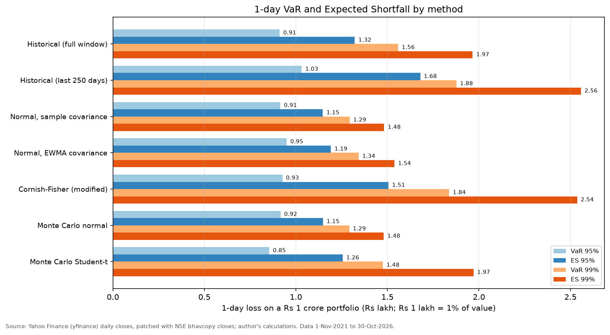
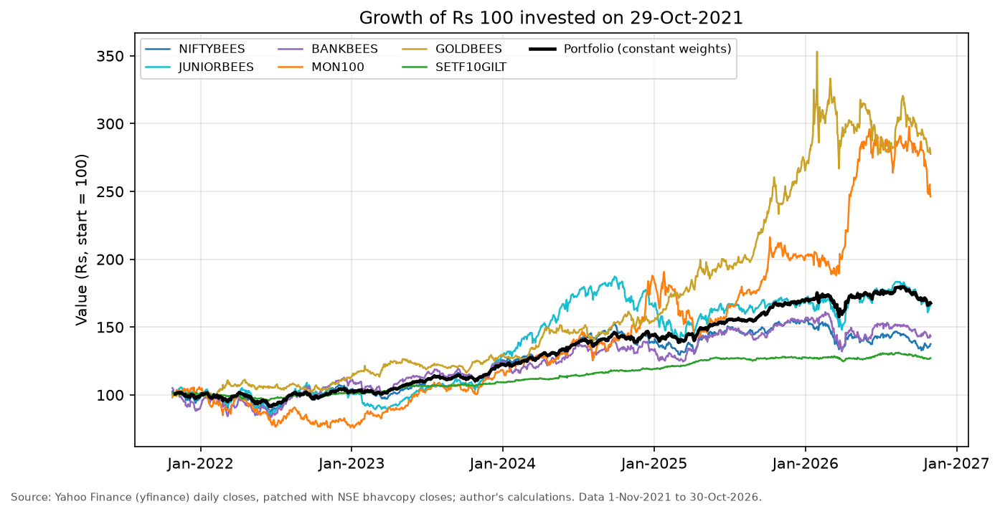
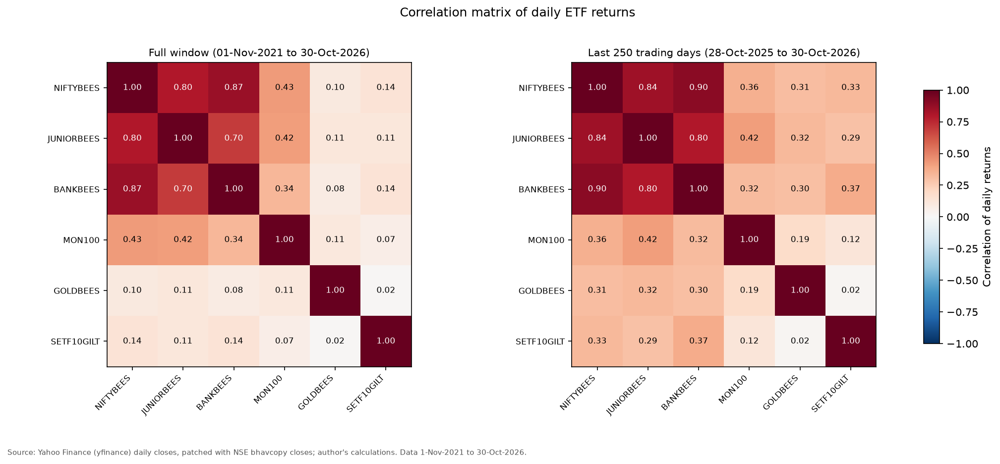
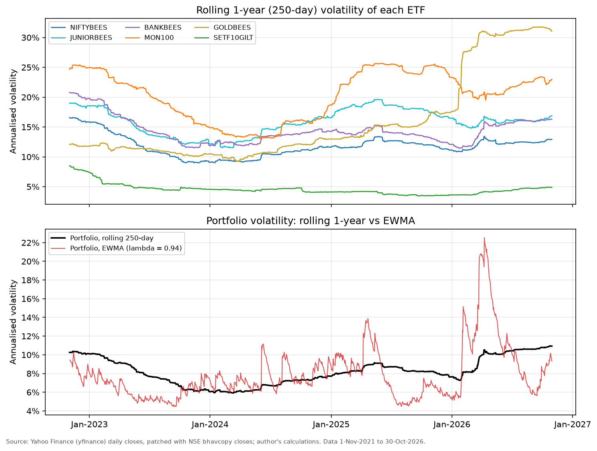
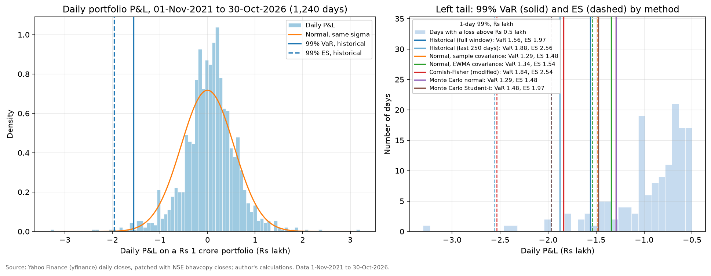
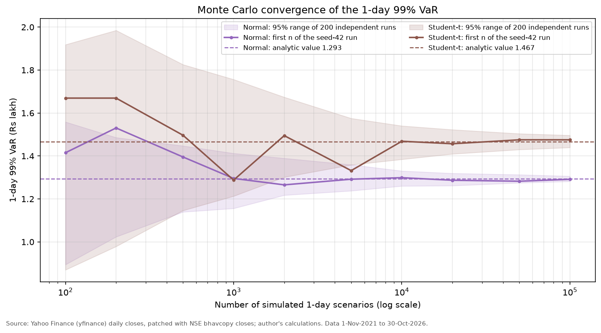
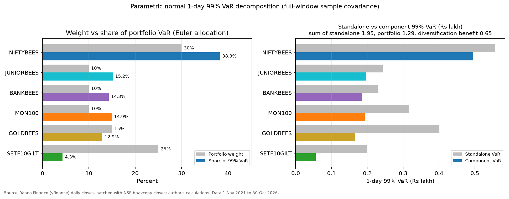
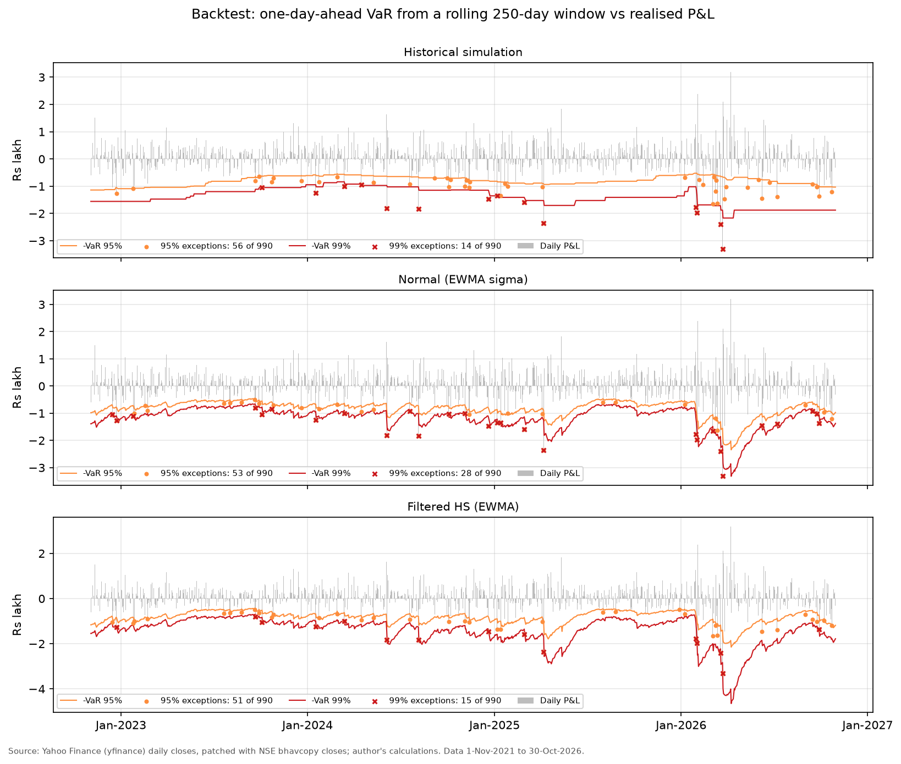

# Value at Risk and Expected Shortfall of a ₹1 crore multi-asset ETF portfolio

This project measures the market risk of a ₹1 crore portfolio of six NSE-listed ETFs (Indian large caps, the next 50 large caps, banks, the Nasdaq-100, gold and a 10-year government-bond ETF) at the close of 30-Oct-2026. It uses five years of daily prices (1-Nov-2021 to 30-Oct-2026, 1,240 trading days) and computes Value at Risk (VaR) and Expected Shortfall (ES) with historical simulation, parametric normal and Cornish-Fisher formulas, and Monte Carlo simulation (100,000 scenarios). The one-day 99% VaR is **₹1.56 lakh (1.56% of the portfolio)** by historical simulation, with an ES of **₹1.97 lakh**. The normal model gives a lower **₹1.29 lakh**, because the real return distribution has fat tails. A rolling 250-day backtest over 990 days confirms this: historical simulation (14 exceptions against 9.9 expected) and filtered historical simulation pass every coverage test at 99%, while the normal model with EWMA volatility fails (28 exceptions, Basel red zone in the last 250 days). Indian equities are 50% of the money but **68% of the risk**, and diversification cuts the 99% VaR by **34%** against the sum of the six stand-alone VaRs. The worst day in the sample, 23-Mar-2026, lost ₹3.30 lakh, 2.1 times the 99% VaR, because gold fell 8.5% together with equities.



## What the project shows

- Three VaR families on the same data: historical simulation (full window and last 250 days), parametric normal (sample and EWMA covariance), Cornish-Fisher modified VaR, and Monte Carlo with multivariate normal and Student-t draws (Cholesky factor, seed 42, convergence study).
- Expected Shortfall for every method, with closed forms checked against numerical integration and Monte Carlo.
- Ten-day VaR by square-root-of-time scaling and by direct estimation, with an explanation of the gap.
- Risk decomposition: marginal and component VaR (Euler allocation) and the diversification benefit.
- Model validation: a rolling one-day-ahead backtest of five models with the Kupiec, Christoffersen and conditional-coverage tests and the Basel traffic light.
- Stress testing with historical worst days (each matched to a news event) and hypothetical shocks.
- Data cleaning against an official source: every suspicious Yahoo Finance row checked against the NSE bhavcopy, a jump screen, a calendar check that found five sessions missing from Yahoo, and a rule-based choice of the bond ETF.
- Reproducible Python: typed modules in `src/`, an executed notebook, one command that rebuilds every output, saved raw data and 38 PASS/FAIL validation checks.

## Data and sources

| Item | Detail | Source |
|---|---|---|
| Daily ETF prices | The six portfolio ETFs, eight other bond ETFs screened for the bond sleeve and the NIFTY 50 index (`^NSEI`, used as the trading calendar); 1-Oct-2021 to 30-Oct-2026; `auto_adjust=False`, `Adj Close` (equal to `Close`: none of the six ETFs paid a distribution) | Yahoo Finance via yfinance 1.7.0, downloaded 31-Oct-2026 23:51 IST (`data/raw/download_log.json`) |
| Official closing prices | NSE capital-market bhavcopy files for 76 dates. Files were requested for every non-trading date in the window (a file exists only if the exchange traded; 5 did), every date with a missing, zero-volume or extreme Yahoo row, the valuation date, 3-5 Jun-2024 and 25 random days | NSE archives, `https://nsearchives.nseindia.com/content/cm/BhavCopy_NSE_CM_0_0_0_<YYYYMMDD>_F_0000.csv.zip` (older format before 2024: `.../content/historical/EQUITIES/<YYYY>/<MON>/cm<DD><MON><YYYY>bhav.csv.zip`), downloaded 31-Oct-2026 and 1-Nov-2026 |
| ETF documents | Product notes and factsheets of the six ETFs (index tracked, holdings, expense ratio) | Nippon India Mutual Fund, Motilal Oswal Mutual Fund, SBI Mutual Fund; links in [`source_data/README.md`](source_data/README.md) |
| Risk-free rate (context only) | 91-day T-bill cut-off yield 5.93%, RBI auction of 28-Oct-2026 | [RBI home page](https://www.rbi.org.in/); [Economic Times, 28-Oct-2026](https://economictimes.indiatimes.com/markets/bonds/rbi-accepts-20-bps-higher-treasury-bill-cutoff-yields-than-last-auction/articleshow/135284706.cms) |
| USD/INR (context only) | 95.15 on 30-Oct-2026 | Yahoo Finance `INR=X` |
| Events on the worst days | News reports, linked in the stress-test table | See [Stress tests](#stress-tests) |

Copies of every external source are in [`source_data/`](source_data/), indexed in [`source_data/README.md`](source_data/README.md). Saved news articles are copyrighted, so they stay on the author's PC; the index gives the link for each. A plain-language walk-through is in [`explained_simply/README.md`](explained_simply/README.md).

## The portfolio on 30-Oct-2026

| ETF (NSE symbol) | Fund | Tracks | Weight | Value (₹) | Close (₹) |
|---|---|---|---:|---:|---:|
| NIFTYBEES | Nippon India ETF Nifty 50 BeES | NIFTY 50 | 30% | 30,00,000 | 262.89 |
| JUNIORBEES | Nippon India ETF Nifty Next 50 Junior BeES | NIFTY Next 50 | 10% | 10,00,000 | 730.90 |
| BANKBEES | Nippon India ETF Nifty Bank BeES | NIFTY Bank | 10% | 10,00,000 | 565.47 |
| MON100 | Motilal Oswal Nasdaq 100 ETF | Nasdaq-100, in rupees (no currency hedge) | 10% | 10,00,000 | 284.94 |
| GOLDBEES | Nippon India ETF Gold BeES | Domestic price of gold | 15% | 15,00,000 | 115.23 |
| SETF10GILT | SBI Nifty 10 yr Benchmark G-Sec ETF | NIFTY 10-year benchmark G-Sec | 25% | 25,00,000 | 258.85 |

An ETF portfolio spreads risk across asset classes and keeps this project separate from the single-company projects in this portfolio. Weights are held constant: each past day is read as "what today's positions would have done on that day".

## Data hygiene

All steps run in `src/data_prep.py`. Audit tables: `outputs/data_fixes.csv`, `outputs/nse_crosscheck.csv`, `outputs/jump_screen.csv`, `outputs/bond_etf_screen.csv` and `outputs/data_quality.csv`.

**1. Choosing the bond ETF.** Nine bond ETFs were screened over the same window with a fixed rule: holds government securities, at least 4.9 years of history, at most 5 missing days and at most 5% stale days (close equal to the previous close, a sign of thin trading); among those, the lowest stale share. Only SETF10GILT passes.

| Ticker | Holds | Years of data | Missing days | Stale days (%) | Median traded value (₹ lakh a day) | Result |
|---|---|---:|---:|---:|---:|---|
| SETF10GILT | NIFTY 10-year benchmark G-Sec | 5.0 | 1 | 2.43 | 14.4 | **selected** |
| LTGILTBEES | NIFTY 8-13 yr G-Sec | 5.0 | 21 | 9.14 | 305.3 | too many gaps and stale days |
| GILT5YBEES | NIFTY 5-year benchmark G-Sec | 5.0 | 4 | 5.12 | 112.9 | stale share above 5%, shorter duration |
| LICNETFGSC | NIFTY 8-13 yr G-Sec | 5.0 | 1 | 6.65 | 5.0 | stale share above 5% |
| EBBETF0430, EBBETF0431 | AAA PSU bonds (Bharat Bond 2030, 2031) | 5.0 | 1, 21 | 0.24, 0.16 | 139.7, 95.9 | not government bonds |
| EBBETF0433, GSEC10IETF, GSEC10ABSL | PSU bonds 2033; 10-year G-Secs | 1.7 | 3 | 0.25 to 32.0 | 0.0 to 50.9 | less than two years of data |

SETF10GILT is thinly traded (median ₹14.4 lakh a day), which shows up later as negative autocorrelation in its daily returns.

**2. Trading calendar.** A day counts as an NSE session if Yahoo has a NIFTY 50 close. For every other date in the window the NSE bhavcopy was requested; a file exists only if the exchange traded. This found five sessions that Yahoo omits for every ETF: Sunday 12-Nov-2023 (Diwali Muhurat session), Saturdays 20-Jan-2024, 2-Mar-2024 and 18-May-2024, and Sunday 1-Feb-2026 (Union Budget day, [The Hindu](https://www.thehindu.com/business/markets/stock-markets-sensex-nifty-budget-day-february-1-2026/article70576763.ece)). Their closes come from the bhavcopy. One Yahoo row with no index close and zero volume in every ETF (15-Jan-2026, when the exchanges were shut for the Maharashtra municipal elections, [Livemint](https://www.livemint.com/market/stock-market-news/stock-market-holiday-bse-nse-to-remain-shut-for-maharashtra-municipal-elections-commodity-trading-to-begin-at-5-pm-11768439343202.html)) is dropped. Leaving out the Budget session would merge two days of moves; for GOLDBEES it would have shown a -9.5% day on 2-Feb-2026 instead of -6.7% on 1-Feb and -3.0% on 2-Feb.

**3. Bad prints and missing rows.** A Yahoo close that differs from the NSE close by more than 0.01% is replaced, and missing rows are inserted from the bhavcopy: 19 closes replaced and 35 rows inserted. Most replaced rows are zero-volume placeholders on 1-Nov-2024, 18-Mar-2025 and 19-Dec-2025, when Yahoo shows an old or wrong price. The largest was MON100 on 24-Oct-2025: Yahoo ₹217.32, NSE ₹241.80 (-10.1%); left in, it would have created a -9.6% day followed by a +12.9% day.

**4. Cross-check.** After cleaning, all 453 ETF-day closes fetched from NSE (76 dates) equal the cleaned closes, and so do the previous closes, which confirms no session is missing between them. On the 25 randomly chosen days Yahoo already matched NSE in all 144 ETF-days, so the unchecked days are very likely right too.

**5. Jump screen.** One-day moves above 8% (equity ETFs) or 3% (gold and bond ETFs) were checked: 35 flags, of which 32 are genuine gold moves confirmed by the bhavcopy and 3 are artefacts removed by the fixes above. Gold had nine daily moves of 5% or more between 21-Jan and 23-Mar-2026, including -10.5% on 30-Jan-2026, when Nippon India's gold ETF fell about 11% according to the [Economic Times](https://economictimes.com/markets/stocks/news/explained-why-gold-silver-etfs-crashed-up-to-14-and-should-you-buy-the-dip/articleshow/127791282.cms).

**6. ETF price vs index.** On 4-Jun-2024 (general election results, [The Hindu](https://www.thehindu.com/business/markets/sensex-plunges-57-as-bjp-fails-to-win-majority-on-its-own/article68251438.ece)) NIFTYBEES closed 2.97% lower while the NIFTY 50 fell 5.93%; the NSE bhavcopy confirms the ETF close of ₹250.48. The gap reversed the next day (ETF +0.33%, index +3.36%). This is real ETF price behaviour, so it stays in the data; the sensitivity check below shows its effect on the tail.

## Method

**Returns and portfolio.** Daily simple returns r = P_t / P_(t-1) - 1; portfolio return r_p = Σ w_i r_i with the target weights. VaR and ES are positive rupee losses on V = ₹1 crore. For confidence α (95% or 99%) and tail probability p = 1 - α:

- VaR = -Q_p(r_p) x V, where Q_p is the p-quantile of the daily return.
- ES = -E[r_p | r_p ≤ Q_p] x V, the average loss on the days beyond VaR.

| Method | VaR | ES |
|---|---|---|
| Historical simulation | Empirical p-quantile of the 1,240 daily returns (or the last 250), linear interpolation (`numpy.quantile` default) | Mean of the returns at or below that quantile: 13 days at 99% and 62 at 95% (3 and 13 in the last 250 days) |
| Normal | z_α σ_p V, σ_p = √(w'Σw), zero mean, z_0.95 = 1.645, z_0.99 = 2.326 | σ_p V φ(z_α) / (1 - α) |
| Normal, EWMA | Same with Σ from RiskMetrics EWMA, Σ_(t+1) = λ Σ_t + (1 - λ) r_t r_t', λ = 0.94: the forecast for 2-Nov-2026 | Same |
| Cornish-Fisher | -z_cf σ_p V with z_cf = z + (z² - 1)S/6 + (z³ - 3z)K/24 - (2z³ - 5z)S²/36, z = Φ⁻¹(p), S = skewness, K = excess kurtosis | Tail average of the Cornish-Fisher quantile, (1/p)∫₀ᵖ z_cf(Φ⁻¹(u)) du x σ_p V, in closed form |
| Monte Carlo normal | 100,000 draws r = Lz with LL' = Σ (Cholesky), seed 42; empirical quantile of the simulated P&L | Mean of the simulated losses beyond VaR |
| Monte Carlo Student-t | r = L_s z √(ν/W), W ~ χ²_ν, scale matrix Σ(ν - 2)/ν so the covariance stays Σ; ν = 4.29 fitted by maximum likelihood to the standardised portfolio returns | Same |

Σ is the sample covariance of the full window unless stated. Parametric and Monte Carlo models assume a zero expected return. At the 91-day T-bill yield of 5.93% one day's risk-free return is about ₹2,300 and the sample mean return is ₹4,322 a day, both small against a VaR of ₹1.3 to 1.9 lakh.

**Ten-day VaR.** Square-root-of-time: √10 x the one-day figure. Direct historical: overlapping 10-day returns of each ETF with positions held fixed. Direct Monte Carlo: 10 independent daily draws per path, compounded per ETF.

**Component VaR (Euler allocation).** With the normal model, marginal VaR_i = z_α (Σw)_i / σ_p per rupee, component VaR_i = w_i V x marginal VaR_i, and the components add up exactly to the portfolio VaR. Stand-alone VaR_i = z_α σ_i w_i V.

**Backtest.** From 3-Nov-2022 to 30-Oct-2026 (990 days), each model is re-estimated every day on the previous 250 daily returns and forecasts the next day's VaR. Models: historical simulation (HS); normal with the window's sample volatility; normal with EWMA volatility; Student-t with EWMA volatility and ν refitted daily; and filtered historical simulation (FHS: the empirical quantile of returns divided by their EWMA volatility, multiplied by today's EWMA volatility, after Barone-Adesi et al., 1999). An exception is a day whose loss exceeds the forecast.

| Test | Statistic | Question |
|---|---|---|
| Kupiec (1995) proportion of failures | LR = -2 ln[(1-p)^(n-x) p^x / ((1-x/n)^(n-x) (x/n)^x)] ~ χ²(1) | Is the exception rate equal to p? |
| Christoffersen (1998) independence | Likelihood ratio of a two-state Markov chain (π₀₁, π₁₁) against a constant rate, ~ χ²(1) | Are exceptions more likely the day after an exception? |
| Conditional coverage | LR_cc = LR_pof + LR_ind ~ χ²(2), computed on the day-to-day transitions | Both at once |
| Basel traffic light (BCBS, 1996) | Exceptions of the 99% VaR in the last 250 days: 0-4 green, 5-9 yellow, 10+ red | Would a supervisor accept the model? |

Tests reject at the 5% level.

**Validation.** 38 PASS/FAIL checks, all PASS (`outputs/validation_checks.csv`). Data: cleaned closes equal every NSE close fetched; every large move is confirmed or removed; the screen selects SETF10GILT. Models: historical VaR equals `numpy` and `pandas` quantiles; Monte Carlo VaR is within 2% of the closed form (normal -0.16%, Student-t +0.58% at 99%) and Monte Carlo ES within 3 Monte Carlo standard errors; Student-t and Cornish-Fisher ES closed forms equal numerical integrals; component VaRs add up to the total; the Cholesky factor reproduces Σ; the 10-day square-root rows equal √10 x the 1-day figures. Backtest: the Kupiec code reproduces the published acceptance region (5 to 16 exceptions in 1,000 days at 99%, 38 to 64 at 95%; Jorion, 2007), the conditional-coverage statistic equals its two parts, the Basel zone limits follow from the binomial rule, and a no-look-ahead test (delete later days and change the forecast day's own returns) leaves the forecasts unchanged. The notebook also confirms that its numbers equal those in `outputs/`.

## Results

### Return statistics, 1-Nov-2021 to 30-Oct-2026

| Series | CAGR (%) | Volatility (% a year) | Skewness | Excess kurtosis | Worst day (%) | Date of worst day |
|---|---:|---:|---:|---:|---:|---|
| NIFTYBEES | 6.58 | 12.61 | -0.12 | 2.17 | -3.62 | 24-Feb-2022 |
| JUNIORBEES | 10.64 | 16.51 | -0.57 | 2.04 | -5.26 | 24-Feb-2022 |
| BANKBEES | 7.46 | 15.56 | -0.11 | 3.24 | -4.68 | 24-Feb-2022 |
| MON100 | 19.74 | 21.50 | -0.02 | 2.29 | -6.59 | 7-Apr-2025 |
| GOLDBEES | 22.65 | 18.20 | -0.66 | 15.22 | -10.52 | 30-Jan-2026 |
| SETF10GILT | 4.93 | 5.43 | 0.02 | 6.02 | -1.71 | 20-Jan-2022 |
| Portfolio (constant weights) | 10.88 | 8.79 | -0.32 | 3.35 | -3.30 | 23-Mar-2026 |

Volatility = daily standard deviation x √250. Full table: `outputs/asset_stats.csv`.





Over the full window gold and the gilt ETF have correlations of only 0.08 to 0.14 with the three Indian equity ETFs, which is why the portfolio's volatility (8.8%) is far below that of any equity ETF. In the last 250 days those correlations rose to 0.29 to 0.37, so the diversification was weaker exactly when volatility was highest.



### One-day VaR and ES at the 30-Oct-2026 close

₹ lakh; ₹1 lakh = 1% of the portfolio value. Full table in rupees: `outputs/var_summary.csv`.

| Method | VaR 95% | ES 95% | VaR 99% | ES 99% |
|---|---:|---:|---:|---:|
| Historical, full window (1,240 days) | 0.91 | 1.32 | **1.56** | **1.97** |
| Historical, last 250 days | 1.03 | 1.68 | 1.88 | 2.56 |
| Normal, sample covariance (σ_p = 0.556% a day) | 0.91 | 1.15 | 1.29 | 1.48 |
| Normal, EWMA covariance (σ_p = 0.577% a day) | 0.95 | 1.19 | 1.34 | 1.54 |
| Cornish-Fisher (S = -0.32, K = 3.35) | 0.93 | 1.51 | 1.84 | 2.54 |
| Monte Carlo normal | 0.92 | 1.15 | 1.29 | 1.48 |
| Monte Carlo Student-t (ν = 4.29) | 0.85 | 1.26 | 1.48 | 1.97 |

In rupees, the 99% figures are: historical VaR ₹1,55,855 and ES ₹1,96,546; normal VaR ₹1,29,346 and ES ₹1,48,187; Monte Carlo normal VaR ₹1,29,136 (0.16% below the closed form).



- **At 95% the methods agree** (₹0.85 to 0.95 lakh over the full window): the middle of the distribution is close to normal.
- **At 99% they split.** The normal models give ₹1.29 to 1.34 lakh. Historical simulation (₹1.56 lakh), Cornish-Fisher (₹1.84 lakh) and the Student-t (₹1.48 lakh) allow for the fat left tail and give 14% to 42% more. The Student-t has the lowest 95% VaR: with the same variance, a fat-tailed distribution puts more weight in the centre and in the far tail and less in between.
- **ES is where the methods differ most**: ₹1.48 lakh (normal) to ₹2.54 lakh (Cornish-Fisher) at 99%. The historical 99% ES is 1.26 times its VaR; for the normal it is 1.15 times.
- **The last 250 days were riskier** than the five-year average (99% VaR ₹1.88 lakh), driven by the 2026 sell-offs and gold's swings. The 250-day ES rests on only three days, so it is noisy.
- The ES estimator matters little: the Acerbi-Tasche version (exactly np worst returns, the last one with a fractional weight) gives ₹1.98 lakh instead of ₹1.97 lakh for the full-window 99% ES (`outputs/es_estimators.csv`).

### Monte Carlo convergence



The band is the 2.5% to 97.5% range of 200 independent runs of each size. At 100,000 draws the normal 99% VaR lies between ₹1,28,177 and ₹1,30,598 in 95% of runs (about ±0.9% around the closed-form ₹1,29,346). The Student-t band is wider (₹1,43,949 to ₹1,49,630, about ±1.9% around its closed form of ₹1,46,669) because its tail is heavier. The error shrinks with the square root of the number of draws, so halving it takes four times as many. The seed-42 run used for the results is inside both bands. Table: `outputs/mc_convergence.csv`.

### Ten-day VaR

| Method | 95%: √10 x 1-day (₹ lakh) | 95%: direct (₹ lakh) | 99%: √10 x 1-day (₹ lakh) | 99%: direct (₹ lakh) | 99%: direct / √10 |
|---|---:|---:|---:|---:|---:|
| Historical, full window | 2.88 | 2.48 | 4.93 | 4.15 | 0.84 |
| Monte Carlo normal | 2.90 | 2.86 | 4.08 | 4.01 | 0.98 |
| Monte Carlo Student-t | 2.70 | 2.84 | 4.67 | 4.19 | 0.90 |

Square-root scaling of the other 99% figures gives ₹4.09 lakh (normal), ₹4.25 lakh (EWMA), ₹5.81 lakh (Cornish-Fisher) and ₹5.93 lakh (historical, last 250 days).

The direct historical 10-day VaR is 16% below the square-root figure for two reasons. First, the overlapping 10-day returns include the sample's positive drift (₹43,223 over 10 days). With the drift removed from both, the direct 99% VaR is ₹4.57 lakh against ₹5.07 lakh for √10 x the 1-day figure, still 10% lower. Second, 10-day returns are closer to normal than daily returns (excess kurtosis 0.91 against 3.35), so the 99% loss sits 2.55 standard deviations below the mean instead of 2.88. The portfolio's variance ratio, Var(10-day) / (10 x Var(1-day)), is 1.04, so the variance itself scales almost exactly with time; the gilt ETF on its own has a ratio of 0.43 and a lag-1 autocorrelation of -0.28, the mark of price noise in a thinly traded fund. Using non-overlapping 10-day windows instead (124 of them) gives a 99% VaR anywhere from ₹3.13 lakh to ₹4.73 lakh depending on which of the ten possible start days is used, so the direct estimate is unstable. The Monte Carlo Student-t shows the same effect from the model side: summing ten fat-tailed days moves the 99% VaR down (0.90) and the 95% VaR up (1.05). Tables: `outputs/ten_day_comparison.csv`, `outputs/ten_day_effects.csv`, `outputs/ten_day_variance_ratios.csv`.

### Where the risk comes from

Normal model, one-day 99% VaR, full-window covariance (EWMA covariance in the last column).

| ETF | Weight | Stand-alone VaR (₹) | Component VaR (₹) | Share of portfolio VaR | Share with EWMA covariance |
|---|---:|---:|---:|---:|---:|
| NIFTYBEES | 30% | 55,678 | 49,526 | 38.3% | 33.0% |
| JUNIORBEES | 10% | 24,297 | 19,647 | 15.2% | 15.9% |
| BANKBEES | 10% | 22,892 | 18,522 | 14.3% | 11.6% |
| MON100 | 10% | 31,637 | 19,333 | 14.9% | 15.5% |
| GOLDBEES | 15% | 40,165 | 16,698 | 12.9% | 17.7% |
| SETF10GILT | 25% | 19,989 | 5,620 | 4.3% | 6.4% |
| **Total** | 100% | **1,94,659** | **1,29,346** | 100% | 100% |

The diversification benefit is ₹65,313, or 33.6% of the sum of the stand-alone VaRs (28.6% with the EWMA covariance, ₹53,706). The three Indian equity ETFs carry 68% of the risk on 50% of the money. The gilt ETF carries 4% of the risk on 25% of the money. Gold's share rises from 12.9% to 17.7% with the EWMA covariance because gold was far more volatile in 2026 than before. Tables: `outputs/component_var.csv`, `outputs/diversification.csv`.



### Backtest, 3-Nov-2022 to 30-Oct-2026

990 one-day-ahead forecasts per model, each from the previous 250 days. Expected exceptions: 49.5 at 95% and 9.9 at 99%. p-values below 0.05 reject the model.

| Model | 95%: exceptions | 95%: Kupiec p | 95%: CC p | 99%: exceptions | 99%: Kupiec p | 99%: independence p | 99%: CC p | 99%: exceptions in last 250 days | Basel zone |
|---|---:|---:|---:|---:|---:|---:|---:|---:|---|
| Historical simulation | 56 | 0.3528 | 0.3857 | 14 | 0.2176 | 0.1885 | 0.1962 | 4 | green |
| Normal, sample volatility | 43 | 0.3327 | 0.4572 | 18 | **0.0203** | 0.3324 | **0.0419** | 7 | yellow |
| Normal, EWMA volatility | 53 | 0.6137 | 0.6915 | 28 | **0.0000** | 0.8175 | **0.0000** | 10 | **red** |
| Student-t, EWMA volatility | 59 | 0.1782 | 0.2915 | 20 | **0.0046** | 0.4179 | **0.0128** | 7 | yellow |
| Filtered historical simulation | 51 | 0.8277 | 0.6888 | 15 | 0.1300 | 0.2208 | 0.1495 | 5 | yellow |

Bold = rejected at 5%. Full table: `outputs/backtest_summary.csv`; daily forecasts: `outputs/backtest_daily.csv`.



- **Historical simulation and FHS pass** the Kupiec, independence and conditional-coverage tests at both levels.
- **Normal VaR fails at 99%** with both volatility estimates. EWMA tracks volatility well (it passes at 95% with 53 exceptions), but after dividing by the EWMA volatility the returns still have excess kurtosis of 1.54 and a variance of 1.08 instead of 1, so 2.83% of days fall below -2.326 standard deviations instead of 1%. The Student-t with EWMA volatility helps but still fails (20 exceptions).
- **No model shows clustering**: every independence p-value is above 0.18.
- **The last year was harder.** From 28-Oct-2025, historical simulation had 23 exceptions at 95% against 12.5 expected (Kupiec p = 0.0061 on that year alone), because a 250-day window reacts slowly to a jump in volatility. At 99% it stayed green with 4.

Forecasts for Monday 2-Nov-2026 from the same 250-day models (`outputs/next_day_var.csv`): 99% VaR ₹1.88 lakh (HS), ₹1.74 lakh (FHS), ₹1.61 lakh (normal, sample), ₹1.49 lakh (Student-t) and ₹1.34 lakh (normal, EWMA).

### Stress tests

Moves (%) on the five worst days for today's weights, and the loss on today's ₹1 crore positions.

| Date | NIFTYBEES | JUNIORBEES | BANKBEES | MON100 | GOLDBEES | SETF10GILT | Loss (₹ lakh) | x 1-day 99% historical VaR | What happened |
|---|---:|---:|---:|---:|---:|---:|---:|---:|---|
| 23-Mar-2026 | -2.64 | -3.83 | -3.48 | -3.00 | -8.54 | -0.79 | 3.30 | 2.12 | US-Iran war: crude above $105, NIFTY 50 -2.6%, gold and silver about -10% ([Livemint](https://livemint.com/market/stock-market-news/stock-market-live-gold-silver-rate-today-23-march-2026-nifty-sensex-crude-oil-us-iran-war-11774231309874.html), [Financial Express](https://financialexpress.com/market/why-did-markets-fall-today-nifty-closes-at-8-month-lows-sensex-slides-1800-points-5-key-reasons-explained-4181369/)) |
| 19-Mar-2026 | -2.71 | -2.60 | -3.12 | -0.93 | -5.15 | -0.60 | 2.40 | 1.54 | Oil spike and HDFC Bank's chairman resigned; NIFTY 50 -3.26%, its worst day since 4-Jun-2024 ([Livemint](https://www.livemint.com/market/stock-market-news/stock-market-rout-deepens-as-hdfc-bank-shock-meets-west-asia-turmoil-11773900435554.html), [CNBC-TV18](https://www.cnbctv18.com/market/stock-market-crash-nifty-50-sell-off-key-triggers-market-cap-erosion-oil-hdfc-bank-it-stocks-52-week-low-shares-ws-e-19871727.htm)) |
| 7-Apr-2025 | -3.13 | -2.81 | -2.93 | -6.59 | -1.55 | +0.21 | 2.35 | 1.51 | Global sell-off after the US reciprocal tariffs; NIFTY 50 -3.24% ([Times of India](https://timesofindia.indiatimes.com/business/international-business/global-stock-markets-tumble-amid-tariff-war-japan-china-and-india-hit-hard-10-things-to-know/articleshow/120051763.cms)) |
| 24-Feb-2022 | -3.62 | -5.26 | -4.68 | -4.10 | +3.55 | -0.27 | 2.02 | 1.30 | Russia invaded Ukraine; NIFTY 50 -4.78% ([The Hindu](https://www.thehindu.com/business/markets/russia-ukraine-crisis-sensex-nifty-tank-over-47-in-line-with-global-meltdown/article65080368.ece), [Times of India](https://timesofindia.indiatimes.com/business/markets/sensex/russia-ukraine-crisis-spooks-markets-sensex-crashes-2702-points-nifty-ends-below-16300/articleshow/89799030.cms)) |
| 1-Feb-2026 (Sunday) | -1.51 | -1.57 | -2.02 | -0.65 | -6.72 | -0.35 | 1.97 | 1.26 | Union Budget raised the securities transaction tax on futures and options; NIFTY 50 -1.96%; gold ETFs kept falling after the 30-Jan crash ([The Hindu](https://www.thehindu.com/business/markets/stock-markets-sensex-nifty-budget-day-february-1-2026/article70576763.ece), [Economic Times](https://economictimes.com/markets/stocks/news/rs-10-lakh-crore-wiped-out-sensex-down-1900-points-nifty-below-24600-why-did-the-stock-market-crash-after-budget-key-factors/articleshow/127836069.cms)) |

| Hypothetical shock (instantaneous, on today's positions) | Loss (₹) | x 1-day 99% historical VaR |
|---|---:|---:|
| Indian equity ETFs -10% | 5,00,000 | 3.21 |
| Nasdaq-100 -15% and rupee +3% (USD/INR from 95.15 to 92.30): MON100 (0.85 x 0.97) - 1 = -17.55% | 1,75,500 | 1.13 |
| Gold +5% | gain of 75,000 | -0.48 |
| Gilt ETF -2% (roughly a 0.3 percentage-point rise in the 10-year yield, assuming a modified duration of about 7) | 50,000 | 0.32 |
| All four together | 6,50,500 | 4.17 |

Two of the five worst days are gold days. On 24-Feb-2022 gold rose 3.6% and cushioned the equity fall; on 23-Mar-2026 and 1-Feb-2026 it fell with equities, so the hedge failed when it was needed. Even the worst historical day is only 2.1 times the 99% VaR, but the combined hypothetical shock costs 4.2 times. Table: `outputs/stress_tests.csv`.

### Sensitivity: ETF closing prices vs the index

Replacing NIFTYBEES returns with NIFTY 50 index returns (1,235 days) raises the full-window 99% historical VaR from ₹1,55,855 to ₹1,57,827 and the 99% ES from ₹1,96,546 to ₹2,10,067, mostly because of 4-Jun-2024, which becomes the second-worst day (-2.71%). The ETF's price smooths the most extreme index days, so ETF-price VaR slightly understates the risk of the holdings themselves. Table: `outputs/sensitivity_nifty_index.csv`.

## What this means for a risk manager

- **Report a fat-tail-aware 99% VaR**: ₹1.56 lakh a day (historical) or ₹1.74 lakh (FHS, for the next day), not the ₹1.29 lakh of the normal model, which failed the backtest at 99%. The normal model is fine at 95%.
- **Use ES for limits.** On the worst 1% of days the average loss is about ₹2 lakh (historical), and the five worst days cost ₹1.97 to 3.30 lakh. VaR is a threshold, not a worst case.
- **Recalibrate after volatility jumps.** A 250-day historical window lagged in 2026 (23 exceptions at 95% in the last year). FHS adapts faster and passed the coverage tests over the full period.
- **Risk sits in Indian equities.** The marginal 99% VaR is ₹0.017 to ₹0.020 per rupee for the four equity ETFs, ₹0.011 for gold and ₹0.002 for the gilt ETF, so moving money from equities to the gilt ETF is the most direct way to cut VaR.
- **Do not count on gold as a hedge in every crisis.** Its correlation with Indian equities rose to about 0.3 in the last year, and it fell 8.5% on the worst day.
- **For a 10-day horizon**, the square-root rule (₹4.93 lakh at 99%, historical) is more conservative and more stable than direct 10-day estimates from five years of data.

## Key takeaways

- One-day 99% VaR of the ₹1 crore portfolio: ₹1.56 lakh (historical), ₹1.29 lakh (normal), ₹1.84 lakh (Cornish-Fisher), ₹1.48 lakh (Monte Carlo Student-t). The 99% ES runs from ₹1.48 lakh (normal) to ₹2.54 lakh (Cornish-Fisher).
- The methods agree at 95% and diverge at 99%, because the portfolio's returns have fat tails (excess kurtosis 3.35).
- Historical and filtered historical simulation pass every backtest; normal VaR at 99% is rejected, and the EWMA-normal model lands in the Basel red zone.
- Indian equities are 68% of the risk; diversification removes a third of the stand-alone risk.
- Clean data matters: Yahoo missed five exchange sessions and had 19 wrong closes, one of which would have created a -9.6% / +12.9% pair of days in MON100.

## Limitations

- Five years is one sample. The 99% historical figures rest on 13 days, and the 250-day ES on three.
- Constant weights and daily rebalancing are assumed; there are no transaction costs, and the 10-day figures assume positions are not traded for 10 days.
- ETF closing prices are used, not NAVs. ETF prices can deviate from NAV on stress days (4-Jun-2024) and lag for MON100, whose US holdings trade after the Indian close. The gilt ETF is thinly traded (₹14.4 lakh a day) and its daily returns carry price noise: their volatility is 5.4% a year, while SBI's factsheet reports a standard deviation of 3.02% for the fund (its own measure).
- Liquidity risk is not modelled: selling ₹25 lakh of SETF10GILT would take more than a day's typical turnover.
- The Monte Carlo models use one covariance matrix and, for the Student-t, one degrees-of-freedom parameter for all six ETFs; they ignore volatility clustering, which the EWMA and FHS models address only in the backtest.
- Cornish-Fisher relies on sample skewness and kurtosis, which are themselves noisy (gold's excess kurtosis of 15 comes mainly from January to March 2026).
- Hypothetical shocks are judgement-based and instantaneous; they are not probability-weighted.
- Yahoo data can be revised; a fresh download may differ slightly from the snapshot in `data/raw/`.

## How to reproduce

From the `09-risk-analysis-var` folder, with Python 3.11 or later:

```
python -m pip install -r requirements.txt
python src/run_all.py
python -m jupyter nbconvert --to notebook --execute --inplace var_analysis.ipynb --ExecutePreprocessor.timeout=1200
```

`src/run_all.py` rebuilds `data/prices_adjclose.csv`, `outputs/` and `figures/` from the saved raw data in about two minutes, prints the results and the 38 checks, and exits with code 1 if any check fails (`--no-build` skips the price rebuild). To download the raw data again (internet needed, about five minutes), run `python src/fetch_data.py`. `python src/fetch_source_data.py` rebuilds `source_data/`; the analysis does not use that folder.

## Project structure

```
09-risk-analysis-var/
  README.md
  var_analysis.ipynb              executed notebook: method, results and checks
  requirements.txt
  data/
    raw/                          yfinance CSVs (6 ETFs, 8 other bond ETFs, NIFTY 50), NSE bhavcopy
                                  extract and request log, download log
    prices_adjclose.csv           cleaned closes of the six ETFs
    metadata.json                 download parameters, calendar rule, every data fix, cross-check counts
  source_data/                    original downloads behind every external number, with an index (README.md)
  explained_simply/README.md      plain-language guide to the project
  src/
    config.py                     portfolio, dates, model settings, paths
    fetch_data.py                 Yahoo and NSE downloads (online)
    fetch_source_data.py          saves the source documents into source_data/ (online)
    data_prep.py                  calendar, NSE fixes, quality tables, bond screen, returns
    var_models.py                 VaR/ES formulas, Monte Carlo, decomposition
    backtest.py                   rolling forecasts, Kupiec, Christoffersen, Basel zones
    stress.py                     worst days and hypothetical shocks
    analysis.py                   pipeline steps and the 38 validation checks
    plots.py                      figures
    run_all.py                    regenerates outputs/ and figures/
  figures/                        8 PNG charts (150 dpi)
  outputs/
    var_summary.csv               1-day and 10-day VaR/ES, every method
    backtest_summary.csv          coverage tests and Basel zones; backtest_daily.csv has the daily forecasts
    component_var.csv, diversification.csv
    stress_tests.csv, mc_convergence.csv, next_day_var.csv, es_estimators.csv
    ten_day_comparison.csv, ten_day_effects.csv, ten_day_variance_ratios.csv
    asset_stats.csv, correlation_full_window.csv, correlation_last250.csv, holdings.csv
    sensitivity_nifty_index.csv, backtest_residuals.csv
    bond_etf_screen.csv, data_quality.csv, data_fixes.csv, jump_screen.csv, nse_crosscheck.csv
    validation_checks.csv         38 PASS/FAIL checks
```

## References

- Acerbi, C. and Tasche, D. (2002). On the coherence of expected shortfall. *Journal of Banking & Finance* 26(7), 1487-1503.
- Barone-Adesi, G., Giannopoulos, K. and Vosper, L. (1999). VaR without correlations for portfolios of derivative securities. *Journal of Futures Markets* 19(5), 583-602.
- Basel Committee on Banking Supervision (1996). *Supervisory framework for the use of "backtesting" in conjunction with the internal models approach to market risk capital requirements.* [bis.org/publ/bcbs22.htm](https://www.bis.org/publ/bcbs22.htm)
- Christoffersen, P. (1998). Evaluating interval forecasts. *International Economic Review* 39(4), 841-862.
- J.P. Morgan and Reuters (1996). *RiskMetrics Technical Document*, 4th edition.
- Jorion, P. (2007). *Value at Risk: The New Benchmark for Managing Financial Risk*, 3rd edition. McGraw-Hill.
- Kupiec, P. (1995). Techniques for verifying the accuracy of risk measurement models. *Journal of Derivatives* 3(2), 73-84.
- Zangari, P. (1996). A VaR methodology for portfolios that include options. *RiskMetrics Monitor*, first quarter 1996.

Educational project, not investment advice.
