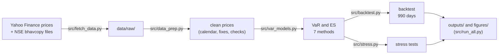

# Project 9 explained simply: how much could a ₹1 crore ETF portfolio lose in one day?

## What this project does

It takes a ₹1 crore portfolio made of six exchange-traded funds (Indian shares, bank shares, US technology shares, gold and government bonds) and asks: how much money could this portfolio lose in a single bad day? It answers with two standard risk numbers, Value at Risk (VaR) and Expected Shortfall (ES), worked out three different ways from five years of daily prices. Then it checks whether those numbers would actually have worked in the past, finds out which ETF causes most of the risk, and replays the worst days of the last five years on today's portfolio.

The short answer: **on 99 days out of 100 this portfolio should not lose more than about ₹1.56 lakh in a day** (1.56% of its value). On the remaining 1 day in 100, the average loss is about **₹1.97 lakh**. A simpler "bell curve" model says ₹1.29 lakh, but that number was broken far too often when tested on past data, because real markets have more extreme days than a bell curve allows.

## Why this data, and why not the obvious alternatives

**Why ETFs and not shares.** Your other projects already use single companies (Asian Paints, UltraTech, Castrol, ten NIFTY 50 stocks and so on). An ETF portfolio adds something different: it mixes asset classes that behave differently (shares, gold, bonds, a foreign market), which is exactly where VaR becomes interesting, because the risks partly cancel out. ETFs also trade on the NSE like shares, so there is a clean daily price for each.

**Why these six.**

| ETF | What it holds | Weight | Why it is in the portfolio |
|---|---|---:|---|
| NIFTYBEES | the 50 biggest Indian companies (NIFTY 50) | 30% | the core of any Indian portfolio |
| JUNIORBEES | the next 50 big companies (NIFTY Next 50) | 10% | more growth, more risk |
| BANKBEES | the big banks (NIFTY Bank) | 10% | banks are the largest sector in India |
| MON100 | the 100 biggest Nasdaq companies, priced in rupees | 10% | foreign shares; it also moves with the dollar |
| GOLDBEES | physical gold | 15% | gold often rises when shares fall |
| SETF10GILT | 10-year Government of India bonds | 25% | the safest asset here; it steadies the portfolio |

**Why not the obvious alternatives.**

- *Mutual funds instead of ETFs:* their price (NAV) is published once a day and you cannot trade them on the exchange, and their data is harder to verify.
- *A more popular bond ETF (LTGILTBEES):* it trades more, but Yahoo Finance is missing 21 of its trading days and 9% of its prices never changed from the day before. Nine bond ETFs were tested with one fixed rule, and only SETF10GILT passed (`outputs/bond_etf_screen.csv`).
- *Yahoo Finance data alone:* free and convenient, but it had holes. It missed five whole trading sessions (for example the Sunday Budget session on 1-Feb-2026) and had 19 wrong prices. Every suspicious day was checked against the NSE's own daily price file (the "bhavcopy"), which is the official record.

## How I did it, step by step

1. **Downloaded five years of daily prices** (`src/fetch_data.py`) for the six ETFs, eight other bond ETFs and the NIFTY 50 index from Yahoo Finance, into `data/raw/`. Why: everything after this runs offline from the saved copy.
2. **Checked prices against the exchange.** For 76 dates the script downloaded the NSE bhavcopy (the exchange's official closing prices). It asked for a file on every weekend and holiday too: a file exists only if the exchange was open, which is how the five sessions Yahoo missed were found. Why: VaR is all about the worst days, and one wrong price can create a fake crash.
3. **Cleaned the data** (`src/data_prep.py`): added the 5 missing sessions, dropped 1 placeholder row that Yahoo shows for a market holiday (15-Jan-2026), replaced 19 wrong prices with the NSE price and filled 35 missing rows. The worst error was MON100 on 24-Oct-2025: Yahoo said ₹217.32, NSE said ₹241.80. Why: left in, it would have shown MON100 falling 9.6% one day and rising 12.9% the next, which never happened.
4. **Picked the bond ETF by a rule** (`outputs/bond_etf_screen.csv`): at least 4.9 years of data, at most 5 missing days, at most 5% "stale" days. Why: a rule chosen before looking at the results cannot be accused of cherry-picking.
5. **Turned prices into daily returns** (1,240 days from 1-Nov-2021 to 30-Oct-2026) and combined them with the weights into one portfolio return per day. Why: each past day then tells us "what would today's portfolio have done on that day".
6. **Historical VaR** (`src/var_models.py`): sorted the 1,240 daily results and read off the loss that only 1% of days were worse than: ₹1,55,855. Why: it uses real history and assumes nothing about its shape.
7. **Parametric VaR**: assumed returns follow a bell curve (normal distribution) and used its formula: 2.326 x daily volatility x ₹1 crore = ₹1,29,346. A second version uses EWMA volatility, which gives recent days more weight (₹1,34,265). A third, Cornish-Fisher, bends the bell curve to match the real lopsidedness and fat tails (₹1,83,755). Why: these are the fastest methods and show how much the shape assumption matters.
8. **Monte Carlo VaR**: let the computer invent 100,000 random days that have the same volatilities and correlations as the real ETFs, once from a bell curve and once from a fat-tailed Student-t curve, and read the 1% worst. Why: this method can handle any portfolio, and comparing it with the formula checks the code (₹1,29,136 vs ₹1,29,346).
9. **Ten-day VaR**: scaled the one-day number by √10 and compared it with a direct estimate from real 10-day periods. Why: banks and regulators often use a 10-day horizon.
10. **Split the risk by ETF** (component VaR): worked out how much of the ₹1,29,346 each ETF is responsible for. Why: it tells you what to sell if you want less risk.
11. **Backtested** (`src/backtest.py`): went back to 3-Nov-2022 and, every day for 990 days, calculated VaR using only the 250 days before, then checked the next day's real result. Why: a risk number is only useful if it would have worked.
12. **Stress tested** (`src/stress.py`): replayed the five worst days of the last five years on today's portfolio and added made-up shocks (for example Indian shares -10%). Why: VaR tells you about a normal bad day, not about a crisis.
13. **Ran 38 checks** (`outputs/validation_checks.csv`), all PASS, and wrote the notebook (`var_analysis.ipynb`), which uses the same code and confirms its numbers equal the files in `outputs/`.

## Where every important number came from

The saved news pages (`news_and_macro/*.html`, except the RBI page) are copyrighted articles, so they stay on your PC and are not in the GitHub copy. Use the link in the Source column instead.

| Number | Value | Source | File in source_data/ |
|---|---|---|---|
| Daily prices of the six ETFs and NIFTY 50 | 1-Oct-2021 to 30-Oct-2026 | [Yahoo Finance](https://finance.yahoo.com/quote/NIFTYBEES.NS/history/) via yfinance | `yahoo_finance/yahoo_<TICKER>.csv`; Excel copy `yahoo_finance/Yahoo_Finance_daily_prices_ETFs_2021-10-01_to_2026-10-30.xlsx` |
| Official closing prices used for checks and fixes | 76 dates, 453 ETF-days | [NSE bhavcopy archive](https://nsearchives.nseindia.com/content/cm/BhavCopy_NSE_CM_0_0_0_20261030_F_0000.csv.zip) (one zip file per day) | `nse/nse_bhavcopy_etf_closes.csv`, Excel copy `nse/NSE_bhavcopy_ETF_closes_extract.xlsx`, seven original zip files |
| ETF prices on 30-Oct-2026 | NIFTYBEES ₹262.89, JUNIORBEES ₹730.90, BANKBEES ₹565.47, MON100 ₹284.94, GOLDBEES ₹115.23, SETF10GILT ₹258.85 | NSE bhavcopy of 30-Oct-2026 (matches Yahoo) | `nse/BhavCopy_NSE_CM_0_0_0_20261030_F_0000.csv.zip` |
| What each ETF holds | index, asset, fund house | [Nippon India product notes](https://mf.nipponindiaim.com/FundsAndPerformance/ProductNotes/NipponIndia-ETF-Nifty-50-BeES-Apr-2026.pdf), [Motilal Oswal SID](https://www.motilaloswalmf.com/content/dam/motilal-mf/downloads/mf/sid/2026/may/SID_Motilal%20Oswal%20Nasdaq%20100%20ETF.pdf), [SBI factsheet](https://www.sbimf.com/campaign/efactsheet/efactsheet-jul-2026/passive-fund-factsheet/fixed-income/nifty-10-yr-benchmark-g-sec-etf.html) | `company_filings/` |
| NIFTYBEES fell 2.97% while NIFTY 50 fell 5.93% on 4-Jun-2024 | ETF close ₹250.48 | NSE bhavcopy of 4-Jun-2024; [The Hindu](https://www.thehindu.com/business/markets/sensex-plunges-57-as-bjp-fails-to-win-majority-on-its-own/article68251438.ece) | `nse/BhavCopy_NSE_CM_0_0_0_20240604_F_0000.csv.zip`, `news_and_macro/TheHindu_election_results_crash_4Jun2024.html` (local only) |
| Worst day, 23-Mar-2026 | NIFTY 50 -2.6%, gold and silver about -10% | [Livemint](https://livemint.com/market/stock-market-news/stock-market-live-gold-silver-rate-today-23-march-2026-nifty-sensex-crude-oil-us-iran-war-11774231309874.html), [Financial Express](https://financialexpress.com/market/why-did-markets-fall-today-nifty-closes-at-8-month-lows-sensex-slides-1800-points-5-key-reasons-explained-4181369/) | `news_and_macro/Livemint_market_crash_US_Iran_war_23Mar2026.html`, `news_and_macro/FinancialExpress_Nifty_8month_low_23Mar2026.html` (local only) |
| Other worst days | 19-Mar-2026, 7-Apr-2025, 24-Feb-2022, 1-Feb-2026 | links in the main README's stress-test table | `news_and_macro/*.html` (local only) |
| Gold ETF crash of 30-Jan-2026 | Nippon India Gold ETF about -11% | [Economic Times](https://economictimes.com/markets/stocks/news/explained-why-gold-silver-etfs-crashed-up-to-14-and-should-you-buy-the-dip/articleshow/127791282.cms) | `news_and_macro/ET_gold_silver_ETF_crash_30Jan2026.html` (local only) |
| Market holiday on 15-Jan-2026 | exchanges shut for municipal elections | [Livemint](https://www.livemint.com/market/stock-market-news/stock-market-holiday-bse-nse-to-remain-shut-for-maharashtra-municipal-elections-commodity-trading-to-begin-at-5-pm-11768439343202.html) | `news_and_macro/Livemint_market_holiday_15Jan2026.html` (local only) |
| Risk-free rate (only to show that ignoring the average return is harmless) | 5.93% a year (91-day T-bill) | [RBI home page](https://www.rbi.org.in/); [Economic Times, 28-Oct-2026](https://economictimes.indiatimes.com/markets/bonds/rbi-accepts-20-bps-higher-treasury-bill-cutoff-yields-than-last-auction/articleshow/135284706.cms) | `news_and_macro/RBI_homepage_current_rates_TBill.html` |
| USD/INR on 30-Oct-2026 | 95.15 | [Yahoo Finance INR=X](https://finance.yahoo.com/quote/INR=X/history/) | `yahoo_finance/yahoo_INR_X.csv` |
| Basel traffic-light zones | green 0-4, yellow 5-9, red 10+ exceptions in 250 days | [Basel Committee, 1996](https://www.bis.org/publ/bcbs22.htm) | `regulators/BIS_BCBS22_publication_page.html` (the PDF download was blocked; `regulators/BIS_BCBS22_backtesting_framework_Jan1996.md` has the link) |

Every other number (returns, volatilities, VaR, ES, backtest counts) is calculated by the code from the price files. See `outputs/*.csv`.

## Key assumptions and why

| Assumption | Value | Why |
|---|---|---|
| Portfolio value and date | ₹1 crore at the 30-Oct-2026 close | A round number makes ₹1 lakh = 1%, so rupees and percentages read the same |
| History used | 1,240 trading days, 1-Nov-2021 to 30-Oct-2026 | Five years covers several shocks (Ukraine war, election day, tariffs, 2026 sell-offs) without going too far back |
| Weights | Held constant every day | Each past day then shows what today's portfolio would have done |
| Expected daily return | Zero in the formula and Monte Carlo methods | Over one day the average return (about ₹4,300) and the T-bill return (about ₹2,300) are tiny next to a ₹1.3 lakh VaR |
| Confidence levels | 95% and 99% | 99% is the regulatory standard; 95% is common for daily risk reports |
| EWMA decay factor | λ = 0.94 | The RiskMetrics standard for daily data |
| Monte Carlo | 100,000 scenarios, seed 42 | Enough for about ±1% precision; the fixed seed makes the result repeatable |
| Student-t degrees of freedom | ν = 4.29, fitted to the data | Lower ν means fatter tails; 4.29 matches the five-year data |
| Backtest window | 250 days, re-estimated daily | About one trading year, the Basel convention |
| Stress shocks | Indian equity -10%, Nasdaq -15% with the rupee +3%, gold +5%, bonds -2% | Round, plausible one-day crisis moves, larger than anything in the sample except gold's |

## Words you need to know

| Term | Meaning |
|---|---|
| ETF | Exchange-traded fund: a fund that holds a basket (an index, gold, bonds) and trades on the stock exchange like a share |
| Value at Risk (VaR) | The loss you should not exceed on most days. A 99% one-day VaR of ₹1.56 lakh means: on 99 days out of 100, the loss should be smaller than ₹1.56 lakh |
| Expected Shortfall (ES) | The average loss on the days that are worse than VaR, the "how bad is bad" number. ₹1.97 lakh here |
| Historical simulation | Replaying the real past days on today's portfolio and reading off the worst 1% |
| Parametric (normal) VaR | Assuming returns follow a bell curve and using its formula |
| Fat tails | Extreme days happen more often than a bell curve says; this is why the normal VaR is too low at 99% |
| Cornish-Fisher | A correction that bends the bell curve to match the data's lopsidedness (skewness) and fat tails (kurtosis) |
| Monte Carlo | Letting the computer invent many random days with the right volatilities and correlations |
| Volatility | How much the daily return usually swings (its standard deviation); 0.556% a day for this portfolio |
| EWMA | Exponentially weighted moving average: a volatility estimate that gives recent days more weight |
| Correlation | How closely two assets move together, from -1 to +1; low correlation is what makes diversification work |
| Component VaR | The share of the total VaR caused by each holding; the shares add up to the total |
| Backtest | Testing the VaR on past data: did losses exceed it about as often as they should? |
| Exception | A day when the actual loss was bigger than the VaR forecast |
| Kupiec and Christoffersen tests | Statistical tests of the backtest: the first checks the number of exceptions, the second checks that they do not come in clusters |
| Basel traffic light | The regulators' rule for 99% VaR: in 250 days, 0-4 exceptions is green, 5-9 yellow, 10 or more red |
| Bhavcopy | The NSE's official end-of-day file with every security's closing price |

## Why the three methods give different answers

At 95% they almost agree (₹0.85 to 0.95 lakh), because ordinary bad days look like a bell curve. At 99% they split. Historical simulation (₹1.56 lakh) uses the real worst days, which include the Ukraine invasion, election day and the 2026 sell-offs. The normal formula (₹1.29 lakh) assumes those days are rarer than they really are. Cornish-Fisher (₹1.84 lakh) bends the bell curve to match the measured lopsidedness and fat tails; its answer sits above the five-year historical figure and close to the last-250-day one (₹1.88 lakh), and it depends heavily on the fat-tail measure, which a few extreme days can move a lot. Monte Carlo gives whatever its assumed curve gives: ₹1.29 lakh with the bell curve, ₹1.48 lakh with the fat-tailed Student-t.

## How the backtest works

Imagine standing on any evening between November 2022 and October 2026. Using only the previous 250 days, you calculate tomorrow's VaR. Next evening, you compare tomorrow's actual loss with it. If the loss was bigger, that is an exception. At 99%, over 990 days, you expect about 10 exceptions.

- Historical simulation had 14: close enough (the Kupiec test accepts it).
- The bell curve with EWMA volatility had 28: far too many, and 10 in the last 250 days, which is the Basel red zone.
- Filtered historical simulation (historical simulation adjusted for today's volatility) had 15 and passed every test.

So the honest one-day 99% VaR for this portfolio is around ₹1.6 to 1.9 lakh, not ₹1.3 lakh.

## How to check the work yourself

1. Run `python src/run_all.py`. It ends with the 38 checks; all must say PASS, or the script exits with an error.
2. Open `outputs/validation_checks.csv` to see each check and its detail.
3. Open `var_analysis.ipynb` on GitHub. It shows every step with its output, and its last cell confirms that the notebook's numbers equal the files in `outputs/`.
4. Look up the headline numbers in `outputs/var_summary.csv`: method "Historical (full window)", horizon 1, confidence 0.99 gives var_inr 155855 and es_inr 196546.
5. Check the backtest in `outputs/backtest_summary.csv`: column `exceptions` (14 for historical simulation at 99%) and `basel_zone_last250`.
6. Pick any fixed price in `outputs/data_fixes.csv` (for example MON100 on 24-Oct-2025) and open the matching zip in `source_data/nse/` to see the official close.

## How to explain this project in an interview

**30-second version.** "I measured the market risk of a ₹1 crore multi-asset ETF portfolio in Python: Indian equities, banks, the Nasdaq-100, gold and a government-bond ETF. I computed one-day and ten-day VaR and Expected Shortfall with historical simulation, parametric normal and Cornish-Fisher formulas, and Monte Carlo with normal and Student-t draws. The 99% one-day VaR is ₹1.56 lakh historically, but only ₹1.29 lakh under the normal model, because the returns have fat tails. A 990-day backtest with Kupiec and Christoffersen tests confirmed it: historical and filtered historical simulation passed, the normal model failed and landed in the Basel red zone. I also split the risk by ETF, which showed Indian equities are two thirds of it, and I cleaned the Yahoo data against the NSE's official files, which fixed five missing sessions and 19 wrong prices."

**Likely questions.**

1. *Why is Expected Shortfall better than VaR?* VaR only says where the bad tail starts; it says nothing about how bad the tail is. ES averages the losses beyond VaR, so it notices fat tails. It is also "coherent": the ES of a portfolio is never more than the sum of the parts. Basel's newer market-risk rules (FRTB) use ES at 97.5% instead of VaR at 99%.
2. *Why did the normal model fail the backtest even with EWMA volatility?* EWMA gets the size of normal swings right, which is why it passed at 95%. But after dividing returns by the EWMA volatility the tails are still fatter than a bell curve, so 2.8% of days fell below the 1% line. A fat-tailed model or filtered historical simulation fixes that.
3. *Is √10 scaling right for 10-day VaR?* Only if returns are independent and normal. Here the direct 10-day estimate is 16% lower, partly because of the positive average return over 10 days and partly because 10-day returns are closer to normal than daily ones. But the direct estimate is unstable with only five years of data, so √10 scaling is the more conservative and more stable choice.
