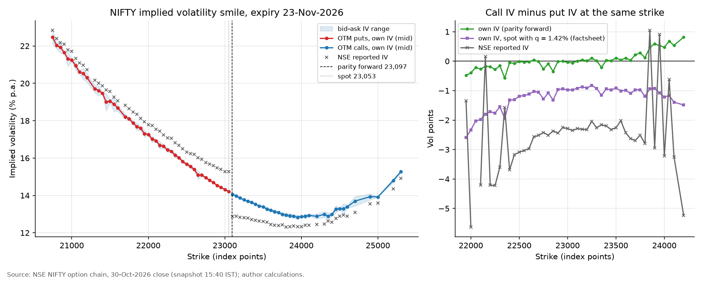
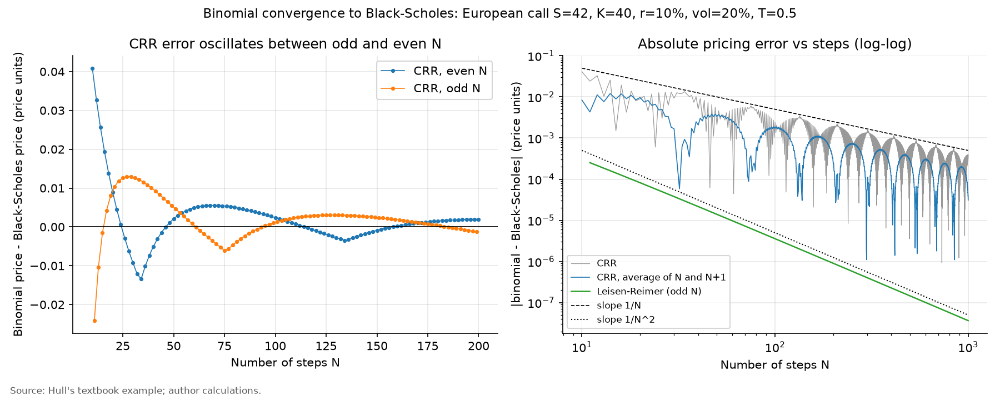
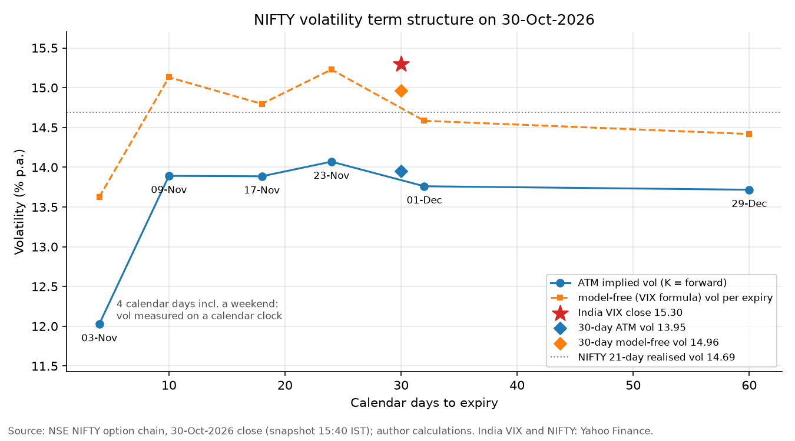
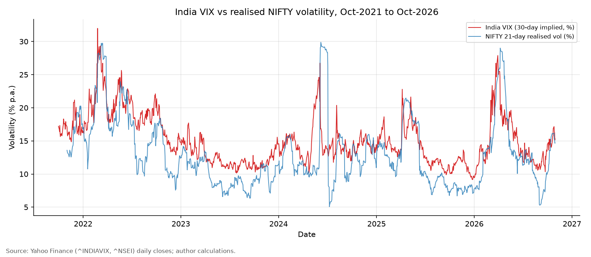
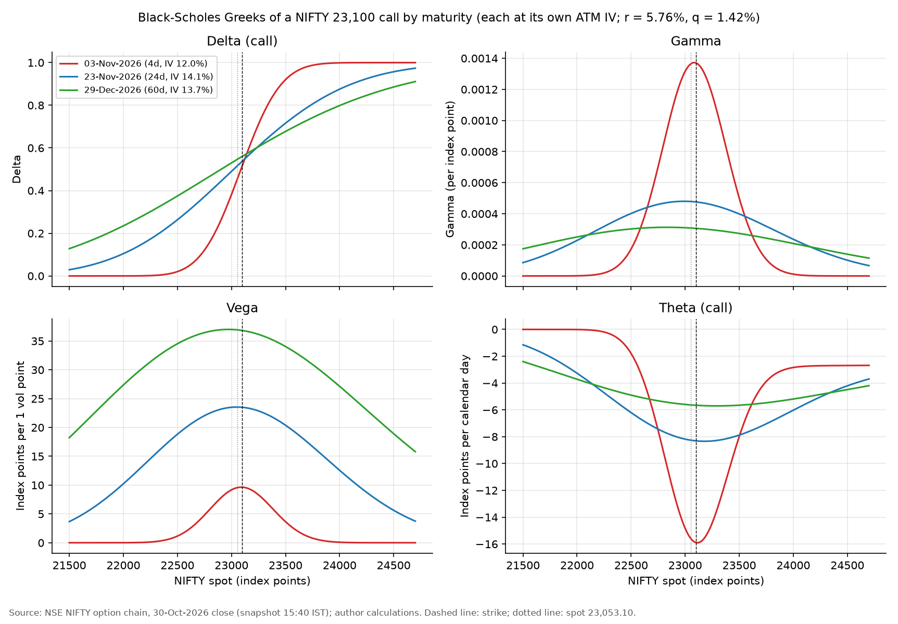
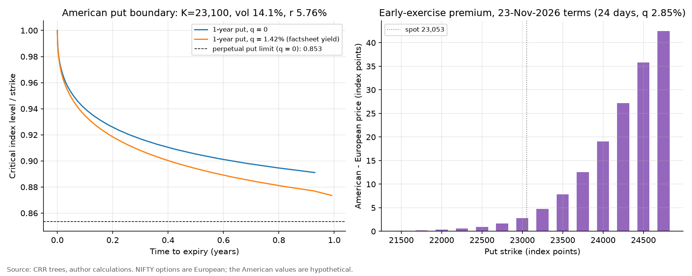
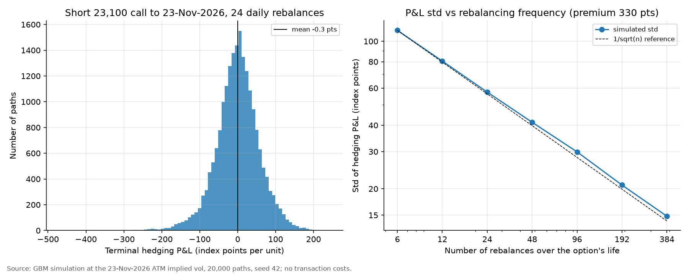

# Options pricing on NIFTY 50: Black-Scholes, binomial trees and the Greeks

This project builds European and American option pricers in Python and applies them to real NIFTY 50 option quotes. The code covers Black-Scholes-Merton with a dividend yield, Black-76, an implied-volatility solver, and Cox-Ross-Rubinstein (CRR) and Leisen-Reimer binomial trees with tree Greeks and the early-exercise boundary. Eighteen textbook and numerical checks confirm the pricers. They are then applied to the NSE NIFTY 50 option chain at the close of Friday 30-Oct-2026. From 773 usable quotes across six expiries, put-call parity gives a 23-Nov-2026 forward of **23,097.29**, 4.1 points below the November futures close of 23,101.40. The 23-Nov smile has an at-the-money (ATM) implied volatility of **14.07%**. Puts struck at 95% of the forward trade at 17.35% and calls at 105% at 12.94%, a skew of **4.41 vol points**. The VIX formula applied to the same quotes gives a 30-day volatility of **14.96%**, against an India VIX close of **15.30**. Leisen-Reimer trees reproduce the Black-Scholes price of all 79 smile contracts within 0.0001 index points. A short ATM call hedged with 24 daily delta rebalances still has a P&L standard deviation of **57 points** (₹3,734 per lot, 17% of the premium), and it loses 93 points on average if the index realises 18% volatility instead of the 14.06% implied. All 28 validation checks pass.



## What the project shows

- Option pricing theory in code: Black-Scholes-Merton (BSM) with a continuous dividend yield, Black-76 on the forward, all five Greeks with trading-desk units (per vol point, per calendar day, per 1% rate), and put-call parity.
- Numerical methods: a vectorised Newton-Raphson implied-volatility solver with a bracket, a Brent fallback and no-arbitrage bounds; CRR and Leisen-Reimer trees for European and American options; N/N+1 averaging; Greeks from the tree; the early-exercise boundary of an American put.
- Model validation: 18 checks against Hull's textbook values, parity, finite-difference Greeks, convergence rates and implied-vol round trips.
- Market data work: cleaning a raw NSE option chain (6 expiries, 1,186 listed contracts), quote filters, parity-implied forwards, the volatility smile and term structure, and replicating both NSE's implied-volatility field and India VIX.
- Risk intuition: Greeks in rupees per lot, the early-exercise premium, and a delta-hedging simulation that shows discrete-hedging error and the volatility exposure of a short option.
- Reproducible Python: typed modules in `src/options/`, an executed notebook, one command to rebuild every output, saved raw data and 28 PASS/FAIL checks.

## Data and sources

| Item | Detail | Source |
|---|---|---|
| NIFTY option chain | Six expiries: 03-Nov, 09-Nov, 17-Nov, 23-Nov, 01-Dec and 29-Dec-2026. Best bid and ask with sizes, last price, open interest, volume and NSE's implied volatility, per strike. Snapshot time 30-Oct-2026 15:40 IST | NSE option-chain API, `https://www.nseindia.com/api/option-chain-v3?type=Indices&symbol=NIFTY&expiry=<DD-Mon-YYYY>`, downloaded 31-Oct-2026 |
| NIFTY 50 and India VIX | Daily closes, 1-Oct-2021 to 30-Oct-2026. NIFTY 50 closed at 23,053.10 and India VIX at 15.30 on 30-Oct-2026 | Yahoo Finance (`^NSEI`, `^INDIAVIX`) via yfinance, downloaded 31-Oct-2026 |
| Risk-free rate | 91-day T-bill cut-off yield 5.93% (5.9337%) at the RBI auction of 28-Oct-2026; used as r = ln(1.0593) = 5.76% a year, continuously compounded | [RBI home page, Current Rates](https://www.rbi.org.in/); [Economic Times, 28-Oct-2026](https://economictimes.indiatimes.com/markets/bonds/rbi-accepts-20-bps-higher-treasury-bill-cutoff-yields-than-last-auction/articleshow/135284706.cms) |
| NIFTY November 2026 futures | Closed at 23,101.40 on 30-Oct-2026, 48.3 points above the cash close | [Capital Market, 30-Oct-2026](https://www.capitalmarket.com/markets/news/live-news/nifty-november-futures-trade-at-a-premium/1742066) |
| Dividend yield | NIFTY 50 trailing dividend yield 1.42% (P/E 19.30, P/B 2.83). Used only for comparisons; prices use the parity forward | [NIFTY 50 factsheet dated 30-Oct-2026, NSE Indices](https://www.niftyindices.com/Factsheet/ind_nifty50.pdf) |
| Contract terms | European exercise (NSE codes CE and PE: Call European, Put European). Weekly contracts expire on Tuesday and monthly contracts on the last Tuesday; a holiday moves expiry to the previous trading day. Lot size 65 units for contracts expiring after 30-Dec-2025 (was 75). Index derivatives trade until 15:40 since 3-Aug-2026 | [NSE NIFTY 50 F&O page](https://www.nseindia.com/products-services/equity-derivatives-nifty50); [NSE circular NSE/FAOP/70616, 3-Oct-2025](https://nsearchives.nseindia.com/content/circulars/FAOP70616.pdf); [NSE circular NSE/FAOP/68747, 25-Jun-2025](https://nsearchives.nseindia.com/content/circulars/FAOP68747.pdf); NSE FAQ on the Closing Auction Session, May 2026 (in `source_data/nse/`) |
| Closing auction | Since 3-Aug-2026 the closing prices of F&O stocks, and so the NIFTY close, come from an auction that runs from 3:15 to 3:35 pm | [Economic Times, Aug-2026](https://economictimes.indiatimes.com/markets/stocks/news/niftys-value-doesnt-change-suddenly-at-330-pm-nse-clarifies-amid-cas-confusion/articleshow/132850802.cms) |
| Market holidays | Tuesday 10-Nov-2026 (Diwali Balipratipada) and Tuesday 24-Nov-2026 (Guru Nanak Jayanti), so the 10-Nov weekly and the November monthly expire on the Mondays before | [Upstox, Oct-2026](https://upstox.com/news/market-news/latest-updates/stock-market-holidays-in-november-2026-nse-bse-to-remain-closed-on-these-days-check-muhurat-trading-schedule/article-202726/) |

NIFTY 50 index options were chosen because they are India's most traded options, they are European (so Black-Scholes applies without an early-exercise adjustment) and they settle in cash against the index. The raw files are saved in `data/raw/`, so everything after the download runs offline.

Copies of every source are in [`source_data/`](source_data/), indexed in [`source_data/README.md`](source_data/README.md): the six NSE chain files, an Excel copy of the cleaned 23-Nov-2026 chain, the Yahoo files, the NSE product page, circulars and FAQ, the NIFTY 50 factsheet and the RBI rates page. Saved news articles are copyrighted, so they stay on the author's PC; the index gives the link for each. A plain-language walk-through is in [`explained_simply/README.md`](explained_simply/README.md).

## Method

**Conventions.** Valuation at the 30-Oct-2026 close. Time to expiry T = calendar days / 365 (4 to 60 days). One rate for all expiries: r = ln(1 + 0.0593) = 5.761% a year, continuously compounded. Prices are in index points; one point is ₹1 per unit and one lot is 65 units.

**Black-Scholes-Merton with dividend yield q.**

$$C = S e^{-qT} N(d_1) - K e^{-rT} N(d_2), \qquad P = K e^{-rT} N(-d_2) - S e^{-qT} N(-d_1),$$

$$d_1 = \frac{\ln(S/K) + (r - q + \sigma^2/2)T}{\sigma\sqrt{T}}, \qquad d_2 = d_1 - \sigma\sqrt{T}.$$

**Black-76** is the same model written on the forward $F = S e^{(r-q)T}$ with discount factor $DF = e^{-rT}$: $C = DF\,[F N(d_1) - K N(d_2)]$ with $d_1 = [\ln(F/K) + \sigma^2 T/2]/(\sigma\sqrt{T})$. The code prices everything through this forward form, so a market forward and a (S, r, q) input use the same function.

**Greeks** (BSM, analytic):

| Greek | Call | Put | Unit reported |
|---|---|---|---|
| Delta | $e^{-qT}N(d_1)$ | $-e^{-qT}N(-d_1)$ | price change per 1-point index move |
| Gamma | $e^{-qT}n(d_1)/(S\sigma\sqrt{T})$ | same as call | delta change per index point |
| Vega | $S e^{-qT}n(d_1)\sqrt{T}$ | same as call | points per 1 vol point (divided by 100) |
| Theta | $-\frac{S e^{-qT}n(d_1)\sigma}{2\sqrt{T}} - rKe^{-rT}N(d_2) + qSe^{-qT}N(d_1)$ | $-\frac{S e^{-qT}n(d_1)\sigma}{2\sqrt{T}} + rKe^{-rT}N(-d_2) - qSe^{-qT}N(-d_1)$ | points per calendar day (divided by 365) |
| Rho | $KTe^{-rT}N(d_2)$ | $-KTe^{-rT}N(-d_2)$ | points per 1 percentage point of r |

**Put-call parity and the implied forward.** $C - P = S e^{-qT} - K e^{-rT} = DF\,(F - K)$. For each strike with a usable call and put, $F_K = K + (C_{mid} - P_{mid})\,e^{rT}$. The forward of an expiry is the median $F_K$ over the five strikes with the smallest $|C - P|$. The quotes bound it: $F_{low} = K + (C_{bid} - P_{ask})e^{rT}$ and $F_{high} = K + (C_{ask} - P_{bid})e^{rT}$. Implied vols use Black-76 on this forward. The same prices come from BSM with spot and $q = r - \ln(F/S)/T$, which is how the spot Greeks are computed.

**Implied volatility.** Newton-Raphson on vega, started at $\sigma^* = \sqrt{2\,|\ln(F/K)|/T}$ (clipped to 5%-100%), with a bracket that always contains the root; a step that leaves the bracket becomes a bisection. Anything not converged after 50 steps goes to `scipy.optimize.brentq`. A price on or outside the no-arbitrage bounds, $DF\max(F-K,0) < C < DF\,F$ and $DF\max(K-F,0) < P < DF\,K$, returns no implied vol.

**Binomial trees.** CRR with N steps of $\Delta t = T/N$:

$$u = e^{\sigma\sqrt{\Delta t}}, \quad d = 1/u, \quad p = \frac{e^{(r-q)\Delta t} - d}{u - d}, \quad V = e^{-r\Delta t}\,[pV_{up} + (1-p)V_{down}].$$

An American option takes the larger of that value and the exercise value at every node. Leisen-Reimer (odd N) uses the Peizer-Pratt inversion $h(z, N)$: $p = h(d_2)$, $p' = h(d_1)$, $u = e^{(r-q)\Delta t}p'/p$, $d = (e^{(r-q)\Delta t} - pu)/(1-p)$. The N/N+1 variant averages the CRR prices with N and N+1 steps. Tree Greeks: delta from the two nodes at step 1, gamma from the three nodes at step 2, theta from the middle node at step 2 against the root, and vega and rho by central bump-and-revalue.

**Early-exercise boundary.** At each step of a 5,000-step tree, the critical index level is the highest node where exercising the put beats holding it, moved half a node spacing towards the continuation region. For q = 0 the boundary must lie between K and the perpetual-put limit $S^*/K = 2r/(2r + \sigma^2)$.

**Quote filters**, applied in this order: strike within ±10% of the spot close (1,186 listed contracts to 1,008), open interest > 0 (884), best bid and best ask both positive (880), and bid-ask spread at most 25% of the mid (773 usable quotes). The mid is (best bid + best ask) / 2.

**Smile and term structure.** The smile uses out-of-the-money (OTM) quotes: puts below the forward, calls above it. IV at a given K/F is interpolated linearly in $\ln(K/F)$. A model-free volatility per expiry uses the CBOE VIX formula on two-sided OTM quotes, stopping after two consecutive strikes without a quote:

$$\sigma^2 = \frac{2}{T}\sum_i \frac{\Delta K_i}{K_i^2}\,e^{rT}\,Q(K_i) - \frac{1}{T}\left(\frac{F}{K_0} - 1\right)^2.$$

Both ATM and model-free vols are interpolated to 30 days in total variance $\sigma^2T$ between the 23-Nov (24-day) and 29-Dec (60-day) expiries, the near and next monthly contracts, which is how India VIX is built.

**NSE's implied-volatility field.** For each usable quote within 3% of spot, the rate r is solved so that BSM with spot, q = 0 and NSE's IV gives the last traded price. The median of these rates is then used to rebuild NSE's field for all usable quotes.

**Delta hedging.** A writer sells one ATM call at its model value, holds the BSM delta in the index, rebalances 6 to 384 times over the 24 days, earns r on cash and the dividend yield on the units held. The index follows geometric Brownian motion; 20,000 paths, seed 42, no transaction costs. Terminal P&L = cash + final delta × S_T - max(S_T - K, 0).

## Validation

All 28 checks pass (`outputs/validation_results.csv`). The first 18 test the models without market data; the last 10 test the market application. The notebook stops if any check fails, and `src/run_all.py` exits with code 1.

| Area | Check | Result | Target | Status |
|---|---|---|---|---|
| BSM | Hull example call (S = 42, K = 40, r = 10%, vol 20%, T = 0.5) | 4.759 | 4.76 (2 dp) | PASS |
| BSM | Hull example put | 0.8086 | 0.81 (2 dp) | PASS |
| Parity | Largest parity error over 10,000 random contracts | 7.1e-14 | < 1e-10 | PASS |
| Greeks | Hull example: largest gap, analytic vs central finite difference (5 Greeks, call and put, q = 0 and 3%) | 4.5e-07 | < 1e-4 | PASS |
| Greeks | NIFTY-size contract: largest relative gap, analytic vs finite difference | 3.5e-06 | < 1e-4 | PASS |
| Implied vol | Newton solver recovers the input vol (1,606 identifiable contracts) | 4.8e-09 | < 1e-8 | PASS |
| Implied vol | Brent fallback recovers the input vol (Newton capped at 1 step, 179 contracts) | 7.2e-10 | < 1e-8 | PASS |
| Implied vol | Prices outside the no-arbitrage bounds return no IV | 5 of 5 | 5 of 5 | PASS |
| Binomial | CRR European call, N = 1,000: error vs BSM | 3.9e-04 | < 1e-3 | PASS |
| Binomial | Average of CRR N = 1,000 and 1,001: error vs BSM | 3.1e-05 | < 1e-4 | PASS |
| Binomial | Leisen-Reimer call, N = 101: error vs BSM | 3.5e-06 | < 1e-5 | PASS |
| Binomial | Leisen-Reimer put, N = 101: error vs BSM | 3.5e-06 | < 1e-5 | PASS |
| American | American call without dividends equals the European call (CRR N = 1,000) | 0 | < 1e-12 | PASS |
| American | American put minus European put, Hull S = 42 example | 0.1014 | > 0 | PASS |
| American | Hull American put (S = K = 50, r = 10%, vol 40%, 5 months), 5 steps | 4.488 | 4.49 (2 dp) | PASS |
| American | Same put with 30, 50, 100 and 500 steps | 4.2634, 4.2720, 4.2781, 4.2830 | 4.263, 4.272, 4.278, 4.283 | PASS |
| American | Put exercise boundary between the perpetual limit and K (lowest S*/K) | 0.7237 | 0.5556 to 1 | PASS |
| Binomial | CRR N = 1,000 tree Greeks vs BSM: largest relative error | 6.9e-04 | < 0.5% | PASS |
| Market data | Yahoo close equals the NSE JSON `underlyingValue` | 23,053.10 | 23,053.10 | PASS |
| Market data | 23-Nov parity forward vs Nov-2026 futures close 23,101.40 | 23,097.29 | within 0.1% | PASS |
| Market data | Near-ATM synthetic-forward bid/ask bands overlap (no conversion or reversal arbitrage), narrowest overlap in points | 1.03 | > 0 for all 6 expiries | PASS |
| Market IV | OTM usable quotes with a valid IV | 424 of 424 | all | PASS |
| Market IV | BSM at the own IV (q = implied yield) reproduces the mid price, 729 quotes: largest error in points | 1.0e-11 | < 1e-6 | PASS |
| Market IV | 23-Nov call IV vs put IV at the same strike, within 2% of F: mean gap in vol points | 0.075 | < 0.5 | PASS |
| Market trees | Leisen-Reimer N = 501 vs BSM on 79 contracts: largest gap in points | 6.8e-05 | < 0.01 | PASS |
| Market trees | CRR N = 1,000 vs BSM on 79 contracts: largest gap in points | 0.079 | < 0.10 (5% of the median spread) | PASS |
| Market IV | NSE IV field rebuilt with spot, q = 0, r = 6.39%: median gap in vol points | 0.0026 | < 0.05 | PASS |
| Market vol | 30-day model-free vol vs India VIX 15.30 | 14.96 | within 1 vol point | PASS |

Of the 773 usable quotes, 44 in-the-money quotes have a mid price at or below the no-arbitrage lower bound (discounted intrinsic value against the forward) and get no implied vol. The smile uses OTM quotes only, and every usable OTM quote has a valid IV.

## Results

### 1. Binomial convergence



For Hull's call (BSM value 4.7594), the CRR error falls roughly as 1/N but oscillates, and odd and even N follow separate curves: +4.1e-2 at N = 10, -2.4e-2 at N = 11, +3.9e-4 at N = 1,000. Averaging N and N+1 cuts the mean error for N = 101 to 1,000 from 6.4e-4 to 2.9e-4. Leisen-Reimer converges as 1/N²: its error is 3.5e-6 at N = 101, against 3.9e-4 for CRR at N = 1,000.

### 2. Implied forwards

| Expiry | Days | Parity forward (index points) | Bid/ask range (index points) | Forward minus spot (points) | Implied q (% a year) | S - DF x F (points) |
|---|---|---|---|---|---|---|
| 03-Nov-2026 | 4 | 23,022.14 | 23,021.7 to 23,022.9 | -31.0 | 18.02 | 45.5 |
| 09-Nov-2026 | 10 | 23,048.46 | 23,047.4 to 23,048.4 | -4.6 | 6.50 | 41.0 |
| 17-Nov-2026 | 18 | 23,074.34 | 23,072.8 to 23,074.5 | +21.2 | 3.89 | 44.2 |
| 23-Nov-2026 | 24 | 23,097.29 | 23,096.3 to 23,097.4 | +44.2 | 2.85 | 43.1 |
| 01-Dec-2026 | 32 | 23,127.16 | 23,120.6 to 23,132.4 | +74.1 | 2.10 | 42.4 |
| 29-Dec-2026 | 60 | 23,241.24 | 23,237.5 to 23,245.0 | +188.1 | 0.82 | 30.9 |

The 23-Nov forward of 23,097.29 is 4.1 points below the November futures close, so options and futures agree. Read as dividend yields against the official close, the forwards make no sense: 18.0% for 4 days and 0.8% for 60 days. The last column explains why. If dividends were the only gap, S - DF x F would be their present value and would grow with maturity. Instead it is 41 to 45 points for every expiry up to 32 days. The derivatives market valued the index about 43 points (0.19%) below the official close of 23,053.10. Possible reasons are the closing auction, which fixes the official close from 3:15 to 3:35 pm while index options trade until 3:40 pm, dividends going ex in early November, and futures trading below full cost of carry. One snapshot cannot separate them. Pricing on the parity forward (Black-76) removes the problem: spot with the 1.42% factsheet yield would put the 23-Nov forward at 23,119, about 22 points too high.

### 3. The 23-Nov-2026 volatility smile

| Strike | Type | K / F | Bid | Ask | Own IV, mid (%) | IV bid to ask (%) | NSE IV (%) |
|---|---|---|---|---|---|---|---|
| 21,000 | put | 0.909 | 19.10 | 19.80 | 21.24 | 21.17 to 21.32 | 21.71 |
| 21,500 | put | 0.931 | 33.65 | 34.85 | 19.05 | 18.97 to 19.13 | 19.57 |
| 22,000 | put | 0.952 | 68.00 | 68.45 | 17.26 | 17.24 to 17.28 | 17.79 |
| 22,500 | put | 0.974 | 140.30 | 142.30 | 15.67 | 15.62 to 15.72 | 16.31 |
| 23,000 | put | 0.996 | 289.40 | 290.70 | 14.32 | 14.29 to 14.35 | 15.28 |
| 23,500 | call | 1.017 | 156.95 | 157.00 | 13.40 | 13.40 to 13.40 | 12.61 |
| 24,000 | call | 1.039 | 46.90 | 47.05 | 12.87 | 12.87 to 12.88 | 12.33 |
| 24,500 | call | 1.061 | 13.60 | 13.85 | 13.29 | 13.27 to 13.31 | 12.90 |
| 25,000 | call | 1.082 | 3.95 | 4.00 | 13.92 | 13.91 to 13.93 | 13.59 |

Prices in index points. The full smile has 79 OTM quotes (45 puts, 34 calls) from 20,750 to 25,300.

- ATM IV (at K = F) is 14.07%. IV rises to 17.35% at 95% of the forward and 22.14% at 90%, and falls to 12.94% at 105%. The 95-105 skew is 4.41 vol points. The curve bottoms at 23,950 (12.83%) and turns up again in the far call wing.
- The skew is not quote noise: the IV range between bid and ask is less than 0.2 vol points for these strikes.
- Why OTM puts cost more: index returns have a fat left tail, and volatility jumps when the market falls, so a crash hurts a put writer twice and delta hedging cannot remove the gap risk. Institutions buy index puts to protect portfolios, while covered-call strategies sell upside calls. Writers charge for downside risk, and the put wing carries that charge. A flat Black-Scholes volatility cannot describe these prices; each strike needs its own implied vol.
- NSE's own IV field differs from mine by 1.57 vol points on average, with call IVs below and put IVs above mine at the same strike (2.31 vol points apart near the money). The field is rebuilt almost exactly (median gap 0.0026 vol points) by BSM on the last traded price with spot, no dividends and r = 6.39%. That implies a 23-Nov forward about 53 points above the market forward. With the parity forward, call and put IVs at the same strike agree within 0.08 vol points; spot with the 1.42% factsheet yield still leaves 1.00 vol point.

### 4. Term structure and India VIX

| Expiry | Days | ATM IV (%) | IV at 95% of F (%) | IV at 105% of F (%) | Skew 95-105 (vol pts) | Model-free vol (%) | OTM quotes |
|---|---|---|---|---|---|---|---|
| 03-Nov-2026 | 4 | 12.03 | 23.02 | 18.54 | 4.49 | 13.63 | 89 |
| 09-Nov-2026 | 10 | 13.89 | 18.65 | 14.58 | 4.07 | 15.13 | 82 |
| 17-Nov-2026 | 18 | 13.89 | 17.40 | 13.19 | 4.21 | 14.80 | 56 |
| 23-Nov-2026 | 24 | 14.07 | 17.35 | 12.94 | 4.41 | 15.23 | 79 |
| 01-Dec-2026 | 32 | 13.76 | 16.73 | 12.56 | 4.17 | 14.58 | 48 |
| 29-Dec-2026 | 60 | 13.72 | 15.87 | 12.47 | 3.39 | 14.42 | 70 |



- ATM IV is flat at 13.7% to 14.1% from 10 to 60 days. The 4-day expiry shows 12.0% because its 4 calendar days include a weekend: only two trading sessions remain, and volatility is measured here on a calendar clock.
- Interpolated to 30 days, ATM IV is 13.95%, below India VIX (15.30). The gap is the skew: the VIX formula integrates the whole OTM strip, and the expensive puts lift it above ATM vol. The same formula on these quotes gives 14.96%, 0.34 vol points below the published index; the strike cut-off, forward and rate differ from NSE's inputs.
- NIFTY's trailing 21-day realised volatility was 14.69%. From Oct-2021 to Sep-2026, India VIX was above the volatility the index then realised over the next 21 trading days on 77% of 1,228 days, by 2.06 vol points on average. Option buyers usually pay a volatility risk premium.



### 5. Greeks of 23-Nov-2026 contracts

BSM spot Greeks at each contract's own IV, with q = 2.85% (the implied yield of the expiry) so that model prices equal the mid quotes. The CRR rows repeat the calculation on a 1,000-step tree. Rupee values per lot of 65 units.

| Measure | ATM call | ATM put | 5% OTM put |
|---|---|---|---|
| Strike (index points) | 23,100 | 23,100 | 21,900 |
| Bid / ask (points) | 329.35 / 329.95 | 331.70 / 333.00 | 57.95 / 60.25 |
| Mid price (points) | 329.65 | 332.35 | 59.10 |
| Own IV (%) | 14.06 | 14.06 | 17.60 |
| NSE IV (%) | 12.88 | 15.17 | 18.13 |
| Delta | 0.5049 | -0.4932 | -0.1144 |
| Gamma (per index point) | 0.000479 | 0.000479 | 0.000186 |
| Vega (points per vol point) | 23.54 | 23.54 | 11.43 |
| Theta (points per calendar day) | -7.77 | -5.94 | -3.97 |
| Rho (points per 1% rate) | 7.44 | -7.69 | -1.77 |
| CRR tree delta (N = 1,000) | 0.5049 | -0.4932 | -0.1143 |
| CRR tree gamma | 0.000479 | 0.000479 | 0.000186 |
| CRR tree vega | 23.57 | 23.57 | 11.48 |
| CRR tree theta | -7.78 | -5.94 | -3.97 |
| Premium per lot (₹) | 21,427 | 21,603 | 3,842 |
| Delta exposure per lot (₹ of index) | 756,639 | -739,008 | -171,433 |
| Vega per lot (₹ per vol point) | 1,530 | 1,530 | 743 |
| Theta per lot (₹ per day) | -505 | -386 | -258 |

- One lot of the ATM call costs ₹21,427. It gains about ₹1,530 if implied vol rises by one point and loses about ₹505 a day from time decay.
- The ATM put has the same gamma and vega as the call. Its theta is smaller because parity ties the two: $\theta_C - \theta_P = qSe^{-qT} - rKe^{-rT}$, which is -1.84 points a day here.
- The 5% OTM put loses 6.7% of its price per day to time decay, against 2.4% for the ATM call.
- Tree Greeks agree with the formulas within 0.1% for delta, gamma, theta and rho and within 0.52% for vega, which the tree gets by bumping the volatility.



As expiry nears, gamma and theta concentrate around the strike and vega shrinks with the square root of time.

### 6. Trees on market contracts and an American-style put

On all 79 smile contracts, at each contract's own IV, Leisen-Reimer (N = 501) is within 0.00007 points of BSM and CRR (N = 1,000) within 0.08 points. The median bid-ask spread is 2.00 points, so for European options the tree only adds computing time.

NIFTY options are European. The table below is a what-if: the same 23-Nov contracts if early exercise were allowed (CRR, N = 1,000, IV from the smile, q = 2.85%).

| Put strike | K / S | IV from smile (%) | European, CRR (points) | American, CRR (points) | Early-exercise premium (points) | Premium (% of European) |
|---|---|---|---|---|---|---|
| 21,500 | 0.933 | 19.05 | 34.26 | 34.40 | 0.14 | 0.40 |
| 22,000 | 0.954 | 17.26 | 68.24 | 68.59 | 0.35 | 0.51 |
| 22,500 | 0.976 | 15.67 | 141.36 | 142.33 | 0.97 | 0.69 |
| 23,000 | 0.998 | 14.32 | 289.97 | 292.79 | 2.82 | 0.97 |
| 23,500 | 1.019 | 13.40 | 558.16 | 565.97 | 7.81 | 1.40 |
| 24,000 | 1.041 | 12.87 | 946.27 | 965.35 | 19.08 | 2.02 |
| 24,500 | 1.063 | 13.29 | 1,411.12 | 1,446.90 | 35.78 | 2.54 |
| 24,750 | 1.074 | 13.76 | 1,654.40 | 1,696.90 | 42.50 | 2.57 |



Because r (5.76%) is above q (2.85%), the right to exercise early is worth something: 2.82 points at the 23,000 strike and 42.50 points at 24,750, where immediate exercise is optimal (the American value equals intrinsic value, 1,696.90). For a 1-year put (K = 23,100, vol 14.07%) with q = 0, exercise is optimal once the index falls below 0.891 × K. The critical level rises to K at expiry and stays above the perpetual limit of 0.853 × K. A dividend yield of 1.42% lowers it to 0.875 × K, because the put holder gains from the index drifting down by its dividends while waiting.

### 7. Delta hedging

Short one 23,100 call to 23-Nov-2026, sold at its model value of 329.65 points (IV 14.06%).

| Realised vol (%) | Rebalances | Mean P&L (points) | Std of P&L (points) | 5th to 95th percentile (points) | Std (% of premium) | Mean per lot (₹) | Std per lot (₹) |
|---|---|---|---|---|---|---|---|
| 14.06 | 6 | -1.8 | 112.6 | -193 to 177 | 34.2 | -115 | 7,322 |
| 14.06 | 12 | -0.9 | 80.6 | -135 to 130 | 24.4 | -59 | 5,237 |
| 14.06 | 24 | -0.3 | 57.4 | -94 to 93 | 17.4 | -18 | 3,734 |
| 14.06 | 48 | -0.2 | 41.3 | -68 to 66 | 12.5 | -13 | 2,686 |
| 14.06 | 96 | +0.1 | 29.9 | -50 to 49 | 9.1 | +5 | 1,945 |
| 14.06 | 192 | -0.0 | 20.8 | -34 to 34 | 6.3 | -1 | 1,354 |
| 14.06 | 384 | +0.1 | 14.8 | -24 to 24 | 4.5 | +5 | 964 |
| 10.00 | 24 | +95.4 | 50.4 | 21 to 186 | 15.3 | +6,198 | 3,275 |
| 18.00 | 24 | -92.9 | 83.4 | -251 to 14 | 25.3 | -6,037 | 5,423 |



When the index realises the implied volatility, the hedge breaks even on average and the P&L spread falls with the square root of the number of rebalances: 113 points with 6 rebalances, 57 with 24, 15 with 384. If the index realises 18% instead, the hedged short call loses 93 points (₹6,037 per lot) on average; at 10% it earns 95 points. Delta hedging removes the direction of the index, not its volatility. The writer is short gamma and collects theta, so the result depends on realised against implied variance.

## Key takeaways

- The pricers match textbook values and each other: BSM, CRR and Leisen-Reimer agree to within 0.08 index points on real contracts, far inside the 2-point bid-ask spread.
- The forward matters more than the dividend assumption. Using the parity forward makes call and put IVs agree within 0.08 vol points; spot with a dividend yield leaves a 1-point gap, and NSE's own field (spot, no dividends) leaves 2.3 points.
- NIFTY options have a steep put skew: 4.41 vol points between 95% and 105% strikes for 24 days, rising to 22% IV at 90%. That skew is why India VIX (15.30) sits above ATM vol (13.95% at 30 days).
- India VIX was above the next month's realised volatility on 77% of days over five years. Option sellers usually earn a premium for bearing volatility risk, and the hedging simulation shows how quickly that turns into a loss when realised volatility rises.

## Limitations

- One snapshot. The smile and term structure describe a single close; there is no history of implied vols, so nothing here is a forecast.
- Quotes are best bid and ask at 15:40 IST; mids can be stale for thin strikes, and the official close was fixed earlier by the closing auction. The 43-point gap between the index close and the market forward is measured, not explained.
- One rate (the 91-day T-bill) for all expiries, and calendar-day time. Expiry intraday timing and the weekend effect on short expiries are ignored.
- BSM assumes constant volatility and no jumps; the smile shows the market does not believe that. Each contract is priced at its own IV, which describes prices but is not a model of the smile.
- The implied yield q absorbs dividends, the close offset and any futures basis. It is a fitting parameter, not a dividend forecast.
- The American put results are hypothetical: NIFTY options cannot be exercised early.
- The hedging simulation uses GBM with constant volatility, no transaction costs, no jumps and calendar-day rebalancing.
- The model-free volatility uses this project's strike cut-off and inputs, so it does not exactly replicate NSE's India VIX.
- Open interest in the 29-Dec-2026 file is fractional for 31 contracts, probably a units conversion after the lot-size change; it only enters the OI > 0 filter.

## How to reproduce

```
python -m pip install -r requirements.txt
python src/run_all.py
python -m jupyter nbconvert --to notebook --execute --inplace options_pricing.ipynb --ExecutePreprocessor.timeout=1200
```

`src/run_all.py` rebuilds `figures/`, `outputs/` and `data/nifty_options_2026-10-30.csv` from `data/raw/`, prints the 28 checks and exits with code 1 if any fails. `python src/fetch_source_data.py` (internet needed) rebuilds `source_data/`; the analysis does not need it.

## Project structure

```
10-options-pricing/
  README.md
  options_pricing.ipynb             executed notebook: models, validation, market analysis, checks
  requirements.txt
  data/
    raw/                            six NSE option-chain JSON files and two Yahoo Finance CSVs
    nifty_options_2026-10-30.csv    tidy chain with quote-filter flags (written by run_all.py)
  source_data/                      original files behind every external number, with an index (README.md)
  explained_simply/README.md        plain-language guide to the project
  src/
    run_all.py                      regenerates outputs/ and figures/
    fetch_source_data.py            saves the source documents into source_data/ (online; the analysis does not need it)
    options/
      black_scholes.py              BSM and Black-76 prices, Greeks, parity helpers
      implied_vol.py                Newton-Raphson implied vol with Brent fallback and no-arbitrage bounds
      binomial.py                   CRR and Leisen-Reimer trees, tree Greeks, early-exercise boundary
      market_data.py                NSE chain loader, quote filters, Yahoo loader
      analysis.py                   forwards, implied vols, smile, term structure, VIX formula, Greeks tables
      hedging.py                    delta-hedging simulation
      validation.py                 the 18 model checks and the convergence study
      plots.py                      figures
  figures/                          7 PNG charts (150 dpi)
  outputs/
    validation_results.csv          28 PASS/FAIL checks
    headline_numbers.csv            every number quoted in this README
    quote_filter_summary.csv        contracts left after each filter, by expiry
    implied_forwards.csv            parity forwards, bid/ask bands, implied carry
    implied_vols.csv                own, bid, ask, NSE and rebuilt-NSE IVs for the 773 usable quotes
    smile_2026-11-23.csv            OTM smile, 23-Nov-2026
    call_put_iv_gap_2026-11-23.csv  call IV minus put IV per strike, three conventions
    atm_term_structure.csv          ATM IV, 95%/105% IVs and model-free vol per expiry
    greeks_2026-11-23.csv           BSM and tree Greeks, per point and per lot
    greek_profiles.csv              Greeks across index levels for three maturities
    binomial_vs_bs_2026-11-23.csv   BSM, CRR and Leisen-Reimer prices of the 79 smile contracts
    american_put_premium_2026-11-23.csv   early-exercise premium by strike
    early_exercise_boundary.csv     critical index level by time to expiry
    binomial_convergence.csv        tree errors for N = 10 to 1,000
    delta_hedge_summary.csv         hedging P&L statistics
```

## References

- Black, F. and Scholes, M. (1973). The pricing of options and corporate liabilities. *Journal of Political Economy* 81(3), 637-654. [doi:10.1086/260062](https://doi.org/10.1086/260062)
- Merton, R. C. (1973). Theory of rational option pricing. *Bell Journal of Economics and Management Science* 4(1), 141-183. [doi:10.2307/3003143](https://doi.org/10.2307/3003143)
- Black, F. (1976). The pricing of commodity contracts. *Journal of Financial Economics* 3(1-2), 167-179. [doi:10.1016/0304-405X(76)90024-6](https://doi.org/10.1016/0304-405X(76)90024-6)
- Cox, J. C., Ross, S. A. and Rubinstein, M. (1979). Option pricing: a simplified approach. *Journal of Financial Economics* 7(3), 229-263. [doi:10.1016/0304-405X(79)90015-1](https://doi.org/10.1016/0304-405X(79)90015-1)
- Leisen, D. P. J. and Reimer, M. (1996). Binomial models for option valuation: examining and improving convergence. *Applied Mathematical Finance* 3(4), 319-346. [doi:10.1080/13504869600000015](https://doi.org/10.1080/13504869600000015)
- Hull, J. C. *Options, Futures, and Other Derivatives*. Pearson. Source of the S = 42 BSM example and the S = 50 American put tree used in the validation.
- Cboe. VIX methodology (white paper): the variance formula used for the model-free volatility. NSE computes India VIX with the same formula on NIFTY options.

Educational project, not investment advice.
