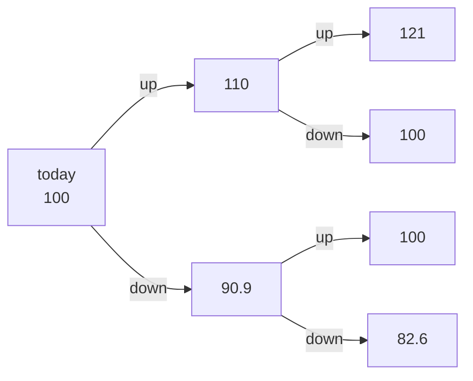

# Project 10 explained simply: what is a NIFTY option worth, and what moves its price?

## What this project does

It writes the two classic formulas for valuing options, Black-Scholes and the binomial tree, in Python, and checks them against textbook answers. Then it uses them on real NIFTY 50 option prices from the NSE at the close of Friday 30-Oct-2026. From those prices it works out what the market expects NIFTY's volatility to be (implied volatility), how that expectation differs between strikes and expiry dates, and how sensitive each option is to the index, to volatility and to time (the Greeks). It ends with a simulation of what happens to an option seller who tries to hedge away the risk.

The short answer: the market priced 24-day NIFTY options at about 14% volatility a year, but charged noticeably more for crash protection (17.4% for puts struck 5% below the forward price, 22% for puts 10% below). The formulas match each other and the market to within a fraction of a point.

## Why NIFTY options, and why not the alternatives

**Why NIFTY 50 index options.** They are the most traded options in India, so there are real two-sided prices at almost every strike. They are European: they can only be exercised at expiry, which is exactly what the Black-Scholes formula assumes. They settle in cash against the index, so there is no delivery of shares. And NSE publishes the whole option chain, so every price used here can be checked.

**Why not stock options** (for example Reliance)? They have fewer active strikes, are settled by delivering shares, and a single company's dividend dates make the maths messier. The companies are also used in your other projects.

**Why not Bank Nifty?** NSE now lists weekly expiries only for the NIFTY 50 ([Zerodha support note](https://support.zerodha.com/category/trading-and-markets/trading-faqs/f-otrading/articles/weekly-expiries-discontinued-for-certain-index-derivatives)), so NIFTY gives the most expiry dates to compare (six here, from 4 to 60 days).

**Why not only textbook examples?** Textbook examples prove the code is right but say nothing about real markets. This project does both: 18 textbook and numerical checks first, then real quotes.

## Options in plain words, with real numbers

All numbers below are from the 23-Nov-2026 expiry, 24 days after 30-Oct-2026, when NIFTY closed at 23,053.10.

- **Option**: a contract that gives the buyer the right, but not the duty, to buy or sell something at a fixed price on a fixed date.
- **Call**: the right to buy. The 23,100 call cost 329.65 index points.
- **Put**: the right to sell. The 21,900 put cost 59.10 points. It works like insurance against a fall.
- **Strike**: the fixed price in the contract (23,100 or 21,900 above).
- **Expiry**: the last day of the contract (here Monday 23-Nov-2026; normally the last Tuesday of the month, moved one day earlier because 24-Nov is a market holiday).
- **Premium**: the price you pay for the option.
- **Lot**: options trade in lots of 65 units. One index point is ₹1 per unit, so one point is ₹65 per lot.

**A call in rupees.** One lot of the 23,100 call costs 329.65 x 65 = **₹21,427**. If NIFTY ends at 23,600 on expiry day, the call pays (23,600 - 23,100) x 65 = ₹32,500, a profit of ₹11,073. If NIFTY ends at or below 23,100, the call pays nothing and you lose the ₹21,427. You break even at 23,100 + 329.65 = 23,429.65.

**A put in rupees.** One lot of the 21,900 put costs 59.10 x 65 = **₹3,842**. If NIFTY crashes to 21,000, it pays (21,900 - 21,000) x 65 = ₹58,500. If NIFTY stays above 21,900, it expires worthless, like an insurance policy you did not claim.

**Implied volatility (IV)**: volatility is how much the index swings, in % a year. Black-Scholes needs it as an input. Implied volatility runs the formula backwards: it is the volatility that makes the formula give the market price. For the 23,100 call, 14.06% makes Black-Scholes give exactly 329.65 points. So the market was "pricing in" NIFTY swings of about 14% a year.

## The Greeks in rupees

The Greeks measure how the option price changes when one input changes. Numbers are for one lot of the 23,100 call.

| Greek | Plain meaning | Value | In rupees per lot |
|---|---|---|---|
| Delta | How much the option moves when NIFTY moves 1 point | 0.505 | NIFTY +100 points: call gains about ₹3,282 |
| Gamma | How fast delta itself changes | 0.000479 per point | after a 100-point rise, delta goes from 0.505 to about 0.553 |
| Vega | Change for a 1-point change in implied volatility | 23.54 points | IV from 14.06% to 15.06%: call gains about ₹1,530 |
| Theta | Value lost per day as expiry gets closer, nothing else changing | -7.77 points | about ₹505 a day |
| Rho | Change for a 1% change in interest rates | 7.44 points | about ₹483 |

The put at the same strike has a negative delta (-0.493): it gains when NIFTY falls. It has the same gamma and vega as the call. The cheap 21,900 put loses 6.7% of its value every day to time decay, against 2.4% for the 23,100 call, which is why buying far out-of-the-money options and waiting is expensive.

## How a binomial tree works

A binomial tree chops the time to expiry into many small steps. In each step the index can only go up by a fixed factor or down by a fixed factor.

1. Build the tree of possible index levels up to expiry (above: start at 100, up = x1.1, down = /1.1, two steps).
2. At expiry the option's value is known: a 100-strike call is worth 21 at 121 and nothing at 100 or 82.6.
3. Step back one level at a time. Each node's value is the weighted average of the two nodes after it, discounted for one step of interest. The weight p is not a real-world probability; it is set so that, on average, the index grows at the risk-free rate.
4. The value at the first node is the option price today.

An American option can be exercised early, so at every node the tree also asks "is exercising now worth more than waiting?" and keeps the larger value. That is the one thing a tree can do that the Black-Scholes formula cannot. With 1,000 steps the tree (Cox-Ross-Rubinstein version) is within 0.0004 of Black-Scholes on the textbook example; the Leisen-Reimer version, which lines the tree up with the strike, gets within 0.0000035 with only 101 steps.

## Why the smile exists

If Black-Scholes were exactly right, every strike would have the same implied volatility. It does not. On 30-Oct-2026 the 24-day NIFTY options showed:

| Strike as % of the forward | Implied volatility |
|---|---|
| 90% (crash protection) | 22.14% |
| 95% | 17.35% |
| 100% (at the money) | 14.07% |
| 105% | 12.94% |

Plotted against the strike this curve is called the **smile**; for NIFTY it is lopsided and mostly a **skew**: puts below the market are expensive. Reasons:

- Markets fall faster than they rise, and big falls come as jumps. Black-Scholes assumes smooth moves.
- When the market falls, volatility rises, so a put seller loses twice: the index moves against them and the option gets more expensive.
- Fund managers buy puts to protect portfolios, while many investors sell calls to earn extra income. More demand for puts and more supply of calls pushes put prices up and call prices down.
- A put seller cannot hedge a sudden gap, so they charge for that risk.

The skew is also why India VIX (15.30) was above the at-the-money volatility (13.95% for 30 days): VIX averages over all the out-of-the-money options, including the expensive puts.

## How I did it, step by step

```mermaid
flowchart LR
    A["NSE option chain<br/>6 expiries (JSON)"] -->|market_data.py| B["clean quotes<br/>and filters"]
    B -->|analysis.py| C["forwards from<br/>put-call parity"]
    C -->|implied_vol.py| D["implied vols,<br/>smile, term structure"]
    D -->|black_scholes.py, binomial.py| E["Greeks, trees,<br/>American put"]
    E -->|hedging.py| F["hedging<br/>simulation"]
    F -->|run_all.py| G["28 checks, figures/<br/>and outputs/"]
```

1. **Downloaded the data** into `data/raw/`: the NSE option chain for six expiries (03-Nov to 29-Dec-2026) and five years of NIFTY 50 and India VIX prices from Yahoo Finance. Why: everything afterwards runs offline from this saved copy.
2. **Wrote the pricing formulas** (`src/options/black_scholes.py`): Black-Scholes price and all five Greeks, plus put-call parity. Why: these are the core tools of option pricing.
3. **Wrote the implied-volatility solver** (`src/options/implied_vol.py`). It guesses a volatility, checks the price, and improves the guess (Newton's method); a slower but safer method (Brent) takes over if that fails. Prices that break basic no-arbitrage limits get no answer. Why: market prices are given, the volatility is what we want.
4. **Wrote the binomial trees** (`src/options/binomial.py`), including American exercise and the early-exercise boundary. Why: the brief asks for both models, and trees handle early exercise.
5. **Checked the models** (`src/options/validation.py`): 18 checks, all PASS. Examples: Hull's textbook call is worth 4.76 and the put 0.81; the analytic Greeks match small "nudge the input" calculations to 1e-4; trees converge to Black-Scholes.
6. **Cleaned the quotes** (`src/options/market_data.py`). Kept a quote only if the strike is within 10% of the index, someone holds the contract (open interest above zero), there is both a buyer and a seller, and the gap between them is at most 25% of the middle price. Why: stale or one-sided quotes give nonsense volatilities. 773 of 1,186 quotes survive.
7. **Found the forward for each expiry** (`src/options/analysis.py`). Put-call parity says call minus put at the same strike equals the discounted forward minus the strike, so the market prices give the forward directly. Why: this avoids guessing NIFTY's dividends. The 23-Nov forward (23,097.29) is within 4.1 points of the NIFTY November futures price (23,101.40).
8. **Computed implied volatilities** for every usable quote, at the bid, the ask and the mid. Why: the bid-ask range shows how much of the pattern is real (the skew is) and how much is quote noise (very little).
9. **Built the smile and the term structure** (how volatility changes with strike and with time), and applied the India VIX formula to the same quotes: 14.96% against the published 15.30.
10. **Calculated the Greeks** of three real contracts in points and rupees per lot, and checked them with a 1,000-step tree.
11. **Priced all 79 smile options with trees**, and asked a what-if: what if NIFTY options could be exercised early? The extra value is up to 42.50 points for deep in-the-money puts.
12. **Simulated delta hedging** (`src/options/hedging.py`): an option seller buys or sells the index to stay neutral, 20,000 times on random paths. Why: to show that hedging removes direction risk but not volatility risk.
13. **Ran everything with one command** (`src/run_all.py`): 28 checks, 7 charts in `figures/`, 15 tables in `outputs/`. The notebook `options_pricing.ipynb` shows the same steps with explanations.

## Where every important number came from

The saved news and broker pages (`news_and_macro/*.html`, except the RBI page) are copyrighted, so they stay on your PC and are not in the GitHub copy. Use the link in the Source column instead.

| Number | Value | Source | File in source_data/ |
|---|---|---|---|
| NIFTY 50 close, 30-Oct-2026 | 23,053.10 | NSE option chain (`underlyingValue`) and [Yahoo Finance](https://finance.yahoo.com/quote/%5ENSEI/history/) | `nse/nse_nifty_chain_23-Nov-2026.json`, `yahoo_finance/IDX_NSEI.csv` |
| Option quotes (bid, ask, open interest, NSE's IV) | 1,186 contracts in 6 expiries | [NSE option-chain API](https://www.nseindia.com/api/option-chain-v3?type=Indices&symbol=NIFTY&expiry=23-Nov-2026) | `nse/nse_nifty_chain_<expiry>.json`; Excel copy `nse/NIFTY_option_chain_23-Nov-2026_cleaned.xlsx` |
| 23,100 call, 23-Nov-2026 | bid 329.35, ask 329.95 | same | same |
| India VIX, 30-Oct-2026 | 15.30 | [Yahoo Finance](https://finance.yahoo.com/quote/%5EINDIAVIX/history/) | `yahoo_finance/IDX_INDIAVIX.csv` |
| Risk-free rate | 5.93% (91-day T-bill, auction of 28-Oct-2026) | [RBI home page](https://www.rbi.org.in/); [Economic Times](https://economictimes.indiatimes.com/markets/bonds/rbi-accepts-20-bps-higher-treasury-bill-cutoff-yields-than-last-auction/articleshow/135284706.cms) | `news_and_macro/RBI_homepage_current_rates_TBill_cutoff_30Oct2026.html` |
| NIFTY November futures close | 23,101.40 | [Capital Market, 30-Oct-2026](https://www.capitalmarket.com/markets/news/live-news/nifty-november-futures-trade-at-a-premium/1742066) | `news_and_macro/CapitalMarket_Nifty_Nov2026_futures_close_30Oct2026.html` (local only) |
| NIFTY 50 dividend yield | 1.42% | [NIFTY 50 factsheet, 30-Oct-2026](https://www.niftyindices.com/Factsheet/ind_nifty50.pdf) | `nse/NIFTY50_factsheet_30Oct2026.pdf` |
| Lot size | 65 units (was 75) | [NSE circular NSE/FAOP/70616](https://nsearchives.nseindia.com/content/circulars/FAOP70616.pdf) | `nse/NSE_circular_FAOP70616_index_lot_size_revision_Oct2025.pdf` |
| European exercise, Tuesday expiry | CE/PE = Call/Put European | [NSE NIFTY 50 F&O page](https://www.nseindia.com/products-services/equity-derivatives-nifty50); [NSE circular NSE/FAOP/68747](https://nsearchives.nseindia.com/content/circulars/FAOP68747.pdf) | `nse/NSE_NIFTY50_FO_contract_specifications.html`, `nse/NSE_circular_FAOP68747_expiry_day_Tuesday.pdf` |
| Options trade until 3:40 pm | since 3-Aug-2026 | NSE FAQ on the closing auction; [Economic Times](https://economictimes.indiatimes.com/articleshow/131404896.cms) | `nse/NSE_FAQ_closing_auction_session_and_derivatives_changes_2026.pdf` |
| Closing auction sets the index close | 3:15 to 3:35 pm | [Economic Times, Aug-2026](https://economictimes.indiatimes.com/markets/stocks/news/niftys-value-doesnt-change-suddenly-at-330-pm-nse-clarifies-amid-cas-confusion/articleshow/132850802.cms) | `news_and_macro/ET_NSE_clarifies_CAS_closing_auction_Aug2026.html` (local only) |
| Market holidays | 10-Nov and 24-Nov-2026 | [Upstox](https://upstox.com/news/market-news/latest-updates/stock-market-holidays-in-november-2026-nse-bse-to-remain-closed-on-these-days-check-muhurat-trading-schedule/article-202726/) | `news_and_macro/Upstox_market_holidays_November2026.html` (local only) |
| Cash settlement of index options | no delivery | [5paisa explainer](https://www.5paisa.com/stock-market-guide/derivatives-trading-basics/options-assignment-and-physical-settlement-in-india-what-retail-traders-must-know) | `news_and_macro/5paisa_index_options_cash_settled.html` (local only) |
| Textbook check values | call 4.76, put 0.81; American put 4.49 | J. Hull, *Options, Futures, and Other Derivatives* | (a book, not saved) |

Every other number (forwards, implied vols, Greeks, tree prices, hedging results) is calculated by the code from these files. See `outputs/*.csv`.

## Key assumptions and why

| Assumption | Value | Why |
|---|---|---|
| Valuation time | Close of 30-Oct-2026 (snapshot stamped 15:40 IST) | The last close before the project date; options trade until 15:40 |
| Time to expiry | Calendar days / 365 | Simple and standard; the 4-day expiry includes a weekend, which is flagged |
| Interest rate | 5.93% T-bill, used as r = ln(1.0593) = 5.76% continuous | An official short-term government rate close to the option maturities (4 to 60 days) |
| One rate for all expiries | 5.76% | The maturities are short, so a rate curve would change little |
| Forward | From put-call parity, per expiry | Needs no dividend guess, and it matches the futures price within 4.1 points |
| Fair price of a quote | Mid = (bid + ask) / 2 | Halfway between what buyers pay and sellers ask |
| Quote filters | Strike within 10%, open interest > 0, bid and ask both quoted, spread at most 25% of the mid | Removes stale or one-sided quotes; 773 of 1,186 remain |
| Smile from out-of-the-money options | Puts below the forward, calls above | These are the actively traded ones; some deep in-the-money quotes are below their minimum fair value |
| Tree size | 1,000 steps (CRR), 501 (Leisen-Reimer), 5,000 for the boundary | Accurate to far less than the 2-point bid-ask spread |
| Hedging simulation | Smooth random index paths, 20,000 runs, seed 42, no trading costs | Isolates the error from hedging only at intervals; the fixed seed makes it repeatable |
| Dividend yield for comparisons | 1.42% | NSE Indices' own figure on the valuation date |

## Words you need to know

| Term | Meaning |
|---|---|
| At the money (ATM) / out of the money (OTM) / in the money (ITM) | Strike near the index / an option that would pay nothing today (a call above the index, a put below) / one that would pay something today |
| European vs American option | European: exercise only at expiry (NIFTY options). American: exercise any day up to expiry |
| Black-Scholes | The formula that values a European option from the index level, strike, time, interest rate, dividends and volatility |
| Binomial tree | A step-by-step map of possible index paths, used to value an option by working backwards from expiry |
| Forward | The price agreed today for buying the index on the expiry date; it is the index plus interest minus dividends |
| Put-call parity | Call minus put at the same strike equals the discounted (forward minus strike); it ties calls and puts together |
| Volatility | How much the index swings, in % a year |
| Implied volatility | The volatility that makes Black-Scholes give the market price |
| Realised volatility | The volatility the index actually showed, measured from daily price changes |
| Smile / skew | How implied volatility changes with the strike; for NIFTY, puts below the market have higher IV |
| Term structure | How implied volatility changes with time to expiry |
| India VIX | NSE's 30-day "fear index", calculated from NIFTY option prices |
| Open interest | The number of contracts still open (not yet closed out) |
| Bid / ask / spread | The best price a buyer offers / the best price a seller asks / the gap between them |
| Delta hedging | Holding the index against an option so that small index moves cancel out |

## How to check the work yourself

1. Run `python src/run_all.py`. It prints 28 checks and ends with `28/28 checks passed`; if any fails, it exits with an error.
2. Open `outputs/validation_results.csv`: every row must say PASS. The first two rows are Hull's textbook values, 4.76 and 0.81.
3. Check one implied volatility by hand. In any Black-Scholes calculator with continuous rates, enter S = 23,053.10, K = 23,100, T = 24/365, r = 5.7608%, dividend yield 2.8484% and volatility 14.0617%. The call price comes out at 329.65, the mid quote. (The 2.8484% is the yield implied by the parity forward, column `q_implied` in `outputs/implied_forwards.csv`; the volatility is `iv_own` in `outputs/greeks_2026-11-23.csv`.)
4. Compare the quote with NSE's file: in `source_data/nse/NIFTY_option_chain_23-Nov-2026_cleaned.xlsx`, the 23,100 call shows bid 329.35 and ask 329.95.
5. Check the forward against the futures: `outputs/implied_forwards.csv` gives 23,097.29 for 23-Nov-2026; the Capital Market article gives a futures close of 23,101.40.
6. Open `options_pricing.ipynb`: every step is shown with its output, and the notebook stops with an error if any check fails.

## How to explain this project in an interview

**30-second version.** "I built Black-Scholes and binomial-tree pricers in Python, with Greeks and an implied-volatility solver, and checked them against Hull's textbook values. Then I applied them to the real NSE NIFTY option chain at the 30-October-2026 close. I took the forward from put-call parity instead of guessing dividends; it matched the futures price within 4 points. The 24-day smile showed 14.1% at the money and a 4.4-point skew towards puts, which explains why India VIX sat above ATM volatility. I also showed that a daily delta hedge still leaves a P&L spread of about 17% of the premium, and that the hedge loses money when realised volatility beats implied."

**Q: Why are out-of-the-money puts more expensive than calls?**
A: Because the market fears crashes more than rallies. Falls come as jumps, volatility rises when the market falls, and investors buy puts as insurance while others sell calls for income. On 30-Oct-2026 the 95% put traded at 17.35% volatility against 12.94% for the 105% call.

**Q: Why use put-call parity for the forward instead of spot plus a dividend yield?**
A: The dividend yield is a guess, and the official index close was set by the closing auction before options stopped trading. With spot and the 1.42% factsheet yield, call and put IVs at the same strike disagree by 1 volatility point. With the parity forward they agree within 0.08 points, and the forward matches the futures.

**Q: When would you use a binomial tree instead of Black-Scholes?**
A: When early exercise matters, as with American options, or for other features the formula cannot handle. For European NIFTY options the two agree within 0.08 points, far inside the 2-point bid-ask spread. The tree also shows where early exercise becomes optimal: for a 1-year put with no dividends, once the index falls below 89% of the strike.

Educational project, not investment advice.
