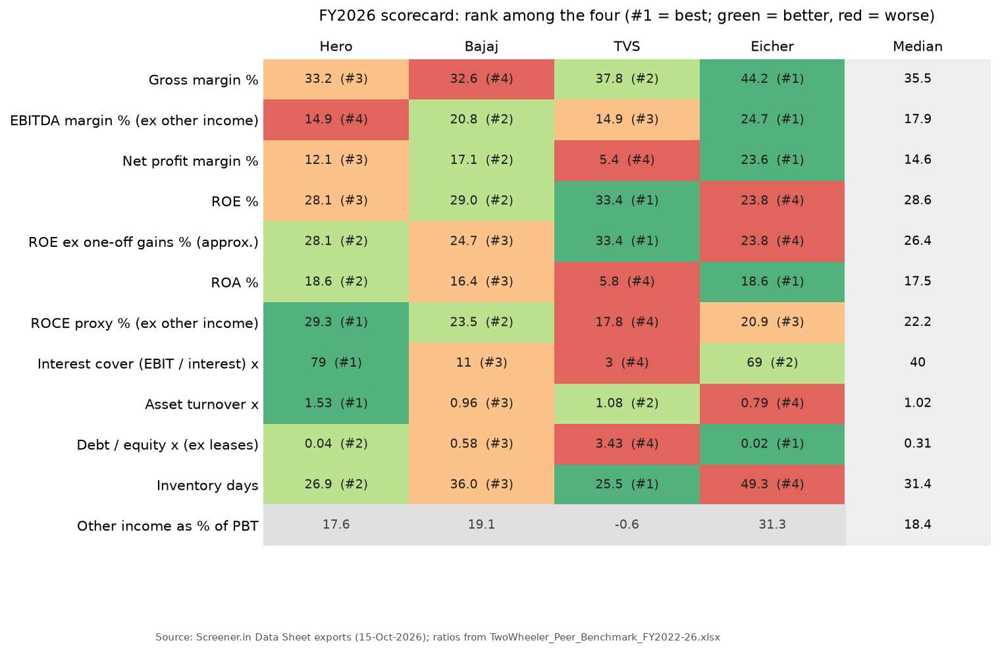
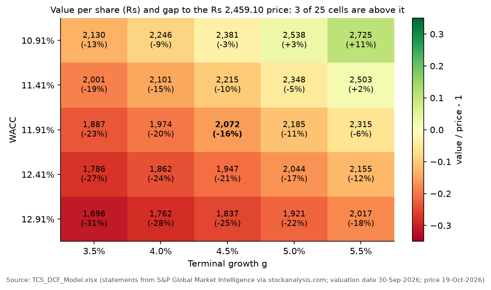
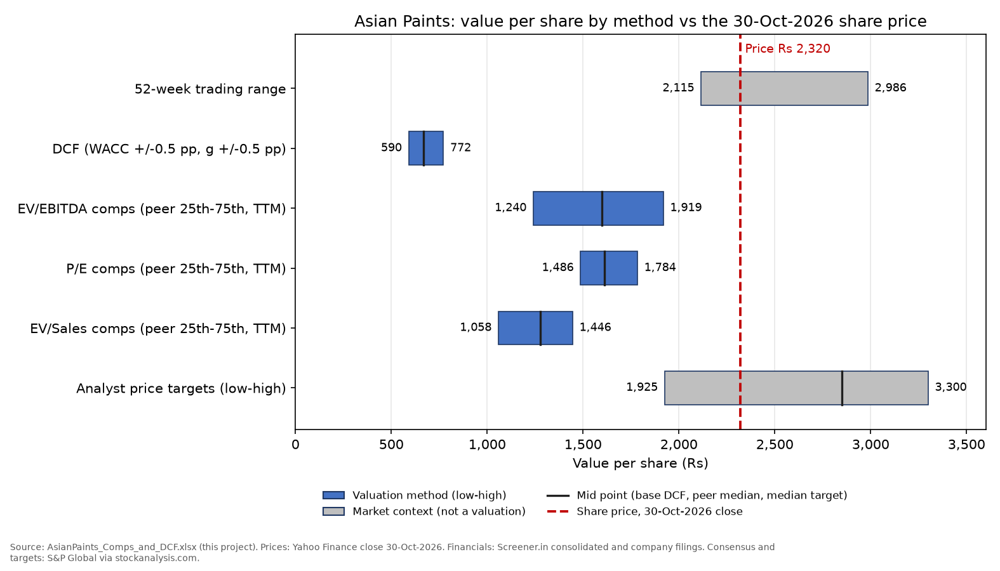
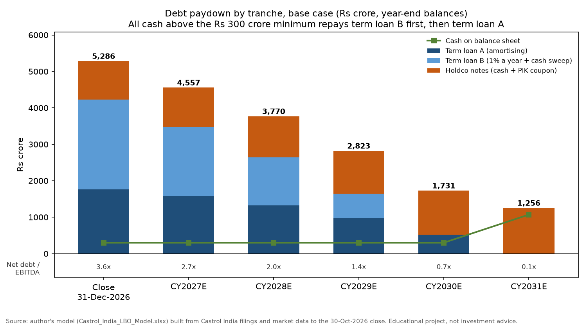
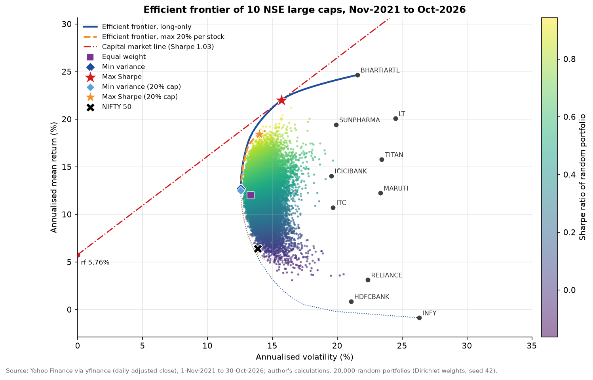
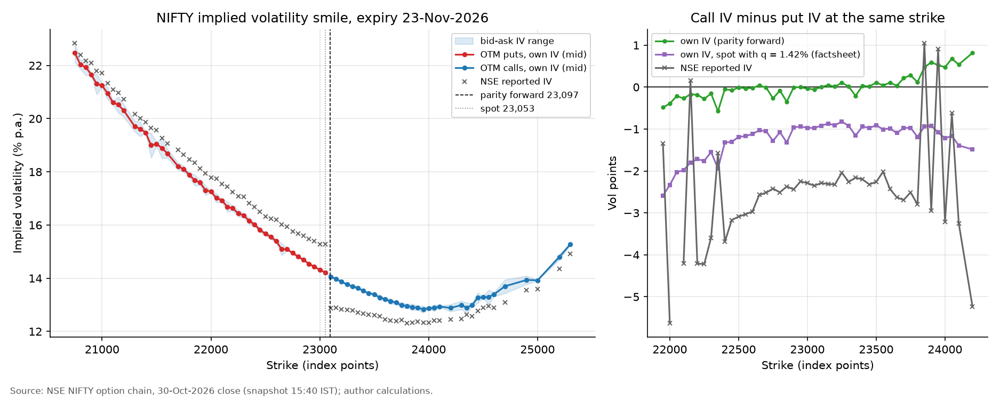

# Finance portfolio: ten projects in valuation, financial modelling, FP&A and quantitative finance

Ten projects built on public data for Indian listed companies and markets, from financial statement analysis and valuation to an LBO, portfolio optimisation, Value at Risk and options pricing. Projects 1-7 are built in Excel with live formulas (Project 5 adds a 9-page research report); projects 8-10 are Python notebooks. Every project folder has the model or code, a README with the method and results, the original source files with links (`source_data/`), a plain-language guide (`explained_simply/`) and automated checks that confirm the numbers.

Data is as of October 2026: Project 1 uses accounts downloaded on 15-Oct-2026, Project 2 prices from 19-Oct-2026, and the other projects data to the 30-Oct-2026 close.

## The ten projects

| # | Project | Company or data | What it shows | Headline result |
|---|---|---|---|---|
| 1 | [Ratio analysis with peer benchmarking](01-ratio-analysis/) | Hero MotoCorp vs Bajaj Auto, TVS Motor and Eicher Motors, FY2022-FY2026 | Profitability, leverage and efficiency ratios, DuPont split, ranking against the peer median (Excel) | Hero is the strongest business: ROCE 29.3%, asset turnover 1.53x, debt/equity 0.04x. TVS's higher ROE (33.4%) comes from a 5.7x equity multiplier |
| 2 | [DCF valuation](02-dcf-valuation/) | Tata Consultancy Services (TCS) | Five-year FCFF forecast, WACC, terminal value, sensitivity grids, reverse DCF (Excel) | ₹2,072 per share against a ₹2,459 price (-15.7%); the price implies a 10.7% WACC instead of 11.9% |
| 3 | [Comparable company analysis](03-comparable-company-analysis/) | Asian Paints vs Berger, Kansai Nerolac, JSW Dulux and Indigo Paints | EV/EBITDA, P/E and EV/Sales comps, a football field next to a DCF (Excel) | Asian Paints trades at 30.4x EV/EBITDA against a peer median of 20.9x; DCF value ₹668 against ₹2,320 |
| 4 | [Three-statement model](04-three-statement-model/) | UltraTech Cement | Linked income statement, balance sheet and cash flow, debt schedule, Base/Bull/Bear cases (Excel) | FY2027E EPS ₹337 against ₹325.76 consensus; 19 checks pass in all three cases |
| 5 | [Equity research report](05-equity-research-report/) | Asian Paints | 9-page initiation report combining projects 1-3: thesis, ratios, valuation, risks, rating | SELL, 12-month target ₹1,707 (-26.4%) |
| 6 | [FP&A: budget and variance analysis](06-fpa-budget-variance/) | Vriddhi Foods (a fictional snacks company) | FY2027 budget, H1 actuals, variance bridges, 6+6 reforecast (Excel) | H1 EBITDA ₹35.3 crore against a ₹43.6 crore budget (-18.9%), mostly input costs and advertising |
| 7 | [LBO model](07-lbo-model/) | Castrol India | Sources and uses, debt schedule with cash sweep, IRR and MOIC, sensitivities (Excel) | Buying at ₹22,113 crore (15.7x EBITDA) returns 11.9% IRR and 1.75x MOIC over five years |
| 8 | [Portfolio analysis](08-portfolio-analysis/) | Ten NIFTY 50 stocks, Nov-2021 to Oct-2026 | Returns, volatility, beta, Sharpe ratio, efficient frontier, out-of-sample test (Python) | Maximum-Sharpe portfolio 1.03 against 0.47 for equal weights; fitted on 2021-24, it lost 4.4% a year in 2024-26 |
| 9 | [Risk analysis: Value at Risk](09-risk-analysis-var/) | ₹1 crore portfolio of six NSE-listed ETFs | Historical, parametric and Monte Carlo VaR and Expected Shortfall, backtests (Python) | One-day 99% VaR ₹1.56 lakh (historical) against ₹1.29 lakh (normal); the normal model fails the backtest |
| 10 | [Options pricing](10-options-pricing/) | NIFTY 50 index options, 30-Oct-2026 | Black-Scholes, binomial trees, Greeks, implied volatility, delta hedging (Python) | 23-Nov-2026 at-the-money implied volatility 14.07%; puts struck 5% below the forward trade at 4.41 volatility points more than calls struck 5% above it |

## Selected charts

<table>
<tr>
<td width="50%"> 1. FY2026 ratio scorecard of four two-wheeler makers</td>
<td width="50%"> 2. TCS value per share by WACC and terminal growth</td>
</tr>
<tr>
<td> 3. Asian Paints football field: comps and DCF against the price</td>
<td> 7. Castrol India LBO: debt paid down from cash flow</td>
</tr>
<tr>
<td> 8. Efficient frontier of ten NIFTY 50 stocks</td>
<td> 10. NIFTY implied-volatility smile</td>
</tr>
</table>

## Skills covered

| Area | Projects |
|---|---|
| Financial statement analysis (ratios, DuPont, one-off adjustments) | 1, 3, 4, 5 |
| Valuation: DCF, WACC, trading comps, reverse DCF | 2, 3, 5, 7 |
| Financial modelling in Excel (linked statements, scenarios, checks) | 1, 2, 3, 4, 6, 7 |
| Equity research writing (thesis, risks, rating) | 5 |
| Corporate finance and FP&A (budget, variance bridges, reforecast) | 6 |
| Private equity: leveraged buyout | 7 |
| Portfolio theory and risk (Sharpe, beta, efficient frontier, VaR, Expected Shortfall, backtesting) | 8, 9 |
| Derivatives (Black-Scholes, binomial trees, Greeks, implied volatility) | 10 |
| Python (pandas, NumPy, SciPy, matplotlib) and reproducible pipelines | 8, 9, 10, and the check scripts in every project |

## How each project folder is organised

| Item | What it holds |
|---|---|
| `README.md` | Summary, data and sources, method, results with charts, checks, limitations, how to reproduce |
| Main file | The Excel model, notebook or report (linked from the table above via each README) |
| `source_data/` | The original downloads (company filings, exchange data, data exports) and an index with the link and date for every file |
| `explained_simply/` | A plain-language guide: why this company, each step, where every number came from, a glossary and interview questions |
| `build/` or `src/` | The scripts that build or check the model; `outputs/` and `figures/` hold their results |

## Data sources

Company annual reports, results and investor presentations; NSE data (option chains, prices, filings); Screener.in and StockAnalysis.com (S&P Global Market Intelligence) for standardised statements; Yahoo Finance for prices; RBI and SEBI for rates and regulation. Saved copies of news articles, broker notes and law-firm commentary are copyrighted, so they are not in this repository; each project's `source_data/README.md` gives their links.

## Branches

Each project was built on its own branch (`project-01-ratio-analysis` to `project-10-options-pricing`) and merged into `main` through a pull request, so `main` holds all ten.

Educational projects, not investment advice.
